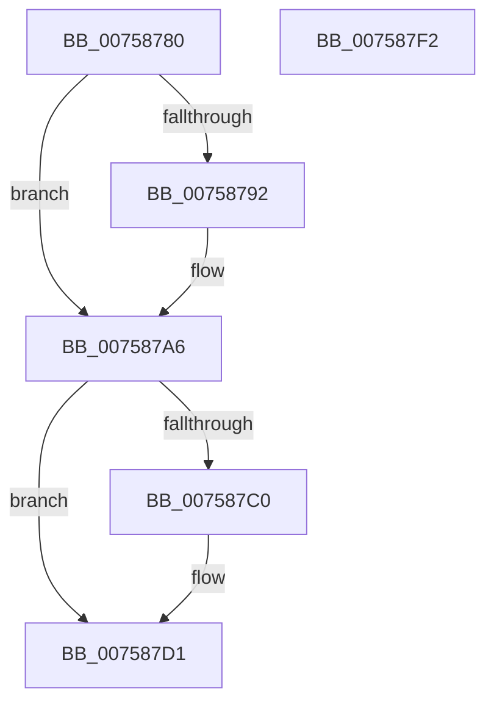

# PoFxRegisterComponentPerfStates

- RVA: `0x00758780`–`0x007587F3` (길이 `115` bytes)
- VA: `0x0000000140758780`
- 실행 섹션: `PAGE`
- PDB 이름 있음: `예`; PDB Function 태그: `아니요`
- unwind 정보 RVA: `0x0005D2F4`
- 디코드: `30`개 명령, `115/115` bytes 표시
- 미해석 바이트: `0` (있으면 어셈블리에 `.byte`로 보존)

> 이 문서는 커널 이미지의 기계어와 PDB 기호를 분석해 생성했습니다. 4번과 5번은 함수 원형과 자료형을 바이너리 사용 방식에서 추정한 C 해석이며 원본 소스 복구 결과는 아닙니다.

## 1. Dependencies

- 직접 호출 지점: **3**; 고유 호출 대상: **2**
- 직접 호출자로 확인된 함수: **0**
- RIP 상대 이미지 참조: **0**

### Outgoing calls
- `0x007587A0` → [PopFxBugCheck](../../text/2B/PopFxBugCheck_function_002BFC6C.md) (function, `0x002BFC6C`)
- `0x007587CB` → [PopFxBugCheck](../../text/2B/PopFxBugCheck_function_002BFC6C.md) (function, `0x002BFC6C`)
- `0x007587E8` → [PopFxRegisterComponentPerfStates](PopFxRegisterComponentPerfStates_function_00759764.md) (function, `0x00759764`)

### Direct callers
- 이 함수 시작 RVA로 연결되는 직접 call은 확인되지 않았습니다. 간접 호출은 완전히 역산할 수 없습니다.

### Static image references
- 디코드된 RIP-relative 메모리 참조가 없습니다.

## 2. Other-region calls and transfers

- 다른 실행 섹션으로 향하는 call: **2**
  - `0x007587A0` → [PopFxBugCheck](../../text/2B/PopFxBugCheck_function_002BFC6C.md) (`PAGE` → `.text`)
  - `0x007587CB` → [PopFxBugCheck](../../text/2B/PopFxBugCheck_function_002BFC6C.md) (`PAGE` → `.text`)
- 별도 외부 분기/꼬리 이동을 확인하지 못했습니다.

## 3. Assembly (complete function range)

```asm
00758780  48 83 EC 38                     sub rsp, 0x38
00758784  4D 8B D0                        mov r10, r8
00758787  44 8B C2                        mov r8d, edx
0075878A  3B 91 64 03 00 00               cmp edx, dword ptr [rcx + 0x364]
00758790  72 14                           jb 0x1407587a6
00758792  48 8B D1                        mov rdx, rcx
00758795  41 B9 02 00 00 00               mov r9d, 2
0075879B  B9 14 06 00 00                  mov ecx, 0x614
007587A0  E8 C7 74 B6 FF                  call 0x1402bfc6c
007587A5  CC                              int3
007587A6  0F AE E8                        lfence
007587A9  48 8B 81 68 03 00 00            mov rax, qword ptr [rcx + 0x368]
007587B0  4A 8B 14 C0                     mov rdx, qword ptr [rax + r8*8]
007587B4  48 8B 82 A8 01 00 00            mov rax, qword ptr [rdx + 0x1a8]
007587BB  48 85 C0                        test rax, rax
007587BE  74 11                           je 0x1407587d1
007587C0  48 8B D1                        mov rdx, rcx
007587C3  45 33 C9                        xor r9d, r9d
007587C6  B9 00 06 00 00                  mov ecx, 0x600
007587CB  E8 9C 74 B6 FF                  call 0x1402bfc6c
007587D0  CC                              int3
007587D1  48 8B 44 24 68                  mov rax, qword ptr [rsp + 0x68]
007587D6  4D 8B C2                        mov r8, r10
007587D9  48 89 44 24 28                  mov qword ptr [rsp + 0x28], rax
007587DE  48 8B 44 24 60                  mov rax, qword ptr [rsp + 0x60]
007587E3  48 89 44 24 20                  mov qword ptr [rsp + 0x20], rax
007587E8  E8 77 0F 00 00                  call 0x140759764
007587ED  48 83 C4 38                     add rsp, 0x38
007587F1  C3                              ret
007587F2  CC                              int3
```

## 4. C-style interpretation (structured pseudocode)

```c
__int64 __fastcall PoFxRegisterComponentPerfStates(__int64 a1, int a2, __int64 a3, __int64 a4, __int64 a5, __int64 a6)
{
    __int64 result;
    __int64 v_rsp;
    unsigned __int64 v_stack_m10;
    unsigned __int64 v_stack_m18;

    v_rsp = (v_rsp) - (56);
    if (a2 >= (*(unsigned int *)(a1 + 868))) {
        a2 = a1;
        a4 = 2;
        a1 = 0x614ULL;
        result = PopFxBugCheck(a1, a2, (unsigned int)(a2), a4);
    }
    result = *(unsigned __int64 *)(*(unsigned __int64 *)(*(unsigned __int64 *)(a1 + 872) + (unsigned int)(a2) * 8) + 424);
    if (*(unsigned __int64 *)(*(unsigned __int64 *)(*(unsigned __int64 *)(a1 + 872) + (unsigned int)(a2) * 8) + 424) != 0) {
        a2 = a1;
        a4 = 0;
        a1 = 0x600ULL;
        result = PopFxBugCheck(a1, a2, (unsigned int)(a2), a4);
    }
    v_stack_m10 = a6;
    v_stack_m18 = a5;
    result = PopFxRegisterComponentPerfStates(a1, a2, a3, a4);
    v_rsp = (v_rsp) + (56);
    return result;
}
```

## 5. (Beta) C Style

```c
int64_t PoFxRegisterComponentPerfStates(void *Arg1, int32_t Arg2, int64_t Arg3, int64_t Arg4, int64_t Arg5, int64_t Arg6)
{
    uint8_t *arg1 = (uint8_t *)Arg1;

    int64_t result;
    int64_t local_rsp;
    uint64_t v_stack_m10;
    uint64_t v_stack_m18;

    local_rsp = (local_rsp) - (56);
    if (Arg2 >= (*(uint32_t *)(arg1 + 0x364))) {
        Arg2 = Arg1;
        Arg4 = 2;
        Arg1 = 0x614ULL;
        result = PopFxBugCheck(Arg1, Arg2, (uint32_t)(Arg2), Arg4);
    }
    result = *(uint64_t *)(*(uint64_t *)(*(uint64_t *)(arg1 + 0x368) + (uint32_t)(Arg2) * 8) + 0x1A8);
    if (*(uint64_t *)(*(uint64_t *)(*(uint64_t *)(arg1 + 0x368) + (uint32_t)(Arg2) * 8) + 0x1A8) != 0) {
        Arg2 = Arg1;
        Arg4 = 0;
        Arg1 = 0x600ULL;
        result = PopFxBugCheck(Arg1, Arg2, (uint32_t)(Arg2), Arg4);
    }
    v_stack_m10 = Arg6;
    v_stack_m18 = Arg5;
    result = PopFxRegisterComponentPerfStates(Arg1, Arg2, Arg3, Arg4);
    local_rsp = (local_rsp) + (56);
    return result;
}
```

### 관측된 메모리 오프셋

구조체 형식이 확인되지 않은 접근은 인자 기준의 오프셋으로만 기록했습니다.

| 기준 인자 | 오프셋 표현 | 폭 (bit) | 접근 |
|---|---:|---:|---|
| `Arg1` | `+ 0x364` | `32` | `R` |

## 6. Execution-region graph

[열기: 2D/3D 그래프와 함수 탐색 컨트롤 패널](../../../control-panel.html?section=page&rva=0x00758780&view=graph)

- 2D 그래프는 위에서 아래로 흐르고, 3D 그래프는 빈 공간을 드래그해 회전합니다. Shift+드래그는 이동, 휠은 확대·축소, 함수 노드 선택은 대상 보고서 이동입니다.

### Static fallback


