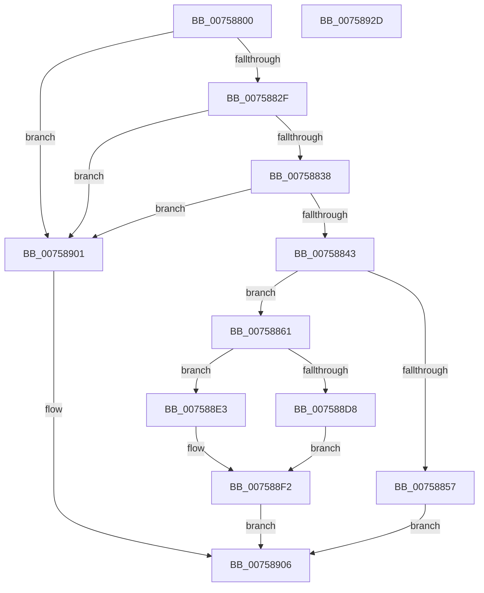

# PoFxRegisterCoreDevice

- RVA: `0x00758800`–`0x0075892E` (길이 `302` bytes)
- VA: `0x0000000140758800`
- 실행 섹션: `PAGE`
- PDB 이름 있음: `예`; PDB Function 태그: `아니요`
- unwind 정보 RVA: `0x000CC260`
- 디코드: `73`개 명령, `302/302` bytes 표시
- 미해석 바이트: `0` (있으면 어셈블리에 `.byte`로 보존)

> 이 문서는 커널 이미지의 기계어와 PDB 기호를 분석해 생성했습니다. 4번과 5번은 함수 원형과 자료형을 바이너리 사용 방식에서 추정한 C 해석이며 원본 소스 복구 결과는 아닙니다.

## 1. Dependencies

- 직접 호출 지점: **5**; 고유 호출 대상: **5**
- 직접 호출자로 확인된 함수: **4**
- RIP 상대 이미지 참조: **0**

### Outgoing calls
- `0x0075884A` → [PopFxConvertV1Components](../AD/PopFxConvertV1Components_function_00AD6508.md) (function, `0x00AD6508`)
- `0x0075886C` → [memset](../../text/6C/memset_function_006C6C40.md) (function, `0x006C6C40`)
- `0x007588CD` → [PopFxRegisterDeviceWorker](PopFxRegisterDeviceWorker_function_00759E20.md) (function, `0x00759E20`)
- `0x007588EB` → [PopFxInsertDevice](../../text/4B/PopFxInsertDevice_function_004B95EC.md) (function, `0x004B95EC`)
- `0x007588FA` → [ExFreePoolWithTag](../../poolcode/B8/ExFreePoolWithTag_function_00B82870.md) (function, `0x00B82870`)

### Direct callers
- [HalpTimerInitPowerManagement](../../text/54/HalpTimerInitPowerManagement_function_00549298.md) at `0x00549358`
- [HalpDmaInitPowerManagement](../../text/55/HalpDmaInitPowerManagement_function_005530E0.md) at `0x00553184`
- [HalpInterruptInitPowerManagement](../../text/55/HalpInterruptInitPowerManagement_function_005577F8.md) at `0x005578B7`
- [PoFxRegisterDebugger](../../init/C4/PoFxRegisterDebugger_function_00C434E0.md) at `0x00C436DB`

### Static image references
- 디코드된 RIP-relative 메모리 참조가 없습니다.

## 2. Other-region calls and transfers

- 다른 실행 섹션으로 향하는 call: **3**
  - `0x0075886C` → [memset](../../text/6C/memset_function_006C6C40.md) (`PAGE` → `.text`)
  - `0x007588EB` → [PopFxInsertDevice](../../text/4B/PopFxInsertDevice_function_004B95EC.md) (`PAGE` → `.text`)
  - `0x007588FA` → [ExFreePoolWithTag](../../poolcode/B8/ExFreePoolWithTag_function_00B82870.md) (`PAGE` → `POOLCODE`)
- 별도 외부 분기/꼬리 이동을 확인하지 못했습니다.

## 3. Assembly (complete function range)

```asm
00758800  48 8B C4                        mov rax, rsp
00758803  48 89 58 10                     mov qword ptr [rax + 0x10], rbx
00758807  48 89 70 18                     mov qword ptr [rax + 0x18], rsi
0075880B  48 89 78 20                     mov qword ptr [rax + 0x20], rdi
0075880F  41 56                           push r14
00758811  48 81 EC A0 00 00 00            sub rsp, 0xa0
00758818  48 83 60 08 00                  and qword ptr [rax + 8], 0
0075881D  4D 8B F0                        mov r14, r8
00758820  48 8B DA                        mov rbx, rdx
00758823  48 8B F1                        mov rsi, rcx
00758826  48 85 C9                        test rcx, rcx
00758829  0F 84 D2 00 00 00               je 0x140758901
0075882F  83 3A 01                        cmp dword ptr [rdx], 1
00758832  0F 85 C9 00 00 00               jne 0x140758901
00758838  48 83 7A 18 00                  cmp qword ptr [rdx + 0x18], 0
0075883D  0F 84 BE 00 00 00               je 0x140758901
00758843  48 8D 4A 30                     lea rcx, [rdx + 0x30]
00758847  8B 52 04                        mov edx, dword ptr [rdx + 4]
0075884A  E8 B9 DC 37 00                  call 0x140ad6508
0075884F  48 8B F8                        mov rdi, rax
00758852  48 85 C0                        test rax, rax
00758855  75 0A                           jne 0x140758861
00758857  BB 9A 00 00 C0                  mov ebx, 0xc000009a
0075885C  E9 A5 00 00 00                  jmp 0x140758906
00758861  33 D2                           xor edx, edx
00758863  48 8D 4C 24 50                  lea rcx, [rsp + 0x50]
00758868  44 8D 42 50                     lea r8d, [rdx + 0x50]
0075886C  E8 CF E3 F6 FF                  call 0x1406c6c40
00758871  48 8B 43 08                     mov rax, qword ptr [rbx + 8]
00758875  4C 8D 44 24 50                  lea r8, [rsp + 0x50]
0075887A  48 89 44 24 50                  mov qword ptr [rsp + 0x50], rax
0075887F  4C 8B CF                        mov r9, rdi
00758882  48 8B 43 10                     mov rax, qword ptr [rbx + 0x10]
00758886  48 8B D6                        mov rdx, rsi
00758889  48 89 44 24 58                  mov qword ptr [rsp + 0x58], rax
0075888E  33 C9                           xor ecx, ecx
00758890  48 8B 43 20                     mov rax, qword ptr [rbx + 0x20]
00758894  48 89 44 24 60                  mov qword ptr [rsp + 0x60], rax
00758899  48 8B 43 18                     mov rax, qword ptr [rbx + 0x18]
0075889D  48 89 84 24 80 00 00 00         mov qword ptr [rsp + 0x80], rax
007588A5  48 8D 84 24 B0 00 00 00         lea rax, [rsp + 0xb0]
007588AD  48 89 44 24 40                  mov qword ptr [rsp + 0x40], rax
007588B2  48 83 64 24 38 00               and qword ptr [rsp + 0x38], 0
007588B8  48 8B 43 28                     mov rax, qword ptr [rbx + 0x28]
007588BC  C6 44 24 30 00                  mov byte ptr [rsp + 0x30], 0
007588C1  48 89 44 24 28                  mov qword ptr [rsp + 0x28], rax
007588C6  8B 43 04                        mov eax, dword ptr [rbx + 4]
007588C9  89 44 24 20                     mov dword ptr [rsp + 0x20], eax
007588CD  E8 4E 15 00 00                  call 0x140759e20
007588D2  8B D8                           mov ebx, eax
007588D4  85 C0                           test eax, eax
007588D6  79 0B                           jns 0x1407588e3
007588D8  48 83 A4 24 B0 00 00 00 00      and qword ptr [rsp + 0xb0], 0
007588E1  EB 0F                           jmp 0x1407588f2
007588E3  4C 8B 84 24 B0 00 00 00         mov r8, qword ptr [rsp + 0xb0]
007588EB  E8 FC 0C D6 FF                  call 0x1404b95ec
007588F0  33 DB                           xor ebx, ebx
007588F2  BA 50 46 58 4D                  mov edx, 0x4d584650
007588F7  48 8B CF                        mov rcx, rdi
007588FA  E8 71 9F 42 00                  call 0x140b82870
007588FF  EB 05                           jmp 0x140758906
00758901  BB 0D 00 00 C0                  mov ebx, 0xc000000d
00758906  48 8B 84 24 B0 00 00 00         mov rax, qword ptr [rsp + 0xb0]
0075890E  4C 8D 9C 24 A0 00 00 00         lea r11, [rsp + 0xa0]
00758916  49 8B 73 20                     mov rsi, qword ptr [r11 + 0x20]
0075891A  49 8B 7B 28                     mov rdi, qword ptr [r11 + 0x28]
0075891E  49 89 06                        mov qword ptr [r14], rax
00758921  8B C3                           mov eax, ebx
00758923  49 8B 5B 18                     mov rbx, qword ptr [r11 + 0x18]
00758927  49 8B E3                        mov rsp, r11
0075892A  41 5E                           pop r14
0075892C  C3                              ret
0075892D  CC                              int3
```

## 4. C-style interpretation (structured pseudocode)

```c
__int64 __fastcall PoFxRegisterCoreDevice(__int64 a1, __int64 a2, __int64 a3)
{
    __int64 result;
    __int64 v_rbx;
    __int64 v_rsp;
    unsigned __int64 v_stack_m28;
    unsigned __int64 v_stack_m48;
    unsigned __int64 v_stack_m50;
    unsigned __int64 v_stack_m58;
    unsigned __int64 v_stack_m68;
    unsigned __int64 v_stack_m70;
    unsigned __int8 v_stack_m78;
    unsigned __int64 v_stack_m8;
    unsigned __int64 v_stack_m80;
    unsigned int v_stack_m88;
    unsigned __int64 v_stack_p8;

    *(unsigned __int64 *)(v_rsp + 16) = v_rbx;
    *(unsigned __int64 *)(v_rsp + 24) = v_rsi;
    *(unsigned __int64 *)(v_rsp + 32) = v_rdi;
    v_rsp = (v_rsp) - (160);
    if (a1 == 0) goto loc_00758901;
    if ((*(unsigned int *)(a2)) != 1) goto loc_00758901;
    if ((*(unsigned __int64 *)(a2 + 24)) == 0) goto loc_00758901;
    result = PopFxConvertV1Components(a2 + 48, (unsigned int)(*(unsigned int *)(a2 + 4)), a3, a4);
    if (result != 0) goto loc_00758861;
    goto loc_00758906;
loc_00758861:
    a2 = 0;
    result = memset(v_stack_m58, a2, a2 + 80, a4);
    v_stack_m58 = *(unsigned __int64 *)((unsigned int)(0xC000009AULL) + 8);
    v_stack_m50 = *(unsigned __int64 *)((unsigned int)(0xC000009AULL) + 16);
    a1 = 0;
    v_stack_m48 = *(unsigned __int64 *)((unsigned int)(0xC000009AULL) + 32);
    v_stack_m28 = *(unsigned __int64 *)((unsigned int)(0xC000009AULL) + 24);
    v_stack_m68 = v_stack_p8;
    v_stack_m78 = 0;
    v_stack_m80 = *(unsigned __int64 *)((unsigned int)(0xC000009AULL) + 40);
    v_stack_m88 = (unsigned int)((unsigned int)(*(unsigned int *)((unsigned int)(0xC000009AULL) + 4)));
    result = PopFxRegisterDeviceWorker(a1, a1, v_stack_m58, result);
    if (!sign_flag) goto loc_007588E3;
    goto loc_007588F2;
loc_007588E3:
    result = PopFxInsertDevice(a1, a1, v_stack_p8, result);
    v_rbx = 0;
loc_007588F2:
    result = ExFreePoolWithTag(result, (unsigned int)(0x4D584650ULL), v_stack_p8, result);
    goto loc_00758906;
loc_00758901:
loc_00758906:
    *(unsigned __int64 *)(a3) = v_stack_p8;
    return (unsigned int)((unsigned int)((unsigned int)(0xC000000DULL)));
}
```

## 5. (Beta) C Style

```c
int64_t PoFxRegisterCoreDevice(int64_t Arg1, void *Arg2, void *Arg3)
{
    uint8_t *arg2 = (uint8_t *)Arg2;
    uint8_t *arg3 = (uint8_t *)Arg3;

    int64_t result;
    int64_t local_rbx;
    int64_t local_rsp;
    uint64_t v_stack_m28;
    uint64_t v_stack_m48;
    uint64_t v_stack_m50;
    uint64_t v_stack_m58;
    uint64_t v_stack_m68;
    uint64_t v_stack_m70;
    uint8_t v_stack_m78;
    uint64_t v_stack_m8;
    uint64_t v_stack_m80;
    uint32_t v_stack_m88;
    uint64_t v_stack_p8;

    *(uint64_t *)(local_rsp + 0x10) = local_rbx;
    *(uint64_t *)(local_rsp + 0x18) = local_rsi;
    *(uint64_t *)(local_rsp + 0x20) = local_rdi;
    local_rsp = (local_rsp) - (160);
    if (Arg1 == 0) goto loc_00758901;
    if ((*(uint32_t *)(arg2)) != 1) goto loc_00758901;
    if ((*(uint64_t *)(arg2 + 0x18)) == 0) goto loc_00758901;
    result = PopFxConvertV1Components(Arg2 + 48, (uint32_t)(*(uint32_t *)(arg2 + 0x4)), Arg3, a4);
    if (result != 0) goto loc_00758861;
    goto loc_00758906;
loc_00758861:
    Arg2 = 0;
    result = memset(v_stack_m58, Arg2, Arg2 + 80, a4);
    v_stack_m58 = *(uint64_t *)((uint32_t)(0xC000009AULL) + 0x8);
    v_stack_m50 = *(uint64_t *)((uint32_t)(0xC000009AULL) + 0x10);
    Arg1 = 0;
    v_stack_m48 = *(uint64_t *)((uint32_t)(0xC000009AULL) + 0x20);
    v_stack_m28 = *(uint64_t *)((uint32_t)(0xC000009AULL) + 0x18);
    v_stack_m68 = v_stack_p8;
    v_stack_m78 = 0;
    v_stack_m80 = *(uint64_t *)((uint32_t)(0xC000009AULL) + 0x28);
    v_stack_m88 = (uint32_t)((uint32_t)(*(uint32_t *)((uint32_t)(0xC000009AULL) + 0x4)));
    result = PopFxRegisterDeviceWorker(Arg1, Arg1, v_stack_m58, result);
    if (!sign_flag) goto loc_007588E3;
    goto loc_007588F2;
loc_007588E3:
    result = PopFxInsertDevice(Arg1, Arg1, v_stack_p8, result);
    local_rbx = 0;
loc_007588F2:
    result = ExFreePoolWithTag(result, (uint32_t)(0x4D584650ULL), v_stack_p8, result);
    goto loc_00758906;
loc_00758901:
loc_00758906:
    *(uint64_t *)(arg3) = v_stack_p8;
    return (uint32_t)((uint32_t)((uint32_t)(0xC000000DULL)));
}
```

### 관측된 메모리 오프셋

구조체 형식이 확인되지 않은 접근은 인자 기준의 오프셋으로만 기록했습니다.

| 기준 인자 | 오프셋 표현 | 폭 (bit) | 접근 |
|---|---:|---:|---|
| `Arg2` | `+ 0x0` | `32` | `R` |
| `Arg2` | `+ 0x4` | `32` | `R` |
| `Arg2` | `+ 0x8` | `64` | `R` |
| `Arg2` | `+ 0x10` | `64` | `R` |
| `Arg2` | `+ 0x18` | `64` | `R` |
| `Arg2` | `+ 0x20` | `64` | `R` |
| `Arg2` | `+ 0x28` | `64` | `R` |
| `Arg2` | `+ 0x30` | `64` | `R` |
| `Arg3` | `+ 0x0` | `64` | `W` |

## 6. Execution-region graph

[열기: 2D/3D 그래프와 함수 탐색 컨트롤 패널](../../../control-panel.html?section=page&rva=0x00758800&view=graph)

- 2D 그래프는 위에서 아래로 흐르고, 3D 그래프는 빈 공간을 드래그해 회전합니다. Shift+드래그는 이동, 휠은 확대·축소, 함수 노드 선택은 대상 보고서 이동입니다.

### Static fallback


