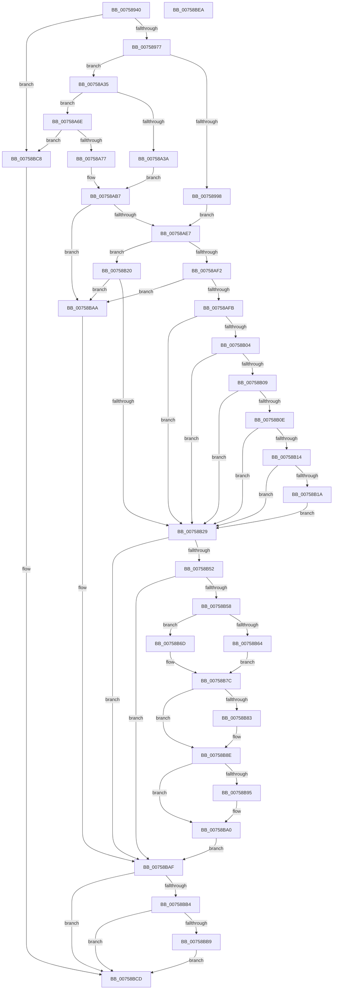

# PoFxRegisterDevice

- RVA: `0x00758940`–`0x00758BEB` (길이 `683` bytes)
- VA: `0x0000000140758940`
- 실행 섹션: `PAGE`
- PDB 이름 있음: `예`; PDB Function 태그: `아니요`
- unwind 정보 RVA: `0x000CC204`
- 디코드: `183`개 명령, `683/683` bytes 표시
- 미해석 바이트: `0` (있으면 어셈블리에 `.byte`로 보존)

> 이 문서는 커널 이미지의 기계어와 PDB 기호를 분석해 생성했습니다. 4번과 5번은 함수 원형과 자료형을 바이너리 사용 방식에서 추정한 C 해석이며 원본 소스 복구 결과는 아닙니다.

## 1. Dependencies

- 직접 호출 지점: **7**; 고유 호출 대상: **5**
- 직접 호출자로 확인된 함수: **1**
- RIP 상대 이미지 참조: **4**

### Outgoing calls
- `0x00758984` → [memset](../../text/6C/memset_function_006C6C40.md) (function, `0x006C6C40`)
- `0x007589A5` → [PopPrintEx](../../text/48/PopPrintEx_function_0048EF24.md) (function, `0x0048EF24`)
- `0x007589BC` → [PopPrintEx](../../text/48/PopPrintEx_function_0048EF24.md) (function, `0x0048EF24`)
- `0x007589CB` → [PopPrintEx](../../text/48/PopPrintEx_function_0048EF24.md) (function, `0x0048EF24`)
- `0x00758A1C` → [PopFxConvertV1Components](../AD/PopFxConvertV1Components_function_00AD6508.md) (function, `0x00AD6508`)
- `0x00758B47` → [PopFxRegisterDevice](PopFxRegisterDevice_function_00759B80.md) (function, `0x00759B80`)
- `0x00758BC1` → [ExFreePoolWithTag](../../poolcode/B8/ExFreePoolWithTag_function_00B82870.md) (function, `0x00B82870`)

### Direct callers
- [DifPoFxRegisterDeviceWrapper](../../text/63/DifPoFxRegisterDeviceWrapper_function_00639880.md) at `0x00639965`

### Static image references
- `0x0075899B` → RVA `0x00B01D00` (` ?? ::NNGAKEGL::`string'`; read)
- `0x007589AE` → RVA `0x00B01D30` (` ?? ::NNGAKEGL::`string'`; read)
- `0x007589C1` → RVA `0x00B01D50` (` ?? ::NNGAKEGL::`string'`; read)
- `0x00758B6F` → RVA `0x00E0B3E0` (`.data`; read)

## 2. Other-region calls and transfers

- 다른 실행 섹션으로 향하는 call: **5**
  - `0x00758984` → [memset](../../text/6C/memset_function_006C6C40.md) (`PAGE` → `.text`)
  - `0x007589A5` → [PopPrintEx](../../text/48/PopPrintEx_function_0048EF24.md) (`PAGE` → `.text`)
  - `0x007589BC` → [PopPrintEx](../../text/48/PopPrintEx_function_0048EF24.md) (`PAGE` → `.text`)
  - `0x007589CB` → [PopPrintEx](../../text/48/PopPrintEx_function_0048EF24.md) (`PAGE` → `.text`)
  - `0x00758BC1` → [ExFreePoolWithTag](../../poolcode/B8/ExFreePoolWithTag_function_00B82870.md) (`PAGE` → `POOLCODE`)
- 별도 외부 분기/꼬리 이동을 확인하지 못했습니다.

## 3. Assembly (complete function range)

```asm
00758940  48 8B C4                        mov rax, rsp
00758943  48 89 58 10                     mov qword ptr [rax + 0x10], rbx
00758947  4C 89 40 18                     mov qword ptr [rax + 0x18], r8
0075894B  48 89 48 08                     mov qword ptr [rax + 8], rcx
0075894F  55                              push rbp
00758950  56                              push rsi
00758951  57                              push rdi
00758952  41 54                           push r12
00758954  41 55                           push r13
00758956  41 56                           push r14
00758958  41 57                           push r15
0075895A  48 8D 68 A1                     lea rbp, [rax - 0x5f]
0075895E  48 81 EC B0 00 00 00            sub rsp, 0xb0
00758965  45 33 F6                        xor r14d, r14d
00758968  48 8B FA                        mov rdi, rdx
0075896B  48 8B D9                        mov rbx, rcx
0075896E  48 85 C9                        test rcx, rcx
00758971  0F 84 51 02 00 00               je 0x140758bc8
00758977  41 8D 76 50                     lea esi, [r14 + 0x50]
0075897B  33 D2                           xor edx, edx
0075897D  44 8B C6                        mov r8d, esi
00758980  48 8D 4D D7                     lea rcx, [rbp - 0x29]
00758984  E8 B7 E2 F6 FF                  call 0x1406c6c40
00758989  8B 07                           mov eax, dword ptr [rdi]
0075898B  45 8D 7E 01                     lea r15d, [r14 + 1]
0075898F  41 3B C7                        cmp eax, r15d
00758992  0F 85 9D 00 00 00               jne 0x140758a35
00758998  4C 8B C3                        mov r8, rbx
0075899B  48 8D 15 5E 93 3A 00            lea rdx, [rip + 0x3a935e]
007589A2  41 8B CF                        mov ecx, r15d
007589A5  E8 7A 65 D3 FF                  call 0x14048ef24
007589AA  4C 8B 43 08                     mov r8, qword ptr [rbx + 8]
007589AE  48 8D 15 7B 93 3A 00            lea rdx, [rip + 0x3a937b]
007589B5  49 83 C0 38                     add r8, 0x38
007589B9  41 8B CF                        mov ecx, r15d
007589BC  E8 63 65 D3 FF                  call 0x14048ef24
007589C1  48 8D 15 88 93 3A 00            lea rdx, [rip + 0x3a9388]
007589C8  41 8B CF                        mov ecx, r15d
007589CB  E8 54 65 D3 FF                  call 0x14048ef24
007589D0  48 8B 47 38                     mov rax, qword ptr [rdi + 0x38]
007589D4  48 8D 4F 40                     lea rcx, [rdi + 0x40]
007589D8  4C 8B 7F 08                     mov r15, qword ptr [rdi + 8]
007589DC  33 DB                           xor ebx, ebx
007589DE  4C 8B 67 10                     mov r12, qword ptr [rdi + 0x10]
007589E2  4C 8B 6F 18                     mov r13, qword ptr [rdi + 0x18]
007589E6  8B 57 04                        mov edx, dword ptr [rdi + 4]
007589E9  48 89 45 B7                     mov qword ptr [rbp - 0x49], rax
007589ED  48 8B 47 20                     mov rax, qword ptr [rdi + 0x20]
007589F1  48 89 45 BF                     mov qword ptr [rbp - 0x41], rax
007589F5  48 89 45 EF                     mov qword ptr [rbp - 0x11], rax
007589F9  48 8B 47 28                     mov rax, qword ptr [rdi + 0x28]
007589FD  48 89 45 C7                     mov qword ptr [rbp - 0x39], rax
00758A01  48 89 45 F7                     mov qword ptr [rbp - 9], rax
00758A05  48 8B 47 30                     mov rax, qword ptr [rdi + 0x30]
00758A09  48 89 45 FF                     mov qword ptr [rbp - 1], rax
00758A0D  89 55 7F                        mov dword ptr [rbp + 0x7f], edx
00758A10  4C 89 7D D7                     mov qword ptr [rbp - 0x29], r15
00758A14  4C 89 65 DF                     mov qword ptr [rbp - 0x21], r12
00758A18  4C 89 6D E7                     mov qword ptr [rbp - 0x19], r13
00758A1C  E8 E7 DA 37 00                  call 0x140ad6508
00758A21  44 8B 4D 7F                     mov r9d, dword ptr [rbp + 0x7f]
00758A25  48 8B F0                        mov rsi, rax
00758A28  48 8B 45 1F                     mov rax, qword ptr [rbp + 0x1f]
00758A2C  48 8B 55 B7                     mov rdx, qword ptr [rbp - 0x49]
00758A30  E9 B2 00 00 00                  jmp 0x140758ae7
00758A35  83 F8 02                        cmp eax, 2
00758A38  75 34                           jne 0x140758a6e
00758A3A  48 8B 4F 28                     mov rcx, qword ptr [rdi + 0x28]
00758A3E  8B 57 48                        mov edx, dword ptr [rdi + 0x48]
00758A41  48 8B 47 38                     mov rax, qword ptr [rdi + 0x38]
00758A45  89 55 7F                        mov dword ptr [rbp + 0x7f], edx
00758A48  48 8B 57 40                     mov rdx, qword ptr [rdi + 0x40]
00758A4C  44 8B 4D 7F                     mov r9d, dword ptr [rbp + 0x7f]
00758A50  48 89 4D BF                     mov qword ptr [rbp - 0x41], rcx
00758A54  48 89 4D EF                     mov qword ptr [rbp - 0x11], rcx
00758A58  48 8B 4F 30                     mov rcx, qword ptr [rdi + 0x30]
00758A5C  48 89 45 FF                     mov qword ptr [rbp - 1], rax
00758A60  48 8B 45 1F                     mov rax, qword ptr [rbp + 0x1f]
00758A64  48 89 4D C7                     mov qword ptr [rbp - 0x39], rcx
00758A68  48 89 4D F7                     mov qword ptr [rbp - 9], rcx
00758A6C  EB 49                           jmp 0x140758ab7
00758A6E  83 F8 03                        cmp eax, 3
00758A71  0F 85 51 01 00 00               jne 0x140758bc8
00758A77  48 8B 47 28                     mov rax, qword ptr [rdi + 0x28]
00758A7B  4C 8B F7                        mov r14, rdi
00758A7E  44 8B 4F 60                     mov r9d, dword ptr [rdi + 0x60]
00758A82  BE 68 00 00 00                  mov esi, 0x68
00758A87  48 8B 57 58                     mov rdx, qword ptr [rdi + 0x58]
00758A8B  48 89 45 BF                     mov qword ptr [rbp - 0x41], rax
00758A8F  48 89 45 EF                     mov qword ptr [rbp - 0x11], rax
00758A93  48 8B 47 30                     mov rax, qword ptr [rdi + 0x30]
00758A97  48 89 45 C7                     mov qword ptr [rbp - 0x39], rax
00758A9B  48 89 45 F7                     mov qword ptr [rbp - 9], rax
00758A9F  48 8B 47 38                     mov rax, qword ptr [rdi + 0x38]
00758AA3  48 89 45 FF                     mov qword ptr [rbp - 1], rax
00758AA7  48 8B 47 40                     mov rax, qword ptr [rdi + 0x40]
00758AAB  48 89 45 17                     mov qword ptr [rbp + 0x17], rax
00758AAF  48 8B 47 48                     mov rax, qword ptr [rdi + 0x48]
00758AB3  48 89 45 1F                     mov qword ptr [rbp + 0x1f], rax
00758AB7  4C 8B 6F 20                     mov r13, qword ptr [rdi + 0x20]
00758ABB  BB 08 00 00 00                  mov ebx, 8
00758AC0  4C 8B 67 18                     mov r12, qword ptr [rdi + 0x18]
00758AC4  48 8B CF                        mov rcx, rdi
00758AC7  4C 8B 7F 10                     mov r15, qword ptr [rdi + 0x10]
00758ACB  48 03 F7                        add rsi, rdi
00758ACE  4C 89 6D E7                     mov qword ptr [rbp - 0x19], r13
00758AD2  4C 89 65 DF                     mov qword ptr [rbp - 0x21], r12
00758AD6  4C 89 7D D7                     mov qword ptr [rbp - 0x29], r15
00758ADA  48 8B 1C 0B                     mov rbx, qword ptr [rbx + rcx]
00758ADE  F6 C3 40                        test bl, 0x40
00758AE1  0F 85 C3 00 00 00               jne 0x140758baa
00758AE7  48 83 7D 17 00                  cmp qword ptr [rbp + 0x17], 0
00758AEC  C6 45 7F 00                     mov byte ptr [rbp + 0x7f], 0
00758AF0  74 2E                           je 0x140758b20
00758AF2  48 85 C0                        test rax, rax
00758AF5  0F 84 AF 00 00 00               je 0x140758baa
00758AFB  C6 45 7F 01                     mov byte ptr [rbp + 0x7f], 1
00758AFF  4D 85 FF                        test r15, r15
00758B02  75 25                           jne 0x140758b29
00758B04  4D 85 E4                        test r12, r12
00758B07  75 20                           jne 0x140758b29
00758B09  4D 85 ED                        test r13, r13
00758B0C  75 1B                           jne 0x140758b29
00758B0E  4C 39 6D BF                     cmp qword ptr [rbp - 0x41], r13
00758B12  75 15                           jne 0x140758b29
00758B14  4C 39 6D C7                     cmp qword ptr [rbp - 0x39], r13
00758B18  75 0F                           jne 0x140758b29
00758B1A  48 83 CB 40                     or rbx, 0x40
00758B1E  EB 09                           jmp 0x140758b29
00758B20  48 85 C0                        test rax, rax
00758B23  0F 85 81 00 00 00               jne 0x140758baa
00758B29  4C 8B 7D 77                     mov r15, qword ptr [rbp + 0x77]
00758B2D  4C 8B C6                        mov r8, rsi
00758B30  48 8B 4D 67                     mov rcx, qword ptr [rbp + 0x67]
00758B34  4C 89 7C 24 30                  mov qword ptr [rsp + 0x30], r15
00758B39  48 89 5C 24 28                  mov qword ptr [rsp + 0x28], rbx
00758B3E  48 89 54 24 20                  mov qword ptr [rsp + 0x20], rdx
00758B43  48 8D 55 D7                     lea rdx, [rbp - 0x29]
00758B47  E8 34 10 00 00                  call 0x140759b80
00758B4C  8B D8                           mov ebx, eax
00758B4E  85 C0                           test eax, eax
00758B50  78 5D                           js 0x140758baf
00758B52  80 7D 7F 00                     cmp byte ptr [rbp + 0x7f], 0
00758B56  74 57                           je 0x140758baf
00758B58  41 8B 56 50                     mov edx, dword ptr [r14 + 0x50]
00758B5C  49 8B 0F                        mov rcx, qword ptr [r15]
00758B5F  83 FA FF                        cmp edx, -1
00758B62  75 09                           jne 0x140758b6d
00758B64  83 A1 BC 03 00 00 00            and dword ptr [rcx + 0x3bc], 0
00758B6B  EB 0F                           jmp 0x140758b7c
00758B6D  85 D2                           test edx, edx
00758B6F  0F 44 15 6A 28 6B 00            cmove edx, dword ptr [rip + 0x6b286a]
00758B76  89 91 BC 03 00 00               mov dword ptr [rcx + 0x3bc], edx
00758B7C  41 F6 46 08 02                  test byte ptr [r14 + 8], 2
00758B81  74 0B                           je 0x140758b8e
00758B83  F0 81 89 60 03 00 00 00 02 00 00  lock or dword ptr [rcx + 0x360], 0x200
00758B8E  41 F6 46 08 04                  test byte ptr [r14 + 8], 4
00758B93  74 0B                           je 0x140758ba0
00758B95  F0 81 89 60 03 00 00 00 04 00 00  lock or dword ptr [rcx + 0x360], 0x400
00758BA0  F0 83 89 60 03 00 00 20         lock or dword ptr [rcx + 0x360], 0x20
00758BA8  EB 05                           jmp 0x140758baf
00758BAA  BB 0D 00 00 C0                  mov ebx, 0xc000000d
00758BAF  48 85 F6                        test rsi, rsi
00758BB2  74 19                           je 0x140758bcd
00758BB4  83 3F 01                        cmp dword ptr [rdi], 1
00758BB7  75 14                           jne 0x140758bcd
00758BB9  BA 50 46 58 4D                  mov edx, 0x4d584650
00758BBE  48 8B CE                        mov rcx, rsi
00758BC1  E8 AA 9C 42 00                  call 0x140b82870
00758BC6  EB 05                           jmp 0x140758bcd
00758BC8  BB 0D 00 00 C0                  mov ebx, 0xc000000d
00758BCD  8B C3                           mov eax, ebx
00758BCF  48 8B 9C 24 F8 00 00 00         mov rbx, qword ptr [rsp + 0xf8]
00758BD7  48 81 C4 B0 00 00 00            add rsp, 0xb0
00758BDE  41 5F                           pop r15
00758BE0  41 5E                           pop r14
00758BE2  41 5D                           pop r13
00758BE4  41 5C                           pop r12
00758BE6  5F                              pop rdi
00758BE7  5E                              pop rsi
00758BE8  5D                              pop rbp
00758BE9  C3                              ret
00758BEA  CC                              int3
```

## 4. C-style interpretation (structured pseudocode)

```c
__int64 __fastcall PoFxRegisterDevice(__int64 a1, __int64 a2, __int64 a3)
{
    __int64 result;
    __int64 v_r14;
    __int64 v_rbx;
    __int64 v_rsi;
    __int64 v_rsp;
    unsigned __int64 v_stack_mB8;
    unsigned __int64 v_stack_mC0;
    unsigned __int64 v_stack_mC8;
    unsigned __int64 v_stack_p10;

    *(unsigned __int64 *)(v_rsp + 16) = v_rbx;
    *(unsigned __int64 *)(v_rsp + 24) = a3;
    *(unsigned __int64 *)(v_rsp + 8) = a1;
    v_rsp = (v_rsp) - (176);
    v_r14 = 0;
    if (a1 == 0) goto loc_00758BC8;
    a2 = 0;
    result = memset(v_rsp - 95 - 41, a2, (unsigned int)((unsigned int)(v_r14 + 80)), a4);
    if (((unsigned int)((unsigned int)(*(unsigned int *)(a2)))) != ((unsigned int)(v_r14 + 1))) goto loc_00758A35;
    result = PopPrintEx((unsigned int)((unsigned int)(v_r14 + 1)), v_rip + 3838814, a1, a4);
    a3 = (*(unsigned __int64 *)(a1 + 8)) + (56);
    result = PopPrintEx((unsigned int)((unsigned int)(v_r14 + 1)), v_rip + 3838843, a3, a4);
    result = PopPrintEx((unsigned int)((unsigned int)(v_r14 + 1)), v_rip + 3838856, a3, a4);
    v_rbx = 0;
    *(unsigned __int64 *)(v_rsp - 95 - 73) = *(unsigned __int64 *)(a2 + 56);
    *(unsigned __int64 *)(v_rsp - 95 - 65) = *(unsigned __int64 *)(a2 + 32);
    *(unsigned __int64 *)(v_rsp - 95 - 17) = *(unsigned __int64 *)(a2 + 32);
    *(unsigned __int64 *)(v_rsp - 95 - 57) = *(unsigned __int64 *)(a2 + 40);
    *(unsigned __int64 *)(v_rsp - 95 - 9) = *(unsigned __int64 *)(a2 + 40);
    *(unsigned __int64 *)(v_rsp - 95 - 1) = *(unsigned __int64 *)(a2 + 48);
    *(unsigned int *)(v_rsp - 95 + 127) = (unsigned int)((unsigned int)(*(unsigned int *)(a2 + 4)));
    *(unsigned __int64 *)(v_rsp - 95 - 41) = *(unsigned __int64 *)(a2 + 8);
    *(unsigned __int64 *)(v_rsp - 95 - 33) = *(unsigned __int64 *)(a2 + 16);
    *(unsigned __int64 *)(v_rsp - 95 - 25) = *(unsigned __int64 *)(a2 + 24);
    result = PopFxConvertV1Components(a2 + 64, (unsigned int)(*(unsigned int *)(a2 + 4)), a3, a4);
    goto loc_00758AE7;
loc_00758A35:
    if (((unsigned int)(*(unsigned __int64 *)(v_rsp - 95 + 31))) != 2) goto loc_00758A6E;
    *(unsigned int *)(v_rsp - 95 + 127) = (unsigned int)((unsigned int)(*(unsigned int *)(a2 + 72)));
    *(unsigned __int64 *)(v_rsp - 95 - 65) = *(unsigned __int64 *)(a2 + 40);
    *(unsigned __int64 *)(v_rsp - 95 - 17) = *(unsigned __int64 *)(a2 + 40);
    *(unsigned __int64 *)(v_rsp - 95 - 1) = *(unsigned __int64 *)(a2 + 56);
    *(unsigned __int64 *)(v_rsp - 95 - 57) = *(unsigned __int64 *)(a2 + 48);
    *(unsigned __int64 *)(v_rsp - 95 - 9) = *(unsigned __int64 *)(a2 + 48);
    goto loc_00758AB7;
loc_00758A6E:
    if (((unsigned int)(*(unsigned __int64 *)(v_rsp - 95 + 31))) != 3) goto loc_00758BC8;
    *(unsigned __int64 *)(v_rsp - 95 - 65) = *(unsigned __int64 *)(a2 + 40);
    *(unsigned __int64 *)(v_rsp - 95 - 17) = *(unsigned __int64 *)(a2 + 40);
    *(unsigned __int64 *)(v_rsp - 95 - 57) = *(unsigned __int64 *)(a2 + 48);
    *(unsigned __int64 *)(v_rsp - 95 - 9) = *(unsigned __int64 *)(a2 + 48);
    *(unsigned __int64 *)(v_rsp - 95 - 1) = *(unsigned __int64 *)(a2 + 56);
    *(unsigned __int64 *)(v_rsp - 95 + 23) = *(unsigned __int64 *)(a2 + 64);
    *(unsigned __int64 *)(v_rsp - 95 + 31) = *(unsigned __int64 *)(a2 + 72);
loc_00758AB7:
    v_rsi = (104) + (0);
    *(unsigned __int64 *)(v_rsp - 95 - 25) = *(unsigned __int64 *)(a2 + 32);
    *(unsigned __int64 *)(v_rsp - 95 - 33) = *(unsigned __int64 *)(a2 + 24);
    *(unsigned __int64 *)(v_rsp - 95 - 41) = *(unsigned __int64 *)(a2 + 16);
    if ((((unsigned __int8)(*(unsigned __int64 *)(8 + 0 * 1))) & (64)) != 0) goto loc_00758BAA;
loc_00758AE7:
    *(unsigned __int8 *)(v_rsp - 95 + 127) = 0;
    if ((*(unsigned __int64 *)(v_rsp - 95 + 23)) == 0) goto loc_00758B20;
    if (*(unsigned __int64 *)(a2 + 72) == 0) goto loc_00758BAA;
    *(unsigned __int8 *)(v_rsp - 95 + 127) = 1;
    if (*(unsigned __int64 *)(a2 + 16) != 0) goto loc_00758B29;
    if (*(unsigned __int64 *)(a2 + 24) != 0) goto loc_00758B29;
    if (*(unsigned __int64 *)(a2 + 32) != 0) goto loc_00758B29;
    if ((*(unsigned __int64 *)(v_rsp - 95 - 65)) != (*(unsigned __int64 *)(a2 + 32))) goto loc_00758B29;
    if ((*(unsigned __int64 *)(v_rsp - 95 - 57)) != (*(unsigned __int64 *)(a2 + 32))) goto loc_00758B29;
    v_rbx = (*(unsigned __int64 *)(8 + 0 * 1)) | (64);
    goto loc_00758B29;
loc_00758B20:
    if (*(unsigned __int64 *)(a2 + 72) != 0) goto loc_00758BAA;
loc_00758B29:
    v_stack_mB8 = *(unsigned __int64 *)(v_rsp - 95 + 119);
    v_stack_mC0 = v_rbx;
    v_stack_mC8 = *(unsigned __int64 *)(a2 + 88);
    result = PopFxRegisterDevice(*(unsigned __int64 *)(v_rsp - 95 + 103), v_rsp - 95 - 41, v_rsi, (unsigned int)(*(unsigned int *)(a2 + 96)));
    if (sign_flag) goto loc_00758BAF;
    if ((*(unsigned __int8 *)(v_rsp - 95 + 127)) == 0) goto loc_00758BAF;
    if (((unsigned int)((unsigned int)(*(unsigned int *)(0 + 80)))) != -1) goto loc_00758B6D;
    goto loc_00758B7C;
loc_00758B6D:
    a2 = (unsigned int)(*(unsigned int *)(0 + 80));
    if ((unsigned int)((unsigned int)(*(unsigned int *)(0 + 80))) == 0) { a2 = *(unsigned int *)(v_rip + 7022698); }
    *(unsigned int *)(*(unsigned __int64 *)(*(unsigned __int64 *)(v_rsp - 95 + 119)) + 956) = (unsigned int)(a2);
loc_00758B7C:
    if (((*(unsigned __int8 *)(0 + 8)) & (2)) != 0) {
    }
    if (((*(unsigned __int8 *)(0 + 8)) & (4)) != 0) {
    }
    goto loc_00758BAF;
loc_00758BAA:
loc_00758BAF:
    if (v_rsi == 0) goto loc_00758BCD;
    if ((*(unsigned int *)(a2)) != 1) goto loc_00758BCD;
    result = ExFreePoolWithTag(v_rsi, (unsigned int)(0x4D584650ULL), v_rsi, (unsigned int)(*(unsigned int *)(a2 + 96)));
    goto loc_00758BCD;
loc_00758BC8:
loc_00758BCD:
    v_rsp = (v_rsp) + (176);
    return (unsigned int)((unsigned int)((unsigned int)(0xC000000DULL)));
}
```

## 5. (Beta) C Style

```c
int64_t PoFxRegisterDevice(void *Arg1, void *Arg2, int64_t Arg3)
{
    uint8_t *arg1 = (uint8_t *)Arg1;
    uint8_t *arg2 = (uint8_t *)Arg2;

    int64_t result;
    int64_t local_r14;
    int64_t local_rbx;
    int64_t local_rsi;
    int64_t local_rsp;
    uint64_t v_stack_mB8;
    uint64_t v_stack_mC0;
    uint64_t v_stack_mC8;
    uint64_t v_stack_p10;

    *(uint64_t *)(local_rsp + 0x10) = local_rbx;
    *(uint64_t *)(local_rsp + 0x18) = Arg3;
    *(void **)(local_rsp + 0x8) = Arg1;
    local_rsp = (local_rsp) - (176);
    local_r14 = 0;
    if (Arg1 == NULL) goto loc_00758BC8;
    Arg2 = 0;
    result = memset(local_rsp - 95 - 41, Arg2, (uint32_t)((uint32_t)(local_r14 + 80)), a4);
    if (((uint32_t)((uint32_t)(*(uint32_t *)(arg2)))) != ((uint32_t)(local_r14 + 1))) goto loc_00758A35;
    result = PopPrintEx((uint32_t)((uint32_t)(local_r14 + 1)), v_rip + 3838814, Arg1, a4);
    Arg3 = (*(uint64_t *)(arg1 + 0x8)) + (56);
    result = PopPrintEx((uint32_t)((uint32_t)(local_r14 + 1)), v_rip + 3838843, Arg3, a4);
    result = PopPrintEx((uint32_t)((uint32_t)(local_r14 + 1)), v_rip + 3838856, Arg3, a4);
    local_rbx = 0;
    *(uint64_t *)(local_rsp - 0x5F - 0x49) = *(uint64_t *)(arg2 + 0x38);
    *(uint64_t *)(local_rsp - 0x5F - 0x41) = *(uint64_t *)(arg2 + 0x20);
    *(uint64_t *)(local_rsp - 0x5F - 0x11) = *(uint64_t *)(arg2 + 0x20);
    *(uint64_t *)(local_rsp - 0x5F - 0x39) = *(uint64_t *)(arg2 + 0x28);
    *(uint64_t *)(local_rsp - 0x5F - 0x9) = *(uint64_t *)(arg2 + 0x28);
    *(uint64_t *)(local_rsp - 0x5F - 0x1) = *(uint64_t *)(arg2 + 0x30);
    *(uint32_t *)(local_rsp - 0x5F + 0x7F) = (uint32_t)((uint32_t)(*(uint32_t *)(arg2 + 0x4)));
    *(uint64_t *)(local_rsp - 0x5F - 0x29) = *(uint64_t *)(arg2 + 0x8);
    *(uint64_t *)(local_rsp - 0x5F - 0x21) = *(uint64_t *)(arg2 + 0x10);
    *(uint64_t *)(local_rsp - 0x5F - 0x19) = *(uint64_t *)(arg2 + 0x18);
    result = PopFxConvertV1Components(Arg2 + 64, (uint32_t)(*(uint32_t *)(arg2 + 0x4)), Arg3, a4);
    goto loc_00758AE7;
loc_00758A35:
    if (((uint32_t)(*(uint64_t *)(local_rsp - 0x5F + 0x1F))) != 2) goto loc_00758A6E;
    *(uint32_t *)(local_rsp - 0x5F + 0x7F) = (uint32_t)((uint32_t)(*(uint32_t *)(arg2 + 0x48)));
    *(uint64_t *)(local_rsp - 0x5F - 0x41) = *(uint64_t *)(arg2 + 0x28);
    *(uint64_t *)(local_rsp - 0x5F - 0x11) = *(uint64_t *)(arg2 + 0x28);
    *(uint64_t *)(local_rsp - 0x5F - 0x1) = *(uint64_t *)(arg2 + 0x38);
    *(uint64_t *)(local_rsp - 0x5F - 0x39) = *(uint64_t *)(arg2 + 0x30);
    *(uint64_t *)(local_rsp - 0x5F - 0x9) = *(uint64_t *)(arg2 + 0x30);
    goto loc_00758AB7;
loc_00758A6E:
    if (((uint32_t)(*(uint64_t *)(local_rsp - 0x5F + 0x1F))) != 3) goto loc_00758BC8;
    *(uint64_t *)(local_rsp - 0x5F - 0x41) = *(uint64_t *)(arg2 + 0x28);
    *(uint64_t *)(local_rsp - 0x5F - 0x11) = *(uint64_t *)(arg2 + 0x28);
    *(uint64_t *)(local_rsp - 0x5F - 0x39) = *(uint64_t *)(arg2 + 0x30);
    *(uint64_t *)(local_rsp - 0x5F - 0x9) = *(uint64_t *)(arg2 + 0x30);
    *(uint64_t *)(local_rsp - 0x5F - 0x1) = *(uint64_t *)(arg2 + 0x38);
    *(uint64_t *)(local_rsp - 0x5F + 0x17) = *(uint64_t *)(arg2 + 0x40);
    *(uint64_t *)(local_rsp - 0x5F + 0x1F) = *(uint64_t *)(arg2 + 0x48);
loc_00758AB7:
    local_rsi = (104) + (0);
    *(uint64_t *)(local_rsp - 0x5F - 0x19) = *(uint64_t *)(arg2 + 0x20);
    *(uint64_t *)(local_rsp - 0x5F - 0x21) = *(uint64_t *)(arg2 + 0x18);
    *(uint64_t *)(local_rsp - 0x5F - 0x29) = *(uint64_t *)(arg2 + 0x10);
    if ((((uint8_t)(*(uint64_t *)(8 + 0x0 * 1))) & (64)) != 0) goto loc_00758BAA;
loc_00758AE7:
    *(uint8_t *)(local_rsp - 0x5F + 0x7F) = 0;
    if ((*(uint64_t *)(local_rsp - 0x5F + 0x17)) == 0) goto loc_00758B20;
    if (*(uint64_t *)(arg2 + 0x48) == 0) goto loc_00758BAA;
    *(uint8_t *)(local_rsp - 0x5F + 0x7F) = 1;
    if (*(uint64_t *)(arg2 + 0x10) != 0) goto loc_00758B29;
    if (*(uint64_t *)(arg2 + 0x18) != 0) goto loc_00758B29;
    if (*(uint64_t *)(arg2 + 0x20) != 0) goto loc_00758B29;
    if ((*(uint64_t *)(local_rsp - 0x5F - 0x41)) != (*(uint64_t *)(arg2 + 0x20))) goto loc_00758B29;
    if ((*(uint64_t *)(local_rsp - 0x5F - 0x39)) != (*(uint64_t *)(arg2 + 0x20))) goto loc_00758B29;
    local_rbx = (*(uint64_t *)(8 + 0x0 * 1)) | (64);
    goto loc_00758B29;
loc_00758B20:
    if (*(uint64_t *)(arg2 + 0x48) != 0) goto loc_00758BAA;
loc_00758B29:
    v_stack_mB8 = *(uint64_t *)(local_rsp - 0x5F + 0x77);
    v_stack_mC0 = local_rbx;
    v_stack_mC8 = *(uint64_t *)(arg2 + 0x58);
    result = PopFxRegisterDevice(*(uint64_t *)(local_rsp - 0x5F + 0x67), local_rsp - 95 - 41, local_rsi, (uint32_t)(*(uint32_t *)(arg2 + 0x60)));
    if (sign_flag) goto loc_00758BAF;
    if ((*(uint8_t *)(local_rsp - 0x5F + 0x7F)) == 0) goto loc_00758BAF;
    if (((uint32_t)((uint32_t)(*(uint32_t *)(0 + 0x50)))) != -1) goto loc_00758B6D;
    goto loc_00758B7C;
loc_00758B6D:
    Arg2 = (uint32_t)(*(uint32_t *)(0 + 0x50));
    if ((uint32_t)((uint32_t)(*(uint32_t *)(0 + 0x50))) == 0) { Arg2 = *(uint32_t *)(v_rip + 0x6B286A); }
    *(uint32_t *)(*(uint64_t *)(*(uint64_t *)(local_rsp - 0x5F + 0x77)) + 0x3BC) = (uint32_t)(Arg2);
loc_00758B7C:
    if (((*(uint8_t *)(0 + 0x8)) & (2)) != 0) {
    }
    if (((*(uint8_t *)(0 + 0x8)) & (4)) != 0) {
    }
    goto loc_00758BAF;
loc_00758BAA:
loc_00758BAF:
    if (local_rsi == 0) goto loc_00758BCD;
    if ((*(uint32_t *)(arg2)) != 1) goto loc_00758BCD;
    result = ExFreePoolWithTag(local_rsi, (uint32_t)(0x4D584650ULL), local_rsi, (uint32_t)(*(uint32_t *)(arg2 + 0x60)));
    goto loc_00758BCD;
loc_00758BC8:
loc_00758BCD:
    local_rsp = (local_rsp) + (176);
    return (uint32_t)((uint32_t)((uint32_t)(0xC000000DULL)));
}
```

### 관측된 메모리 오프셋

구조체 형식이 확인되지 않은 접근은 인자 기준의 오프셋으로만 기록했습니다.

| 기준 인자 | 오프셋 표현 | 폭 (bit) | 접근 |
|---|---:|---:|---|
| `Arg1` | `+ 0x8` | `64` | `R` |
| `Arg2` | `+ 0x0` | `32` | `R` |
| `Arg2` | `+ 0x4` | `32` | `R` |
| `Arg2` | `+ 0x8` | `64` | `R` |
| `Arg2` | `+ 0x10` | `64` | `R` |
| `Arg2` | `+ 0x18` | `64` | `R` |
| `Arg2` | `+ 0x20` | `64` | `R` |
| `Arg2` | `+ 0x28` | `64` | `R` |
| `Arg2` | `+ 0x30` | `64` | `R` |
| `Arg2` | `+ 0x38` | `64` | `R` |
| `Arg2` | `+ 0x40` | `64` | `R` |
| `Arg2` | `+ 0x48` | `32` | `R` |
| `Arg2` | `+ 0x48` | `64` | `R` |
| `Arg2` | `+ 0x58` | `64` | `R` |
| `Arg2` | `+ 0x60` | `32` | `R` |

## 6. Execution-region graph

[열기: 2D/3D 그래프와 함수 탐색 컨트롤 패널](../../../control-panel.html?section=page&rva=0x00758940&view=graph)

- 2D 그래프는 위에서 아래로 흐르고, 3D 그래프는 빈 공간을 드래그해 회전합니다. Shift+드래그는 이동, 휠은 확대·축소, 함수 노드 선택은 대상 보고서 이동입니다.

### Static fallback


