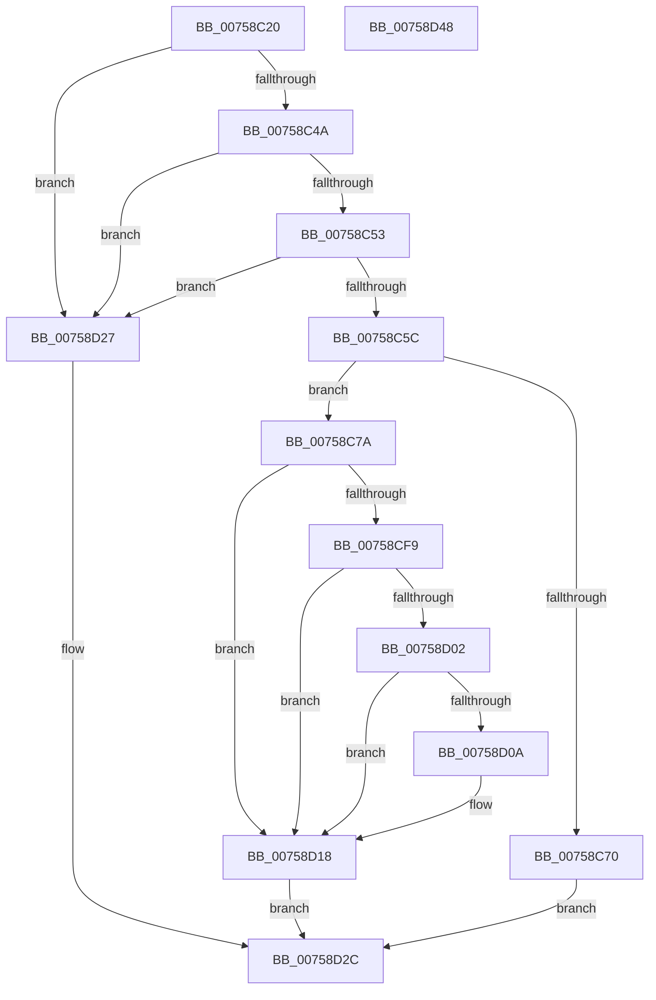

# PoFxRegisterPrimaryDevice

- RVA: `0x00758C20`–`0x00758D49` (길이 `297` bytes)
- VA: `0x0000000140758C20`
- 실행 섹션: `PAGE`
- PDB 이름 있음: `예`; PDB Function 태그: `아니요`
- unwind 정보 RVA: `0x000CC224`
- 디코드: `72`개 명령, `297/297` bytes 표시
- 미해석 바이트: `0` (있으면 어셈블리에 `.byte`로 보존)

> 이 문서는 커널 이미지의 기계어와 PDB 기호를 분석해 생성했습니다. 4번과 5번은 함수 원형과 자료형을 바이너리 사용 방식에서 추정한 C 해석이며 원본 소스 복구 결과는 아닙니다.

## 1. Dependencies

- 직접 호출 지점: **3**; 고유 호출 대상: **3**
- 직접 호출자로 확인된 함수: **0**
- RIP 상대 이미지 참조: **1**

### Outgoing calls
- `0x00758C63` → [PopFxConvertV1Components](../AD/PopFxConvertV1Components_function_00AD6508.md) (function, `0x00AD6508`)
- `0x00758CEE` → [PopFxRegisterDevice](PopFxRegisterDevice_function_00759B80.md) (function, `0x00759B80`)
- `0x00758D20` → [ExFreePoolWithTag](../../poolcode/B8/ExFreePoolWithTag_function_00B82870.md) (function, `0x00B82870`)

### Direct callers
- 이 함수 시작 RVA로 연결되는 직접 call은 확인되지 않았습니다. 간접 호출은 완전히 역산할 수 없습니다.

### Static image references
- `0x00758CF9` → RVA `0x00F083F1` (`.data`; read)

## 2. Other-region calls and transfers

- 다른 실행 섹션으로 향하는 call: **1**
  - `0x00758D20` → [ExFreePoolWithTag](../../poolcode/B8/ExFreePoolWithTag_function_00B82870.md) (`PAGE` → `POOLCODE`)
- 별도 외부 분기/꼬리 이동을 확인하지 못했습니다.

## 3. Assembly (complete function range)

```asm
00758C20  48 89 5C 24 08                  mov qword ptr [rsp + 8], rbx
00758C25  48 89 74 24 10                  mov qword ptr [rsp + 0x10], rsi
00758C2A  48 89 7C 24 18                  mov qword ptr [rsp + 0x18], rdi
00758C2F  41 56                           push r14
00758C31  48 81 EC 90 00 00 00            sub rsp, 0x90
00758C38  4D 8B F0                        mov r14, r8
00758C3B  48 8B DA                        mov rbx, rdx
00758C3E  48 8B F9                        mov rdi, rcx
00758C41  48 85 C9                        test rcx, rcx
00758C44  0F 84 DD 00 00 00               je 0x140758d27
00758C4A  48 85 D2                        test rdx, rdx
00758C4D  0F 84 D4 00 00 00               je 0x140758d27
00758C53  83 3A 01                        cmp dword ptr [rdx], 1
00758C56  0F 85 CB 00 00 00               jne 0x140758d27
00758C5C  48 8D 4A 50                     lea rcx, [rdx + 0x50]
00758C60  8B 52 04                        mov edx, dword ptr [rdx + 4]
00758C63  E8 A0 D8 37 00                  call 0x140ad6508
00758C68  48 8B F0                        mov rsi, rax
00758C6B  48 85 C0                        test rax, rax
00758C6E  75 0A                           jne 0x140758c7a
00758C70  BF 9A 00 00 C0                  mov edi, 0xc000009a
00758C75  E9 B2 00 00 00                  jmp 0x140758d2c
00758C7A  48 8B 43 10                     mov rax, qword ptr [rbx + 0x10]
00758C7E  48 8D 54 24 40                  lea rdx, [rsp + 0x40]
00758C83  44 8B 4B 04                     mov r9d, dword ptr [rbx + 4]
00758C87  0F 57 C0                        xorps xmm0, xmm0
00758C8A  48 83 64 24 78 00               and qword ptr [rsp + 0x78], 0
00758C90  4C 8B C6                        mov r8, rsi
00758C93  48 89 44 24 40                  mov qword ptr [rsp + 0x40], rax
00758C98  48 8B CF                        mov rcx, rdi
00758C9B  48 8B 43 18                     mov rax, qword ptr [rbx + 0x18]
00758C9F  48 89 44 24 48                  mov qword ptr [rsp + 0x48], rax
00758CA4  48 8B 43 20                     mov rax, qword ptr [rbx + 0x20]
00758CA8  48 89 44 24 50                  mov qword ptr [rsp + 0x50], rax
00758CAD  48 8B 43 28                     mov rax, qword ptr [rbx + 0x28]
00758CB1  48 89 44 24 58                  mov qword ptr [rsp + 0x58], rax
00758CB6  48 8B 43 30                     mov rax, qword ptr [rbx + 0x30]
00758CBA  48 89 44 24 60                  mov qword ptr [rsp + 0x60], rax
00758CBF  48 8B 43 38                     mov rax, qword ptr [rbx + 0x38]
00758CC3  48 89 44 24 68                  mov qword ptr [rsp + 0x68], rax
00758CC8  48 8B 43 40                     mov rax, qword ptr [rbx + 0x40]
00758CCC  48 89 44 24 70                  mov qword ptr [rsp + 0x70], rax
00758CD1  48 8B 43 48                     mov rax, qword ptr [rbx + 0x48]
00758CD5  4C 89 74 24 30                  mov qword ptr [rsp + 0x30], r14
00758CDA  48 83 64 24 28 00               and qword ptr [rsp + 0x28], 0
00758CE0  48 89 44 24 20                  mov qword ptr [rsp + 0x20], rax
00758CE5  66 0F 7F 84 24 80 00 00 00      movdqa xmmword ptr [rsp + 0x80], xmm0
00758CEE  E8 8D 0E 00 00                  call 0x140759b80
00758CF3  8B F8                           mov edi, eax
00758CF5  85 C0                           test eax, eax
00758CF7  78 1F                           js 0x140758d18
00758CF9  80 3D F1 F6 7A 00 00            cmp byte ptr [rip + 0x7af6f1], 0
00758D00  74 16                           je 0x140758d18
00758D02  8B 4B 08                        mov ecx, dword ptr [rbx + 8]
00758D05  F6 C1 01                        test cl, 1
00758D08  74 0E                           je 0x140758d18
00758D0A  49 8B 0E                        mov rcx, qword ptr [r14]
00758D0D  F0 81 89 60 03 00 00 80 00 00 00  lock or dword ptr [rcx + 0x360], 0x80
00758D18  BA 50 46 58 4D                  mov edx, 0x4d584650
00758D1D  48 8B CE                        mov rcx, rsi
00758D20  E8 4B 9B 42 00                  call 0x140b82870
00758D25  EB 05                           jmp 0x140758d2c
00758D27  BF 0D 00 00 C0                  mov edi, 0xc000000d
00758D2C  4C 8D 9C 24 90 00 00 00         lea r11, [rsp + 0x90]
00758D34  8B C7                           mov eax, edi
00758D36  49 8B 5B 10                     mov rbx, qword ptr [r11 + 0x10]
00758D3A  49 8B 73 18                     mov rsi, qword ptr [r11 + 0x18]
00758D3E  49 8B 7B 20                     mov rdi, qword ptr [r11 + 0x20]
00758D42  49 8B E3                        mov rsp, r11
00758D45  41 5E                           pop r14
00758D47  C3                              ret
00758D48  CC                              int3
```

## 4. C-style interpretation (structured pseudocode)

```c
__int64 __fastcall PoFxRegisterPrimaryDevice(__int64 a1, __int64 a2, __int64 a3)
{
    __int64 result;
    __int64 v_rsp;
    unsigned __int64 v_stack_m18;
    unsigned __int64 v_stack_m20;
    unsigned __int64 v_stack_m28;
    unsigned __int64 v_stack_m30;
    unsigned __int64 v_stack_m38;
    unsigned __int64 v_stack_m40;
    unsigned __int64 v_stack_m48;
    unsigned __int64 v_stack_m50;
    unsigned __int64 v_stack_m58;
    unsigned __int64 v_stack_m68;
    unsigned __int64 v_stack_m70;
    unsigned __int64 v_stack_m78;
    unsigned __int64 v_stack_m8;
    unsigned __int64 v_stack_p10;
    unsigned __int64 v_stack_p18;
    unsigned __int64 v_stack_p8;

    v_stack_p8 = v_rbx;
    v_stack_p10 = v_rsi;
    v_stack_p18 = v_rdi;
    v_rsp = (v_rsp) - (144);
    if (a1 == 0) goto loc_00758D27;
    if (a2 == 0) goto loc_00758D27;
    if ((*(unsigned int *)(a2)) != 1) goto loc_00758D27;
    result = PopFxConvertV1Components(a2 + 80, (unsigned int)(*(unsigned int *)(a2 + 4)), a3, a4);
    if (result != 0) goto loc_00758C7A;
    goto loc_00758D2C;
loc_00758C7A:
    v_stack_m58 = *(unsigned __int64 *)(a2 + 16);
    v_stack_m50 = *(unsigned __int64 *)(a2 + 24);
    v_stack_m48 = *(unsigned __int64 *)(a2 + 32);
    v_stack_m40 = *(unsigned __int64 *)(a2 + 40);
    v_stack_m38 = *(unsigned __int64 *)(a2 + 48);
    v_stack_m30 = *(unsigned __int64 *)(a2 + 56);
    v_stack_m28 = *(unsigned __int64 *)(a2 + 64);
    v_stack_m68 = a3;
    v_stack_m78 = *(unsigned __int64 *)(a2 + 72);
    v_stack_m18 = v_xmm0;
    result = PopFxRegisterDevice((unsigned int)(0xC000009AULL), v_stack_m58, result, (unsigned int)(*(unsigned int *)(a2 + 4)));
    if (sign_flag) goto loc_00758D18;
    if ((*(unsigned __int8 *)(v_rip + 8058609)) == 0) goto loc_00758D18;
    if ((((unsigned __int8)((unsigned int)(*(unsigned int *)(a2 + 8)))) & (1)) != 0) {
        a1 = *(unsigned __int64 *)(a3);
    }
    result = ExFreePoolWithTag(result, (unsigned int)(0x4D584650ULL), result, (unsigned int)(*(unsigned int *)(a2 + 4)));
    goto loc_00758D2C;
loc_00758D27:
loc_00758D2C:
    return (unsigned int)((unsigned int)((unsigned int)(0xC000000DULL)));
}
```

## 5. (Beta) C Style

```c
int64_t PoFxRegisterPrimaryDevice(int64_t Arg1, void *Arg2, void *Arg3)
{
    uint8_t *arg2 = (uint8_t *)Arg2;
    uint8_t *arg3 = (uint8_t *)Arg3;

    int64_t result;
    int64_t local_rsp;
    uint64_t v_stack_m18;
    uint64_t v_stack_m20;
    uint64_t v_stack_m28;
    uint64_t v_stack_m30;
    uint64_t v_stack_m38;
    uint64_t v_stack_m40;
    uint64_t v_stack_m48;
    uint64_t v_stack_m50;
    uint64_t v_stack_m58;
    uint64_t v_stack_m68;
    uint64_t v_stack_m70;
    uint64_t v_stack_m78;
    uint64_t v_stack_m8;
    uint64_t v_stack_p10;
    uint64_t v_stack_p18;
    uint64_t v_stack_p8;

    v_stack_p8 = local_rbx;
    v_stack_p10 = local_rsi;
    v_stack_p18 = local_rdi;
    local_rsp = (local_rsp) - (144);
    if (Arg1 == 0) goto loc_00758D27;
    if (Arg2 == NULL) goto loc_00758D27;
    if ((*(uint32_t *)(arg2)) != 1) goto loc_00758D27;
    result = PopFxConvertV1Components(Arg2 + 80, (uint32_t)(*(uint32_t *)(arg2 + 0x4)), Arg3, a4);
    if (result != 0) goto loc_00758C7A;
    goto loc_00758D2C;
loc_00758C7A:
    v_stack_m58 = *(uint64_t *)(arg2 + 0x10);
    v_stack_m50 = *(uint64_t *)(arg2 + 0x18);
    v_stack_m48 = *(uint64_t *)(arg2 + 0x20);
    v_stack_m40 = *(uint64_t *)(arg2 + 0x28);
    v_stack_m38 = *(uint64_t *)(arg2 + 0x30);
    v_stack_m30 = *(uint64_t *)(arg2 + 0x38);
    v_stack_m28 = *(uint64_t *)(arg2 + 0x40);
    v_stack_m68 = Arg3;
    v_stack_m78 = *(uint64_t *)(arg2 + 0x48);
    v_stack_m18 = v_xmm0;
    result = PopFxRegisterDevice((uint32_t)(0xC000009AULL), v_stack_m58, result, (uint32_t)(*(uint32_t *)(arg2 + 0x4)));
    if (sign_flag) goto loc_00758D18;
    if ((*(uint8_t *)(v_rip + 0x7AF6F1)) == 0) goto loc_00758D18;
    if ((((uint8_t)((uint32_t)(*(uint32_t *)(arg2 + 0x8)))) & (1)) != 0) {
        Arg1 = *(uint64_t *)(arg3);
    }
    result = ExFreePoolWithTag(result, (uint32_t)(0x4D584650ULL), result, (uint32_t)(*(uint32_t *)(arg2 + 0x4)));
    goto loc_00758D2C;
loc_00758D27:
loc_00758D2C:
    return (uint32_t)((uint32_t)((uint32_t)(0xC000000DULL)));
}
```

### 관측된 메모리 오프셋

구조체 형식이 확인되지 않은 접근은 인자 기준의 오프셋으로만 기록했습니다.

| 기준 인자 | 오프셋 표현 | 폭 (bit) | 접근 |
|---|---:|---:|---|
| `Arg2` | `+ 0x4` | `32` | `R` |
| `Arg2` | `+ 0x8` | `32` | `R` |
| `Arg2` | `+ 0x10` | `64` | `R` |
| `Arg2` | `+ 0x18` | `64` | `R` |
| `Arg2` | `+ 0x20` | `64` | `R` |
| `Arg2` | `+ 0x28` | `64` | `R` |
| `Arg2` | `+ 0x30` | `64` | `R` |
| `Arg2` | `+ 0x38` | `64` | `R` |
| `Arg2` | `+ 0x40` | `64` | `R` |
| `Arg2` | `+ 0x48` | `64` | `R` |
| `Arg3` | `+ 0x0` | `64` | `R` |

## 6. Execution-region graph

[열기: 2D/3D 그래프와 함수 탐색 컨트롤 패널](../../../control-panel.html?section=page&rva=0x00758C20&view=graph)

- 2D 그래프는 위에서 아래로 흐르고, 3D 그래프는 빈 공간을 드래그해 회전합니다. Shift+드래그는 이동, 휠은 확대·축소, 함수 노드 선택은 대상 보고서 이동입니다.

### Static fallback


