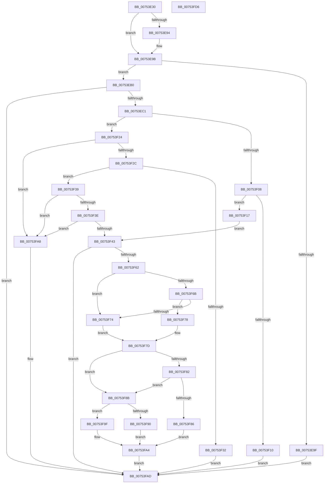

# PoGetLightestSystemStateForEject

- RVA: `0x00753E30`–`0x00753FD7` (길이 `423` bytes)
- VA: `0x0000000140753E30`
- 실행 섹션: `PAGE`
- PDB 이름 있음: `예`; PDB Function 태그: `아니요`
- unwind 정보 RVA: `0x000CBE34`
- 디코드: `125`개 명령, `423/423` bytes 표시
- 미해석 바이트: `0` (있으면 어셈블리에 `.byte`로 보존)

> 이 문서는 커널 이미지의 기계어와 PDB 기호를 분석해 생성했습니다. 4번과 5번은 함수 원형과 자료형을 바이너리 사용 방식에서 추정한 C 해석이며 원본 소스 복구 결과는 아닙니다.

## 1. Dependencies

- 직접 호출 지점: **6**; 고유 호출 대상: **6**
- 직접 호출자로 확인된 함수: **1**
- RIP 상대 이미지 참조: **2**

### Outgoing calls
- `0x00753EB4` → [PopOpenPowerKey](../../text/4B/PopOpenPowerKey_function_004B4314.md) (function, `0x004B4314`)
- `0x00753ECC` → [RtlInitUnicodeString](../../text/42/RtlInitUnicodeString_function_0042A780.md) (function, `0x0042A780`)
- `0x00753EF4` → [ZwQueryValueKey](../../text/6A/ZwQueryValueKey_function_006AD3B0.md) (function, `0x006AD3B0`)
- `0x00753EFF` → [ZwClose](../../text/6A/ZwClose_function_006AD2B0.md) (function, `0x006AD2B0`)
- `0x00753F57` → [ZwPowerInformation](../../text/6A/ZwPowerInformation_function_006ADCB0.md) (function, `0x006ADCB0`)
- `0x00753FB4` → [_security_check_cookie](../../text/6A/_security_check_cookie_function_006AC640.md) (function, `0x006AC640`)

### Direct callers
- [sub_00B33FE8](../B3/Unknown_function_00B33FE8.md) at `0x00B34424`

### Static image references
- `0x00753E4F` → RVA `0x00E0A740` (`.data`; read)
- `0x00753EC1` → RVA `0x000295E8` (`.rdata`; read)

## 2. Other-region calls and transfers

- 다른 실행 섹션으로 향하는 call: **6**
  - `0x00753EB4` → [PopOpenPowerKey](../../text/4B/PopOpenPowerKey_function_004B4314.md) (`PAGE` → `.text`)
  - `0x00753ECC` → [RtlInitUnicodeString](../../text/42/RtlInitUnicodeString_function_0042A780.md) (`PAGE` → `.text`)
  - `0x00753EF4` → [ZwQueryValueKey](../../text/6A/ZwQueryValueKey_function_006AD3B0.md) (`PAGE` → `.text`)
  - `0x00753EFF` → [ZwClose](../../text/6A/ZwClose_function_006AD2B0.md) (`PAGE` → `.text`)
  - `0x00753F57` → [ZwPowerInformation](../../text/6A/ZwPowerInformation_function_006ADCB0.md) (`PAGE` → `.text`)
  - `0x00753FB4` → [_security_check_cookie](../../text/6A/_security_check_cookie_function_006AC640.md) (`PAGE` → `.text`)
- 별도 외부 분기/꼬리 이동을 확인하지 못했습니다.

## 3. Assembly (complete function range)

```asm
00753E30  48 8B C4                        mov rax, rsp
00753E33  48 89 58 08                     mov qword ptr [rax + 8], rbx
00753E37  48 89 70 10                     mov qword ptr [rax + 0x10], rsi
00753E3B  48 89 78 18                     mov qword ptr [rax + 0x18], rdi
00753E3F  55                              push rbp
00753E40  41 54                           push r12
00753E42  41 56                           push r14
00753E44  48 8D 68 A1                     lea rbp, [rax - 0x5f]
00753E48  48 81 EC A0 00 00 00            sub rsp, 0xa0
00753E4F  48 8B 05 EA 68 6B 00            mov rax, qword ptr [rip + 0x6b68ea]
00753E56  48 33 C4                        xor rax, rsp
00753E59  48 89 45 37                     mov qword ptr [rbp + 0x37], rax
00753E5D  48 83 65 DF 00                  and qword ptr [rbp - 0x21], 0
00753E62  0F 57 C0                        xorps xmm0, xmm0
00753E65  83 65 D7 00                     and dword ptr [rbp - 0x29], 0
00753E69  49 8B F9                        mov rdi, r9
00753E6C  41 83 21 00                     and dword ptr [r9], 0
00753E70  45 8A F0                        mov r14b, r8b
00753E73  0F B6 DA                        movzx ebx, dl
00753E76  41 BC 01 00 00 00               mov r12d, 1
00753E7C  0F 11 45 17                     movups xmmword ptr [rbp + 0x17], xmm0
00753E80  0F 11 45 27                     movups xmmword ptr [rbp + 0x27], xmm0
00753E84  0F 11 45 E7                     movups xmmword ptr [rbp - 0x19], xmm0
00753E88  0F 11 45 F7                     movups xmmword ptr [rbp - 9], xmm0
00753E8C  0F 11 45 07                     movups xmmword ptr [rbp + 7], xmm0
00753E90  84 D2                           test dl, dl
00753E92  75 07                           jne 0x140753e9b
00753E94  45 84 C0                        test r8b, r8b
00753E97  41 0F 44 DC                     cmove ebx, r12d
00753E9B  84 C9                           test cl, cl
00753E9D  75 11                           jne 0x140753eb0
00753E9F  F6 DB                           neg bl
00753EA1  1B C0                           sbb eax, eax
00753EA3  83 C0 02                        add eax, 2
00753EA6  41 89 01                        mov dword ptr [r9], eax
00753EA9  33 C0                           xor eax, eax
00753EAB  E9 FD 00 00 00                  jmp 0x140753fad
00753EB0  48 8D 4D DF                     lea rcx, [rbp - 0x21]
00753EB4  E8 5B 04 D6 FF                  call 0x1404b4314
00753EB9  85 C0                           test eax, eax
00753EBB  0F 88 EC 00 00 00               js 0x140753fad
00753EC1  48 8D 15 20 57 8D FF            lea rdx, [rip - 0x72a8e0]
00753EC8  48 8D 4D E7                     lea rcx, [rbp - 0x19]
00753ECC  E8 AF 68 CD FF                  call 0x14042a780
00753ED1  48 8B 4D DF                     mov rcx, qword ptr [rbp - 0x21]
00753ED5  48 8D 45 D7                     lea rax, [rbp - 0x29]
00753ED9  48 89 44 24 28                  mov qword ptr [rsp + 0x28], rax
00753EDE  4C 8D 4D F7                     lea r9, [rbp - 9]
00753EE2  41 B8 02 00 00 00               mov r8d, 2
00753EE8  C7 44 24 20 20 00 00 00         mov dword ptr [rsp + 0x20], 0x20
00753EF0  48 8D 55 E7                     lea rdx, [rbp - 0x19]
00753EF4  E8 B7 94 F5 FF                  call 0x1406ad3b0
00753EF9  48 8B 4D DF                     mov rcx, qword ptr [rbp - 0x21]
00753EFD  8B F0                           mov esi, eax
00753EFF  E8 AC 93 F5 FF                  call 0x1406ad2b0
00753F04  85 F6                           test esi, esi
00753F06  79 1C                           jns 0x140753f24
00753F08  81 FE 34 00 00 C0               cmp esi, 0xc0000034
00753F0E  74 07                           je 0x140753f17
00753F10  8B C6                           mov eax, esi
00753F12  E9 96 00 00 00                  jmp 0x140753fad
00753F17  83 65 0F 00                     and dword ptr [rbp + 0xf], 0
00753F1B  C7 45 0B 0A 00 00 00            mov dword ptr [rbp + 0xb], 0xa
00753F22  EB 1F                           jmp 0x140753f43
00753F24  8B 45 FF                        mov eax, dword ptr [rbp - 1]
00753F27  83 F8 08                        cmp eax, 8
00753F2A  72 7C                           jb 0x140753fa8
00753F2C  44 39 65 03                     cmp dword ptr [rbp + 3], r12d
00753F30  74 07                           je 0x140753f39
00753F32  B8 01 00 00 C0                  mov eax, 0xc0000001
00753F37  EB 74                           jmp 0x140753fad
00753F39  83 F8 10                        cmp eax, 0x10
00753F3C  72 6A                           jb 0x140753fa8
00753F3E  39 45 07                        cmp dword ptr [rbp + 7], eax
00753F41  75 65                           jne 0x140753fa8
00753F43  33 D2                           xor edx, edx
00753F45  C7 44 24 20 20 00 00 00         mov dword ptr [rsp + 0x20], 0x20
00753F4D  4C 8D 4D 17                     lea r9, [rbp + 0x17]
00753F51  45 33 C0                        xor r8d, r8d
00753F54  8D 4A 05                        lea ecx, [rdx + 5]
00753F57  E8 54 9D F5 FF                  call 0x1406adcb0
00753F5C  8B C8                           mov ecx, eax
00753F5E  85 C0                           test eax, eax
00753F60  78 4B                           js 0x140753fad
00753F62  44 8B 45 1F                     mov r8d, dword ptr [rbp + 0x1f]
00753F66  45 85 C0                        test r8d, r8d
00753F69  74 09                           je 0x140753f74
00753F6B  6B 45 23 64                     imul eax, dword ptr [rbp + 0x23], 0x64
00753F6F  3B 45 23                        cmp eax, dword ptr [rbp + 0x23]
00753F72  77 04                           ja 0x140753f78
00753F74  33 C0                           xor eax, eax
00753F76  EB 05                           jmp 0x140753f7d
00753F78  33 D2                           xor edx, edx
00753F7A  41 F7 F0                        div r8d
00753F7D  3B 45 0B                        cmp eax, dword ptr [rbp + 0xb]
00753F80  72 09                           jb 0x140753f8b
00753F82  84 DB                           test bl, bl
00753F84  74 05                           je 0x140753f8b
00753F86  44 89 27                        mov dword ptr [rdi], r12d
00753F89  EB 19                           jmp 0x140753fa4
00753F8B  45 84 F6                        test r14b, r14b
00753F8E  74 0F                           je 0x140753f9f
00753F90  3B 45 0F                        cmp eax, dword ptr [rbp + 0xf]
00753F93  1B C0                           sbb eax, eax
00753F95  83 E0 03                        and eax, 3
00753F98  83 C0 02                        add eax, 2
00753F9B  89 07                           mov dword ptr [rdi], eax
00753F9D  EB 05                           jmp 0x140753fa4
00753F9F  B9 DE 02 00 C0                  mov ecx, 0xc00002de
00753FA4  8B C1                           mov eax, ecx
00753FA6  EB 05                           jmp 0x140753fad
00753FA8  B8 4C 01 00 C0                  mov eax, 0xc000014c
00753FAD  48 8B 4D 37                     mov rcx, qword ptr [rbp + 0x37]
00753FB1  48 33 CC                        xor rcx, rsp
00753FB4  E8 87 86 F5 FF                  call 0x1406ac640
00753FB9  4C 8D 9C 24 A0 00 00 00         lea r11, [rsp + 0xa0]
00753FC1  49 8B 5B 20                     mov rbx, qword ptr [r11 + 0x20]
00753FC5  49 8B 73 28                     mov rsi, qword ptr [r11 + 0x28]
00753FC9  49 8B 7B 30                     mov rdi, qword ptr [r11 + 0x30]
00753FCD  49 8B E3                        mov rsp, r11
00753FD0  41 5E                           pop r14
00753FD2  41 5C                           pop r12
00753FD4  5D                              pop rbp
00753FD5  C3                              ret
00753FD6  CC                              int3
```

## 4. C-style interpretation (structured pseudocode)

```c
__int64 __fastcall PoGetLightestSystemStateForEject(unsigned __int8 a1, unsigned __int8 a2, unsigned __int8 a3, __int64 a4)
{
    __int64 result;
    __int64 v_rbx;
    __int64 v_rsp;
    unsigned __int64 v_stack_m18;
    unsigned __int64 v_stack_m90;
    unsigned int v_stack_m98;

    *(unsigned __int64 *)(v_rsp + 8) = v_rbx;
    *(unsigned __int64 *)(v_rsp + 16) = v_rsi;
    *(unsigned __int64 *)(v_rsp + 24) = v_rdi;
    v_rsp = (v_rsp) - (160);
    result = (*(unsigned __int64 *)(v_rip + 7039210)) ^ (v_rsp);
    *(unsigned __int64 *)(v_rsp - 95 + 55) = result;
    *(unsigned __int64 *)(v_rsp - 95 + 23) = v_xmm0;
    *(unsigned __int64 *)(v_rsp - 95 + 39) = v_xmm0;
    *(unsigned __int64 *)(v_rsp - 95 - 25) = v_xmm0;
    *(unsigned __int64 *)(v_rsp - 95 - 9) = v_xmm0;
    *(unsigned __int64 *)(v_rsp - 95 + 7) = v_xmm0;
    if (a2 == 0) {
        if (a3 == 0) { a2 = 1; }
    }
    if (a1 != 0) goto loc_00753EB0;
    v_rbx = (unsigned __int8)(-(a2));
    result = (unsigned int)((result) + (2));
    *(unsigned int *)(a4) = (unsigned int)(result);
    result = 0;
    goto loc_00753FAD;
loc_00753EB0:
    result = PopOpenPowerKey(v_rsp - 95 - 33, a2, a3, a4);
    if (sign_flag) goto loc_00753FAD;
    result = RtlInitUnicodeString(v_rsp - 95 - 25, v_rip - 7514336, a3, a4);
    v_stack_m90 = v_rsp - 95 - 41;
    v_stack_m98 = 32;
    result = ZwQueryValueKey(*(unsigned __int64 *)(v_rsp - 95 - 33), v_rsp - 95 - 25, 2, v_rsp - 95 - 9);
    result = ZwClose(*(unsigned __int64 *)(v_rsp - 95 - 33), v_rsp - 95 - 25, 2, v_rsp - 95 - 9);
    if (!sign_flag) goto loc_00753F24;
    if (((unsigned int)((unsigned int)((unsigned int)(result)))) == 0xC0000034ULL) goto loc_00753F17;
    goto loc_00753FAD;
loc_00753F17:
    *(unsigned int *)(v_rsp - 95 + 11) = 10;
    goto loc_00753F43;
loc_00753F24:
    if (((unsigned int)((unsigned int)(*(unsigned int *)(v_rsp - 95 - 1)))) < 8) goto loc_00753FA8;
    if ((*(unsigned int *)(v_rsp - 95 + 3)) == 1) goto loc_00753F39;
    goto loc_00753FAD;
loc_00753F39:
    if (((unsigned int)((unsigned int)(0xC0000001ULL))) < 16) goto loc_00753FA8;
    if ((*(unsigned int *)(v_rsp - 95 + 7)) != ((unsigned int)((unsigned int)(0xC0000001ULL)))) goto loc_00753FA8;
loc_00753F43:
    a2 = 0;
    v_stack_m98 = 32;
    a3 = 0;
    result = ZwPowerInformation(a2 + 5, a2, a3, v_rsp - 95 + 23);
    if (sign_flag) goto loc_00753FAD;
    if ((unsigned int)((unsigned int)(*(unsigned int *)(v_rsp - 95 + 31))) == 0) goto loc_00753F74;
    result = (unsigned int)((result) * (*(unsigned int *)(v_rsp - 95 + 35)));
    if (((unsigned int)(result)) > (*(unsigned int *)(v_rsp - 95 + 35))) goto loc_00753F78;
loc_00753F74:
    result = 0;
    goto loc_00753F7D;
loc_00753F78:
    a2 = 0;
loc_00753F7D:
    if (0 < (*(unsigned int *)(v_rsp - 95 + 11))) goto loc_00753F8B;
    if ((unsigned __int8)(v_rbx) == 0) goto loc_00753F8B;
    *(unsigned int *)(a4) = 1;
    goto loc_00753FA4;
loc_00753F8B:
    if (0 == 0) goto loc_00753F9F;
    result = (unsigned int)((result) & (3));
    result = (unsigned int)((result) + (2));
    *(unsigned int *)(a4) = (unsigned int)(result);
    goto loc_00753FA4;
loc_00753F9F:
loc_00753FA4:
    goto loc_00753FAD;
loc_00753FA8:
loc_00753FAD:
    a1 = (*(unsigned __int64 *)(v_rsp - 95 + 55)) ^ (v_rsp);
    result = _security_check_cookie(a1, a2, (unsigned int)(*(unsigned int *)(v_rsp - 95 + 31)), v_rsp - 95 + 23);
    return result;
}
```

## 5. (Beta) C Style

```c
int64_t PoGetLightestSystemStateForEject(uint8_t Arg1, uint8_t Arg2, uint8_t Arg3, void *Arg4)
{
    uint8_t *arg4 = (uint8_t *)Arg4;

    int64_t result;
    int64_t local_rbx;
    int64_t local_rsp;
    uint64_t v_stack_m18;
    uint64_t v_stack_m90;
    uint32_t v_stack_m98;

    *(uint64_t *)(local_rsp + 0x8) = local_rbx;
    *(uint64_t *)(local_rsp + 0x10) = local_rsi;
    *(uint64_t *)(local_rsp + 0x18) = local_rdi;
    local_rsp = (local_rsp) - (160);
    result = (*(uint64_t *)(v_rip + 0x6B68EA)) ^ (local_rsp);
    *(uint64_t *)(local_rsp - 0x5F + 0x37) = result;
    *(uint64_t *)(local_rsp - 0x5F + 0x17) = v_xmm0;
    *(uint64_t *)(local_rsp - 0x5F + 0x27) = v_xmm0;
    *(uint64_t *)(local_rsp - 0x5F - 0x19) = v_xmm0;
    *(uint64_t *)(local_rsp - 0x5F - 0x9) = v_xmm0;
    *(uint64_t *)(local_rsp - 0x5F + 0x7) = v_xmm0;
    if (Arg2 == 0) {
        if (Arg3 == 0) { Arg2 = 1; }
    }
    if (Arg1 != 0) goto loc_00753EB0;
    local_rbx = (uint8_t)(-(Arg2));
    result = (uint32_t)((result) + (2));
    *(uint32_t *)(arg4) = (uint32_t)(result);
    result = 0;
    goto loc_00753FAD;
loc_00753EB0:
    result = PopOpenPowerKey(local_rsp - 95 - 33, Arg2, Arg3, Arg4);
    if (sign_flag) goto loc_00753FAD;
    result = RtlInitUnicodeString(local_rsp - 95 - 25, v_rip - 7514336, Arg3, Arg4);
    v_stack_m90 = local_rsp - 95 - 41;
    v_stack_m98 = 32;
    result = ZwQueryValueKey(*(uint64_t *)(local_rsp - 0x5F - 0x21), local_rsp - 95 - 25, 2, local_rsp - 95 - 9);
    result = ZwClose(*(uint64_t *)(local_rsp - 0x5F - 0x21), local_rsp - 95 - 25, 2, local_rsp - 95 - 9);
    if (!sign_flag) goto loc_00753F24;
    if (((uint32_t)((uint32_t)((uint32_t)(result)))) == 0xC0000034ULL) goto loc_00753F17;
    goto loc_00753FAD;
loc_00753F17:
    *(uint32_t *)(local_rsp - 0x5F + 0xB) = 10;
    goto loc_00753F43;
loc_00753F24:
    if (((uint32_t)((uint32_t)(*(uint32_t *)(local_rsp - 0x5F - 0x1)))) < 8) goto loc_00753FA8;
    if ((*(uint32_t *)(local_rsp - 0x5F + 0x3)) == 1) goto loc_00753F39;
    goto loc_00753FAD;
loc_00753F39:
    if (((uint32_t)((uint32_t)(0xC0000001ULL))) < 16) goto loc_00753FA8;
    if ((*(uint32_t *)(local_rsp - 0x5F + 0x7)) != ((uint32_t)((uint32_t)(0xC0000001ULL)))) goto loc_00753FA8;
loc_00753F43:
    Arg2 = 0;
    v_stack_m98 = 32;
    Arg3 = 0;
    result = ZwPowerInformation(Arg2 + 5, Arg2, Arg3, local_rsp - 95 + 23);
    if (sign_flag) goto loc_00753FAD;
    if ((uint32_t)((uint32_t)(*(uint32_t *)(local_rsp - 0x5F + 0x1F))) == 0) goto loc_00753F74;
    result = (uint32_t)((result) * (*(uint32_t *)(local_rsp - 0x5F + 0x23)));
    if (((uint32_t)(result)) > (*(uint32_t *)(local_rsp - 0x5F + 0x23))) goto loc_00753F78;
loc_00753F74:
    result = 0;
    goto loc_00753F7D;
loc_00753F78:
    Arg2 = 0;
loc_00753F7D:
    if (0 < (*(uint32_t *)(local_rsp - 0x5F + 0xB))) goto loc_00753F8B;
    if ((uint8_t)(local_rbx) == 0) goto loc_00753F8B;
    *(uint32_t *)(arg4) = 1;
    goto loc_00753FA4;
loc_00753F8B:
    if (0 == 0) goto loc_00753F9F;
    result = (uint32_t)((result) & (3));
    result = (uint32_t)((result) + (2));
    *(uint32_t *)(arg4) = (uint32_t)(result);
    goto loc_00753FA4;
loc_00753F9F:
loc_00753FA4:
    goto loc_00753FAD;
loc_00753FA8:
loc_00753FAD:
    Arg1 = (*(uint64_t *)(local_rsp - 0x5F + 0x37)) ^ (local_rsp);
    result = _security_check_cookie(Arg1, Arg2, (uint32_t)(*(uint32_t *)(local_rsp - 0x5F + 0x1F)), local_rsp - 95 + 23);
    return result;
}
```

### 관측된 메모리 오프셋

구조체 형식이 확인되지 않은 접근은 인자 기준의 오프셋으로만 기록했습니다.

| 기준 인자 | 오프셋 표현 | 폭 (bit) | 접근 |
|---|---:|---:|---|
| `Arg4` | `+ 0x0` | `32` | `R/W` |
| `Arg4` | `+ 0x0` | `32` | `W` |

## 6. Execution-region graph

[열기: 2D/3D 그래프와 함수 탐색 컨트롤 패널](../../../control-panel.html?section=page&rva=0x00753E30&view=graph)

- 2D 그래프는 위에서 아래로 흐르고, 3D 그래프는 빈 공간을 드래그해 회전합니다. Shift+드래그는 이동, 휠은 확대·축소, 함수 노드 선택은 대상 보고서 이동입니다.

### Static fallback


