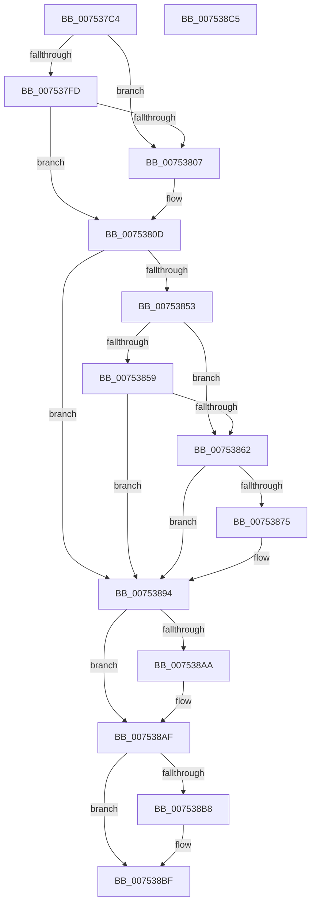

# PoInitHiberServices

- RVA: `0x007537C4`–`0x007538C6` (길이 `258` bytes)
- VA: `0x00000001407537C4`
- 실행 섹션: `PAGE`
- PDB 이름 있음: `예`; PDB Function 태그: `아니요`
- unwind 정보 RVA: `0x0008A2E0`
- 디코드: `66`개 명령, `258/258` bytes 표시
- 미해석 바이트: `0` (있으면 어셈블리에 `.byte`로 보존)

> 이 문서는 커널 이미지의 기계어와 PDB 기호를 분석해 생성했습니다. 4번과 5번은 함수 원형과 자료형을 바이너리 사용 방식에서 추정한 C 해석이며 원본 소스 복구 결과는 아닙니다.

## 1. Dependencies

- 직접 호출 지점: **18**; 고유 호출 대상: **18**
- 직접 호출자로 확인된 함수: **1**
- RIP 상대 이미지 참조: **8**

### Outgoing calls
- `0x007537E6` → [RtlInitUnicodeString](../../text/42/RtlInitUnicodeString_function_0042A780.md) (function, `0x0042A780`)
- `0x007537EB` → [PopInitializeHibernateGlobals](PopInitializeHibernateGlobals_function_0075DA64.md) (function, `0x0075DA64`)
- `0x00753812` → [PopAcquireTransitionLock](../AA/PopAcquireTransitionLock_function_00AA9E7C.md) (function, `0x00AA9E7C`)
- `0x00753817` → [PopAcquirePolicyLock](../../pagelk/B7/PopAcquirePolicyLock_function_00B783C0.md) (function, `0x00B783C0`)
- `0x0075382B` → [PopHibernateEvaluation](../90/PopHibernateEvaluation_function_0090F7B0.md) (function, `0x0090F7B0`)
- `0x00753830` → [PopReleasePolicyLock](../../pagelk/B7/PopReleasePolicyLock_function_00B78410.md) (function, `0x00B78410`)
- `0x0075383A` → [PopReleaseTransitionLock](../AB/PopReleaseTransitionLock_function_00ABDABC.md) (function, `0x00ABDABC`)
- `0x00753845` → [PopTraceHibernatePolicyUpdate](../76/PopTraceHibernatePolicyUpdate_function_00763B18.md) (function, `0x00763B18`)
- `0x0075384A` → [ExIsSoftBoot](../../text/4F/ExIsSoftBoot_function_004FAE60.md) (function, `0x004FAE60`)
- `0x0075386C` → [BcdOpenStore](../A4/BcdOpenStore_function_00A4116C.md) (function, `0x00A4116C`)
- `0x0075387F` → [PopBcdEstablishResumeObject](../77/PopBcdEstablishResumeObject_function_007700E4.md) (function, `0x007700E4`)
- `0x00753887` → [PopBcdClearPendingResume](../A3/PopBcdClearPendingResume_function_00A3E07C.md) (function, `0x00A3E07C`)
- `0x0075388F` → [BcdCloseStore](../A3/BcdCloseStore_function_00A3C68C.md) (function, `0x00A3C68C`)
- `0x00753894` → [PopSubscribeHibernatePolicyWnf](PopSubscribeHibernatePolicyWnf_function_0075DF6C.md) (function, `0x0075DF6C`)
- `0x00753899` → [PopAdaptiveClearInitialSystemPowerState](../76/PopAdaptiveClearInitialSystemPowerState_function_0076B55C.md) (function, `0x0076B55C`)
- `0x007538AA` → [guard_dispatch_icall](../../text/6B/guard_dispatch_icall_function_006BAAD0.md) (function, `0x006BAAD0`)
- `0x007538AF` → [Feature_Servicing_GamingHandheldPowBtnFilter__private_IsEnabledDeviceUsageNoInline](../../text/5C/Feature_Servicing_GamingHandheldPowBtnFilter__private_IsEnabledDeviceUsageNoInline_function_005CE2F4.md) (function, `0x005CE2F4`)
- `0x007538BA` → [PopUpdateDeviceFamily](PopUpdateDeviceFamily_function_007546D0.md) (function, `0x007546D0`)

### Direct callers
- [CmCompleteRegistryInitialization](../7D/CmCompleteRegistryInitialization_function_007DF1EC.md) at `0x007DF33C`

### Static image references
- `0x007537D3` → RVA `0x00B01960` (` ?? ::NNGAKEGL::`string'`; read)
- `0x007537DA` → RVA `0x00F0CFD0` (`.data`; read)
- `0x007537F0` → RVA `0x00FC5198` (`ALMOSTRO`; read)
- `0x007537FD` → RVA `0x00FC5298` (`ALMOSTRO`; read)
- `0x00753807` → RVA `0x00FC5074` (`ALMOSTRO`; write)
- `0x0075381C` → RVA `0x00FC510C` (`ALMOSTRO`; read)
- `0x00753859` → RVA `0x00FC6FC4` (`ALMOSTRO`; read)
- `0x0075389E` → RVA `0x00E67788` (`.data`; read)

## 2. Other-region calls and transfers

- 다른 실행 섹션으로 향하는 call: **6**
  - `0x007537E6` → [RtlInitUnicodeString](../../text/42/RtlInitUnicodeString_function_0042A780.md) (`PAGE` → `.text`)
  - `0x00753817` → [PopAcquirePolicyLock](../../pagelk/B7/PopAcquirePolicyLock_function_00B783C0.md) (`PAGE` → `PAGELK`)
  - `0x00753830` → [PopReleasePolicyLock](../../pagelk/B7/PopReleasePolicyLock_function_00B78410.md) (`PAGE` → `PAGELK`)
  - `0x0075384A` → [ExIsSoftBoot](../../text/4F/ExIsSoftBoot_function_004FAE60.md) (`PAGE` → `.text`)
  - `0x007538AA` → [guard_dispatch_icall](../../text/6B/guard_dispatch_icall_function_006BAAD0.md) (`PAGE` → `.text`)
  - `0x007538AF` → [Feature_Servicing_GamingHandheldPowBtnFilter__private_IsEnabledDeviceUsageNoInline](../../text/5C/Feature_Servicing_GamingHandheldPowBtnFilter__private_IsEnabledDeviceUsageNoInline_function_005CE2F4.md) (`PAGE` → `.text`)
- 별도 외부 분기/꼬리 이동을 확인하지 못했습니다.

## 3. Assembly (complete function range)

```asm
007537C4  88 4C 24 08                     mov byte ptr [rsp + 8], cl
007537C8  53                              push rbx
007537C9  48 83 EC 20                     sub rsp, 0x20
007537CD  48 83 64 24 38 00               and qword ptr [rsp + 0x38], 0
007537D3  48 8D 15 86 E1 3A 00            lea rdx, [rip + 0x3ae186]
007537DA  48 8D 0D EF 97 7B 00            lea rcx, [rip + 0x7b97ef]
007537E1  C6 44 24 30 00                  mov byte ptr [rsp + 0x30], 0
007537E6  E8 95 6F CD FF                  call 0x14042a780
007537EB  E8 74 A2 00 00                  call 0x14075da64
007537F0  8B 05 A2 19 87 00               mov eax, dword ptr [rip + 0x8719a2]
007537F6  83 C9 FF                        or ecx, 0xffffffff
007537F9  3B C1                           cmp eax, ecx
007537FB  75 0A                           jne 0x140753807
007537FD  8B 05 95 1A 87 00               mov eax, dword ptr [rip + 0x871a95]
00753803  3B C1                           cmp eax, ecx
00753805  74 06                           je 0x14075380d
00753807  89 05 67 18 87 00               mov dword ptr [rip + 0x871867], eax
0075380D  B9 02 00 00 00                  mov ecx, 2
00753812  E8 65 66 35 00                  call 0x140aa9e7c
00753817  E8 A4 4B 42 00                  call 0x140b783c0
0075381C  8B 1D EA 18 87 00               mov ebx, dword ptr [rip + 0x8718ea]
00753822  4C 8D 44 24 30                  lea r8, [rsp + 0x30]
00753827  B2 01                           mov dl, 1
00753829  8A CA                           mov cl, dl
0075382B  E8 80 BF 1B 00                  call 0x14090f7b0
00753830  E8 DB 4B 42 00                  call 0x140b78410
00753835  B9 02 00 00 00                  mov ecx, 2
0075383A  E8 7D A2 36 00                  call 0x140abdabc
0075383F  8A 54 24 30                     mov dl, byte ptr [rsp + 0x30]
00753843  8B CB                           mov ecx, ebx
00753845  E8 CE 02 01 00                  call 0x140763b18
0075384A  E8 11 76 DA FF                  call 0x1404fae60
0075384F  84 C0                           test al, al
00753851  75 41                           jne 0x140753894
00753853  38 44 24 30                     cmp byte ptr [rsp + 0x30], al
00753857  75 09                           jne 0x140753862
00753859  83 3D 64 37 87 00 00            cmp dword ptr [rip + 0x873764], 0
00753860  75 32                           jne 0x140753894
00753862  4C 8D 44 24 38                  lea r8, [rsp + 0x38]
00753867  BA 02 00 00 00                  mov edx, 2
0075386C  E8 FB D8 2E 00                  call 0x140a4116c
00753871  85 C0                           test eax, eax
00753873  78 1F                           js 0x140753894
00753875  48 8B 5C 24 38                  mov rbx, qword ptr [rsp + 0x38]
0075387A  33 D2                           xor edx, edx
0075387C  48 8B CB                        mov rcx, rbx
0075387F  E8 60 C8 01 00                  call 0x1407700e4
00753884  48 8B CB                        mov rcx, rbx
00753887  E8 F0 A7 2E 00                  call 0x140a3e07c
0075388C  48 8B CB                        mov rcx, rbx
0075388F  E8 F8 8D 2E 00                  call 0x140a3c68c
00753894  E8 D3 A6 00 00                  call 0x14075df6c
00753899  E8 BE 7C 01 00                  call 0x14076b55c
0075389E  48 8B 05 E3 3E 71 00            mov rax, qword ptr [rip + 0x713ee3]
007538A5  48 85 C0                        test rax, rax
007538A8  74 05                           je 0x1407538af
007538AA  E8 21 72 F6 FF                  call 0x1406baad0
007538AF  E8 40 AA E7 FF                  call 0x1405ce2f4
007538B4  85 C0                           test eax, eax
007538B6  74 07                           je 0x1407538bf
007538B8  33 C9                           xor ecx, ecx
007538BA  E8 11 0E 00 00                  call 0x1407546d0
007538BF  48 83 C4 20                     add rsp, 0x20
007538C3  5B                              pop rbx
007538C4  C3                              ret
007538C5  CC                              int3
```

## 4. C-style interpretation (structured pseudocode)

```c
__int64 __fastcall PoInitHiberServices(unsigned __int8 a1)
{
    __int64 result;
    __int64 v_rbx;
    __int64 v_rsp;
    unsigned __int64 v_stack_p10;
    unsigned __int8 v_stack_p8;

    v_stack_p8 = a1;
    v_rsp = (v_rsp) - (32);
    v_stack_p8 = 0;
    result = RtlInitUnicodeString(v_rip + 8099823, v_rip + 3858822, a3, a4);
    result = PopInitializeHibernateGlobals(v_rip + 8099823, v_rip + 3858822, a3, a4);
    a1 = (unsigned int)((v_rip + 8099823) | (0xFFFFFFFFULL));
    if (((unsigned int)((unsigned int)(*(unsigned int *)(v_rip + 8853922)))) != a1) goto loc_00753807;
    if (((unsigned int)((unsigned int)(*(unsigned int *)(v_rip + 8854165)))) != a1) {
        *(unsigned int *)(v_rip + 8853607) = (unsigned int)((unsigned int)(*(unsigned int *)(v_rip + 8854165)));
    }
    result = PopAcquireTransitionLock(2, v_rip + 3858822, a3, a4);
    result = PopAcquirePolicyLock(2, v_rip + 3858822, a3, a4);
    result = PopHibernateEvaluation(1, 1, v_stack_p8, a4);
    result = PopReleasePolicyLock(1, 1, v_stack_p8, a4);
    result = PopReleaseTransitionLock(2, 1, v_stack_p8, a4);
    result = PopTraceHibernatePolicyUpdate((unsigned int)((unsigned int)((unsigned int)(*(unsigned int *)(v_rip + 8853738)))), v_stack_p8, v_stack_p8, a4);
    result = ExIsSoftBoot((unsigned int)((unsigned int)((unsigned int)(*(unsigned int *)(v_rip + 8853738)))), v_stack_p8, v_stack_p8, a4);
    if ((unsigned __int8)(result) != 0) goto loc_00753894;
    if (v_stack_p8 != ((unsigned __int8)(result))) goto loc_00753862;
    if ((*(unsigned int *)(v_rip + 8861540)) != 0) goto loc_00753894;
loc_00753862:
    result = BcdOpenStore((unsigned int)((unsigned int)((unsigned int)(*(unsigned int *)(v_rip + 8853738)))), 2, v_stack_p10, a4);
    v_rbx = (unsigned int)(*(unsigned int *)(v_rip + 8853738));
    if (!(sign_flag)) {
        v_rbx = v_stack_p10;
        a2 = 0;
        a1 = v_rbx;
        result = PopBcdEstablishResumeObject(a1, a2, v_stack_p10, a4);
        a1 = v_rbx;
        result = PopBcdClearPendingResume(a1, a2, v_stack_p10, a4);
        a1 = v_rbx;
        result = BcdCloseStore(a1, a2, v_stack_p10, a4);
    }
    result = PopSubscribeHibernatePolicyWnf(a1, a2, v_stack_p10, a4);
    result = PopAdaptiveClearInitialSystemPowerState(a1, a2, v_stack_p10, a4);
    result = *(unsigned __int64 *)(v_rip + 7421667);
    if (*(unsigned __int64 *)(v_rip + 7421667) != 0) {
        result = guard_dispatch_icall(a1, a2, v_stack_p10, a4);
    }
    result = Feature_Servicing_GamingHandheldPowBtnFilter__private_IsEnabledDeviceUsageNoInline(a1, a2, v_stack_p10, a4);
    if ((unsigned int)(result) != 0) {
        a1 = 0;
        result = PopUpdateDeviceFamily(a1, a2, v_stack_p10, a4);
    }
    v_rsp = (v_rsp) + (32);
    return result;
}
```

## 5. (Beta) C Style

```c
int64_t PoInitHiberServices(uint8_t Arg1)
{
    int64_t result;
    int64_t local_rbx;
    int64_t local_rsp;
    uint64_t v_stack_p10;
    uint8_t v_stack_p8;

    v_stack_p8 = Arg1;
    local_rsp = (local_rsp) - (32);
    v_stack_p8 = 0;
    result = RtlInitUnicodeString(v_rip + 8099823, v_rip + 3858822, a3, a4);
    result = PopInitializeHibernateGlobals(v_rip + 8099823, v_rip + 3858822, a3, a4);
    Arg1 = (uint32_t)((v_rip + 8099823) | (0xFFFFFFFFULL));
    if (((uint32_t)((uint32_t)(*(uint32_t *)(v_rip + 0x8719A2)))) != Arg1) goto loc_00753807;
    if (((uint32_t)((uint32_t)(*(uint32_t *)(v_rip + 0x871A95)))) != Arg1) {
        *(uint32_t *)(v_rip + 0x871867) = (uint32_t)((uint32_t)(*(uint32_t *)(v_rip + 0x871A95)));
    }
    result = PopAcquireTransitionLock(2, v_rip + 3858822, a3, a4);
    result = PopAcquirePolicyLock(2, v_rip + 3858822, a3, a4);
    result = PopHibernateEvaluation(1, 1, v_stack_p8, a4);
    result = PopReleasePolicyLock(1, 1, v_stack_p8, a4);
    result = PopReleaseTransitionLock(2, 1, v_stack_p8, a4);
    result = PopTraceHibernatePolicyUpdate((uint32_t)((uint32_t)((uint32_t)(*(uint32_t *)(v_rip + 0x8718EA)))), v_stack_p8, v_stack_p8, a4);
    result = ExIsSoftBoot((uint32_t)((uint32_t)((uint32_t)(*(uint32_t *)(v_rip + 0x8718EA)))), v_stack_p8, v_stack_p8, a4);
    if ((uint8_t)(result) != 0) goto loc_00753894;
    if (v_stack_p8 != ((uint8_t)(result))) goto loc_00753862;
    if ((*(uint32_t *)(v_rip + 0x873764)) != 0) goto loc_00753894;
loc_00753862:
    result = BcdOpenStore((uint32_t)((uint32_t)((uint32_t)(*(uint32_t *)(v_rip + 0x8718EA)))), 2, v_stack_p10, a4);
    local_rbx = (uint32_t)(*(uint32_t *)(v_rip + 0x8718EA));
    if (!(sign_flag)) {
        local_rbx = v_stack_p10;
        a2 = 0;
        Arg1 = local_rbx;
        result = PopBcdEstablishResumeObject(Arg1, a2, v_stack_p10, a4);
        Arg1 = local_rbx;
        result = PopBcdClearPendingResume(Arg1, a2, v_stack_p10, a4);
        Arg1 = local_rbx;
        result = BcdCloseStore(Arg1, a2, v_stack_p10, a4);
    }
    result = PopSubscribeHibernatePolicyWnf(Arg1, a2, v_stack_p10, a4);
    result = PopAdaptiveClearInitialSystemPowerState(Arg1, a2, v_stack_p10, a4);
    result = *(uint64_t *)(v_rip + 0x713EE3);
    if (*(uint64_t *)(v_rip + 0x713EE3) != 0) {
        result = guard_dispatch_icall(Arg1, a2, v_stack_p10, a4);
    }
    result = Feature_Servicing_GamingHandheldPowBtnFilter__private_IsEnabledDeviceUsageNoInline(Arg1, a2, v_stack_p10, a4);
    if ((uint32_t)(result) != 0) {
        Arg1 = 0;
        result = PopUpdateDeviceFamily(Arg1, a2, v_stack_p10, a4);
    }
    local_rsp = (local_rsp) + (32);
    return result;
}
```

## 6. Execution-region graph

[열기: 2D/3D 그래프와 함수 탐색 컨트롤 패널](../../../control-panel.html?section=page&rva=0x007537C4&view=graph)

- 2D 그래프는 위에서 아래로 흐르고, 3D 그래프는 빈 공간을 드래그해 회전합니다. Shift+드래그는 이동, 휠은 확대·축소, 함수 노드 선택은 대상 보고서 이동입니다.

### Static fallback


