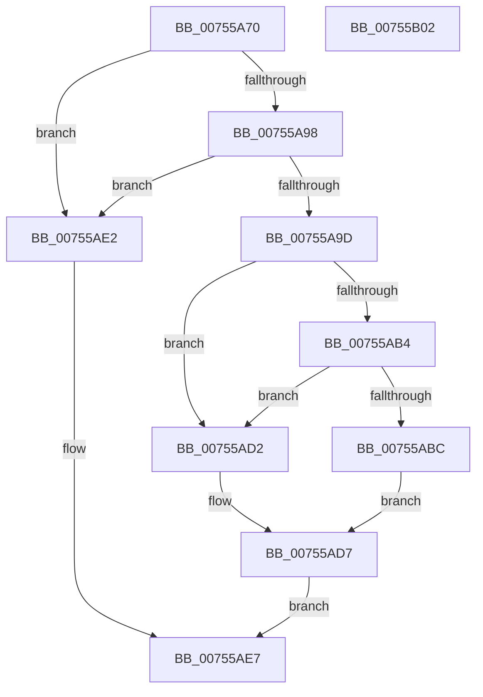

# PoQueryPowerLimitAttributes

- RVA: `0x00755A70`–`0x00755B03` (길이 `147` bytes)
- VA: `0x0000000140755A70`
- 실행 섹션: `PAGE`
- PDB 이름 있음: `예`; PDB Function 태그: `아니요`
- unwind 정보 RVA: `0x00060300`
- 디코드: `46`개 명령, `147/147` bytes 표시
- 미해석 바이트: `0` (있으면 어셈블리에 `.byte`로 보존)

> 이 문서는 커널 이미지의 기계어와 PDB 기호를 분석해 생성했습니다. 4번과 5번은 함수 원형과 자료형을 바이너리 사용 방식에서 추정한 C 해석이며 원본 소스 복구 결과는 아닙니다.

## 1. Dependencies

- 직접 호출 지점: **3**; 고유 호출 대상: **3**
- 직접 호출자로 확인된 함수: **0**
- RIP 상대 이미지 참조: **0**

### Outgoing calls
- `0x00755AA5` → [PopAcquireRwLockShared](../../text/2D/PopAcquireRwLockShared_function_002D9A40.md) (function, `0x002D9A40`)
- `0x00755ACB` → [memcpy](../../text/6C/memcpy_function_006C6840.md) (function, `0x006C6840`)
- `0x00755ADB` → [PopReleaseRwLock](../../text/2D/PopReleaseRwLock_function_002DFBBC.md) (function, `0x002DFBBC`)

### Direct callers
- 이 함수 시작 RVA로 연결되는 직접 call은 확인되지 않았습니다. 간접 호출은 완전히 역산할 수 없습니다.

### Static image references
- 디코드된 RIP-relative 메모리 참조가 없습니다.

## 2. Other-region calls and transfers

- 다른 실행 섹션으로 향하는 call: **3**
  - `0x00755AA5` → [PopAcquireRwLockShared](../../text/2D/PopAcquireRwLockShared_function_002D9A40.md) (`PAGE` → `.text`)
  - `0x00755ACB` → [memcpy](../../text/6C/memcpy_function_006C6840.md) (`PAGE` → `.text`)
  - `0x00755ADB` → [PopReleaseRwLock](../../text/2D/PopReleaseRwLock_function_002DFBBC.md) (`PAGE` → `.text`)
- 별도 외부 분기/꼬리 이동을 확인하지 못했습니다.

## 3. Assembly (complete function range)

```asm
00755A70  48 89 5C 24 08                  mov qword ptr [rsp + 8], rbx
00755A75  48 89 6C 24 10                  mov qword ptr [rsp + 0x10], rbp
00755A7A  48 89 74 24 18                  mov qword ptr [rsp + 0x18], rsi
00755A7F  57                              push rdi
00755A80  41 56                           push r14
00755A82  41 57                           push r15
00755A84  48 83 EC 20                     sub rsp, 0x20
00755A88  33 DB                           xor ebx, ebx
00755A8A  49 8B F1                        mov rsi, r9
00755A8D  4D 8B F0                        mov r14, r8
00755A90  44 8B FA                        mov r15d, edx
00755A93  48 85 C9                        test rcx, rcx
00755A96  74 4A                           je 0x140755ae2
00755A98  4D 85 C9                        test r9, r9
00755A9B  74 45                           je 0x140755ae2
00755A9D  48 8B 79 40                     mov rdi, qword ptr [rcx + 0x40]
00755AA1  48 8D 4F 20                     lea rcx, [rdi + 0x20]
00755AA5  E8 96 3F B8 FF                  call 0x1402d9a40
00755AAA  8B 47 48                        mov eax, dword ptr [rdi + 0x48]
00755AAD  89 06                           mov dword ptr [rsi], eax
00755AAF  4D 85 F6                        test r14, r14
00755AB2  74 1E                           je 0x140755ad2
00755AB4  8B 47 48                        mov eax, dword ptr [rdi + 0x48]
00755AB7  44 3B F8                        cmp r15d, eax
00755ABA  72 16                           jb 0x140755ad2
00755ABC  48 8B 57 50                     mov rdx, qword ptr [rdi + 0x50]
00755AC0  4C 8D 04 C0                     lea r8, [rax + rax*8]
00755AC4  49 C1 E0 02                     shl r8, 2
00755AC8  49 8B CE                        mov rcx, r14
00755ACB  E8 70 0D F7 FF                  call 0x1406c6840
00755AD0  EB 05                           jmp 0x140755ad7
00755AD2  BB 23 00 00 C0                  mov ebx, 0xc0000023
00755AD7  48 8D 4F 20                     lea rcx, [rdi + 0x20]
00755ADB  E8 DC A0 B8 FF                  call 0x1402dfbbc
00755AE0  EB 05                           jmp 0x140755ae7
00755AE2  BB 0D 00 00 C0                  mov ebx, 0xc000000d
00755AE7  48 8B 6C 24 48                  mov rbp, qword ptr [rsp + 0x48]
00755AEC  8B C3                           mov eax, ebx
00755AEE  48 8B 5C 24 40                  mov rbx, qword ptr [rsp + 0x40]
00755AF3  48 8B 74 24 50                  mov rsi, qword ptr [rsp + 0x50]
00755AF8  48 83 C4 20                     add rsp, 0x20
00755AFC  41 5F                           pop r15
00755AFE  41 5E                           pop r14
00755B00  5F                              pop rdi
00755B01  C3                              ret
00755B02  CC                              int3
```

## 4. C-style interpretation (structured pseudocode)

```c
__int64 __fastcall PoQueryPowerLimitAttributes(__int64 a1, int a2, __int64 a3, __int64 a4)
{
    __int64 result;
    __int64 v_rbx;
    __int64 v_rsp;
    unsigned __int64 v_stack_p10;
    unsigned __int64 v_stack_p18;
    unsigned __int64 v_stack_p8;

    v_stack_p8 = v_rbx;
    v_stack_p10 = v_rbp;
    v_stack_p18 = v_rsi;
    v_rsp = (v_rsp) - (32);
    v_rbx = 0;
    if (a1 == 0) goto loc_00755AE2;
    if (a4 == 0) goto loc_00755AE2;
    result = PopAcquireRwLockShared(*(unsigned __int64 *)(a1 + 64) + 32, a2, a3, a4);
    *(unsigned int *)(a4) = (unsigned int)((unsigned int)(*(unsigned int *)(*(unsigned __int64 *)(a1 + 64) + 72)));
    if (a3 == 0) goto loc_00755AD2;
    if (((unsigned int)((unsigned int)(a2))) < ((unsigned int)((unsigned int)(*(unsigned int *)(*(unsigned __int64 *)(a1 + 64) + 72))))) goto loc_00755AD2;
    a3 = ((unsigned int)(*(unsigned int *)(*(unsigned __int64 *)(a1 + 64) + 72)) + (unsigned int)(*(unsigned int *)(*(unsigned __int64 *)(a1 + 64) + 72)) * 8) << (2);
    result = memcpy(a3, *(unsigned __int64 *)(*(unsigned __int64 *)(a1 + 64) + 80), a3, a4);
    goto loc_00755AD7;
loc_00755AD2:
loc_00755AD7:
    result = PopReleaseRwLock(*(unsigned __int64 *)(a1 + 64) + 32, *(unsigned __int64 *)(*(unsigned __int64 *)(a1 + 64) + 80), a3, a4);
    goto loc_00755AE7;
loc_00755AE2:
loc_00755AE7:
    v_rsp = (v_rsp) + (32);
    return (unsigned int)((unsigned int)((unsigned int)(0xC000000DULL)));
}
```

## 5. (Beta) C Style

```c
int64_t PoQueryPowerLimitAttributes(int64_t Arg1, int32_t Arg2, int64_t Arg3, void *Arg4)
{
    uint8_t *arg4 = (uint8_t *)Arg4;

    int64_t result;
    int64_t local_rbx;
    int64_t local_rsp;
    uint64_t v_stack_p10;
    uint64_t v_stack_p18;
    uint64_t v_stack_p8;

    v_stack_p8 = local_rbx;
    v_stack_p10 = local_rbp;
    v_stack_p18 = local_rsi;
    local_rsp = (local_rsp) - (32);
    local_rbx = 0;
    if (Arg1 == 0) goto loc_00755AE2;
    if (Arg4 == NULL) goto loc_00755AE2;
    result = PopAcquireRwLockShared(*(uint64_t *)(Arg1 + 0x40) + 32, Arg2, Arg3, Arg4);
    *(uint32_t *)(arg4) = (uint32_t)((uint32_t)(*(uint32_t *)(*(uint64_t *)(Arg1 + 0x40) + 0x48)));
    if (Arg3 == 0) goto loc_00755AD2;
    if (((uint32_t)((uint32_t)(Arg2))) < ((uint32_t)((uint32_t)(*(uint32_t *)(*(uint64_t *)(Arg1 + 0x40) + 0x48))))) goto loc_00755AD2;
    Arg3 = ((uint32_t)(*(uint32_t *)(*(uint64_t *)(Arg1 + 0x40) + 0x48)) + (uint32_t)(*(uint32_t *)(*(uint64_t *)(Arg1 + 0x40) + 0x48)) * 8) << (2);
    result = memcpy(Arg3, *(uint64_t *)(*(uint64_t *)(Arg1 + 0x40) + 0x50), Arg3, Arg4);
    goto loc_00755AD7;
loc_00755AD2:
loc_00755AD7:
    result = PopReleaseRwLock(*(uint64_t *)(Arg1 + 0x40) + 32, *(uint64_t *)(*(uint64_t *)(Arg1 + 0x40) + 0x50), Arg3, Arg4);
    goto loc_00755AE7;
loc_00755AE2:
loc_00755AE7:
    local_rsp = (local_rsp) + (32);
    return (uint32_t)((uint32_t)((uint32_t)(0xC000000DULL)));
}
```

### 관측된 메모리 오프셋

구조체 형식이 확인되지 않은 접근은 인자 기준의 오프셋으로만 기록했습니다.

| 기준 인자 | 오프셋 표현 | 폭 (bit) | 접근 |
|---|---:|---:|---|
| `Arg4` | `+ 0x0` | `32` | `W` |

## 6. Execution-region graph

[열기: 2D/3D 그래프와 함수 탐색 컨트롤 패널](../../../control-panel.html?section=page&rva=0x00755A70&view=graph)

- 2D 그래프는 위에서 아래로 흐르고, 3D 그래프는 빈 공간을 드래그해 회전합니다. Shift+드래그는 이동, 휠은 확대·축소, 함수 노드 선택은 대상 보고서 이동입니다.

### Static fallback


