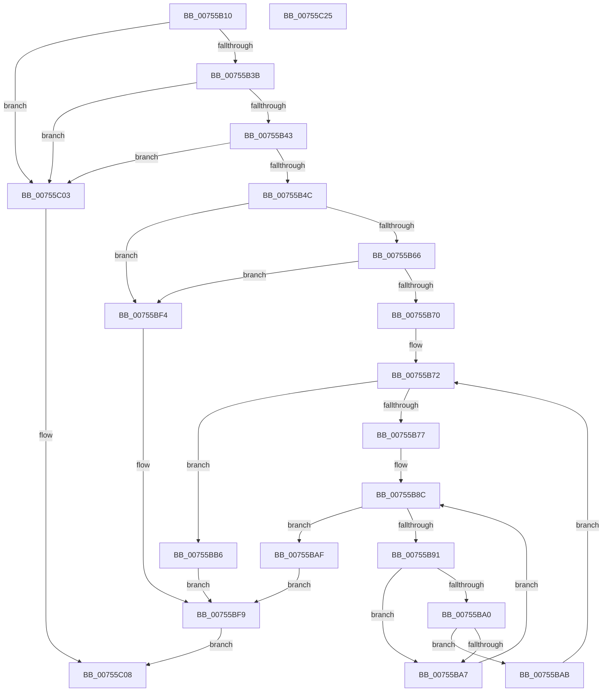

# PoQueryPowerLimitValue

- RVA: `0x00755B10`–`0x00755C26` (길이 `278` bytes)
- VA: `0x0000000140755B10`
- 실행 섹션: `PAGE`
- PDB 이름 있음: `예`; PDB Function 태그: `아니요`
- unwind 정보 RVA: `0x0005E6B4`
- 디코드: `77`개 명령, `278/278` bytes 표시
- 미해석 바이트: `0` (있으면 어셈블리에 `.byte`로 보존)

> 이 문서는 커널 이미지의 기계어와 PDB 기호를 분석해 생성했습니다. 4번과 5번은 함수 원형과 자료형을 바이너리 사용 방식에서 추정한 C 해석이며 원본 소스 복구 결과는 아닙니다.

## 1. Dependencies

- 직접 호출 지점: **6**; 고유 호출 대상: **4**
- 직접 호출자로 확인된 함수: **0**
- RIP 상대 이미지 참조: **0**

### Outgoing calls
- `0x00755B57` → [PopAcquireRwLockExclusive](../../text/43/PopAcquireRwLockExclusive_function_00430B44.md) (function, `0x00430B44`)
- `0x00755BBF` → [PopReleaseRwLock](../../text/2D/PopReleaseRwLock_function_002DFBBC.md) (function, `0x002DFBBC`)
- `0x00755BD5` → [guard_dispatch_icall](../../text/6B/guard_dispatch_icall_function_006BAAD0.md) (function, `0x006BAAD0`)
- `0x00755BDF` → [PopAcquireRwLockExclusive](../../text/43/PopAcquireRwLockExclusive_function_00430B44.md) (function, `0x00430B44`)
- `0x00755BED` → [PopPowerLimitUpdatePendingEvents](PopPowerLimitUpdatePendingEvents_function_007568D4.md) (function, `0x007568D4`)
- `0x00755BFC` → [PopReleaseRwLock](../../text/2D/PopReleaseRwLock_function_002DFBBC.md) (function, `0x002DFBBC`)

### Direct callers
- 이 함수 시작 RVA로 연결되는 직접 call은 확인되지 않았습니다. 간접 호출은 완전히 역산할 수 없습니다.

### Static image references
- 디코드된 RIP-relative 메모리 참조가 없습니다.

## 2. Other-region calls and transfers

- 다른 실행 섹션으로 향하는 call: **5**
  - `0x00755B57` → [PopAcquireRwLockExclusive](../../text/43/PopAcquireRwLockExclusive_function_00430B44.md) (`PAGE` → `.text`)
  - `0x00755BBF` → [PopReleaseRwLock](../../text/2D/PopReleaseRwLock_function_002DFBBC.md) (`PAGE` → `.text`)
  - `0x00755BD5` → [guard_dispatch_icall](../../text/6B/guard_dispatch_icall_function_006BAAD0.md) (`PAGE` → `.text`)
  - `0x00755BDF` → [PopAcquireRwLockExclusive](../../text/43/PopAcquireRwLockExclusive_function_00430B44.md) (`PAGE` → `.text`)
  - `0x00755BFC` → [PopReleaseRwLock](../../text/2D/PopReleaseRwLock_function_002DFBBC.md) (`PAGE` → `.text`)
- 별도 외부 분기/꼬리 이동을 확인하지 못했습니다.

## 3. Assembly (complete function range)

```asm
00755B10  48 8B C4                        mov rax, rsp
00755B13  48 89 58 08                     mov qword ptr [rax + 8], rbx
00755B17  48 89 68 10                     mov qword ptr [rax + 0x10], rbp
00755B1B  48 89 70 18                     mov qword ptr [rax + 0x18], rsi
00755B1F  48 89 78 20                     mov qword ptr [rax + 0x20], rdi
00755B23  41 56                           push r14
00755B25  48 83 EC 20                     sub rsp, 0x20
00755B29  49 8B E8                        mov rbp, r8
00755B2C  44 8B F2                        mov r14d, edx
00755B2F  48 8B D9                        mov rbx, rcx
00755B32  48 85 C9                        test rcx, rcx
00755B35  0F 84 C8 00 00 00               je 0x140755c03
00755B3B  85 D2                           test edx, edx
00755B3D  0F 84 C0 00 00 00               je 0x140755c03
00755B43  4D 85 C0                        test r8, r8
00755B46  0F 84 B7 00 00 00               je 0x140755c03
00755B4C  48 8B 79 40                     mov rdi, qword ptr [rcx + 0x40]
00755B50  48 8D 77 20                     lea rsi, [rdi + 0x20]
00755B54  48 8B CE                        mov rcx, rsi
00755B57  E8 E8 AF CD FF                  call 0x140430b44
00755B5C  80 7B 10 00                     cmp byte ptr [rbx + 0x10], 0
00755B60  0F 84 8E 00 00 00               je 0x140755bf4
00755B66  80 7F 30 00                     cmp byte ptr [rdi + 0x30], 0
00755B6A  0F 84 84 00 00 00               je 0x140755bf4
00755B70  33 C9                           xor ecx, ecx
00755B72  41 3B CE                        cmp ecx, r14d
00755B75  73 3F                           jae 0x140755bb6
00755B77  44 8B 4B 20                     mov r9d, dword ptr [rbx + 0x20]
00755B7B  8B C1                           mov eax, ecx
00755B7D  48 03 C0                        add rax, rax
00755B80  44 8B 5C C5 00                  mov r11d, dword ptr [rbp + rax*8]
00755B85  44 8B 54 C5 04                  mov r10d, dword ptr [rbp + rax*8 + 4]
00755B8A  33 C0                           xor eax, eax
00755B8C  41 3B C1                        cmp eax, r9d
00755B8F  73 1E                           jae 0x140755baf
00755B91  4C 8B 43 28                     mov r8, qword ptr [rbx + 0x28]
00755B95  8B D0                           mov edx, eax
00755B97  48 03 D2                        add rdx, rdx
00755B9A  45 3B 1C D0                     cmp r11d, dword ptr [r8 + rdx*8]
00755B9E  75 07                           jne 0x140755ba7
00755BA0  45 3B 54 D0 04                  cmp r10d, dword ptr [r8 + rdx*8 + 4]
00755BA5  74 04                           je 0x140755bab
00755BA7  FF C0                           inc eax
00755BA9  EB E1                           jmp 0x140755b8c
00755BAB  FF C1                           inc ecx
00755BAD  EB C3                           jmp 0x140755b72
00755BAF  BB BB 00 00 C0                  mov ebx, 0xc00000bb
00755BB4  EB 43                           jmp 0x140755bf9
00755BB6  FF 87 B4 00 00 00               inc dword ptr [rdi + 0xb4]
00755BBC  48 8B CE                        mov rcx, rsi
00755BBF  E8 F8 9F B8 FF                  call 0x1402dfbbc
00755BC4  48 8B 87 A8 00 00 00            mov rax, qword ptr [rdi + 0xa8]
00755BCB  4C 8B C5                        mov r8, rbp
00755BCE  48 8B 4F 78                     mov rcx, qword ptr [rdi + 0x78]
00755BD2  41 8B D6                        mov edx, r14d
00755BD5  E8 F6 4E F6 FF                  call 0x1406baad0
00755BDA  48 8B CE                        mov rcx, rsi
00755BDD  8B D8                           mov ebx, eax
00755BDF  E8 60 AF CD FF                  call 0x140430b44
00755BE4  FF 8F B4 00 00 00               dec dword ptr [rdi + 0xb4]
00755BEA  48 8B CF                        mov rcx, rdi
00755BED  E8 E2 0C 00 00                  call 0x1407568d4
00755BF2  EB 05                           jmp 0x140755bf9
00755BF4  BB 89 01 00 C0                  mov ebx, 0xc0000189
00755BF9  48 8B CE                        mov rcx, rsi
00755BFC  E8 BB 9F B8 FF                  call 0x1402dfbbc
00755C01  EB 05                           jmp 0x140755c08
00755C03  BB 0D 00 00 C0                  mov ebx, 0xc000000d
00755C08  48 8B 6C 24 38                  mov rbp, qword ptr [rsp + 0x38]
00755C0D  8B C3                           mov eax, ebx
00755C0F  48 8B 5C 24 30                  mov rbx, qword ptr [rsp + 0x30]
00755C14  48 8B 74 24 40                  mov rsi, qword ptr [rsp + 0x40]
00755C19  48 8B 7C 24 48                  mov rdi, qword ptr [rsp + 0x48]
00755C1E  48 83 C4 20                     add rsp, 0x20
00755C22  41 5E                           pop r14
00755C24  C3                              ret
00755C25  CC                              int3
```

## 4. C-style interpretation (structured pseudocode)

```c
__int64 __fastcall PoQueryPowerLimitValue(__int64 a1, int a2, __int64 a3)
{
    __int64 result;
    __int64 v_rsp;
    unsigned __int64 v_stack_p10;
    unsigned __int64 v_stack_p18;
    unsigned __int64 v_stack_p20;
    unsigned __int64 v_stack_p8;

    *(unsigned __int64 *)(v_rsp + 8) = v_rbx;
    *(unsigned __int64 *)(v_rsp + 16) = v_rbp;
    *(unsigned __int64 *)(v_rsp + 24) = v_rsi;
    *(unsigned __int64 *)(v_rsp + 32) = v_rdi;
    v_rsp = (v_rsp) - (32);
    if (a1 == 0) goto loc_00755C03;
    if (a2 == 0) goto loc_00755C03;
    if (a3 == 0) goto loc_00755C03;
    result = PopAcquireRwLockExclusive(*(unsigned __int64 *)(a1 + 64) + 32, a2, a3, a4);
    if ((*(unsigned __int8 *)(a1 + 16)) == 0) goto loc_00755BF4;
    if ((*(unsigned __int8 *)(*(unsigned __int64 *)(a1 + 64) + 48)) == 0) goto loc_00755BF4;
    a1 = 0;
loc_00755B72:
    if (0 >= ((unsigned int)((unsigned int)(a2)))) goto loc_00755BB6;
    result = (0) + (0);
    result = 0;
loc_00755B8C:
    if (0 >= ((unsigned int)((unsigned int)(*(unsigned int *)(a1 + 32))))) goto loc_00755BAF;
    a2 = (0) + (0);
    if (((unsigned int)((unsigned int)(*(unsigned int *)(a3 + result * 8)))) != (*(unsigned int *)(*(unsigned __int64 *)(a1 + 40) + a2 * 8))) goto loc_00755BA7;
    if (((unsigned int)((unsigned int)(*(unsigned int *)(a3 + result * 8 + 4)))) == (*(unsigned int *)(*(unsigned __int64 *)(a1 + 40) + a2 * 8 + 4))) goto loc_00755BAB;
loc_00755BA7:
    result = (unsigned int)((result) + 1);
    goto loc_00755B8C;
loc_00755BAB:
    a1 = (unsigned int)((a1) + 1);
    goto loc_00755B72;
loc_00755BAF:
    goto loc_00755BF9;
loc_00755BB6:
    result = PopReleaseRwLock(*(unsigned __int64 *)(a1 + 64) + 32, a2, *(unsigned __int64 *)(a1 + 40), (unsigned int)(*(unsigned int *)(a1 + 32)));
    result = guard_dispatch_icall(*(unsigned __int64 *)(*(unsigned __int64 *)(a1 + 64) + 120), (unsigned int)((unsigned int)((unsigned int)(a2))), a3, (unsigned int)(*(unsigned int *)(a1 + 32)));
    result = PopAcquireRwLockExclusive(*(unsigned __int64 *)(a1 + 64) + 32, (unsigned int)((unsigned int)((unsigned int)(a2))), a3, (unsigned int)(*(unsigned int *)(a1 + 32)));
    result = PopPowerLimitUpdatePendingEvents(*(unsigned __int64 *)(a1 + 64), (unsigned int)((unsigned int)((unsigned int)(a2))), a3, (unsigned int)(*(unsigned int *)(a1 + 32)));
    goto loc_00755BF9;
loc_00755BF4:
loc_00755BF9:
    result = PopReleaseRwLock(*(unsigned __int64 *)(a1 + 64) + 32, (unsigned int)((unsigned int)((unsigned int)(a2))), a3, (unsigned int)(*(unsigned int *)(a1 + 32)));
    goto loc_00755C08;
loc_00755C03:
loc_00755C08:
    v_rsp = (v_rsp) + (32);
    return (unsigned int)((unsigned int)((unsigned int)(0xC000000DULL)));
}
```

## 5. (Beta) C Style

```c
int64_t PoQueryPowerLimitValue(void *Arg1, int32_t Arg2, void *Arg3)
{
    uint8_t *arg1 = (uint8_t *)Arg1;
    uint8_t *arg3 = (uint8_t *)Arg3;

    int64_t result;
    int64_t local_rsp;
    uint64_t v_stack_p10;
    uint64_t v_stack_p18;
    uint64_t v_stack_p20;
    uint64_t v_stack_p8;

    *(uint64_t *)(local_rsp + 0x8) = local_rbx;
    *(uint64_t *)(local_rsp + 0x10) = local_rbp;
    *(uint64_t *)(local_rsp + 0x18) = local_rsi;
    *(uint64_t *)(local_rsp + 0x20) = local_rdi;
    local_rsp = (local_rsp) - (32);
    if (Arg1 == NULL) goto loc_00755C03;
    if (Arg2 == 0) goto loc_00755C03;
    if (Arg3 == NULL) goto loc_00755C03;
    result = PopAcquireRwLockExclusive(*(uint64_t *)(arg1 + 0x40) + 32, Arg2, Arg3, a4);
    if ((*(uint8_t *)(arg1 + 0x10)) == 0) goto loc_00755BF4;
    if ((*(uint8_t *)(*(uint64_t *)(arg1 + 0x40) + 0x30)) == 0) goto loc_00755BF4;
    Arg1 = 0;
loc_00755B72:
    if (0 >= ((uint32_t)((uint32_t)(Arg2)))) goto loc_00755BB6;
    result = (0) + (0);
    result = 0;
loc_00755B8C:
    if (0 >= ((uint32_t)((uint32_t)(*(uint32_t *)(arg1 + 0x20))))) goto loc_00755BAF;
    Arg2 = (0) + (0);
    if (((uint32_t)((uint32_t)(*(uint32_t *)(arg3 + result * 8)))) != (*(uint32_t *)(*(uint64_t *)(arg1 + 0x28) + Arg2 * 8))) goto loc_00755BA7;
    if (((uint32_t)((uint32_t)(*(uint32_t *)(arg3 + result * 8 + 0x4)))) == (*(uint32_t *)(*(uint64_t *)(arg1 + 0x28) + Arg2 * 8 + 0x4))) goto loc_00755BAB;
loc_00755BA7:
    result = (uint32_t)((result) + 1);
    goto loc_00755B8C;
loc_00755BAB:
    Arg1 = (uint32_t)((Arg1) + 1);
    goto loc_00755B72;
loc_00755BAF:
    goto loc_00755BF9;
loc_00755BB6:
    result = PopReleaseRwLock(*(uint64_t *)(arg1 + 0x40) + 32, Arg2, *(uint64_t *)(arg1 + 0x28), (uint32_t)(*(uint32_t *)(arg1 + 0x20)));
    result = guard_dispatch_icall(*(uint64_t *)(*(uint64_t *)(arg1 + 0x40) + 0x78), (uint32_t)((uint32_t)((uint32_t)(Arg2))), Arg3, (uint32_t)(*(uint32_t *)(arg1 + 0x20)));
    result = PopAcquireRwLockExclusive(*(uint64_t *)(arg1 + 0x40) + 32, (uint32_t)((uint32_t)((uint32_t)(Arg2))), Arg3, (uint32_t)(*(uint32_t *)(arg1 + 0x20)));
    result = PopPowerLimitUpdatePendingEvents(*(uint64_t *)(arg1 + 0x40), (uint32_t)((uint32_t)((uint32_t)(Arg2))), Arg3, (uint32_t)(*(uint32_t *)(arg1 + 0x20)));
    goto loc_00755BF9;
loc_00755BF4:
loc_00755BF9:
    result = PopReleaseRwLock(*(uint64_t *)(arg1 + 0x40) + 32, (uint32_t)((uint32_t)((uint32_t)(Arg2))), Arg3, (uint32_t)(*(uint32_t *)(arg1 + 0x20)));
    goto loc_00755C08;
loc_00755C03:
loc_00755C08:
    local_rsp = (local_rsp) + (32);
    return (uint32_t)((uint32_t)((uint32_t)(0xC000000DULL)));
}
```

### 관측된 메모리 오프셋

구조체 형식이 확인되지 않은 접근은 인자 기준의 오프셋으로만 기록했습니다.

| 기준 인자 | 오프셋 표현 | 폭 (bit) | 접근 |
|---|---:|---:|---|
| `Arg1` | `+ 0x10` | `8` | `R` |
| `Arg1` | `+ 0x20` | `32` | `R` |
| `Arg1` | `+ 0x28` | `64` | `R` |
| `Arg3` | `+ 0x0 + rax*8` | `32` | `R` |
| `Arg3` | `+ 0x4 + rax*8` | `32` | `R` |

## 6. Execution-region graph

[열기: 2D/3D 그래프와 함수 탐색 컨트롤 패널](../../../control-panel.html?section=page&rva=0x00755B10&view=graph)

- 2D 그래프는 위에서 아래로 흐르고, 3D 그래프는 빈 공간을 드래그해 회전합니다. Shift+드래그는 이동, 휠은 확대·축소, 함수 노드 선택은 대상 보고서 이동입니다.

### Static fallback


