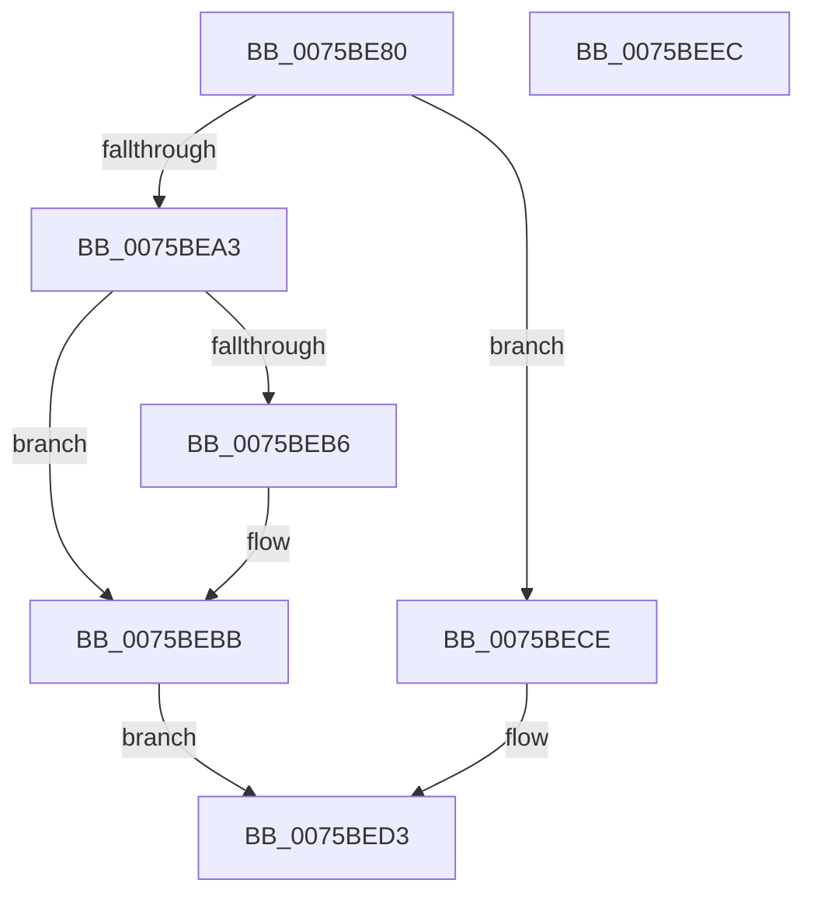

# PoQueueShutdownWorkItem

- RVA: `0x0075BE80`–`0x0075BEED` (길이 `109` bytes)
- VA: `0x000000014075BE80`
- 실행 섹션: `PAGE`
- PDB 이름 있음: `예`; PDB Function 태그: `아니요`
- unwind 정보 RVA: `0x0005CAAC`
- 디코드: `29`개 명령, `109/109` bytes 표시
- 미해석 바이트: `0` (있으면 어셈블리에 `.byte`로 보존)

> 이 문서는 커널 이미지의 기계어와 PDB 기호를 분석해 생성했습니다. 4번과 5번은 함수 원형과 자료형을 바이너리 사용 방식에서 추정한 C 해석이며 원본 소스 복구 결과는 아닙니다.

## 1. Dependencies

- 직접 호출 지점: **2**; 고유 호출 대상: **2**
- 직접 호출자로 확인된 함수: **0**
- RIP 상대 이미지 참조: **5**

### Outgoing calls
- `0x0075BE94` → [ExAcquireFastMutex](../../text/20/ExAcquireFastMutex_function_0020E5A0.md) (function, `0x0020E5A0`)
- `0x0075BEDA` → [ExReleaseFastMutex](../../text/25/ExReleaseFastMutex_function_002519C0.md) (function, `0x002519C0`)

### Direct callers
- 이 함수 시작 RVA로 연결되는 직접 call은 확인되지 않았습니다. 간접 호출은 완전히 역산할 수 없습니다.

### Static image references
- `0x0075BE8D` → RVA `0x00F0E0A0` (`.data`; read)
- `0x0075BE9B` → RVA `0x00E676D0` (`.data`; read)
- `0x0075BEA3` → RVA `0x00F0E0E8` (`.data`; read)
- `0x0075BEAA` → RVA `0x00F0E0E0` (`.data`; read)
- `0x0075BEC5` → RVA `0x00F0E0E8` (`.data`; write)

## 2. Other-region calls and transfers

- 다른 실행 섹션으로 향하는 call: **2**
  - `0x0075BE94` → [ExAcquireFastMutex](../../text/20/ExAcquireFastMutex_function_0020E5A0.md) (`PAGE` → `.text`)
  - `0x0075BEDA` → [ExReleaseFastMutex](../../text/25/ExReleaseFastMutex_function_002519C0.md) (`PAGE` → `.text`)
- 별도 외부 분기/꼬리 이동을 확인하지 못했습니다.

## 3. Assembly (complete function range)

```asm
0075BE80  48 89 5C 24 08                  mov qword ptr [rsp + 8], rbx
0075BE85  57                              push rdi
0075BE86  48 83 EC 20                     sub rsp, 0x20
0075BE8A  48 8B F9                        mov rdi, rcx
0075BE8D  48 8D 0D 0C 22 7B 00            lea rcx, [rip + 0x7b220c]
0075BE94  E8 07 27 AB FF                  call 0x14020e5a0
0075BE99  33 DB                           xor ebx, ebx
0075BE9B  38 1D 2F B8 70 00               cmp byte ptr [rip + 0x70b82f], bl
0075BEA1  74 2B                           je 0x14075bece
0075BEA3  48 8B 05 3E 22 7B 00            mov rax, qword ptr [rip + 0x7b223e]
0075BEAA  48 8D 0D 2F 22 7B 00            lea rcx, [rip + 0x7b222f]
0075BEB1  48 39 08                        cmp qword ptr [rax], rcx
0075BEB4  74 05                           je 0x14075bebb
0075BEB6  8D 4B 03                        lea ecx, [rbx + 3]
0075BEB9  CD 29                           int 0x29
0075BEBB  48 89 0F                        mov qword ptr [rdi], rcx
0075BEBE  48 89 47 08                     mov qword ptr [rdi + 8], rax
0075BEC2  48 89 38                        mov qword ptr [rax], rdi
0075BEC5  48 89 3D 1C 22 7B 00            mov qword ptr [rip + 0x7b221c], rdi
0075BECC  EB 05                           jmp 0x14075bed3
0075BECE  BB EB 02 00 C0                  mov ebx, 0xc00002eb
0075BED3  48 8D 0D C6 21 7B 00            lea rcx, [rip + 0x7b21c6]
0075BEDA  E8 E1 5A AF FF                  call 0x1402519c0
0075BEDF  8B C3                           mov eax, ebx
0075BEE1  48 8B 5C 24 30                  mov rbx, qword ptr [rsp + 0x30]
0075BEE6  48 83 C4 20                     add rsp, 0x20
0075BEEA  5F                              pop rdi
0075BEEB  C3                              ret
0075BEEC  CC                              int3
```

## 4. C-style interpretation (structured pseudocode)

```c
__int64 __fastcall PoQueueShutdownWorkItem(__int64 a1)
{
    __int64 result;
    __int64 v_rbx;
    __int64 v_rsp;
    unsigned __int64 v_stack_p8;

    v_stack_p8 = v_rbx;
    v_rsp = (v_rsp) - (32);
    result = ExAcquireFastMutex(v_rip + 8069644, a2, a3, a4);
    v_rbx = 0;
    if ((*(unsigned __int8 *)(v_rip + 7387183)) == 0) goto loc_0075BECE;
    if ((*(unsigned __int64 *)(*(unsigned __int64 *)(v_rip + 8069694))) != (v_rip + 8069679)) {
        a1 = v_rbx + 3;
    }
    *(unsigned __int64 *)(a1) = a1;
    *(unsigned __int64 *)(a1 + 8) = *(unsigned __int64 *)(v_rip + 8069694);
    *(unsigned __int64 *)(*(unsigned __int64 *)(v_rip + 8069694)) = a1;
    *(unsigned __int64 *)(v_rip + 8069660) = a1;
    goto loc_0075BED3;
loc_0075BECE:
loc_0075BED3:
    result = ExReleaseFastMutex(v_rip + 8069574, a2, a3, a4);
    v_rsp = (v_rsp) + (32);
    return (unsigned int)((unsigned int)((unsigned int)(0xC00002EBULL)));
}
```

## 5. (Beta) C Style

```c
int64_t PoQueueShutdownWorkItem(void *Arg1)
{
    uint8_t *arg1 = (uint8_t *)Arg1;

    int64_t result;
    int64_t local_rbx;
    int64_t local_rsp;
    uint64_t v_stack_p8;

    v_stack_p8 = local_rbx;
    local_rsp = (local_rsp) - (32);
    result = ExAcquireFastMutex(v_rip + 8069644, a2, a3, a4);
    local_rbx = 0;
    if ((*(uint8_t *)(v_rip + 0x70B82F)) == 0) goto loc_0075BECE;
    if ((*(uint64_t *)(*(uint64_t *)(v_rip + 0x7B223E))) != (v_rip + 8069679)) {
        Arg1 = local_rbx + 3;
    }
    *(void **)(arg1) = Arg1;
    *(uint64_t *)(arg1 + 0x8) = *(uint64_t *)(v_rip + 0x7B223E);
    *(void **)(*(uint64_t *)(v_rip + 0x7B223E)) = Arg1;
    *(void **)(v_rip + 0x7B221C) = Arg1;
    goto loc_0075BED3;
loc_0075BECE:
loc_0075BED3:
    result = ExReleaseFastMutex(v_rip + 8069574, a2, a3, a4);
    local_rsp = (local_rsp) + (32);
    return (uint32_t)((uint32_t)((uint32_t)(0xC00002EBULL)));
}
```

### 관측된 메모리 오프셋

구조체 형식이 확인되지 않은 접근은 인자 기준의 오프셋으로만 기록했습니다.

| 기준 인자 | 오프셋 표현 | 폭 (bit) | 접근 |
|---|---:|---:|---|
| `Arg1` | `+ 0x0` | `64` | `W` |
| `Arg1` | `+ 0x8` | `64` | `W` |

## 6. Execution-region graph

[열기: 2D/3D 그래프와 함수 탐색 컨트롤 패널](../../../control-panel.html?section=page&rva=0x0075BE80&view=graph)

- 2D 그래프는 위에서 아래로 흐르고, 3D 그래프는 빈 공간을 드래그해 회전합니다. Shift+드래그는 이동, 휠은 확대·축소, 함수 노드 선택은 대상 보고서 이동입니다.

### Static fallback


