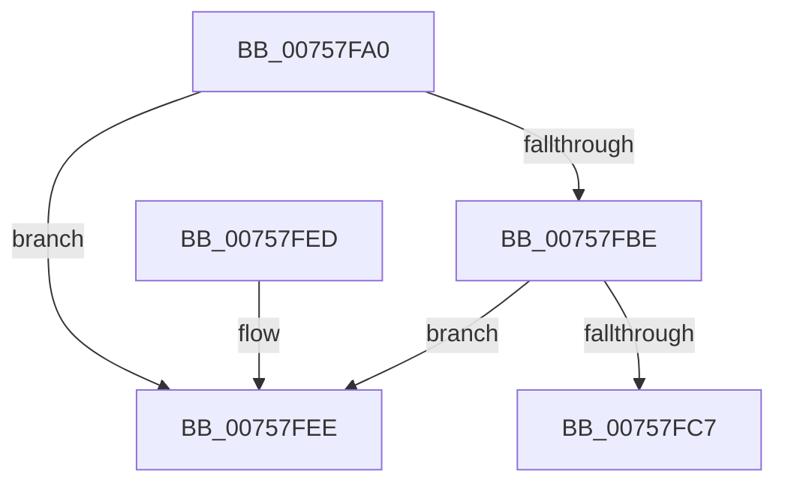

# PoReenableSleepStates

- RVA: `0x00757FA0`–`0x00757FF5` (길이 `85` bytes)
- VA: `0x0000000140757FA0`
- 실행 섹션: `PAGE`
- PDB 이름 있음: `예`; PDB Function 태그: `아니요`
- unwind 정보 RVA: `0x0005DAC8`
- 디코드: `24`개 명령, `85/85` bytes 표시
- 미해석 바이트: `0` (있으면 어셈블리에 `.byte`로 보존)

> 이 문서는 커널 이미지의 기계어와 PDB 기호를 분석해 생성했습니다. 4번과 5번은 함수 원형과 자료형을 바이너리 사용 방식에서 추정한 C 해석이며 원본 소스 복구 결과는 아닙니다.

## 1. Dependencies

- 직접 호출 지점: **3**; 고유 호출 대상: **3**
- 직접 호출자로 확인된 함수: **0**
- RIP 상대 이미지 참조: **1**

### Outgoing calls
- `0x00757FB0` → [ExAcquireFastMutex](../../text/20/ExAcquireFastMutex_function_0020E5A0.md) (function, `0x0020E5A0`)
- `0x00757FD5` → [ExReleaseFastMutex](../../text/25/ExReleaseFastMutex_function_002519C0.md) (function, `0x002519C0`)
- `0x00757FE2` → [ExFreePoolWithTag](../../poolcode/B8/ExFreePoolWithTag_function_00B82870.md) (function, `0x00B82870`)

### Direct callers
- 이 함수 시작 RVA로 연결되는 직접 call은 확인되지 않았습니다. 간접 호출은 완전히 역산할 수 없습니다.

### Static image references
- `0x00757FA9` → RVA `0x00F0EA80` (`.data`; read)

## 2. Other-region calls and transfers

- 다른 실행 섹션으로 향하는 call: **3**
  - `0x00757FB0` → [ExAcquireFastMutex](../../text/20/ExAcquireFastMutex_function_0020E5A0.md) (`PAGE` → `.text`)
  - `0x00757FD5` → [ExReleaseFastMutex](../../text/25/ExReleaseFastMutex_function_002519C0.md) (`PAGE` → `.text`)
  - `0x00757FE2` → [ExFreePoolWithTag](../../poolcode/B8/ExFreePoolWithTag_function_00B82870.md) (`PAGE` → `POOLCODE`)
- 별도 외부 분기/꼬리 이동을 확인하지 못했습니다.

## 3. Assembly (complete function range)

```asm
00757FA0  40 53                           push rbx
00757FA2  48 83 EC 20                     sub rsp, 0x20
00757FA6  48 8B D9                        mov rbx, rcx
00757FA9  48 8D 0D D0 6A 7B 00            lea rcx, [rip + 0x7b6ad0]
00757FB0  E8 EB 65 AB FF                  call 0x14020e5a0
00757FB5  48 8B 13                        mov rdx, qword ptr [rbx]
00757FB8  48 39 5A 08                     cmp qword ptr [rdx + 8], rbx
00757FBC  75 30                           jne 0x140757fee
00757FBE  48 8B 43 08                     mov rax, qword ptr [rbx + 8]
00757FC2  48 39 18                        cmp qword ptr [rax], rbx
00757FC5  75 27                           jne 0x140757fee
00757FC7  48 89 10                        mov qword ptr [rax], rdx
00757FCA  48 8D 0D AF 6A 7B 00            lea rcx, [rip + 0x7b6aaf]
00757FD1  48 89 42 08                     mov qword ptr [rdx + 8], rax
00757FD5  E8 E6 99 AF FF                  call 0x1402519c0
00757FDA  BA 50 6F 53 64                  mov edx, 0x64536f50
00757FDF  48 8B CB                        mov rcx, rbx
00757FE2  E8 89 A8 42 00                  call 0x140b82870
00757FE7  48 83 C4 20                     add rsp, 0x20
00757FEB  5B                              pop rbx
00757FEC  C3                              ret
00757FED  CC                              int3
00757FEE  B9 03 00 00 00                  mov ecx, 3
00757FF3  CD 29                           int 0x29
```

## 4. C-style interpretation (structured pseudocode)

```c
__int64 __fastcall PoReenableSleepStates(__int64 a1)
{
    __int64 result;
    __int64 v_rsp;

    v_rsp = (v_rsp) - (32);
    result = ExAcquireFastMutex(v_rip + 8088272, a2, a3, a4);
    if ((*(unsigned __int64 *)(*(unsigned __int64 *)(a1) + 8)) != a1) goto loc_00757FEE;
    if ((*(unsigned __int64 *)(*(unsigned __int64 *)(a1 + 8))) != a1) goto loc_00757FEE;
    *(unsigned __int64 *)(*(unsigned __int64 *)(a1 + 8)) = *(unsigned __int64 *)(a1);
    *(unsigned __int64 *)(*(unsigned __int64 *)(a1) + 8) = *(unsigned __int64 *)(a1 + 8);
    result = ExReleaseFastMutex(v_rip + 8088239, *(unsigned __int64 *)(a1), a3, a4);
    result = ExFreePoolWithTag(a1, (unsigned int)(0x64536F50ULL), a3, a4);
    v_rsp = (v_rsp) + (32);
    return result;
loc_00757FEE:
    return result;
}
```

## 5. (Beta) C Style

```c
int64_t PoReenableSleepStates(void *Arg1)
{
    uint8_t *arg1 = (uint8_t *)Arg1;

    int64_t result;
    int64_t local_rsp;

    local_rsp = (local_rsp) - (32);
    result = ExAcquireFastMutex(v_rip + 8088272, a2, a3, a4);
    if ((*(uint64_t *)(*(uint64_t *)(arg1) + 0x8)) != Arg1) goto loc_00757FEE;
    if ((*(uint64_t *)(*(uint64_t *)(arg1 + 0x8))) != Arg1) goto loc_00757FEE;
    *(uint64_t *)(*(uint64_t *)(arg1 + 0x8)) = *(uint64_t *)(arg1);
    *(uint64_t *)(*(uint64_t *)(arg1) + 0x8) = *(uint64_t *)(arg1 + 0x8);
    result = ExReleaseFastMutex(v_rip + 8088239, *(uint64_t *)(arg1), a3, a4);
    result = ExFreePoolWithTag(Arg1, (uint32_t)(0x64536F50ULL), a3, a4);
    local_rsp = (local_rsp) + (32);
    return result;
loc_00757FEE:
    return result;
}
```

### 관측된 메모리 오프셋

구조체 형식이 확인되지 않은 접근은 인자 기준의 오프셋으로만 기록했습니다.

| 기준 인자 | 오프셋 표현 | 폭 (bit) | 접근 |
|---|---:|---:|---|
| `Arg1` | `+ 0x0` | `64` | `R` |
| `Arg1` | `+ 0x8` | `64` | `R` |

## 6. Execution-region graph

[열기: 2D/3D 그래프와 함수 탐색 컨트롤 패널](../../../control-panel.html?section=page&rva=0x00757FA0&view=graph)

- 2D 그래프는 위에서 아래로 흐르고, 3D 그래프는 빈 공간을 드래그해 회전합니다. Shift+드래그는 이동, 휠은 확대·축소, 함수 노드 선택은 대상 보고서 이동입니다.

### Static fallback


