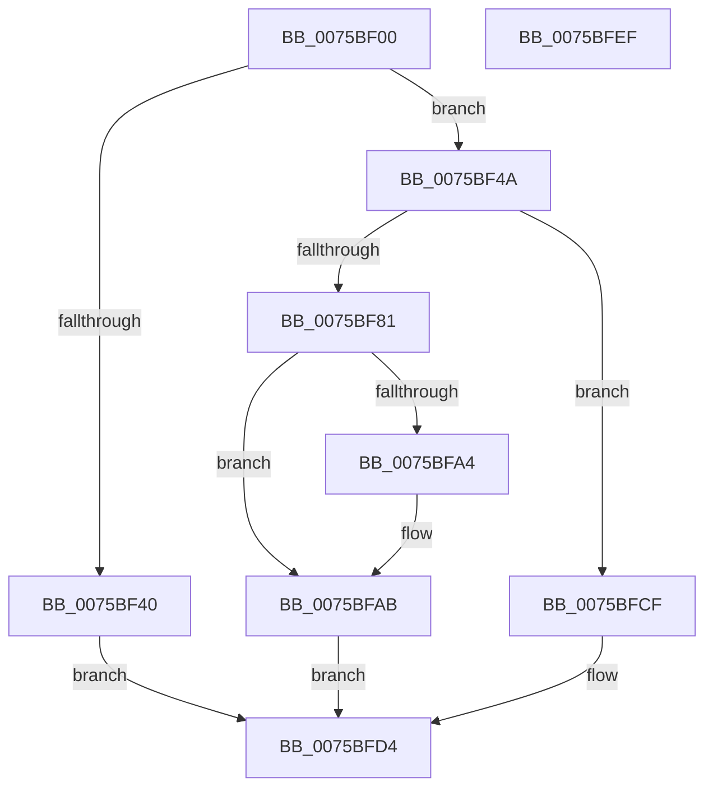

# PoRegisterCoalescingCallback

- RVA: `0x0075BF00`–`0x0075BFF0` (길이 `240` bytes)
- VA: `0x000000014075BF00`
- 실행 섹션: `PAGE`
- PDB 이름 있음: `예`; PDB Function 태그: `아니요`
- unwind 정보 RVA: `0x0005E6B4`
- 디코드: `62`개 명령, `240/240` bytes 표시
- 미해석 바이트: `0` (있으면 어셈블리에 `.byte`로 보존)

> 이 문서는 커널 이미지의 기계어와 PDB 기호를 분석해 생성했습니다. 4번과 5번은 함수 원형과 자료형을 바이너리 사용 방식에서 추정한 C 해석이며 원본 소스 복구 결과는 아닙니다.

## 1. Dependencies

- 직접 호출 지점: **4**; 고유 호출 대상: **4**
- 직접 호출자로 확인된 함수: **3**
- RIP 상대 이미지 참조: **5**

### Outgoing calls
- `0x0075BF33` → [ExAllocatePool2](../../poolcode/B8/ExAllocatePool2_function_00B820F0.md) (function, `0x00B820F0`)
- `0x0075BF78` → [ExCompareExchangeCallBack](../../text/41/ExCompareExchangeCallBack_function_0041BCD0.md) (function, `0x0041BCD0`)
- `0x0075BF88` → [PopAcquireRwLockExclusive](../../text/43/PopAcquireRwLockExclusive_function_00430B44.md) (function, `0x00430B44`)
- `0x0075BFC3` → [PopReleaseRwLock](../../text/2D/PopReleaseRwLock_function_002DFBBC.md) (function, `0x002DFBBC`)

### Direct callers
- [CmpCmdInit](../7E/CmpCmdInit_function_007E5768.md) at `0x007E58E3`
- [CcInitializeCacheManager](../../init/BE/CcInitializeCacheManager_function_00BEE2E8.md) at `0x00BEE7F3`
- [PopCoalescingInitialize](../../init/C3/PopCoalescingInitialize_function_00C3EDB4.md) at `0x00C3EDF2`

### Static image references
- `0x0075BF4A` → RVA `0x00A99570` (`PopCoalescingCallback`; read)
- `0x0075BF81` → RVA `0x00F0E070` (`.data`; read)
- `0x0075BF8D` → RVA `0x00E07518` (`.data`; read)
- `0x0075BF94` → RVA `0x00E07510` (`.data`; read)
- `0x0075BFBC` → RVA `0x00E07518` (`.data`; write)

## 2. Other-region calls and transfers

- 다른 실행 섹션으로 향하는 call: **4**
  - `0x0075BF33` → [ExAllocatePool2](../../poolcode/B8/ExAllocatePool2_function_00B820F0.md) (`PAGE` → `POOLCODE`)
  - `0x0075BF78` → [ExCompareExchangeCallBack](../../text/41/ExCompareExchangeCallBack_function_0041BCD0.md) (`PAGE` → `.text`)
  - `0x0075BF88` → [PopAcquireRwLockExclusive](../../text/43/PopAcquireRwLockExclusive_function_00430B44.md) (`PAGE` → `.text`)
  - `0x0075BFC3` → [PopReleaseRwLock](../../text/2D/PopReleaseRwLock_function_002DFBBC.md) (`PAGE` → `.text`)
- 별도 외부 분기/꼬리 이동을 확인하지 못했습니다.

## 3. Assembly (complete function range)

```asm
0075BF00  48 8B C4                        mov rax, rsp
0075BF03  48 89 58 08                     mov qword ptr [rax + 8], rbx
0075BF07  48 89 68 10                     mov qword ptr [rax + 0x10], rbp
0075BF0B  48 89 70 18                     mov qword ptr [rax + 0x18], rsi
0075BF0F  48 89 78 20                     mov qword ptr [rax + 0x20], rdi
0075BF13  41 56                           push r14
0075BF15  48 83 EC 20                     sub rsp, 0x20
0075BF19  40 8A EA                        mov bpl, dl
0075BF1C  49 8B F8                        mov rdi, r8
0075BF1F  BA 48 00 00 00                  mov edx, 0x48
0075BF24  4C 8B F1                        mov r14, rcx
0075BF27  41 B8 50 6F 43 62               mov r8d, 0x62436f50
0075BF2D  49 8B F1                        mov rsi, r9
0075BF30  8D 4A F8                        lea ecx, [rdx - 8]
0075BF33  E8 B8 61 42 00                  call 0x140b820f0
0075BF38  48 8B D8                        mov rbx, rax
0075BF3B  48 85 C0                        test rax, rax
0075BF3E  75 0A                           jne 0x14075bf4a
0075BF40  B8 9A 00 00 C0                  mov eax, 0xc000009a
0075BF45  E9 8A 00 00 00                  jmp 0x14075bfd4
0075BF4A  48 8D 05 1F D6 33 00            lea rax, [rip + 0x33d61f]
0075BF51  48 89 5B 10                     mov qword ptr [rbx + 0x10], rbx
0075BF55  48 89 43 08                     mov qword ptr [rbx + 8], rax
0075BF59  48 8D 4B 40                     lea rcx, [rbx + 0x40]
0075BF5D  40 84 ED                        test bpl, bpl
0075BF60  48 89 73 28                     mov qword ptr [rbx + 0x28], rsi
0075BF64  48 8B D3                        mov rdx, rbx
0075BF67  4C 89 73 18                     mov qword ptr [rbx + 0x18], r14
0075BF6B  0F 95 C0                        setne al
0075BF6E  48 83 23 00                     and qword ptr [rbx], 0
0075BF72  45 33 C0                        xor r8d, r8d
0075BF75  88 43 20                        mov byte ptr [rbx + 0x20], al
0075BF78  E8 53 FD CB FF                  call 0x14041bcd0
0075BF7D  84 C0                           test al, al
0075BF7F  74 4E                           je 0x14075bfcf
0075BF81  48 8D 0D E8 20 7B 00            lea rcx, [rip + 0x7b20e8]
0075BF88  E8 B7 4B CD FF                  call 0x140430b44
0075BF8D  48 8B 0D 84 B5 6A 00            mov rcx, qword ptr [rip + 0x6ab584]
0075BF94  48 8D 15 75 B5 6A 00            lea rdx, [rip + 0x6ab575]
0075BF9B  48 8D 43 30                     lea rax, [rbx + 0x30]
0075BF9F  48 39 11                        cmp qword ptr [rcx], rdx
0075BFA2  74 07                           je 0x14075bfab
0075BFA4  B9 03 00 00 00                  mov ecx, 3
0075BFA9  CD 29                           int 0x29
0075BFAB  48 89 48 08                     mov qword ptr [rax + 8], rcx
0075BFAF  48 89 10                        mov qword ptr [rax], rdx
0075BFB2  48 89 01                        mov qword ptr [rcx], rax
0075BFB5  48 8D 0D B4 20 7B 00            lea rcx, [rip + 0x7b20b4]
0075BFBC  48 89 05 55 B5 6A 00            mov qword ptr [rip + 0x6ab555], rax
0075BFC3  E8 F4 3B B8 FF                  call 0x1402dfbbc
0075BFC8  33 C0                           xor eax, eax
0075BFCA  48 89 1F                        mov qword ptr [rdi], rbx
0075BFCD  EB 05                           jmp 0x14075bfd4
0075BFCF  B8 0D 00 00 C0                  mov eax, 0xc000000d
0075BFD4  48 8B 5C 24 30                  mov rbx, qword ptr [rsp + 0x30]
0075BFD9  48 8B 6C 24 38                  mov rbp, qword ptr [rsp + 0x38]
0075BFDE  48 8B 74 24 40                  mov rsi, qword ptr [rsp + 0x40]
0075BFE3  48 8B 7C 24 48                  mov rdi, qword ptr [rsp + 0x48]
0075BFE8  48 83 C4 20                     add rsp, 0x20
0075BFEC  41 5E                           pop r14
0075BFEE  C3                              ret
0075BFEF  CC                              int3
```

## 4. C-style interpretation (structured pseudocode)

```c
__int64 __fastcall PoRegisterCoalescingCallback(__int64 a1, unsigned __int8 a2, __int64 a3, __int64 a4)
{
    __int64 result;
    __int64 v_rsp;
    unsigned __int64 v_stack_p10;
    unsigned __int64 v_stack_p18;
    unsigned __int64 v_stack_p20;
    unsigned __int64 v_stack_p8;

    *(unsigned __int64 *)(v_rsp + 8) = v_rbx;
    *(unsigned __int64 *)(v_rsp + 16) = v_rbp;
    *(unsigned __int64 *)(v_rsp + 24) = v_rsi;
    *(unsigned __int64 *)(v_rsp + 32) = v_rdi;
    v_rsp = (v_rsp) - (32);
    result = ExAllocatePool2(72 - 8, 72, (unsigned int)(0x62436F50ULL), a4);
    if (result != 0) goto loc_0075BF4A;
    goto loc_0075BFD4;
loc_0075BF4A:
    *(unsigned __int64 *)(result + 16) = result;
    *(unsigned __int64 *)(result + 8) = v_rip + 3397151;
    *(unsigned __int64 *)(result + 40) = a4;
    *(unsigned __int64 *)(result + 24) = a1;
    result = (a2 != 0) ? 1 : 0;
    a3 = 0;
    *(unsigned __int8 *)(result + 32) = (unsigned __int8)(result);
    result = ExCompareExchangeCallBack(result + 64, result, a3, a4);
    if ((unsigned __int8)(result) == 0) goto loc_0075BFCF;
    result = PopAcquireRwLockExclusive(v_rip + 8069352, result, a3, a4);
    if ((*(unsigned __int64 *)(*(unsigned __int64 *)(v_rip + 6993284))) != (v_rip + 6993269)) {
        a1 = 3;
    }
    *(unsigned __int64 *)(result + 48 + 8) = a1;
    *(unsigned __int64 *)(result + 48) = v_rip + 6993269;
    *(unsigned __int64 *)(a1) = result + 48;
    *(unsigned __int64 *)(v_rip + 6993237) = result + 48;
    result = PopReleaseRwLock(v_rip + 8069300, v_rip + 6993269, a3, a4);
    result = 0;
    *(unsigned __int64 *)(a3) = 0;
    goto loc_0075BFD4;
loc_0075BFCF:
loc_0075BFD4:
    v_rsp = (v_rsp) + (32);
    return (unsigned int)(0xC000000DULL);
}
```

## 5. (Beta) C Style

```c
int64_t PoRegisterCoalescingCallback(int64_t Arg1, uint8_t Arg2, void *Arg3, int64_t Arg4)
{
    uint8_t *arg3 = (uint8_t *)Arg3;

    int64_t result;
    int64_t local_rsp;
    uint64_t v_stack_p10;
    uint64_t v_stack_p18;
    uint64_t v_stack_p20;
    uint64_t v_stack_p8;

    *(uint64_t *)(local_rsp + 0x8) = local_rbx;
    *(uint64_t *)(local_rsp + 0x10) = local_rbp;
    *(uint64_t *)(local_rsp + 0x18) = local_rsi;
    *(uint64_t *)(local_rsp + 0x20) = local_rdi;
    local_rsp = (local_rsp) - (32);
    result = ExAllocatePool2(72 - 8, 72, (uint32_t)(0x62436F50ULL), Arg4);
    if (result != 0) goto loc_0075BF4A;
    goto loc_0075BFD4;
loc_0075BF4A:
    *(uint64_t *)(result + 0x10) = result;
    *(uint64_t *)(result + 0x8) = v_rip + 3397151;
    *(uint64_t *)(result + 0x28) = Arg4;
    *(uint64_t *)(result + 0x18) = Arg1;
    result = (Arg2 != 0) ? 1 : 0;
    Arg3 = 0;
    *(uint8_t *)(result + 0x20) = (uint8_t)(result);
    result = ExCompareExchangeCallBack(result + 64, result, Arg3, Arg4);
    if ((uint8_t)(result) == 0) goto loc_0075BFCF;
    result = PopAcquireRwLockExclusive(v_rip + 8069352, result, Arg3, Arg4);
    if ((*(uint64_t *)(*(uint64_t *)(v_rip + 0x6AB584))) != (v_rip + 6993269)) {
        Arg1 = 3;
    }
    *(uint64_t *)(result + 0x30 + 0x8) = Arg1;
    *(uint64_t *)(result + 0x30) = v_rip + 6993269;
    *(uint64_t *)(Arg1) = result + 48;
    *(uint64_t *)(v_rip + 0x6AB555) = result + 48;
    result = PopReleaseRwLock(v_rip + 8069300, v_rip + 6993269, Arg3, Arg4);
    result = 0;
    *(uint64_t *)(arg3) = 0;
    goto loc_0075BFD4;
loc_0075BFCF:
loc_0075BFD4:
    local_rsp = (local_rsp) + (32);
    return (uint32_t)(0xC000000DULL);
}
```

### 관측된 메모리 오프셋

구조체 형식이 확인되지 않은 접근은 인자 기준의 오프셋으로만 기록했습니다.

| 기준 인자 | 오프셋 표현 | 폭 (bit) | 접근 |
|---|---:|---:|---|
| `Arg3` | `+ 0x0` | `64` | `W` |

## 6. Execution-region graph

[열기: 2D/3D 그래프와 함수 탐색 컨트롤 패널](../../../control-panel.html?section=page&rva=0x0075BF00&view=graph)

- 2D 그래프는 위에서 아래로 흐르고, 3D 그래프는 빈 공간을 드래그해 회전합니다. Shift+드래그는 이동, 휠은 확대·축소, 함수 노드 선택은 대상 보고서 이동입니다.

### Static fallback


