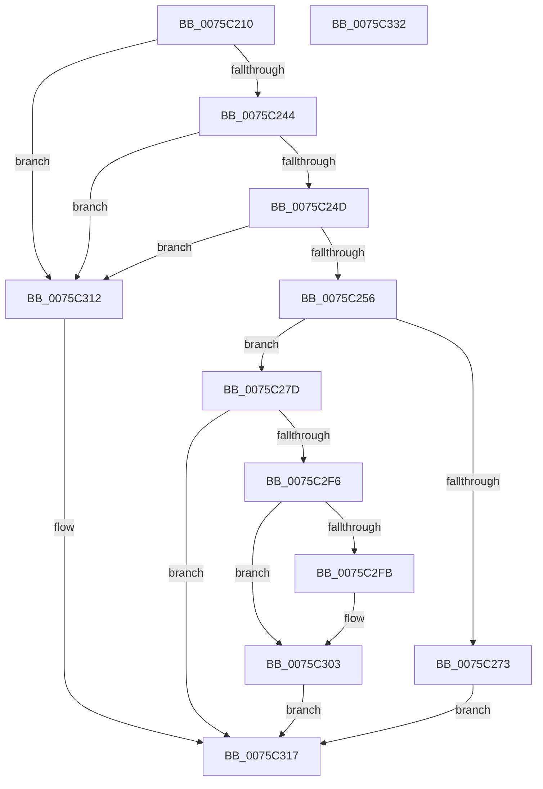

# PoRegisterForEffectivePowerModeNotifications

- RVA: `0x0075C210`–`0x0075C333` (길이 `291` bytes)
- VA: `0x000000014075C210`
- 실행 섹션: `PAGE`
- PDB 이름 있음: `예`; PDB Function 태그: `아니요`
- unwind 정보 RVA: `0x00093E28`
- 디코드: `76`개 명령, `291/291` bytes 표시
- 미해석 바이트: `0` (있으면 어셈블리에 `.byte`로 보존)

> 이 문서는 커널 이미지의 기계어와 PDB 기호를 분석해 생성했습니다. 4번과 5번은 함수 원형과 자료형을 바이너리 사용 방식에서 추정한 C 해석이며 원본 소스 복구 결과는 아닙니다.

## 1. Dependencies

- 직접 호출 지점: **6**; 고유 호출 대상: **6**
- 직접 호출자로 확인된 함수: **0**
- RIP 상대 이미지 참조: **2**

### Outgoing calls
- `0x0075C266` → [ExAllocatePool2](../../poolcode/B8/ExAllocatePool2_function_00B820F0.md) (function, `0x00B820F0`)
- `0x0075C28D` → [PopAcquireRwLockExclusive](../../text/43/PopAcquireRwLockExclusive_function_00430B44.md) (function, `0x00430B44`)
- `0x0075C2D7` → [ExSubscribeWnfStateChange](../9D/ExSubscribeWnfStateChange_function_009D4BC0.md) (function, `0x009D4BC0`)
- `0x0075C2ED` → [PopReleaseRwLock](../../text/2D/PopReleaseRwLock_function_002DFBBC.md) (function, `0x002DFBBC`)
- `0x0075C2FE` → [ExUnsubscribeWnfStateChange](../A7/ExUnsubscribeWnfStateChange_function_00A7BE50.md) (function, `0x00A7BE50`)
- `0x0075C30B` → [ExFreePoolWithTag](../../poolcode/B8/ExFreePoolWithTag_function_00B82870.md) (function, `0x00B82870`)

### Direct callers
- 이 함수 시작 RVA로 연결되는 직접 call은 확인되지 않았습니다. 간접 호출은 완전히 역산할 수 없습니다.

### Static image references
- `0x0075C29A` → RVA `0x000209F0` (`.rdata`; read)
- `0x0075C2B1` → RVA `0x0075C3B0` (`PopWnfEffectivePowerModeCallback`; read)

## 2. Other-region calls and transfers

- 다른 실행 섹션으로 향하는 call: **4**
  - `0x0075C266` → [ExAllocatePool2](../../poolcode/B8/ExAllocatePool2_function_00B820F0.md) (`PAGE` → `POOLCODE`)
  - `0x0075C28D` → [PopAcquireRwLockExclusive](../../text/43/PopAcquireRwLockExclusive_function_00430B44.md) (`PAGE` → `.text`)
  - `0x0075C2ED` → [PopReleaseRwLock](../../text/2D/PopReleaseRwLock_function_002DFBBC.md) (`PAGE` → `.text`)
  - `0x0075C30B` → [ExFreePoolWithTag](../../poolcode/B8/ExFreePoolWithTag_function_00B82870.md) (`PAGE` → `POOLCODE`)
- 별도 외부 분기/꼬리 이동을 확인하지 못했습니다.

## 3. Assembly (complete function range)

```asm
0075C210  48 8B C4                        mov rax, rsp
0075C213  48 89 58 08                     mov qword ptr [rax + 8], rbx
0075C217  48 89 68 10                     mov qword ptr [rax + 0x10], rbp
0075C21B  48 89 70 18                     mov qword ptr [rax + 0x18], rsi
0075C21F  57                              push rdi
0075C220  41 56                           push r14
0075C222  41 57                           push r15
0075C224  48 83 EC 40                     sub rsp, 0x40
0075C228  48 83 60 D8 00                  and qword ptr [rax - 0x28], 0
0075C22D  4D 8B F1                        mov r14, r9
0075C230  8D 41 FF                        lea eax, [rcx - 1]
0075C233  4D 8B F8                        mov r15, r8
0075C236  48 8B F2                        mov rsi, rdx
0075C239  8B E9                           mov ebp, ecx
0075C23B  83 F8 01                        cmp eax, 1
0075C23E  0F 87 CE 00 00 00               ja 0x14075c312
0075C244  48 85 D2                        test rdx, rdx
0075C247  0F 84 C5 00 00 00               je 0x14075c312
0075C24D  4D 85 C9                        test r9, r9
0075C250  0F 84 BC 00 00 00               je 0x14075c312
0075C256  BA 58 00 00 00                  mov edx, 0x58
0075C25B  B9 00 01 00 00                  mov ecx, 0x100
0075C260  41 B8 50 53 65 74               mov r8d, 0x74655350
0075C266  E8 85 5E 42 00                  call 0x140b820f0
0075C26B  48 8B F8                        mov rdi, rax
0075C26E  48 85 C0                        test rax, rax
0075C271  75 0A                           jne 0x14075c27d
0075C273  BE 9A 00 00 C0                  mov esi, 0xc000009a
0075C278  E9 9A 00 00 00                  jmp 0x14075c317
0075C27D  48 83 60 30 00                  and qword ptr [rax + 0x30], 0
0075C282  48 8D 58 28                     lea rbx, [rax + 0x28]
0075C286  48 83 23 00                     and qword ptr [rbx], 0
0075C28A  48 8B CB                        mov rcx, rbx
0075C28D  E8 B2 48 CD FF                  call 0x140430b44
0075C292  48 8B 84 24 80 00 00 00         mov rax, qword ptr [rsp + 0x80]
0075C29A  48 8D 15 4F 47 8C FF            lea rdx, [rip - 0x73b8b1]
0075C2A1  83 4F 10 FF                     or dword ptr [rdi + 0x10], 0xffffffff
0075C2A5  48 8D 4C 24 30                  lea rcx, [rsp + 0x30]
0075C2AA  45 33 C9                        xor r9d, r9d
0075C2AD  48 89 47 08                     mov qword ptr [rdi + 8], rax
0075C2B1  48 8D 05 F8 00 00 00            lea rax, [rip + 0xf8]
0075C2B8  48 89 7C 24 28                  mov qword ptr [rsp + 0x28], rdi
0075C2BD  89 2F                           mov dword ptr [rdi], ebp
0075C2BF  4C 89 7F 50                     mov qword ptr [rdi + 0x50], r15
0075C2C3  45 8D 41 01                     lea r8d, [r9 + 1]
0075C2C7  C7 47 20 BB DD EE FF            mov dword ptr [rdi + 0x20], 0xffeeddbb
0075C2CE  48 89 77 38                     mov qword ptr [rdi + 0x38], rsi
0075C2D2  48 89 44 24 20                  mov qword ptr [rsp + 0x20], rax
0075C2D7  E8 E4 88 27 00                  call 0x1409d4bc0
0075C2DC  48 8B 6C 24 30                  mov rbp, qword ptr [rsp + 0x30]
0075C2E1  48 8B CB                        mov rcx, rbx
0075C2E4  48 89 6F 18                     mov qword ptr [rdi + 0x18], rbp
0075C2E8  8B F0                           mov esi, eax
0075C2EA  49 89 3E                        mov qword ptr [r14], rdi
0075C2ED  E8 CA 38 B8 FF                  call 0x1402dfbbc
0075C2F2  85 F6                           test esi, esi
0075C2F4  74 21                           je 0x14075c317
0075C2F6  48 85 ED                        test rbp, rbp
0075C2F9  74 08                           je 0x14075c303
0075C2FB  48 8B CD                        mov rcx, rbp
0075C2FE  E8 4D FB 31 00                  call 0x140a7be50
0075C303  BA 50 53 65 74                  mov edx, 0x74655350
0075C308  48 8B CF                        mov rcx, rdi
0075C30B  E8 60 65 42 00                  call 0x140b82870
0075C310  EB 05                           jmp 0x14075c317
0075C312  BE 0D 00 00 C0                  mov esi, 0xc000000d
0075C317  48 8B 5C 24 60                  mov rbx, qword ptr [rsp + 0x60]
0075C31C  8B C6                           mov eax, esi
0075C31E  48 8B 74 24 70                  mov rsi, qword ptr [rsp + 0x70]
0075C323  48 8B 6C 24 68                  mov rbp, qword ptr [rsp + 0x68]
0075C328  48 83 C4 40                     add rsp, 0x40
0075C32C  41 5F                           pop r15
0075C32E  41 5E                           pop r14
0075C330  5F                              pop rdi
0075C331  C3                              ret
0075C332  CC                              int3
```

## 4. C-style interpretation (structured pseudocode)

```c
__int64 __fastcall PoRegisterForEffectivePowerModeNotifications(__int64 a1, __int64 a2, __int64 a3, __int64 a4, __int64 a5)
{
    __int64 result;
    __int64 v_rsp;
    unsigned __int64 v_stack_m28;
    unsigned __int64 v_stack_m30;
    unsigned __int64 v_stack_m38;
    unsigned __int64 v_stack_p10;
    unsigned __int64 v_stack_p18;
    unsigned __int64 v_stack_p8;

    *(unsigned __int64 *)(v_rsp + 8) = v_rbx;
    *(unsigned __int64 *)(v_rsp + 16) = v_rbp;
    *(unsigned __int64 *)(v_rsp + 24) = v_rsi;
    v_rsp = (v_rsp) - (64);
    if (((unsigned int)(a1 - 1)) > 1) goto loc_0075C312;
    if (a2 == 0) goto loc_0075C312;
    if (a4 == 0) goto loc_0075C312;
    result = ExAllocatePool2(256, 88, (unsigned int)(0x74655350ULL), a4);
    if (result != 0) goto loc_0075C27D;
    goto loc_0075C317;
loc_0075C27D:
    result = PopAcquireRwLockExclusive(result + 40, 88, (unsigned int)(0x74655350ULL), a4);
    a4 = 0;
    *(unsigned __int64 *)(result + 8) = a5;
    v_stack_m30 = result;
    *(unsigned int *)(result) = (unsigned int)((unsigned int)((unsigned int)(a1)));
    *(unsigned __int64 *)(result + 80) = a3;
    *(unsigned int *)(result + 32) = 0xFFEEDDBBULL;
    *(unsigned __int64 *)(result + 56) = (unsigned int)(0xC000009AULL);
    v_stack_m38 = v_rip + 248;
    result = ExSubscribeWnfStateChange(v_stack_m28, v_rip - 7583921, a4 + 1, a4);
    *(unsigned __int64 *)(result + 24) = v_stack_m28;
    *(unsigned __int64 *)(a4) = result;
    result = PopReleaseRwLock(result + 40, v_rip - 7583921, a4 + 1, a4);
    if ((unsigned int)((unsigned int)((unsigned int)(result))) == 0) goto loc_0075C317;
    if (v_stack_m28 != 0) {
        a1 = v_stack_m28;
        result = ExUnsubscribeWnfStateChange(a1, v_rip - 7583921, a4 + 1, a4);
    }
    result = ExFreePoolWithTag(result, (unsigned int)(0x74655350ULL), a4 + 1, a4);
    goto loc_0075C317;
loc_0075C312:
loc_0075C317:
    v_rsp = (v_rsp) + (64);
    return (unsigned int)((unsigned int)((unsigned int)(0xC000000DULL)));
}
```

## 5. (Beta) C Style

```c
int64_t PoRegisterForEffectivePowerModeNotifications(void *Arg1, int64_t Arg2, int64_t Arg3, void *Arg4, int64_t Arg5)
{
    uint8_t *arg1 = (uint8_t *)Arg1;
    uint8_t *arg4 = (uint8_t *)Arg4;

    int64_t result;
    int64_t local_rsp;
    uint64_t v_stack_m28;
    uint64_t v_stack_m30;
    uint64_t v_stack_m38;
    uint64_t v_stack_p10;
    uint64_t v_stack_p18;
    uint64_t v_stack_p8;

    *(uint64_t *)(local_rsp + 0x8) = local_rbx;
    *(uint64_t *)(local_rsp + 0x10) = local_rbp;
    *(uint64_t *)(local_rsp + 0x18) = local_rsi;
    local_rsp = (local_rsp) - (64);
    if (((uint32_t)(Arg1 - 1)) > 1) goto loc_0075C312;
    if (Arg2 == 0) goto loc_0075C312;
    if (Arg4 == NULL) goto loc_0075C312;
    result = ExAllocatePool2(256, 88, (uint32_t)(0x74655350ULL), Arg4);
    if (result != 0) goto loc_0075C27D;
    goto loc_0075C317;
loc_0075C27D:
    result = PopAcquireRwLockExclusive(result + 40, 88, (uint32_t)(0x74655350ULL), Arg4);
    Arg4 = 0;
    *(uint64_t *)(result + 0x8) = Arg5;
    v_stack_m30 = result;
    *(uint32_t *)(result) = (uint32_t)((uint32_t)((uint32_t)(Arg1)));
    *(uint64_t *)(result + 0x50) = Arg3;
    *(uint32_t *)(result + 0x20) = 0xFFEEDDBBULL;
    *(uint64_t *)(result + 0x38) = (uint32_t)(0xC000009AULL);
    v_stack_m38 = v_rip + 248;
    result = ExSubscribeWnfStateChange(v_stack_m28, v_rip - 7583921, Arg4 + 1, Arg4);
    *(uint64_t *)(result + 0x18) = v_stack_m28;
    *(uint64_t *)(arg4) = result;
    result = PopReleaseRwLock(result + 40, v_rip - 7583921, Arg4 + 1, Arg4);
    if ((uint32_t)((uint32_t)((uint32_t)(result))) == 0) goto loc_0075C317;
    if (v_stack_m28 != 0) {
        Arg1 = v_stack_m28;
        result = ExUnsubscribeWnfStateChange(Arg1, v_rip - 7583921, Arg4 + 1, Arg4);
    }
    result = ExFreePoolWithTag(result, (uint32_t)(0x74655350ULL), Arg4 + 1, Arg4);
    goto loc_0075C317;
loc_0075C312:
loc_0075C317:
    local_rsp = (local_rsp) + (64);
    return (uint32_t)((uint32_t)((uint32_t)(0xC000000DULL)));
}
```

### 관측된 메모리 오프셋

구조체 형식이 확인되지 않은 접근은 인자 기준의 오프셋으로만 기록했습니다.

| 기준 인자 | 오프셋 표현 | 폭 (bit) | 접근 |
|---|---:|---:|---|
| `Arg1` | `- 0x1` | `32` | `R` |
| `Arg4` | `+ 0x0` | `64` | `W` |

## 6. Execution-region graph

[열기: 2D/3D 그래프와 함수 탐색 컨트롤 패널](../../../control-panel.html?section=page&rva=0x0075C210&view=graph)

- 2D 그래프는 위에서 아래로 흐르고, 3D 그래프는 빈 공간을 드래그해 회전합니다. Shift+드래그는 이동, 휠은 확대·축소, 함수 노드 선택은 대상 보고서 이동입니다.

### Static fallback


