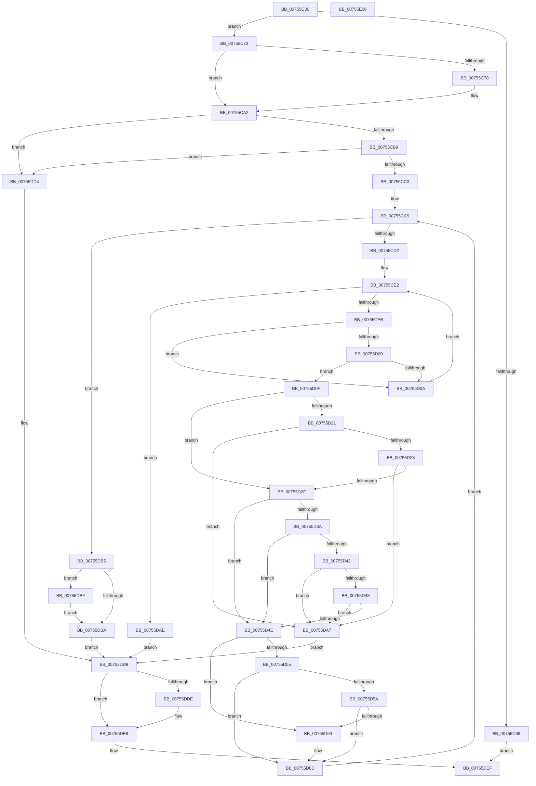

# PoSetPowerLimitValue

- RVA: `0x00755C30`–`0x00755E07` (길이 `471` bytes)
- VA: `0x0000000140755C30`
- 실행 섹션: `PAGE`
- PDB 이름 있음: `예`; PDB Function 태그: `아니요`
- unwind 정보 RVA: `0x000CBFC4`
- 디코드: `141`개 명령, `471/471` bytes 표시
- 미해석 바이트: `0` (있으면 어셈블리에 `.byte`로 보존)

> 이 문서는 커널 이미지의 기계어와 PDB 기호를 분석해 생성했습니다. 4번과 5번은 함수 원형과 자료형을 바이너리 사용 방식에서 추정한 C 해석이며 원본 소스 복구 결과는 아닙니다.

## 1. Dependencies

- 직접 호출 지점: **7**; 고유 호출 대상: **7**
- 직접 호출자로 확인된 함수: **0**
- RIP 상대 이미지 참조: **0**

### Outgoing calls
- `0x00755C92` → [PoCaptureReasonContext](../../text/23/PoCaptureReasonContext_function_00230A38.md) (function, `0x00230A38`)
- `0x00755CAA` → [PopAcquireRwLockExclusive](../../text/43/PopAcquireRwLockExclusive_function_00430B44.md) (function, `0x00430B44`)
- `0x00755D6A` → [PopUpdatePowerLimitTimeTracking](../../text/5D/PopUpdatePowerLimitTimeTracking_function_005D0F6C.md) (function, `0x005D0F6C`)
- `0x00755DC5` → [PopDiagTracePowerLimitRequestValueUpdate](../76/PopDiagTracePowerLimitRequestValueUpdate_function_007629E8.md) (function, `0x007629E8`)
- `0x00755DCD` → [PopEvaluatePowerLimitChange](PopEvaluatePowerLimitChange_function_00756224.md) (function, `0x00756224`)
- `0x00755DE1` → [PoDestroyReasonContext](../../text/23/PoDestroyReasonContext_function_00230944.md) (function, `0x00230944`)
- `0x00755DEA` → [PopReleaseRwLock](../../text/2D/PopReleaseRwLock_function_002DFBBC.md) (function, `0x002DFBBC`)

### Direct callers
- 이 함수 시작 RVA로 연결되는 직접 call은 확인되지 않았습니다. 간접 호출은 완전히 역산할 수 없습니다.

### Static image references
- 디코드된 RIP-relative 메모리 참조가 없습니다.

## 2. Other-region calls and transfers

- 다른 실행 섹션으로 향하는 call: **5**
  - `0x00755C92` → [PoCaptureReasonContext](../../text/23/PoCaptureReasonContext_function_00230A38.md) (`PAGE` → `.text`)
  - `0x00755CAA` → [PopAcquireRwLockExclusive](../../text/43/PopAcquireRwLockExclusive_function_00430B44.md) (`PAGE` → `.text`)
  - `0x00755D6A` → [PopUpdatePowerLimitTimeTracking](../../text/5D/PopUpdatePowerLimitTimeTracking_function_005D0F6C.md) (`PAGE` → `.text`)
  - `0x00755DE1` → [PoDestroyReasonContext](../../text/23/PoDestroyReasonContext_function_00230944.md) (`PAGE` → `.text`)
  - `0x00755DEA` → [PopReleaseRwLock](../../text/2D/PopReleaseRwLock_function_002DFBBC.md) (`PAGE` → `.text`)
- 별도 외부 분기/꼬리 이동을 확인하지 못했습니다.

## 3. Assembly (complete function range)

```asm
00755C30  4C 8B DC                        mov r11, rsp
00755C33  49 89 5B 10                     mov qword ptr [r11 + 0x10], rbx
00755C37  4D 89 4B 20                     mov qword ptr [r11 + 0x20], r9
00755C3B  45 89 43 18                     mov dword ptr [r11 + 0x18], r8d
00755C3F  55                              push rbp
00755C40  56                              push rsi
00755C41  57                              push rdi
00755C42  41 54                           push r12
00755C44  41 55                           push r13
00755C46  41 56                           push r14
00755C48  41 57                           push r15
00755C4A  48 83 EC 30                     sub rsp, 0x30
00755C4E  45 33 E4                        xor r12d, r12d
00755C51  4D 8B F9                        mov r15, r9
00755C54  4D 89 63 08                     mov qword ptr [r11 + 8], r12
00755C58  41 8B F0                        mov esi, r8d
00755C5B  48 8B C2                        mov rax, rdx
00755C5E  48 8B D9                        mov rbx, rcx
00755C61  41 8B FC                        mov edi, r12d
00755C64  48 85 C9                        test rcx, rcx
00755C67  75 0A                           jne 0x140755c73
00755C69  BB 0D 00 00 C0                  mov ebx, 0xc000000d
00755C6E  E9 7C 01 00 00                  jmp 0x140755def
00755C73  48 85 C0                        test rax, rax
00755C76  74 2A                           je 0x140755ca2
00755C78  48 8D 4C 24 70                  lea rcx, [rsp + 0x70]
00755C7D  41 B1 01                        mov r9b, 1
00755C80  48 89 4C 24 28                  mov qword ptr [rsp + 0x28], rcx
00755C85  45 33 C0                        xor r8d, r8d
00755C88  48 8B C8                        mov rcx, rax
00755C8B  4C 89 64 24 20                  mov qword ptr [rsp + 0x20], r12
00755C90  33 D2                           xor edx, edx
00755C92  E8 A1 AD AD FF                  call 0x140230a38
00755C97  48 8B 7C 24 70                  mov rdi, qword ptr [rsp + 0x70]
00755C9C  85 C0                           test eax, eax
00755C9E  49 0F 48 FC                     cmovs rdi, r12
00755CA2  48 8B 6B 40                     mov rbp, qword ptr [rbx + 0x40]
00755CA6  48 8D 4D 20                     lea rcx, [rbp + 0x20]
00755CAA  E8 95 AE CD FF                  call 0x140430b44
00755CAF  44 38 63 10                     cmp byte ptr [rbx + 0x10], r12b
00755CB3  0F 84 1B 01 00 00               je 0x140755dd4
00755CB9  44 38 65 30                     cmp byte ptr [rbp + 0x30], r12b
00755CBD  0F 84 11 01 00 00               je 0x140755dd4
00755CC3  45 8A EC                        mov r13b, r12b
00755CC6  45 8B F4                        mov r14d, r12d
00755CC9  44 3B F6                        cmp r14d, esi
00755CCC  0F 83 E3 00 00 00               jae 0x140755db5
00755CD2  8B 4B 20                        mov ecx, dword ptr [rbx + 0x20]
00755CD5  45 8B C4                        mov r8d, r12d
00755CD8  41 8B F6                        mov esi, r14d
00755CDB  48 C1 E6 04                     shl rsi, 4
00755CDF  49 03 F7                        add rsi, r15
00755CE2  44 3B C1                        cmp r8d, ecx
00755CE5  0F 83 C3 00 00 00               jae 0x140755dae
00755CEB  4C 8B 5B 28                     mov r11, qword ptr [rbx + 0x28]
00755CEF  45 8B F8                        mov r15d, r8d
00755CF2  4D 03 FF                        add r15, r15
00755CF5  45 8B E0                        mov r12d, r8d
00755CF8  43 8B 04 FB                     mov eax, dword ptr [r11 + r15*8]
00755CFC  39 06                           cmp dword ptr [rsi], eax
00755CFE  75 0A                           jne 0x140755d0a
00755D00  43 8B 44 FB 04                  mov eax, dword ptr [r11 + r15*8 + 4]
00755D05  39 46 04                        cmp dword ptr [rsi + 4], eax
00755D08  74 05                           je 0x140755d0f
00755D0A  41 FF C0                        inc r8d
00755D0D  EB D3                           jmp 0x140755ce2
00755D0F  44 8B 4E 08                     mov r9d, dword ptr [rsi + 8]
00755D13  4B 8D 04 E4                     lea rax, [r12 + r12*8]
00755D17  48 8B 4D 50                     mov rcx, qword ptr [rbp + 0x50]
00755D1B  41 83 F9 FF                     cmp r9d, -1
00755D1F  74 0E                           je 0x140755d2f
00755D21  44 3B 4C 81 0C                  cmp r9d, dword ptr [rcx + rax*4 + 0xc]
00755D26  72 7F                           jb 0x140755da7
00755D28  44 3B 4C 81 08                  cmp r9d, dword ptr [rcx + rax*4 + 8]
00755D2D  77 78                           ja 0x140755da7
00755D2F  44 8B 54 81 20                  mov r10d, dword ptr [rcx + rax*4 + 0x20]
00755D34  41 83 E2 01                     and r10d, 1
00755D38  74 14                           je 0x140755d4e
00755D3A  8B 56 0C                        mov edx, dword ptr [rsi + 0xc]
00755D3D  83 FA FF                        cmp edx, -1
00755D40  74 0C                           je 0x140755d4e
00755D42  3B 54 81 10                     cmp edx, dword ptr [rcx + rax*4 + 0x10]
00755D46  72 5F                           jb 0x140755da7
00755D48  3B 54 81 14                     cmp edx, dword ptr [rcx + rax*4 + 0x14]
00755D4C  77 59                           ja 0x140755da7
00755D4E  47 3B 4C FB 08                  cmp r9d, dword ptr [r11 + r15*8 + 8]
00755D53  75 0F                           jne 0x140755d64
00755D55  45 85 D2                        test r10d, r10d
00755D58  74 33                           je 0x140755d8d
00755D5A  43 8B 44 FB 0C                  mov eax, dword ptr [r11 + r15*8 + 0xc]
00755D5F  39 46 0C                        cmp dword ptr [rsi + 0xc], eax
00755D62  74 29                           je 0x140755d8d
00755D64  41 8B D0                        mov edx, r8d
00755D67  48 8B CB                        mov rcx, rbx
00755D6A  E8 FD B1 E7 FF                  call 0x1405d0f6c
00755D6F  48 8B 4B 28                     mov rcx, qword ptr [rbx + 0x28]
00755D73  4D 03 E4                        add r12, r12
00755D76  8B 46 08                        mov eax, dword ptr [rsi + 8]
00755D79  41 B5 01                        mov r13b, 1
00755D7C  42 89 44 F9 08                  mov dword ptr [rcx + r15*8 + 8], eax
00755D81  48 8B 4B 28                     mov rcx, qword ptr [rbx + 0x28]
00755D85  8B 46 0C                        mov eax, dword ptr [rsi + 0xc]
00755D88  42 89 44 E1 0C                  mov dword ptr [rcx + r12*8 + 0xc], eax
00755D8D  8B B4 24 80 00 00 00            mov esi, dword ptr [rsp + 0x80]
00755D94  41 FF C6                        inc r14d
00755D97  4C 8B BC 24 88 00 00 00         mov r15, qword ptr [rsp + 0x88]
00755D9F  45 33 E4                        xor r12d, r12d
00755DA2  E9 22 FF FF FF                  jmp 0x140755cc9
00755DA7  BB 0D 00 00 C0                  mov ebx, 0xc000000d
00755DAC  EB 2B                           jmp 0x140755dd9
00755DAE  BB BB 00 00 C0                  mov ebx, 0xc00000bb
00755DB3  EB 24                           jmp 0x140755dd9
00755DB5  45 84 ED                        test r13b, r13b
00755DB8  75 05                           jne 0x140755dbf
00755DBA  41 8B DC                        mov ebx, r12d
00755DBD  EB 1A                           jmp 0x140755dd9
00755DBF  48 8B D7                        mov rdx, rdi
00755DC2  48 8B CB                        mov rcx, rbx
00755DC5  E8 1E CC 00 00                  call 0x1407629e8
00755DCA  48 8B CD                        mov rcx, rbp
00755DCD  E8 52 04 00 00                  call 0x140756224
00755DD2  EB E6                           jmp 0x140755dba
00755DD4  BB 89 01 00 C0                  mov ebx, 0xc0000189
00755DD9  48 85 FF                        test rdi, rdi
00755DDC  74 08                           je 0x140755de6
00755DDE  48 8B CF                        mov rcx, rdi
00755DE1  E8 5E AB AD FF                  call 0x140230944
00755DE6  48 8D 4D 20                     lea rcx, [rbp + 0x20]
00755DEA  E8 CD 9D B8 FF                  call 0x1402dfbbc
00755DEF  8B C3                           mov eax, ebx
00755DF1  48 8B 5C 24 78                  mov rbx, qword ptr [rsp + 0x78]
00755DF6  48 83 C4 30                     add rsp, 0x30
00755DFA  41 5F                           pop r15
00755DFC  41 5E                           pop r14
00755DFE  41 5D                           pop r13
00755E00  41 5C                           pop r12
00755E02  5F                              pop rdi
00755E03  5E                              pop rsi
00755E04  5D                              pop rbp
00755E05  C3                              ret
00755E06  CC                              int3
```

## 4. C-style interpretation (structured pseudocode)

```c
__int64 __fastcall PoSetPowerLimitValue(__int64 a1, __int64 a2, int a3, __int64 a4)
{
    __int64 result;
    __int64 v_r10;
    __int64 v_r12;
    __int64 v_r13;
    __int64 v_r14;
    __int64 v_r15;
    __int64 v_rdi;
    __int64 v_rsi;
    __int64 v_rsp;
    unsigned __int64 v_stack_m40;
    unsigned __int64 v_stack_m48;
    unsigned __int64 v_stack_p10;
    unsigned int v_stack_p18;
    unsigned __int64 v_stack_p20;
    unsigned __int64 v_stack_p8;

    *(unsigned __int64 *)(v_rsp + 16) = v_rbx;
    *(unsigned __int64 *)(v_rsp + 32) = a4;
    *(unsigned int *)(v_rsp + 24) = a3;
    v_rsp = (v_rsp) - (48);
    v_r12 = 0;
    *(unsigned __int64 *)(v_rsp + 8) = 0;
    if (a1 != 0) goto loc_00755C73;
    goto loc_00755DEF;
loc_00755C73:
    result = a2;
    v_rdi = 0;
    if (a2 != 0) {
        a1 = v_stack_p8;
        a4 = 1;
        v_stack_m40 = a1;
        a3 = 0;
        a1 = a2;
        v_stack_m48 = 0;
        a2 = 0;
        result = PoCaptureReasonContext(a1, a2, a3, a4);
        v_rdi = v_stack_p8;
        if (sign_flag) { v_rdi = 0; }
    }
    result = PopAcquireRwLockExclusive(*(unsigned __int64 *)((unsigned int)(0xC000000DULL) + 64) + 32, a2, a3, a4);
    if ((*(unsigned __int8 *)((unsigned int)(0xC000000DULL) + 16)) == 0) goto loc_00755DD4;
    if ((*(unsigned __int8 *)(*(unsigned __int64 *)((unsigned int)(0xC000000DULL) + 64) + 48)) == 0) goto loc_00755DD4;
loc_00755CC9:
    if (0 >= ((unsigned int)((unsigned int)(a3)))) goto loc_00755DB5;
    v_rsi = (0) << (4);
    v_rsi = (v_rsi) + (a4);
loc_00755CE2:
    if (0 >= ((unsigned int)((unsigned int)(*(unsigned int *)((unsigned int)(0xC000000DULL) + 32))))) goto loc_00755DAE;
    v_r15 = (0) + (0);
    if ((*(unsigned int *)(v_rsi)) != ((unsigned int)((unsigned int)(*(unsigned int *)(*(unsigned __int64 *)((unsigned int)(0xC000000DULL) + 40) + v_r15 * 8))))) goto loc_00755D0A;
    if ((*(unsigned int *)(v_rsi + 4)) == ((unsigned int)((unsigned int)(*(unsigned int *)(*(unsigned __int64 *)((unsigned int)(0xC000000DULL) + 40) + v_r15 * 8 + 4))))) goto loc_00755D0F;
loc_00755D0A:
    a3 = (unsigned int)((0) + 1);
    goto loc_00755CE2;
loc_00755D0F:
    if (((unsigned int)((unsigned int)(*(unsigned int *)(v_rsi + 8)))) == -1) goto loc_00755D2F;
    if (((unsigned int)((unsigned int)(*(unsigned int *)(v_rsi + 8)))) < (*(unsigned int *)(*(unsigned __int64 *)(*(unsigned __int64 *)((unsigned int)(0xC000000DULL) + 64) + 80) + 0 + 0 * 8 * 4 + 12))) goto loc_00755DA7;
    if (((unsigned int)((unsigned int)(*(unsigned int *)(v_rsi + 8)))) > (*(unsigned int *)(*(unsigned __int64 *)(*(unsigned __int64 *)((unsigned int)(0xC000000DULL) + 64) + 80) + 0 + 0 * 8 * 4 + 8))) goto loc_00755DA7;
loc_00755D2F:
    v_r10 = (unsigned int)(((unsigned int)(*(unsigned int *)(*(unsigned __int64 *)(*(unsigned __int64 *)((unsigned int)(0xC000000DULL) + 64) + 80) + 0 + 0 * 8 * 4 + 32))) & (1));
    if (condition_is_equal) goto loc_00755D4E;
    if (((unsigned int)((unsigned int)(*(unsigned int *)(v_rsi + 12)))) == -1) goto loc_00755D4E;
    if (((unsigned int)((unsigned int)(*(unsigned int *)(v_rsi + 12)))) < (*(unsigned int *)(*(unsigned __int64 *)(*(unsigned __int64 *)((unsigned int)(0xC000000DULL) + 64) + 80) + 0 + 0 * 8 * 4 + 16))) goto loc_00755DA7;
    if (((unsigned int)((unsigned int)(*(unsigned int *)(v_rsi + 12)))) > (*(unsigned int *)(*(unsigned __int64 *)(*(unsigned __int64 *)((unsigned int)(0xC000000DULL) + 64) + 80) + 0 + 0 * 8 * 4 + 20))) goto loc_00755DA7;
loc_00755D4E:
    if (((unsigned int)((unsigned int)(*(unsigned int *)(v_rsi + 8)))) != (*(unsigned int *)(*(unsigned __int64 *)((unsigned int)(0xC000000DULL) + 40) + v_r15 * 8 + 8))) goto loc_00755D64;
    if ((unsigned int)(v_r10) == 0) goto loc_00755D8D;
    result = (unsigned int)(*(unsigned int *)(*(unsigned __int64 *)((unsigned int)(0xC000000DULL) + 40) + v_r15 * 8 + 12));
    v_r12 = 0;
    v_r13 = 0;
    if ((*(unsigned int *)(v_rsi + 12)) != ((unsigned int)((unsigned int)(*(unsigned int *)(*(unsigned __int64 *)((unsigned int)(0xC000000DULL) + 40) + v_r15 * 8 + 12))))) {
        a2 = a3;
        a1 = (unsigned int)(0xC000000DULL);
        result = PopUpdatePowerLimitTimeTracking(a1, a2, a3, (unsigned int)(*(unsigned int *)(v_rsi + 8)));
        a1 = *(unsigned __int64 *)((unsigned int)(0xC000000DULL) + 40);
        v_r12 = (0) + (0);
        result = *(unsigned int *)(v_rsi + 8);
        v_r13 = 1;
        *(unsigned int *)(a1 + v_r15 * 8 + 8) = (unsigned int)(result);
        a1 = *(unsigned __int64 *)((unsigned int)(0xC000000DULL) + 40);
        result = *(unsigned int *)(v_rsi + 12);
        *(unsigned int *)(a1 + v_r12 * 8 + 12) = (unsigned int)(result);
    }
    v_r14 = (unsigned int)((0) + 1);
    v_r12 = 0;
    goto loc_00755CC9;
loc_00755DA7:
    goto loc_00755DD9;
loc_00755DAE:
    goto loc_00755DD9;
loc_00755DB5:
    if ((unsigned __int8)(v_r13) != 0) goto loc_00755DBF;
loc_00755DBA:
    goto loc_00755DD9;
loc_00755DBF:
    result = PopDiagTracePowerLimitRequestValueUpdate(0, v_rdi, a3, (unsigned int)(*(unsigned int *)(v_rsi + 8)));
    result = PopEvaluatePowerLimitChange(*(unsigned __int64 *)((unsigned int)(0xC000000DULL) + 64), v_rdi, a3, (unsigned int)(*(unsigned int *)(v_rsi + 8)));
    goto loc_00755DBA;
loc_00755DD4:
loc_00755DD9:
    if (v_rdi != 0) {
        a1 = v_rdi;
        result = PoDestroyReasonContext(a1, v_rdi, a3, (unsigned int)(*(unsigned int *)(v_rsi + 8)));
    }
    result = PopReleaseRwLock(*(unsigned __int64 *)((unsigned int)(0xC000000DULL) + 64) + 32, v_rdi, a3, (unsigned int)(*(unsigned int *)(v_rsi + 8)));
loc_00755DEF:
    v_rsp = (v_rsp) + (48);
    return (unsigned int)((unsigned int)((unsigned int)(0xC0000189ULL)));
}
```

## 5. (Beta) C Style

```c
int64_t PoSetPowerLimitValue(void *Arg1, int64_t Arg2, int32_t Arg3, int64_t Arg4)
{
    uint8_t *arg1 = (uint8_t *)Arg1;

    int64_t result;
    int64_t local_r10;
    int64_t local_r12;
    int64_t local_r13;
    int64_t local_r14;
    int64_t local_r15;
    int64_t local_rdi;
    int64_t local_rsi;
    int64_t local_rsp;
    uint64_t v_stack_m40;
    uint64_t v_stack_m48;
    uint64_t v_stack_p10;
    uint32_t v_stack_p18;
    uint64_t v_stack_p20;
    uint64_t v_stack_p8;

    *(uint64_t *)(local_rsp + 0x10) = local_rbx;
    *(uint64_t *)(local_rsp + 0x20) = Arg4;
    *(uint32_t *)(local_rsp + 0x18) = Arg3;
    local_rsp = (local_rsp) - (48);
    local_r12 = 0;
    *(uint64_t *)(local_rsp + 0x8) = 0;
    if (Arg1 != NULL) goto loc_00755C73;
    goto loc_00755DEF;
loc_00755C73:
    result = Arg2;
    local_rdi = 0;
    if (Arg2 != 0) {
        Arg1 = v_stack_p8;
        Arg4 = 1;
        v_stack_m40 = Arg1;
        Arg3 = 0;
        Arg1 = Arg2;
        v_stack_m48 = 0;
        Arg2 = 0;
        result = PoCaptureReasonContext(Arg1, Arg2, Arg3, Arg4);
        local_rdi = v_stack_p8;
        if (sign_flag) { local_rdi = 0; }
    }
    result = PopAcquireRwLockExclusive(*(uint64_t *)((uint32_t)(0xC000000DULL) + 0x40) + 32, Arg2, Arg3, Arg4);
    if ((*(uint8_t *)((uint32_t)(0xC000000DULL) + 0x10)) == 0) goto loc_00755DD4;
    if ((*(uint8_t *)(*(uint64_t *)((uint32_t)(0xC000000DULL) + 0x40) + 0x30)) == 0) goto loc_00755DD4;
loc_00755CC9:
    if (0 >= ((uint32_t)((uint32_t)(Arg3)))) goto loc_00755DB5;
    local_rsi = (0) << (4);
    local_rsi = (local_rsi) + (Arg4);
loc_00755CE2:
    if (0 >= ((uint32_t)((uint32_t)(*(uint32_t *)((uint32_t)(0xC000000DULL) + 0x20))))) goto loc_00755DAE;
    local_r15 = (0) + (0);
    if ((*(uint32_t *)(local_rsi)) != ((uint32_t)((uint32_t)(*(uint32_t *)(*(uint64_t *)((uint32_t)(0xC000000DULL) + 0x28) + local_r15 * 8))))) goto loc_00755D0A;
    if ((*(uint32_t *)(local_rsi + 0x4)) == ((uint32_t)((uint32_t)(*(uint32_t *)(*(uint64_t *)((uint32_t)(0xC000000DULL) + 0x28) + local_r15 * 8 + 0x4))))) goto loc_00755D0F;
loc_00755D0A:
    Arg3 = (uint32_t)((0) + 1);
    goto loc_00755CE2;
loc_00755D0F:
    if (((uint32_t)((uint32_t)(*(uint32_t *)(local_rsi + 0x8)))) == -1) goto loc_00755D2F;
    if (((uint32_t)((uint32_t)(*(uint32_t *)(local_rsi + 0x8)))) < (*(uint32_t *)(*(uint64_t *)(*(uint64_t *)((uint32_t)(0xC000000DULL) + 0x40) + 0x50) + 0x0 + 0x0 * 8 * 4 + 0xC))) goto loc_00755DA7;
    if (((uint32_t)((uint32_t)(*(uint32_t *)(local_rsi + 0x8)))) > (*(uint32_t *)(*(uint64_t *)(*(uint64_t *)((uint32_t)(0xC000000DULL) + 0x40) + 0x50) + 0x0 + 0x0 * 8 * 4 + 0x8))) goto loc_00755DA7;
loc_00755D2F:
    local_r10 = (uint32_t)(((uint32_t)(*(uint32_t *)(*(uint64_t *)(*(uint64_t *)((uint32_t)(0xC000000DULL) + 0x40) + 0x50) + 0x0 + 0x0 * 8 * 4 + 0x20))) & (1));
    if (condition_is_equal) goto loc_00755D4E;
    if (((uint32_t)((uint32_t)(*(uint32_t *)(local_rsi + 0xC)))) == -1) goto loc_00755D4E;
    if (((uint32_t)((uint32_t)(*(uint32_t *)(local_rsi + 0xC)))) < (*(uint32_t *)(*(uint64_t *)(*(uint64_t *)((uint32_t)(0xC000000DULL) + 0x40) + 0x50) + 0x0 + 0x0 * 8 * 4 + 0x10))) goto loc_00755DA7;
    if (((uint32_t)((uint32_t)(*(uint32_t *)(local_rsi + 0xC)))) > (*(uint32_t *)(*(uint64_t *)(*(uint64_t *)((uint32_t)(0xC000000DULL) + 0x40) + 0x50) + 0x0 + 0x0 * 8 * 4 + 0x14))) goto loc_00755DA7;
loc_00755D4E:
    if (((uint32_t)((uint32_t)(*(uint32_t *)(local_rsi + 0x8)))) != (*(uint32_t *)(*(uint64_t *)((uint32_t)(0xC000000DULL) + 0x28) + local_r15 * 8 + 0x8))) goto loc_00755D64;
    if ((uint32_t)(local_r10) == 0) goto loc_00755D8D;
    result = (uint32_t)(*(uint32_t *)(*(uint64_t *)((uint32_t)(0xC000000DULL) + 0x28) + local_r15 * 8 + 0xC));
    local_r12 = 0;
    local_r13 = 0;
    if ((*(uint32_t *)(local_rsi + 0xC)) != ((uint32_t)((uint32_t)(*(uint32_t *)(*(uint64_t *)((uint32_t)(0xC000000DULL) + 0x28) + local_r15 * 8 + 0xC))))) {
        Arg2 = Arg3;
        Arg1 = (uint32_t)(0xC000000DULL);
        result = PopUpdatePowerLimitTimeTracking(Arg1, Arg2, Arg3, (uint32_t)(*(uint32_t *)(local_rsi + 0x8)));
        Arg1 = *(uint64_t *)((uint32_t)(0xC000000DULL) + 0x28);
        local_r12 = (0) + (0);
        result = *(uint32_t *)(local_rsi + 0x8);
        local_r13 = 1;
        *(uint32_t *)(arg1 + local_r15 * 8 + 0x8) = (uint32_t)(result);
        Arg1 = *(uint64_t *)((uint32_t)(0xC000000DULL) + 0x28);
        result = *(uint32_t *)(local_rsi + 0xC);
        *(uint32_t *)(arg1 + local_r12 * 8 + 0xC) = (uint32_t)(result);
    }
    local_r14 = (uint32_t)((0) + 1);
    local_r12 = 0;
    goto loc_00755CC9;
loc_00755DA7:
    goto loc_00755DD9;
loc_00755DAE:
    goto loc_00755DD9;
loc_00755DB5:
    if ((uint8_t)(local_r13) != 0) goto loc_00755DBF;
loc_00755DBA:
    goto loc_00755DD9;
loc_00755DBF:
    result = PopDiagTracePowerLimitRequestValueUpdate(0, local_rdi, Arg3, (uint32_t)(*(uint32_t *)(local_rsi + 0x8)));
    result = PopEvaluatePowerLimitChange(*(uint64_t *)((uint32_t)(0xC000000DULL) + 0x40), local_rdi, Arg3, (uint32_t)(*(uint32_t *)(local_rsi + 0x8)));
    goto loc_00755DBA;
loc_00755DD4:
loc_00755DD9:
    if (local_rdi != 0) {
        Arg1 = local_rdi;
        result = PoDestroyReasonContext(Arg1, local_rdi, Arg3, (uint32_t)(*(uint32_t *)(local_rsi + 0x8)));
    }
    result = PopReleaseRwLock(*(uint64_t *)((uint32_t)(0xC000000DULL) + 0x40) + 32, local_rdi, Arg3, (uint32_t)(*(uint32_t *)(local_rsi + 0x8)));
loc_00755DEF:
    local_rsp = (local_rsp) + (48);
    return (uint32_t)((uint32_t)((uint32_t)(0xC0000189ULL)));
}
```

### 관측된 메모리 오프셋

구조체 형식이 확인되지 않은 접근은 인자 기준의 오프셋으로만 기록했습니다.

| 기준 인자 | 오프셋 표현 | 폭 (bit) | 접근 |
|---|---:|---:|---|
| `Arg1` | `+ 0x10` | `8` | `R` |
| `Arg1` | `+ 0x20` | `32` | `R` |
| `Arg1` | `+ 0x28` | `64` | `R` |
| `Arg1` | `+ 0x40` | `64` | `R` |

## 6. Execution-region graph

[열기: 2D/3D 그래프와 함수 탐색 컨트롤 패널](../../../control-panel.html?section=page&rva=0x00755C30&view=graph)

- 2D 그래프는 위에서 아래로 흐르고, 3D 그래프는 빈 공간을 드래그해 회전합니다. Shift+드래그는 이동, 휠은 확대·축소, 함수 노드 선택은 대상 보고서 이동입니다.

### Static fallback


