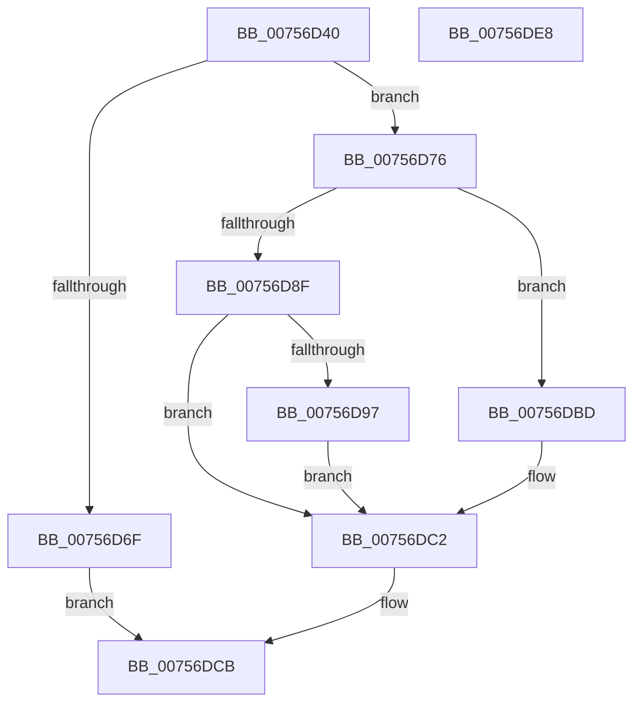

# PoSetThermalActiveCooling

- RVA: `0x00756D40`–`0x00756DE9` (길이 `169` bytes)
- VA: `0x0000000140756D40`
- 실행 섹션: `PAGE`
- PDB 이름 있음: `예`; PDB Function 태그: `아니요`
- unwind 정보 RVA: `0x0005E6B4`
- 디코드: `49`개 명령, `169/169` bytes 표시
- 미해석 바이트: `0` (있으면 어셈블리에 `.byte`로 보존)

> 이 문서는 커널 이미지의 기계어와 PDB 기호를 분석해 생성했습니다. 4번과 5번은 함수 원형과 자료형을 바이너리 사용 방식에서 추정한 C 해석이며 원본 소스 복구 결과는 아닙니다.

## 1. Dependencies

- 직접 호출 지점: **6**; 고유 호출 대상: **6**
- 직접 호출자로 확인된 함수: **0**
- RIP 상대 이미지 참조: **0**

### Outgoing calls
- `0x00756D64` → [PoGetThermalRequestSupport](../70/PoGetThermalRequestSupport_function_00704470.md) (function, `0x00704470`)
- `0x00756D85` → [PopAcquireRwLockExclusive](../../text/43/PopAcquireRwLockExclusive_function_00430B44.md) (function, `0x00430B44`)
- `0x00756DA0` → [PopThermalUpdateActiveTimeTracking](../AB/PopThermalUpdateActiveTimeTracking_function_00ABA79C.md) (function, `0x00ABA79C`)
- `0x00756DAC` → [PopDiagTraceThermalRequestActiveUpdate](../76/PopDiagTraceThermalRequestActiveUpdate_function_00763684.md) (function, `0x00763684`)
- `0x00756DB6` → [PopPropogateCoolingChange](../../text/4E/PopPropogateCoolingChange_function_004E8FA0.md) (function, `0x004E8FA0`)
- `0x00756DC6` → [PopReleaseRwLock](../../text/2D/PopReleaseRwLock_function_002DFBBC.md) (function, `0x002DFBBC`)

### Direct callers
- 이 함수 시작 RVA로 연결되는 직접 call은 확인되지 않았습니다. 간접 호출은 완전히 역산할 수 없습니다.

### Static image references
- 디코드된 RIP-relative 메모리 참조가 없습니다.

## 2. Other-region calls and transfers

- 다른 실행 섹션으로 향하는 call: **3**
  - `0x00756D85` → [PopAcquireRwLockExclusive](../../text/43/PopAcquireRwLockExclusive_function_00430B44.md) (`PAGE` → `.text`)
  - `0x00756DB6` → [PopPropogateCoolingChange](../../text/4E/PopPropogateCoolingChange_function_004E8FA0.md) (`PAGE` → `.text`)
  - `0x00756DC6` → [PopReleaseRwLock](../../text/2D/PopReleaseRwLock_function_002DFBBC.md) (`PAGE` → `.text`)
- 별도 외부 분기/꼬리 이동을 확인하지 못했습니다.

## 3. Assembly (complete function range)

```asm
00756D40  48 8B C4                        mov rax, rsp
00756D43  48 89 58 08                     mov qword ptr [rax + 8], rbx
00756D47  48 89 68 10                     mov qword ptr [rax + 0x10], rbp
00756D4B  48 89 70 18                     mov qword ptr [rax + 0x18], rsi
00756D4F  48 89 78 20                     mov qword ptr [rax + 0x20], rdi
00756D53  41 56                           push r14
00756D55  48 83 EC 20                     sub rsp, 0x20
00756D59  40 8A F2                        mov sil, dl
00756D5C  48 8B F9                        mov rdi, rcx
00756D5F  BA 01 00 00 00                  mov edx, 1
00756D64  E8 07 D7 FA FF                  call 0x140704470
00756D69  33 DB                           xor ebx, ebx
00756D6B  84 C0                           test al, al
00756D6D  75 07                           jne 0x140756d76
00756D6F  BB BB 00 00 C0                  mov ebx, 0xc00000bb
00756D74  EB 55                           jmp 0x140756dcb
00756D76  4C 8B 77 20                     mov r14, qword ptr [rdi + 0x20]
00756D7A  40 84 F6                        test sil, sil
00756D7D  40 0F 95 C5                     setne bpl
00756D81  49 8D 4E 20                     lea rcx, [r14 + 0x20]
00756D85  E8 BA 9D CD FF                  call 0x140430b44
00756D8A  38 5F 12                        cmp byte ptr [rdi + 0x12], bl
00756D8D  74 2E                           je 0x140756dbd
00756D8F  8A 47 11                        mov al, byte ptr [rdi + 0x11]
00756D92  40 3A C5                        cmp al, bpl
00756D95  74 2B                           je 0x140756dc2
00756D97  84 C0                           test al, al
00756D99  48 8D 4F 28                     lea rcx, [rdi + 0x28]
00756D9D  0F 94 C2                        sete dl
00756DA0  E8 F7 39 36 00                  call 0x140aba79c
00756DA5  48 8B CF                        mov rcx, rdi
00756DA8  40 88 6F 11                     mov byte ptr [rdi + 0x11], bpl
00756DAC  E8 D3 C8 00 00                  call 0x140763684
00756DB1  33 D2                           xor edx, edx
00756DB3  49 8B CE                        mov rcx, r14
00756DB6  E8 E5 21 D9 FF                  call 0x1404e8fa0
00756DBB  EB 05                           jmp 0x140756dc2
00756DBD  BB 89 01 00 C0                  mov ebx, 0xc0000189
00756DC2  49 8D 4E 20                     lea rcx, [r14 + 0x20]
00756DC6  E8 F1 8D B8 FF                  call 0x1402dfbbc
00756DCB  48 8B 6C 24 38                  mov rbp, qword ptr [rsp + 0x38]
00756DD0  8B C3                           mov eax, ebx
00756DD2  48 8B 5C 24 30                  mov rbx, qword ptr [rsp + 0x30]
00756DD7  48 8B 74 24 40                  mov rsi, qword ptr [rsp + 0x40]
00756DDC  48 8B 7C 24 48                  mov rdi, qword ptr [rsp + 0x48]
00756DE1  48 83 C4 20                     add rsp, 0x20
00756DE5  41 5E                           pop r14
00756DE7  C3                              ret
00756DE8  CC                              int3
```

## 4. C-style interpretation (structured pseudocode)

```c
__int64 __fastcall PoSetThermalActiveCooling(__int64 a1, unsigned __int8 a2)
{
    __int64 result;
    __int64 v_rbp;
    __int64 v_rbx;
    __int64 v_rsp;
    unsigned __int64 v_stack_p10;
    unsigned __int64 v_stack_p18;
    unsigned __int64 v_stack_p20;
    unsigned __int64 v_stack_p8;

    *(unsigned __int64 *)(v_rsp + 8) = v_rbx;
    *(unsigned __int64 *)(v_rsp + 16) = v_rbp;
    *(unsigned __int64 *)(v_rsp + 24) = v_rsi;
    *(unsigned __int64 *)(v_rsp + 32) = v_rdi;
    v_rsp = (v_rsp) - (32);
    result = PoGetThermalRequestSupport(a1, 1, a3, a4);
    v_rbx = 0;
    if ((unsigned __int8)(result) != 0) goto loc_00756D76;
    goto loc_00756DCB;
loc_00756D76:
    v_rbp = (a2 != 0) ? 1 : 0;
    result = PopAcquireRwLockExclusive(*(unsigned __int64 *)(a1 + 32) + 32, 1, a3, a4);
    if ((*(unsigned __int8 *)(a1 + 18)) == ((unsigned __int8)((unsigned int)(0xC00000BBULL)))) goto loc_00756DBD;
    if (((unsigned __int8)(*(unsigned __int8 *)(a1 + 17))) == ((unsigned __int8)(v_rbp))) goto loc_00756DC2;
    a2 = ((unsigned __int8)(*(unsigned __int8 *)(a1 + 17)) == 0) ? 1 : 0;
    result = PopThermalUpdateActiveTimeTracking(a1 + 40, a2, a3, a4);
    *(unsigned __int8 *)(a1 + 17) = (unsigned __int8)(v_rbp);
    result = PopDiagTraceThermalRequestActiveUpdate(a1, a2, a3, a4);
    a2 = 0;
    result = PopPropogateCoolingChange(*(unsigned __int64 *)(a1 + 32), a2, a3, a4);
    goto loc_00756DC2;
loc_00756DBD:
loc_00756DC2:
    result = PopReleaseRwLock(*(unsigned __int64 *)(a1 + 32) + 32, a2, a3, a4);
loc_00756DCB:
    v_rsp = (v_rsp) + (32);
    return (unsigned int)((unsigned int)((unsigned int)(0xC0000189ULL)));
}
```

## 5. (Beta) C Style

```c
int64_t PoSetThermalActiveCooling(void *Arg1, uint8_t Arg2)
{
    uint8_t *arg1 = (uint8_t *)Arg1;

    int64_t result;
    int64_t local_rbp;
    int64_t local_rbx;
    int64_t local_rsp;
    uint64_t v_stack_p10;
    uint64_t v_stack_p18;
    uint64_t v_stack_p20;
    uint64_t v_stack_p8;

    *(uint64_t *)(local_rsp + 0x8) = local_rbx;
    *(uint64_t *)(local_rsp + 0x10) = local_rbp;
    *(uint64_t *)(local_rsp + 0x18) = local_rsi;
    *(uint64_t *)(local_rsp + 0x20) = local_rdi;
    local_rsp = (local_rsp) - (32);
    result = PoGetThermalRequestSupport(Arg1, 1, a3, a4);
    local_rbx = 0;
    if ((uint8_t)(result) != 0) goto loc_00756D76;
    goto loc_00756DCB;
loc_00756D76:
    local_rbp = (Arg2 != 0) ? 1 : 0;
    result = PopAcquireRwLockExclusive(*(uint64_t *)(arg1 + 0x20) + 32, 1, a3, a4);
    if ((*(uint8_t *)(arg1 + 0x12)) == ((uint8_t)((uint32_t)(0xC00000BBULL)))) goto loc_00756DBD;
    if (((uint8_t)(*(uint8_t *)(arg1 + 0x11))) == ((uint8_t)(local_rbp))) goto loc_00756DC2;
    Arg2 = ((uint8_t)(*(uint8_t *)(arg1 + 0x11)) == 0) ? 1 : 0;
    result = PopThermalUpdateActiveTimeTracking(Arg1 + 40, Arg2, a3, a4);
    *(uint8_t *)(arg1 + 0x11) = (uint8_t)(local_rbp);
    result = PopDiagTraceThermalRequestActiveUpdate(Arg1, Arg2, a3, a4);
    Arg2 = 0;
    result = PopPropogateCoolingChange(*(uint64_t *)(arg1 + 0x20), Arg2, a3, a4);
    goto loc_00756DC2;
loc_00756DBD:
loc_00756DC2:
    result = PopReleaseRwLock(*(uint64_t *)(arg1 + 0x20) + 32, Arg2, a3, a4);
loc_00756DCB:
    local_rsp = (local_rsp) + (32);
    return (uint32_t)((uint32_t)((uint32_t)(0xC0000189ULL)));
}
```

### 관측된 메모리 오프셋

구조체 형식이 확인되지 않은 접근은 인자 기준의 오프셋으로만 기록했습니다.

| 기준 인자 | 오프셋 표현 | 폭 (bit) | 접근 |
|---|---:|---:|---|
| `Arg1` | `+ 0x11` | `8` | `R` |
| `Arg1` | `+ 0x11` | `8` | `W` |
| `Arg1` | `+ 0x12` | `8` | `R` |
| `Arg1` | `+ 0x20` | `64` | `R` |
| `Arg1` | `+ 0x28` | `64` | `R` |

## 6. Execution-region graph

[열기: 2D/3D 그래프와 함수 탐색 컨트롤 패널](../../../control-panel.html?section=page&rva=0x00756D40&view=graph)

- 2D 그래프는 위에서 아래로 흐르고, 3D 그래프는 빈 공간을 드래그해 회전합니다. Shift+드래그는 이동, 휠은 확대·축소, 함수 노드 선택은 대상 보고서 이동입니다.

### Static fallback


