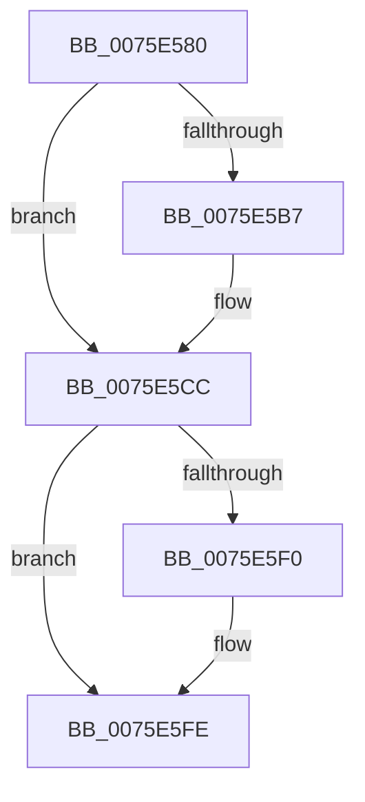

# PoShutdownBugCheck

- RVA: `0x0075E580`–`0x0075E670` (길이 `240` bytes)
- VA: `0x000000014075E580`
- 실행 섹션: `PAGE`
- PDB 이름 있음: `예`; PDB Function 태그: `아니요`
- unwind 정보 RVA: `0x000CC598`
- 디코드: `61`개 명령, `240/240` bytes 표시
- 미해석 바이트: `0` (있으면 어셈블리에 `.byte`로 보존)

> 이 문서는 커널 이미지의 기계어와 PDB 기호를 분석해 생성했습니다. 4번과 5번은 함수 원형과 자료형을 바이너리 사용 방식에서 추정한 C 해석이며 원본 소스 복구 결과는 아닙니다.

## 1. Dependencies

- 직접 호출 지점: **7**; 고유 호출 대상: **7**
- 직접 호출자로 확인된 함수: **2**
- RIP 상대 이미지 참조: **2**

### Outgoing calls
- `0x0075E5C7` → [KeDelayExecutionThread](../../text/20/KeDelayExecutionThread_function_00209550.md) (function, `0x00209550`)
- `0x0075E5D3` → [PopInternalAddToDumpFile](../../text/5C/PopInternalAddToDumpFile_function_005CE634.md) (function, `0x005CE634`)
- `0x0075E5F9` → [IoConfigureCrashDump](../../text/59/IoConfigureCrashDump_function_00591CB4.md) (function, `0x00591CB4`)
- `0x0075E60B` → [PsGetCurrentThreadId](../../text/43/PsGetCurrentThreadId_function_00439680.md) (function, `0x00439680`)
- `0x0075E614` → [PsGetCurrentProcessId](../../text/43/PsGetCurrentProcessId_function_00433560.md) (function, `0x00433560`)
- `0x0075E654` → [ZwInitiatePowerAction](../../text/6A/ZwInitiatePowerAction_function_006AF210.md) (function, `0x006AF210`)
- `0x0075E66A` → [KeBugCheckEx](../../text/4F/KeBugCheckEx_function_004FD660.md) (function, `0x004FD660`)

### Direct callers
- [PopInitializeHibernateGlobals](PopInitializeHibernateGlobals_function_0075DA64.md) at `0x0075DB68`
- [ExpSystemErrorHandler2](../../pagelk/B7/ExpSystemErrorHandler2_function_00B72C30.md) at `0x00B732BD`

### Static image references
- `0x0075E5A5` → RVA `0x00FC6AFE` (`ALMOSTRO`; read)
- `0x0075E64D` → RVA `0x00F0BD80` (`.data`; write)

## 2. Other-region calls and transfers

- 다른 실행 섹션으로 향하는 call: **7**
  - `0x0075E5C7` → [KeDelayExecutionThread](../../text/20/KeDelayExecutionThread_function_00209550.md) (`PAGE` → `.text`)
  - `0x0075E5D3` → [PopInternalAddToDumpFile](../../text/5C/PopInternalAddToDumpFile_function_005CE634.md) (`PAGE` → `.text`)
  - `0x0075E5F9` → [IoConfigureCrashDump](../../text/59/IoConfigureCrashDump_function_00591CB4.md) (`PAGE` → `.text`)
  - `0x0075E60B` → [PsGetCurrentThreadId](../../text/43/PsGetCurrentThreadId_function_00439680.md) (`PAGE` → `.text`)
  - `0x0075E614` → [PsGetCurrentProcessId](../../text/43/PsGetCurrentProcessId_function_00433560.md) (`PAGE` → `.text`)
  - `0x0075E654` → [ZwInitiatePowerAction](../../text/6A/ZwInitiatePowerAction_function_006AF210.md) (`PAGE` → `.text`)
  - `0x0075E66A` → [KeBugCheckEx](../../text/4F/KeBugCheckEx_function_004FD660.md) (`PAGE` → `.text`)
- 별도 외부 분기/꼬리 이동을 확인하지 못했습니다.

## 3. Assembly (complete function range)

```asm
0075E580  48 89 5C 24 08                  mov qword ptr [rsp + 8], rbx
0075E585  48 89 74 24 10                  mov qword ptr [rsp + 0x10], rsi
0075E58A  48 89 7C 24 20                  mov qword ptr [rsp + 0x20], rdi
0075E58F  55                              push rbp
0075E590  41 56                           push r14
0075E592  41 57                           push r15
0075E594  48 8B EC                        mov rbp, rsp
0075E597  48 81 EC 80 00 00 00            sub rsp, 0x80
0075E59E  83 65 D4 00                     and dword ptr [rbp - 0x2c], 0
0075E5A2  49 8B F1                        mov rsi, r9
0075E5A5  8A 05 53 85 86 00               mov al, byte ptr [rip + 0x868553]
0075E5AB  4D 8B F0                        mov r14, r8
0075E5AE  44 8B FA                        mov r15d, edx
0075E5B1  8A D9                           mov bl, cl
0075E5B3  84 C0                           test al, al
0075E5B5  74 15                           je 0x14075e5cc
0075E5B7  4C 8D 45 30                     lea r8, [rbp + 0x30]
0075E5BB  48 C7 45 30 00 5D 1E EE         mov qword ptr [rbp + 0x30], 0xffffffffee1e5d00
0075E5C3  33 D2                           xor edx, edx
0075E5C5  33 C9                           xor ecx, ecx
0075E5C7  E8 84 AF AA FF                  call 0x140209550
0075E5CC  45 33 C0                        xor r8d, r8d
0075E5CF  33 D2                           xor edx, edx
0075E5D1  33 C9                           xor ecx, ecx
0075E5D3  E8 5C 00 E7 FF                  call 0x1405ce634
0075E5D8  65 48 8B 04 25 88 01 00 00      mov rax, qword ptr gs:[0x188]
0075E5E1  48 8B 88 B8 00 00 00            mov rcx, qword ptr [rax + 0xb8]
0075E5E8  48 89 4D B8                     mov qword ptr [rbp - 0x48], rcx
0075E5EC  84 DB                           test bl, bl
0075E5EE  75 0E                           jne 0x14075e5fe
0075E5F0  48 83 65 B8 00                  and qword ptr [rbp - 0x48], 0
0075E5F5  33 D2                           xor edx, edx
0075E5F7  33 C9                           xor ecx, ecx
0075E5F9  E8 B6 36 E3 FF                  call 0x140591cb4
0075E5FE  65 48 8B 04 25 88 01 00 00      mov rax, qword ptr gs:[0x188]
0075E607  48 89 45 B0                     mov qword ptr [rbp - 0x50], rax
0075E60B  E8 70 B0 CD FF                  call 0x140439680
0075E610  48 89 45 C0                     mov qword ptr [rbp - 0x40], rax
0075E614  E8 47 4F CD FF                  call 0x140433560
0075E619  48 8B 7D 40                     mov rdi, qword ptr [rbp + 0x40]
0075E61D  45 33 C9                        xor r9d, r9d
0075E620  48 8B 5D 48                     mov rbx, qword ptr [rbp + 0x48]
0075E624  41 B8 04 00 00 C0               mov r8d, 0xc0000004
0075E62A  48 89 45 C8                     mov qword ptr [rbp - 0x38], rax
0075E62E  48 8D 45 B0                     lea rax, [rbp - 0x50]
0075E632  44 89 7D D0                     mov dword ptr [rbp - 0x30], r15d
0075E636  41 8D 51 04                     lea edx, [r9 + 4]
0075E63A  4C 89 75 D8                     mov qword ptr [rbp - 0x28], r14
0075E63E  8D 4A 01                        lea ecx, [rdx + 1]
0075E641  48 89 75 E0                     mov qword ptr [rbp - 0x20], rsi
0075E645  48 89 7D E8                     mov qword ptr [rbp - 0x18], rdi
0075E649  48 89 5D F0                     mov qword ptr [rbp - 0x10], rbx
0075E64D  48 89 05 2C D7 7A 00            mov qword ptr [rip + 0x7ad72c], rax
0075E654  E8 B7 0B F5 FF                  call 0x1406af210
0075E659  4C 8B CF                        mov r9, rdi
0075E65C  48 89 5C 24 20                  mov qword ptr [rsp + 0x20], rbx
0075E661  4C 8B C6                        mov r8, rsi
0075E664  49 8B D6                        mov rdx, r14
0075E667  41 8B CF                        mov ecx, r15d
0075E66A  E8 F1 EF D9 FF                  call 0x1404fd660
0075E66F  CC                              int3
```

## 4. C-style interpretation (structured pseudocode)

```c
__int64 __fastcall PoShutdownBugCheck(int a1, int a2, __int64 a3, __int64 a4, __int64 a5, __int64 a6)
{
    __int64 result;
    __int64 v_rsp;
    unsigned __int64 v_stack_m28;
    unsigned __int64 v_stack_m30;
    unsigned __int64 v_stack_m38;
    unsigned __int64 v_stack_m40;
    unsigned int v_stack_m44;
    unsigned int v_stack_m48;
    unsigned __int64 v_stack_m50;
    unsigned __int64 v_stack_m58;
    unsigned __int64 v_stack_m60;
    unsigned __int64 v_stack_m68;
    unsigned __int64 v_stack_m78;
    unsigned __int64 v_stack_p10;
    unsigned __int64 v_stack_p18;
    unsigned __int64 v_stack_p20;
    unsigned __int64 v_stack_p8;

    v_stack_p8 = v_rbx;
    v_stack_p10 = v_rsi;
    v_stack_p20 = v_rdi;
    v_rsp = (v_rsp) - (128);
    result = *(unsigned __int8 *)(v_rip + 8815955);
    if ((unsigned __int8)(*(unsigned __int8 *)(v_rip + 8815955)) != 0) {
        a3 = v_stack_p18;
        v_stack_p18 = 0xFFFFFFFFEE1E5D00ULL;
        a2 = 0;
        a1 = 0;
        result = KeDelayExecutionThread(a1, a2, a3, a4);
    }
    a3 = 0;
    a2 = 0;
    a1 = 0;
    result = PopInternalAddToDumpFile(a1, a2, a3, a4);
    v_stack_m60 = *(unsigned __int64 *)(*(unsigned __int64 *)(gs_base + (0 + 392)) + 184);
    result = *(unsigned __int64 *)(gs_base + (0 + 392));
    if ((unsigned __int8)((unsigned __int8)(a1)) == 0) {
        a2 = 0;
        a1 = 0;
        result = IoConfigureCrashDump(a1, a2, a3, a4);
    }
    v_stack_m68 = *(unsigned __int64 *)(gs_base + (0 + 392));
    result = PsGetCurrentThreadId(a1, a2, a3, a4);
    v_stack_m58 = result;
    result = PsGetCurrentProcessId(a1, a2, a3, a4);
    a4 = 0;
    v_stack_m50 = result;
    v_stack_m48 = (unsigned int)((unsigned int)(a2));
    v_stack_m40 = 0;
    v_stack_m38 = 0;
    v_stack_m30 = a5;
    v_stack_m28 = a6;
    *(unsigned __int64 *)(v_rip + 8050476) = v_stack_m68;
    result = ZwInitiatePowerAction(a4 + 4 + 1, a4 + 4, (unsigned int)(0xC0000004ULL), a4);
    v_stack_m78 = a6;
    result = KeBugCheckEx((unsigned int)((unsigned int)((unsigned int)(a2))), 0, 0, a5);
    return result;
}
```

## 5. (Beta) C Style

```c
int64_t PoShutdownBugCheck(int32_t Arg1, int32_t Arg2, int64_t Arg3, int64_t Arg4, int64_t Arg5, int64_t Arg6)
{
    int64_t result;
    int64_t local_rsp;
    uint64_t v_stack_m28;
    uint64_t v_stack_m30;
    uint64_t v_stack_m38;
    uint64_t v_stack_m40;
    uint32_t v_stack_m44;
    uint32_t v_stack_m48;
    uint64_t v_stack_m50;
    uint64_t v_stack_m58;
    uint64_t v_stack_m60;
    uint64_t v_stack_m68;
    uint64_t v_stack_m78;
    uint64_t v_stack_p10;
    uint64_t v_stack_p18;
    uint64_t v_stack_p20;
    uint64_t v_stack_p8;

    v_stack_p8 = local_rbx;
    v_stack_p10 = local_rsi;
    v_stack_p20 = local_rdi;
    local_rsp = (local_rsp) - (128);
    result = *(uint8_t *)(v_rip + 0x868553);
    if ((uint8_t)(*(uint8_t *)(v_rip + 0x868553)) != 0) {
        Arg3 = v_stack_p18;
        v_stack_p18 = 0xFFFFFFFFEE1E5D00ULL;
        Arg2 = 0;
        Arg1 = 0;
        result = KeDelayExecutionThread(Arg1, Arg2, Arg3, Arg4);
    }
    Arg3 = 0;
    Arg2 = 0;
    Arg1 = 0;
    result = PopInternalAddToDumpFile(Arg1, Arg2, Arg3, Arg4);
    v_stack_m60 = *(uint64_t *)(*(uint64_t *)(gs_base + (0 + 0x188)) + 0xB8);
    result = *(uint64_t *)(gs_base + (0 + 0x188));
    if ((uint8_t)((uint8_t)(Arg1)) == 0) {
        Arg2 = 0;
        Arg1 = 0;
        result = IoConfigureCrashDump(Arg1, Arg2, Arg3, Arg4);
    }
    v_stack_m68 = *(uint64_t *)(gs_base + (0 + 0x188));
    result = PsGetCurrentThreadId(Arg1, Arg2, Arg3, Arg4);
    v_stack_m58 = result;
    result = PsGetCurrentProcessId(Arg1, Arg2, Arg3, Arg4);
    Arg4 = 0;
    v_stack_m50 = result;
    v_stack_m48 = (uint32_t)((uint32_t)(Arg2));
    v_stack_m40 = 0;
    v_stack_m38 = 0;
    v_stack_m30 = Arg5;
    v_stack_m28 = Arg6;
    *(uint64_t *)(v_rip + 0x7AD72C) = v_stack_m68;
    result = ZwInitiatePowerAction(Arg4 + 4 + 1, Arg4 + 4, (uint32_t)(0xC0000004ULL), Arg4);
    v_stack_m78 = Arg6;
    result = KeBugCheckEx((uint32_t)((uint32_t)((uint32_t)(Arg2))), 0, 0, Arg5);
    return result;
}
```

## 6. Execution-region graph

[열기: 2D/3D 그래프와 함수 탐색 컨트롤 패널](../../../control-panel.html?section=page&rva=0x0075E580&view=graph)

- 2D 그래프는 위에서 아래로 흐르고, 3D 그래프는 빈 공간을 드래그해 회전합니다. Shift+드래그는 이동, 휠은 확대·축소, 함수 노드 선택은 대상 보고서 이동입니다.

### Static fallback


