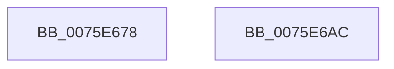

# PoStartPartitionReplace

- RVA: `0x0075E678`–`0x0075E6AD` (길이 `53` bytes)
- VA: `0x000000014075E678`
- 실행 섹션: `PAGE`
- PDB 이름 있음: `예`; PDB Function 태그: `아니요`
- unwind 정보 RVA: `0x0008A2E0`
- 디코드: `15`개 명령, `53/53` bytes 표시
- 미해석 바이트: `0` (있으면 어셈블리에 `.byte`로 보존)

> 이 문서는 커널 이미지의 기계어와 PDB 기호를 분석해 생성했습니다. 4번과 5번은 함수 원형과 자료형을 바이너리 사용 방식에서 추정한 C 해석이며 원본 소스 복구 결과는 아닙니다.

## 1. Dependencies

- 직접 호출 지점: **2**; 고유 호출 대상: **1**
- 직접 호출자로 확인된 함수: **1**
- RIP 상대 이미지 참조: **0**

### Outgoing calls
- `0x0075E690` → [PopDispatchStateCallout](../91/PopDispatchStateCallout_function_0091248C.md) (function, `0x0091248C`)
- `0x0075E6A1` → [PopDispatchStateCallout](../91/PopDispatchStateCallout_function_0091248C.md) (function, `0x0091248C`)

### Direct callers
- [PnprQuiesceDevices](../../pagelk/B6/PnprQuiesceDevices_function_00B649E4.md) at `0x00B64A8D`

### Static image references
- 디코드된 RIP-relative 메모리 참조가 없습니다.

## 2. Other-region calls and transfers

- 다른 실행 섹션으로 향하는 call: **0**
- 별도 외부 분기/꼬리 이동을 확인하지 못했습니다.

## 3. Assembly (complete function range)

```asm
0075E678  89 54 24 10                     mov dword ptr [rsp + 0x10], edx
0075E67C  53                              push rbx
0075E67D  48 83 EC 20                     sub rsp, 0x20
0075E681  48 8D 54 24 38                  lea rdx, [rsp + 0x38]
0075E686  C7 41 20 0A 00 00 00            mov dword ptr [rcx + 0x20], 0xa
0075E68D  48 8B D9                        mov rbx, rcx
0075E690  E8 F7 3D 1B 00                  call 0x14091248c
0075E695  33 D2                           xor edx, edx
0075E697  C7 43 20 09 00 00 00            mov dword ptr [rbx + 0x20], 9
0075E69E  48 8B CB                        mov rcx, rbx
0075E6A1  E8 E6 3D 1B 00                  call 0x14091248c
0075E6A6  48 83 C4 20                     add rsp, 0x20
0075E6AA  5B                              pop rbx
0075E6AB  C3                              ret
0075E6AC  CC                              int3
```

## 4. C-style interpretation (structured pseudocode)

```c
__int64 __fastcall PoStartPartitionReplace(__int64 a1, int a2)
{
    __int64 result;
    __int64 v_rsp;
    unsigned int v_stack_p10;

    v_stack_p10 = a2;
    v_rsp = (v_rsp) - (32);
    *(unsigned int *)(a1 + 32) = 10;
    result = PopDispatchStateCallout(a1, v_stack_p10, a3, a4);
    a2 = 0;
    *(unsigned int *)(a1 + 32) = 9;
    result = PopDispatchStateCallout(a1, a2, a3, a4);
    v_rsp = (v_rsp) + (32);
    return result;
}
```

## 5. (Beta) C Style

```c
int64_t PoStartPartitionReplace(void *Arg1, int32_t Arg2)
{
    uint8_t *arg1 = (uint8_t *)Arg1;

    int64_t result;
    int64_t local_rsp;
    uint32_t v_stack_p10;

    v_stack_p10 = Arg2;
    local_rsp = (local_rsp) - (32);
    *(uint32_t *)(arg1 + 0x20) = 10;
    result = PopDispatchStateCallout(Arg1, v_stack_p10, a3, a4);
    Arg2 = 0;
    *(uint32_t *)(arg1 + 0x20) = 9;
    result = PopDispatchStateCallout(Arg1, Arg2, a3, a4);
    local_rsp = (local_rsp) + (32);
    return result;
}
```

### 관측된 메모리 오프셋

구조체 형식이 확인되지 않은 접근은 인자 기준의 오프셋으로만 기록했습니다.

| 기준 인자 | 오프셋 표현 | 폭 (bit) | 접근 |
|---|---:|---:|---|
| `Arg1` | `+ 0x20` | `32` | `W` |

## 6. Execution-region graph

[열기: 2D/3D 그래프와 함수 탐색 컨트롤 패널](../../../control-panel.html?section=page&rva=0x0075E678&view=graph)

- 2D 그래프는 위에서 아래로 흐르고, 3D 그래프는 빈 공간을 드래그해 회전합니다. Shift+드래그는 이동, 휠은 확대·축소, 함수 노드 선택은 대상 보고서 이동입니다.

### Static fallback


