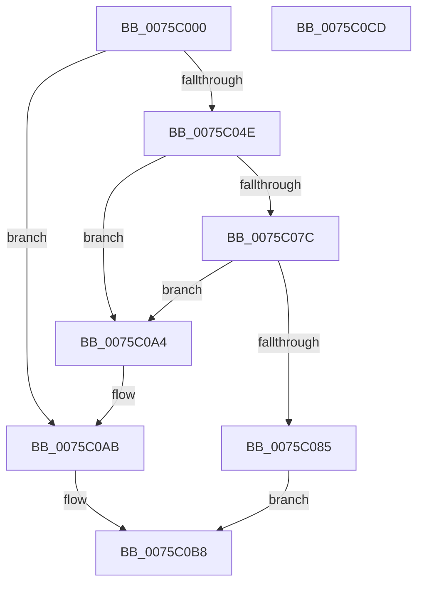

# PoUnregisterCoalescingCallback

- RVA: `0x0075C000`–`0x0075C0CE` (길이 `206` bytes)
- VA: `0x000000014075C000`
- 실행 섹션: `PAGE`
- PDB 이름 있음: `예`; PDB Function 태그: `아니요`
- unwind 정보 RVA: `0x0005C954`
- 디코드: `55`개 명령, `206/206` bytes 표시
- 미해석 바이트: `0` (있으면 어셈블리에 `.byte`로 보존)

> 이 문서는 커널 이미지의 기계어와 PDB 기호를 분석해 생성했습니다. 4번과 5번은 함수 원형과 자료형을 바이너리 사용 방식에서 추정한 C 해석이며 원본 소스 복구 결과는 아닙니다.

## 1. Dependencies

- 직접 호출 지점: **10**; 고유 호출 대상: **8**
- 직접 호출자로 확인된 함수: **0**
- RIP 상대 이미지 참조: **1**

### Outgoing calls
- `0x0075C02F` → [ExReferenceCallBackBlock](../../text/2F/ExReferenceCallBackBlock_function_002F0040.md) (function, `0x002F0040`)
- `0x0075C03F` → [ExCompareExchangeCallBack](../../text/41/ExCompareExchangeCallBack_function_0041BCD0.md) (function, `0x0041BCD0`)
- `0x0075C04E` → [ExDereferenceCallBackBlock](../../text/44/ExDereferenceCallBackBlock_function_0044D730.md) (function, `0x0044D730`)
- `0x0075C056` → [KiLeaveCriticalRegionUnsafe](../../text/25/KiLeaveCriticalRegionUnsafe_function_0025F010.md) (function, `0x0025F010`)
- `0x0075C05E` → [ExWaitForRundownProtectionRelease](../../text/2A/ExWaitForRundownProtectionRelease_function_002A4CB0.md) (function, `0x002A4CB0`)
- `0x0075C06A` → [PopAcquireRwLockExclusive](../../text/43/PopAcquireRwLockExclusive_function_00430B44.md) (function, `0x00430B44`)
- `0x0075C093` → [PopReleaseRwLock](../../text/2D/PopReleaseRwLock_function_002DFBBC.md) (function, `0x002DFBBC`)
- `0x0075C09D` → [ExFreePoolWithTag](../../poolcode/B8/ExFreePoolWithTag_function_00B82870.md) (function, `0x00B82870`)
- `0x0075C0AB` → [ExDereferenceCallBackBlock](../../text/44/ExDereferenceCallBackBlock_function_0044D730.md) (function, `0x0044D730`)
- `0x0075C0B3` → [KiLeaveCriticalRegionUnsafe](../../text/25/KiLeaveCriticalRegionUnsafe_function_0025F010.md) (function, `0x0025F010`)

### Direct callers
- 이 함수 시작 RVA로 연결되는 직접 call은 확인되지 않았습니다. 간접 호출은 완전히 역산할 수 없습니다.

### Static image references
- `0x0075C063` → RVA `0x00F0E070` (`.data`; read)

## 2. Other-region calls and transfers

- 다른 실행 섹션으로 향하는 call: **10**
  - `0x0075C02F` → [ExReferenceCallBackBlock](../../text/2F/ExReferenceCallBackBlock_function_002F0040.md) (`PAGE` → `.text`)
  - `0x0075C03F` → [ExCompareExchangeCallBack](../../text/41/ExCompareExchangeCallBack_function_0041BCD0.md) (`PAGE` → `.text`)
  - `0x0075C04E` → [ExDereferenceCallBackBlock](../../text/44/ExDereferenceCallBackBlock_function_0044D730.md) (`PAGE` → `.text`)
  - `0x0075C056` → [KiLeaveCriticalRegionUnsafe](../../text/25/KiLeaveCriticalRegionUnsafe_function_0025F010.md) (`PAGE` → `.text`)
  - `0x0075C05E` → [ExWaitForRundownProtectionRelease](../../text/2A/ExWaitForRundownProtectionRelease_function_002A4CB0.md) (`PAGE` → `.text`)
  - `0x0075C06A` → [PopAcquireRwLockExclusive](../../text/43/PopAcquireRwLockExclusive_function_00430B44.md) (`PAGE` → `.text`)
  - `0x0075C093` → [PopReleaseRwLock](../../text/2D/PopReleaseRwLock_function_002DFBBC.md) (`PAGE` → `.text`)
  - `0x0075C09D` → [ExFreePoolWithTag](../../poolcode/B8/ExFreePoolWithTag_function_00B82870.md) (`PAGE` → `POOLCODE`)
  - `0x0075C0AB` → [ExDereferenceCallBackBlock](../../text/44/ExDereferenceCallBackBlock_function_0044D730.md) (`PAGE` → `.text`)
  - `0x0075C0B3` → [KiLeaveCriticalRegionUnsafe](../../text/25/KiLeaveCriticalRegionUnsafe_function_0025F010.md) (`PAGE` → `.text`)
- 별도 외부 분기/꼬리 이동을 확인하지 못했습니다.

## 3. Assembly (complete function range)

```asm
0075C000  48 89 5C 24 08                  mov qword ptr [rsp + 8], rbx
0075C005  48 89 6C 24 10                  mov qword ptr [rsp + 0x10], rbp
0075C00A  48 89 74 24 18                  mov qword ptr [rsp + 0x18], rsi
0075C00F  57                              push rdi
0075C010  48 83 EC 20                     sub rsp, 0x20
0075C014  65 48 8B 3C 25 88 01 00 00      mov rdi, qword ptr gs:[0x188]
0075C01D  48 8D 71 40                     lea rsi, [rcx + 0x40]
0075C021  48 8B E9                        mov rbp, rcx
0075C024  48 8B CE                        mov rcx, rsi
0075C027  66 FF 8F E4 01 00 00            dec word ptr [rdi + 0x1e4]
0075C02E  90                              nop
0075C02F  E8 0C 40 B9 FF                  call 0x1402f0040
0075C034  4C 8B C0                        mov r8, rax
0075C037  33 D2                           xor edx, edx
0075C039  48 8B CE                        mov rcx, rsi
0075C03C  48 8B D8                        mov rbx, rax
0075C03F  E8 8C FC CB FF                  call 0x14041bcd0
0075C044  48 8B D3                        mov rdx, rbx
0075C047  48 8B CE                        mov rcx, rsi
0075C04A  84 C0                           test al, al
0075C04C  74 5D                           je 0x14075c0ab
0075C04E  E8 DD 16 CF FF                  call 0x14044d730
0075C053  48 8B CF                        mov rcx, rdi
0075C056  E8 B5 2F B0 FF                  call 0x14025f010
0075C05B  48 8B CB                        mov rcx, rbx
0075C05E  E8 4D 8C B4 FF                  call 0x1402a4cb0
0075C063  48 8D 0D 06 20 7B 00            lea rcx, [rip + 0x7b2006]
0075C06A  E8 D5 4A CD FF                  call 0x140430b44
0075C06F  48 8D 55 30                     lea rdx, [rbp + 0x30]
0075C073  4C 8B 02                        mov r8, qword ptr [rdx]
0075C076  49 39 50 08                     cmp qword ptr [r8 + 8], rdx
0075C07A  75 28                           jne 0x14075c0a4
0075C07C  48 8B 42 08                     mov rax, qword ptr [rdx + 8]
0075C080  48 39 10                        cmp qword ptr [rax], rdx
0075C083  75 1F                           jne 0x14075c0a4
0075C085  4C 89 00                        mov qword ptr [rax], r8
0075C088  48 8D 0D E1 1F 7B 00            lea rcx, [rip + 0x7b1fe1]
0075C08F  49 89 40 08                     mov qword ptr [r8 + 8], rax
0075C093  E8 24 3B B8 FF                  call 0x1402dfbbc
0075C098  33 D2                           xor edx, edx
0075C09A  48 8B CB                        mov rcx, rbx
0075C09D  E8 CE 67 42 00                  call 0x140b82870
0075C0A2  EB 14                           jmp 0x14075c0b8
0075C0A4  B9 03 00 00 00                  mov ecx, 3
0075C0A9  CD 29                           int 0x29
0075C0AB  E8 80 16 CF FF                  call 0x14044d730
0075C0B0  48 8B CF                        mov rcx, rdi
0075C0B3  E8 58 2F B0 FF                  call 0x14025f010
0075C0B8  48 8B 5C 24 30                  mov rbx, qword ptr [rsp + 0x30]
0075C0BD  48 8B 6C 24 38                  mov rbp, qword ptr [rsp + 0x38]
0075C0C2  48 8B 74 24 40                  mov rsi, qword ptr [rsp + 0x40]
0075C0C7  48 83 C4 20                     add rsp, 0x20
0075C0CB  5F                              pop rdi
0075C0CC  C3                              ret
0075C0CD  CC                              int3
```

## 4. C-style interpretation (structured pseudocode)

```c
__int64 __fastcall PoUnregisterCoalescingCallback(__int64 a1, int a2)
{
    __int64 result;
    __int64 v_rsp;
    unsigned __int64 v_stack_p10;
    unsigned __int64 v_stack_p18;
    unsigned __int64 v_stack_p8;

    v_stack_p8 = v_rbx;
    v_stack_p10 = v_rbp;
    v_stack_p18 = v_rsi;
    v_rsp = (v_rsp) - (32);
    result = ExReferenceCallBackBlock(a1 + 64, a2, a3, a4);
    a2 = 0;
    result = ExCompareExchangeCallBack(a1 + 64, a2, result, a4);
    if ((unsigned __int8)(result) == 0) goto loc_0075C0AB;
    result = ExDereferenceCallBackBlock(a1 + 64, result, result, a4);
    result = KiLeaveCriticalRegionUnsafe(*(unsigned __int64 *)(gs_base + (0 + 392)), result, result, a4);
    result = ExWaitForRundownProtectionRelease(result, result, result, a4);
    result = PopAcquireRwLockExclusive(v_rip + 8069126, result, result, a4);
    if ((*(unsigned __int64 *)(*(unsigned __int64 *)(a1 + 48) + 8)) != (a1 + 48)) goto loc_0075C0A4;
    if ((*(unsigned __int64 *)(*(unsigned __int64 *)(a1 + 48 + 8))) != (a1 + 48)) goto loc_0075C0A4;
    *(unsigned __int64 *)(*(unsigned __int64 *)(a1 + 48 + 8)) = *(unsigned __int64 *)(a1 + 48);
    *(unsigned __int64 *)(*(unsigned __int64 *)(a1 + 48) + 8) = *(unsigned __int64 *)(a1 + 48 + 8);
    result = PopReleaseRwLock(v_rip + 8069089, a1 + 48, *(unsigned __int64 *)(a1 + 48), a4);
    a2 = 0;
    result = ExFreePoolWithTag(result, a2, *(unsigned __int64 *)(a1 + 48), a4);
    goto loc_0075C0B8;
loc_0075C0A4:
loc_0075C0AB:
    result = ExDereferenceCallBackBlock(3, a2, *(unsigned __int64 *)(a1 + 48), a4);
    result = KiLeaveCriticalRegionUnsafe(*(unsigned __int64 *)(gs_base + (0 + 392)), a2, *(unsigned __int64 *)(a1 + 48), a4);
loc_0075C0B8:
    v_rsp = (v_rsp) + (32);
    return result;
}
```

## 5. (Beta) C Style

```c
int64_t PoUnregisterCoalescingCallback(void *Arg1, int32_t Arg2)
{
    uint8_t *arg1 = (uint8_t *)Arg1;

    int64_t result;
    int64_t local_rsp;
    uint64_t v_stack_p10;
    uint64_t v_stack_p18;
    uint64_t v_stack_p8;

    v_stack_p8 = local_rbx;
    v_stack_p10 = local_rbp;
    v_stack_p18 = local_rsi;
    local_rsp = (local_rsp) - (32);
    result = ExReferenceCallBackBlock(Arg1 + 64, Arg2, a3, a4);
    Arg2 = 0;
    result = ExCompareExchangeCallBack(Arg1 + 64, Arg2, result, a4);
    if ((uint8_t)(result) == 0) goto loc_0075C0AB;
    result = ExDereferenceCallBackBlock(Arg1 + 64, result, result, a4);
    result = KiLeaveCriticalRegionUnsafe(*(uint64_t *)(gs_base + (0 + 0x188)), result, result, a4);
    result = ExWaitForRundownProtectionRelease(result, result, result, a4);
    result = PopAcquireRwLockExclusive(v_rip + 8069126, result, result, a4);
    if ((*(uint64_t *)(*(uint64_t *)(arg1 + 0x30) + 0x8)) != (Arg1 + 48)) goto loc_0075C0A4;
    if ((*(uint64_t *)(*(uint64_t *)(arg1 + 0x30 + 0x8))) != (Arg1 + 48)) goto loc_0075C0A4;
    *(uint64_t *)(*(uint64_t *)(arg1 + 0x30 + 0x8)) = *(uint64_t *)(arg1 + 0x30);
    *(uint64_t *)(*(uint64_t *)(arg1 + 0x30) + 0x8) = *(uint64_t *)(arg1 + 0x30 + 0x8);
    result = PopReleaseRwLock(v_rip + 8069089, Arg1 + 48, *(uint64_t *)(arg1 + 0x30), a4);
    Arg2 = 0;
    result = ExFreePoolWithTag(result, Arg2, *(uint64_t *)(arg1 + 0x30), a4);
    goto loc_0075C0B8;
loc_0075C0A4:
loc_0075C0AB:
    result = ExDereferenceCallBackBlock(3, Arg2, *(uint64_t *)(arg1 + 0x30), a4);
    result = KiLeaveCriticalRegionUnsafe(*(uint64_t *)(gs_base + (0 + 0x188)), Arg2, *(uint64_t *)(arg1 + 0x30), a4);
loc_0075C0B8:
    local_rsp = (local_rsp) + (32);
    return result;
}
```

### 관측된 메모리 오프셋

구조체 형식이 확인되지 않은 접근은 인자 기준의 오프셋으로만 기록했습니다.

| 기준 인자 | 오프셋 표현 | 폭 (bit) | 접근 |
|---|---:|---:|---|
| `Arg1` | `+ 0x0` | `64` | `R` |
| `Arg1` | `+ 0x8` | `64` | `R` |
| `Arg1` | `+ 0x30` | `64` | `R` |
| `Arg1` | `+ 0x40` | `64` | `R` |

## 6. Execution-region graph

[열기: 2D/3D 그래프와 함수 탐색 컨트롤 패널](../../../control-panel.html?section=page&rva=0x0075C000&view=graph)

- 2D 그래프는 위에서 아래로 흐르고, 3D 그래프는 빈 공간을 드래그해 회전합니다. Shift+드래그는 이동, 휠은 확대·축소, 함수 노드 선택은 대상 보고서 이동입니다.

### Static fallback


