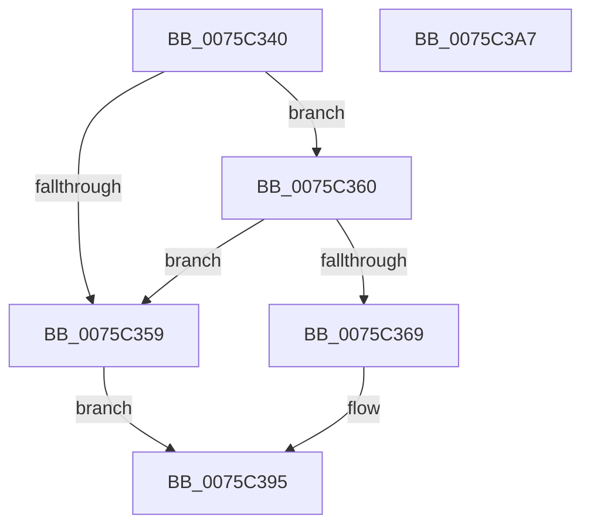

# PoUnregisterFromEffectivePowerModeNotifications

- RVA: `0x0075C340`–`0x0075C3A8` (길이 `104` bytes)
- VA: `0x000000014075C340`
- 실행 섹션: `PAGE`
- PDB 이름 있음: `예`; PDB Function 태그: `아니요`
- unwind 정보 RVA: `0x00060BC4`
- 디코드: `29`개 명령, `104/104` bytes 표시
- 미해석 바이트: `0` (있으면 어셈블리에 `.byte`로 보존)

> 이 문서는 커널 이미지의 기계어와 PDB 기호를 분석해 생성했습니다. 4번과 5번은 함수 원형과 자료형을 바이너리 사용 방식에서 추정한 C 해석이며 원본 소스 복구 결과는 아닙니다.

## 1. Dependencies

- 직접 호출 지점: **4**; 고유 호출 대상: **4**
- 직접 호출자로 확인된 함수: **0**
- RIP 상대 이미지 참조: **0**

### Outgoing calls
- `0x0075C36D` → [PopAcquireRwLockExclusive](../../text/43/PopAcquireRwLockExclusive_function_00430B44.md) (function, `0x00430B44`)
- `0x0075C37A` → [PopReleaseRwLock](../../text/2D/PopReleaseRwLock_function_002DFBBC.md) (function, `0x002DFBBC`)
- `0x0075C383` → [ExUnsubscribeWnfStateChange](../A7/ExUnsubscribeWnfStateChange_function_00A7BE50.md) (function, `0x00A7BE50`)
- `0x0075C390` → [ExFreePoolWithTag](../../poolcode/B8/ExFreePoolWithTag_function_00B82870.md) (function, `0x00B82870`)

### Direct callers
- 이 함수 시작 RVA로 연결되는 직접 call은 확인되지 않았습니다. 간접 호출은 완전히 역산할 수 없습니다.

### Static image references
- 디코드된 RIP-relative 메모리 참조가 없습니다.

## 2. Other-region calls and transfers

- 다른 실행 섹션으로 향하는 call: **3**
  - `0x0075C36D` → [PopAcquireRwLockExclusive](../../text/43/PopAcquireRwLockExclusive_function_00430B44.md) (`PAGE` → `.text`)
  - `0x0075C37A` → [PopReleaseRwLock](../../text/2D/PopReleaseRwLock_function_002DFBBC.md) (`PAGE` → `.text`)
  - `0x0075C390` → [ExFreePoolWithTag](../../poolcode/B8/ExFreePoolWithTag_function_00B82870.md) (`PAGE` → `POOLCODE`)
- 별도 외부 분기/꼬리 이동을 확인하지 못했습니다.

## 3. Assembly (complete function range)

```asm
0075C340  48 89 5C 24 08                  mov qword ptr [rsp + 8], rbx
0075C345  48 89 74 24 10                  mov qword ptr [rsp + 0x10], rsi
0075C34A  57                              push rdi
0075C34B  48 83 EC 20                     sub rsp, 0x20
0075C34F  33 FF                           xor edi, edi
0075C351  48 8B F1                        mov rsi, rcx
0075C354  48 85 C9                        test rcx, rcx
0075C357  75 07                           jne 0x14075c360
0075C359  BF 0D 00 00 C0                  mov edi, 0xc000000d
0075C35E  EB 35                           jmp 0x14075c395
0075C360  81 79 20 BB DD EE FF            cmp dword ptr [rcx + 0x20], 0xffeeddbb
0075C367  75 F0                           jne 0x14075c359
0075C369  48 83 C1 28                     add rcx, 0x28
0075C36D  E8 D2 47 CD FF                  call 0x140430b44
0075C372  48 8D 4E 28                     lea rcx, [rsi + 0x28]
0075C376  48 89 7E 38                     mov qword ptr [rsi + 0x38], rdi
0075C37A  E8 3D 38 B8 FF                  call 0x1402dfbbc
0075C37F  48 8B 4E 18                     mov rcx, qword ptr [rsi + 0x18]
0075C383  E8 C8 FA 31 00                  call 0x140a7be50
0075C388  BA 50 53 65 74                  mov edx, 0x74655350
0075C38D  48 8B CE                        mov rcx, rsi
0075C390  E8 DB 64 42 00                  call 0x140b82870
0075C395  48 8B 5C 24 30                  mov rbx, qword ptr [rsp + 0x30]
0075C39A  8B C7                           mov eax, edi
0075C39C  48 8B 74 24 38                  mov rsi, qword ptr [rsp + 0x38]
0075C3A1  48 83 C4 20                     add rsp, 0x20
0075C3A5  5F                              pop rdi
0075C3A6  C3                              ret
0075C3A7  CC                              int3
```

## 4. C-style interpretation (structured pseudocode)

```c
__int64 __fastcall PoUnregisterFromEffectivePowerModeNotifications(__int64 a1)
{
    __int64 result;
    __int64 v_rdi;
    __int64 v_rsp;
    unsigned __int64 v_stack_p10;
    unsigned __int64 v_stack_p8;

    v_stack_p8 = v_rbx;
    v_stack_p10 = v_rsi;
    v_rsp = (v_rsp) - (32);
    v_rdi = 0;
    if (a1 != 0) goto loc_0075C360;
loc_0075C359:
    goto loc_0075C395;
loc_0075C360:
    if ((*(unsigned int *)(a1 + 32)) != 0xFFEEDDBBULL) goto loc_0075C359;
    a1 = (a1) + (40);
    result = PopAcquireRwLockExclusive(a1, a2, a3, a4);
    *(unsigned __int64 *)(a1 + 56) = (unsigned int)(0xC000000DULL);
    result = PopReleaseRwLock(a1 + 40, a2, a3, a4);
    result = ExUnsubscribeWnfStateChange(*(unsigned __int64 *)(a1 + 24), a2, a3, a4);
    result = ExFreePoolWithTag(a1, (unsigned int)(0x74655350ULL), a3, a4);
loc_0075C395:
    v_rsp = (v_rsp) + (32);
    return (unsigned int)((unsigned int)((unsigned int)(0xC000000DULL)));
}
```

## 5. (Beta) C Style

```c
int64_t PoUnregisterFromEffectivePowerModeNotifications(void *Arg1)
{
    uint8_t *arg1 = (uint8_t *)Arg1;

    int64_t result;
    int64_t local_rdi;
    int64_t local_rsp;
    uint64_t v_stack_p10;
    uint64_t v_stack_p8;

    v_stack_p8 = local_rbx;
    v_stack_p10 = local_rsi;
    local_rsp = (local_rsp) - (32);
    local_rdi = 0;
    if (Arg1 != NULL) goto loc_0075C360;
loc_0075C359:
    goto loc_0075C395;
loc_0075C360:
    if ((*(uint32_t *)(arg1 + 0x20)) != 0xFFEEDDBBULL) goto loc_0075C359;
    Arg1 = (Arg1) + (40);
    result = PopAcquireRwLockExclusive(Arg1, a2, a3, a4);
    *(uint64_t *)(arg1 + 0x38) = (uint32_t)(0xC000000DULL);
    result = PopReleaseRwLock(Arg1 + 40, a2, a3, a4);
    result = ExUnsubscribeWnfStateChange(*(uint64_t *)(arg1 + 0x18), a2, a3, a4);
    result = ExFreePoolWithTag(Arg1, (uint32_t)(0x74655350ULL), a3, a4);
loc_0075C395:
    local_rsp = (local_rsp) + (32);
    return (uint32_t)((uint32_t)((uint32_t)(0xC000000DULL)));
}
```

### 관측된 메모리 오프셋

구조체 형식이 확인되지 않은 접근은 인자 기준의 오프셋으로만 기록했습니다.

| 기준 인자 | 오프셋 표현 | 폭 (bit) | 접근 |
|---|---:|---:|---|
| `Arg1` | `+ 0x18` | `64` | `R` |
| `Arg1` | `+ 0x28` | `64` | `R` |
| `Arg1` | `+ 0x38` | `64` | `W` |

## 6. Execution-region graph

[열기: 2D/3D 그래프와 함수 탐색 컨트롤 패널](../../../control-panel.html?section=page&rva=0x0075C340&view=graph)

- 2D 그래프는 위에서 아래로 흐르고, 3D 그래프는 빈 공간을 드래그해 회전합니다. Shift+드래그는 이동, 휠은 확대·축소, 함수 노드 선택은 대상 보고서 이동입니다.

### Static fallback


