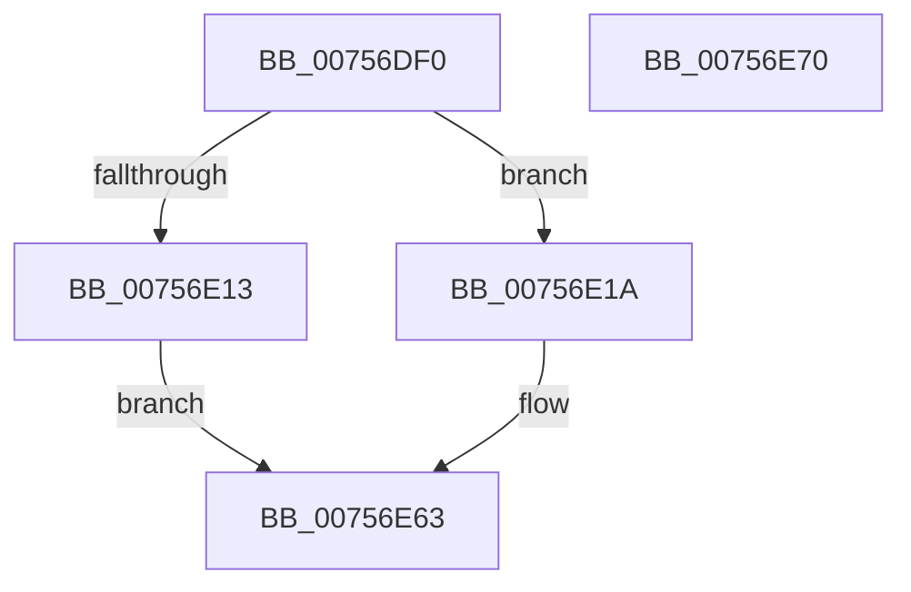

# PopAcquireCoolingInterface

- RVA: `0x00756DF0`–`0x00756E71` (길이 `129` bytes)
- VA: `0x0000000140756DF0`
- 실행 섹션: `PAGE`
- PDB 이름 있음: `예`; PDB Function 태그: `아니요`
- unwind 정보 RVA: `0x0005CAAC`
- 디코드: `34`개 명령, `129/129` bytes 표시
- 미해석 바이트: `0` (있으면 어셈블리에 `.byte`로 보존)

> 이 문서는 커널 이미지의 기계어와 PDB 기호를 분석해 생성했습니다. 4번과 5번은 함수 원형과 자료형을 바이너리 사용 방식에서 추정한 C 해석이며 원본 소스 복구 결과는 아닙니다.

## 1. Dependencies

- 직접 호출 지점: **3**; 고유 호출 대상: **3**
- 직접 호출자로 확인된 함수: **3**
- RIP 상대 이미지 참조: **1**

### Outgoing calls
- `0x00756E06` → [IoAllocateIrp](../../text/20/IoAllocateIrp_function_002065D0.md) (function, `0x002065D0`)
- `0x00756E54` → [IoSynchronousCallDriver](../../text/48/IoSynchronousCallDriver_function_00484050.md) (function, `0x00484050`)
- `0x00756E5E` → [IoFreeIrp](../../text/24/IoFreeIrp_function_0024DF70.md) (function, `0x0024DF70`)

### Direct callers
- [PopAssociateThermalRequest](PopAssociateThermalRequest_function_00756E78.md) at `0x00756F3E`
- [PopCoolingExtensionPnpNotification](PopCoolingExtensionPnpNotification_function_00757110.md) at `0x007571BE`
- [PopHandleCancelQueryRemove](PopHandleCancelQueryRemove_function_0075730C.md) at `0x00757375`

### Static image references
- `0x00756E24` → RVA `0x00024188` (`.rdata`; read)

## 2. Other-region calls and transfers

- 다른 실행 섹션으로 향하는 call: **3**
  - `0x00756E06` → [IoAllocateIrp](../../text/20/IoAllocateIrp_function_002065D0.md) (`PAGE` → `.text`)
  - `0x00756E54` → [IoSynchronousCallDriver](../../text/48/IoSynchronousCallDriver_function_00484050.md) (`PAGE` → `.text`)
  - `0x00756E5E` → [IoFreeIrp](../../text/24/IoFreeIrp_function_0024DF70.md) (`PAGE` → `.text`)
- 별도 외부 분기/꼬리 이동을 확인하지 못했습니다.

## 3. Assembly (complete function range)

```asm
00756DF0  48 89 5C 24 08                  mov qword ptr [rsp + 8], rbx
00756DF5  57                              push rdi
00756DF6  48 83 EC 20                     sub rsp, 0x20
00756DFA  48 8B D9                        mov rbx, rcx
00756DFD  33 D2                           xor edx, edx
00756DFF  48 8B 49 40                     mov rcx, qword ptr [rcx + 0x40]
00756E03  8A 49 4C                        mov cl, byte ptr [rcx + 0x4c]
00756E06  E8 C5 F7 AA FF                  call 0x1402065d0
00756E0B  48 8B F8                        mov rdi, rax
00756E0E  48 85 C0                        test rax, rax
00756E11  75 07                           jne 0x140756e1a
00756E13  BB 9A 00 00 C0                  mov ebx, 0xc000009a
00756E18  EB 49                           jmp 0x140756e63
00756E1A  48 8B 88 B8 00 00 00            mov rcx, qword ptr [rax + 0xb8]
00756E21  48 8B D7                        mov rdx, rdi
00756E24  48 8D 05 5D D3 8C FF            lea rax, [rip - 0x732ca3]
00756E2B  48 83 61 D8 00                  and qword ptr [rcx - 0x28], 0
00756E30  48 89 41 C0                     mov qword ptr [rcx - 0x40], rax
00756E34  48 8D 43 68                     lea rax, [rbx + 0x68]
00756E38  48 89 41 D0                     mov qword ptr [rcx - 0x30], rax
00756E3C  66 C7 41 B8 1B 08               mov word ptr [rcx - 0x48], 0x81b
00756E42  C7 41 C8 38 00 01 00            mov dword ptr [rcx - 0x38], 0x10038
00756E49  C7 47 30 BB 00 00 C0            mov dword ptr [rdi + 0x30], 0xc00000bb
00756E50  48 8B 4B 40                     mov rcx, qword ptr [rbx + 0x40]
00756E54  E8 F7 D1 D2 FF                  call 0x140484050
00756E59  8B D8                           mov ebx, eax
00756E5B  48 8B CF                        mov rcx, rdi
00756E5E  E8 0D 71 AF FF                  call 0x14024df70
00756E63  8B C3                           mov eax, ebx
00756E65  48 8B 5C 24 30                  mov rbx, qword ptr [rsp + 0x30]
00756E6A  48 83 C4 20                     add rsp, 0x20
00756E6E  5F                              pop rdi
00756E6F  C3                              ret
00756E70  CC                              int3
```

## 4. C-style interpretation (structured pseudocode)

```c
__int64 __fastcall PopAcquireCoolingInterface(__int64 a1, int a2)
{
    __int64 result;
    __int64 v_rsp;
    unsigned __int64 v_stack_p8;

    v_stack_p8 = v_rbx;
    v_rsp = (v_rsp) - (32);
    a2 = 0;
    result = IoAllocateIrp(*(unsigned __int8 *)(*(unsigned __int64 *)(a1 + 64) + 76), a2, a3, a4);
    if (result != 0) goto loc_00756E1A;
    goto loc_00756E63;
loc_00756E1A:
    *(unsigned __int64 *)(*(unsigned __int64 *)(result + 184) - 64) = v_rip - 7548067;
    *(unsigned __int64 *)(*(unsigned __int64 *)(result + 184) - 48) = (unsigned int)(0xC000009AULL) + 104;
    *(unsigned __int16 *)(*(unsigned __int64 *)(result + 184) - 72) = 0x81BULL;
    *(unsigned int *)(*(unsigned __int64 *)(result + 184) - 56) = 0x10038ULL;
    *(unsigned int *)(result + 48) = 0xC00000BBULL;
    result = IoSynchronousCallDriver(*(unsigned __int64 *)((unsigned int)(0xC000009AULL) + 64), result, a3, a4);
    result = IoFreeIrp(result, result, a3, a4);
loc_00756E63:
    v_rsp = (v_rsp) + (32);
    return (unsigned int)((unsigned int)((unsigned int)((unsigned int)(result))));
}
```

## 5. (Beta) C Style

```c
int64_t PopAcquireCoolingInterface(void *Arg1, int32_t Arg2)
{
    uint8_t *arg1 = (uint8_t *)Arg1;

    int64_t result;
    int64_t local_rsp;
    uint64_t v_stack_p8;

    v_stack_p8 = local_rbx;
    local_rsp = (local_rsp) - (32);
    Arg2 = 0;
    result = IoAllocateIrp(*(uint8_t *)(*(uint64_t *)(arg1 + 0x40) + 0x4C), Arg2, a3, a4);
    if (result != 0) goto loc_00756E1A;
    goto loc_00756E63;
loc_00756E1A:
    *(uint64_t *)(*(uint64_t *)(result + 0xB8) - 0x40) = v_rip - 7548067;
    *(uint64_t *)(*(uint64_t *)(result + 0xB8) - 0x30) = (uint32_t)(0xC000009AULL) + 104;
    *(uint16_t *)(*(uint64_t *)(result + 0xB8) - 0x48) = 0x81BULL;
    *(uint32_t *)(*(uint64_t *)(result + 0xB8) - 0x38) = 0x10038ULL;
    *(uint32_t *)(result + 0x30) = 0xC00000BBULL;
    result = IoSynchronousCallDriver(*(uint64_t *)((uint32_t)(0xC000009AULL) + 0x40), result, a3, a4);
    result = IoFreeIrp(result, result, a3, a4);
loc_00756E63:
    local_rsp = (local_rsp) + (32);
    return (uint32_t)((uint32_t)((uint32_t)((uint32_t)(result))));
}
```

### 관측된 메모리 오프셋

구조체 형식이 확인되지 않은 접근은 인자 기준의 오프셋으로만 기록했습니다.

| 기준 인자 | 오프셋 표현 | 폭 (bit) | 접근 |
|---|---:|---:|---|
| `Arg1` | `+ 0x40` | `64` | `R` |
| `Arg1` | `+ 0x68` | `64` | `R` |

## 6. Execution-region graph

[열기: 2D/3D 그래프와 함수 탐색 컨트롤 패널](../../../control-panel.html?section=page&rva=0x00756DF0&view=graph)

- 2D 그래프는 위에서 아래로 흐르고, 3D 그래프는 빈 공간을 드래그해 회전합니다. Shift+드래그는 이동, 휠은 확대·축소, 함수 노드 선택은 대상 보고서 이동입니다.

### Static fallback


