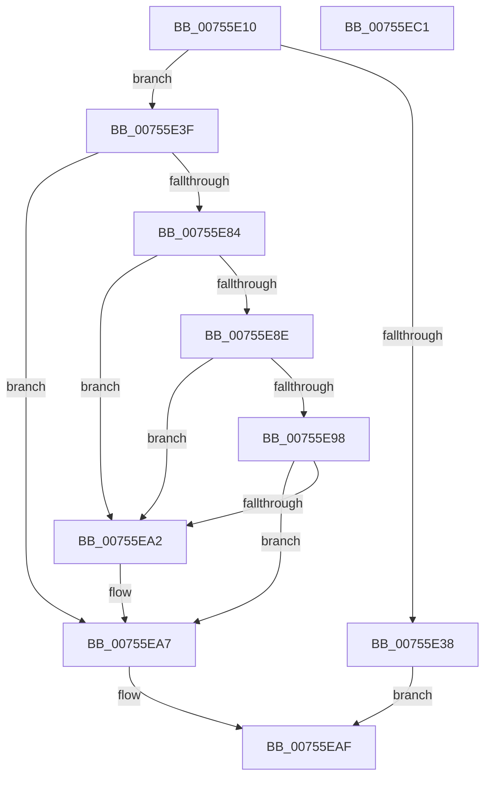

# PopAcquirePowerLimitInterface

- RVA: `0x00755E10`–`0x00755EC2` (길이 `178` bytes)
- VA: `0x0000000140755E10`
- 실행 섹션: `PAGE`
- PDB 이름 있음: `예`; PDB Function 태그: `아니요`
- unwind 정보 RVA: `0x00060BC4`
- 디코드: `45`개 명령, `178/178` bytes 표시
- 미해석 바이트: `0` (있으면 어셈블리에 `.byte`로 보존)

> 이 문서는 커널 이미지의 기계어와 PDB 기호를 분석해 생성했습니다. 4번과 5번은 함수 원형과 자료형을 바이너리 사용 방식에서 추정한 C 해석이며 원본 소스 복구 결과는 아닙니다.

## 1. Dependencies

- 직접 호출 지점: **3**; 고유 호출 대상: **3**
- 직접 호출자로 확인된 함수: **2**
- RIP 상대 이미지 참조: **1**

### Outgoing calls
- `0x00755E2B` → [IoAllocateIrp](../../text/20/IoAllocateIrp_function_002065D0.md) (function, `0x002065D0`)
- `0x00755E79` → [IoSynchronousCallDriver](../../text/48/IoSynchronousCallDriver_function_00484050.md) (function, `0x00484050`)
- `0x00755EAA` → [IoFreeIrp](../../text/24/IoFreeIrp_function_0024DF70.md) (function, `0x0024DF70`)

### Direct callers
- [PopAssociatePowerLimitRequest](PopAssociatePowerLimitRequest_function_00755EC8.md) at `0x00755F5F`
- [PopPowerLimitPnpNotification](PopPowerLimitPnpNotification_function_007567C0.md) at `0x00756863`

### Static image references
- `0x00755E49` → RVA `0x000240A8` (`.rdata`; read)

## 2. Other-region calls and transfers

- 다른 실행 섹션으로 향하는 call: **3**
  - `0x00755E2B` → [IoAllocateIrp](../../text/20/IoAllocateIrp_function_002065D0.md) (`PAGE` → `.text`)
  - `0x00755E79` → [IoSynchronousCallDriver](../../text/48/IoSynchronousCallDriver_function_00484050.md) (`PAGE` → `.text`)
  - `0x00755EAA` → [IoFreeIrp](../../text/24/IoFreeIrp_function_0024DF70.md) (`PAGE` → `.text`)
- 별도 외부 분기/꼬리 이동을 확인하지 못했습니다.

## 3. Assembly (complete function range)

```asm
00755E10  48 89 5C 24 08                  mov qword ptr [rsp + 8], rbx
00755E15  48 89 74 24 10                  mov qword ptr [rsp + 0x10], rsi
00755E1A  57                              push rdi
00755E1B  48 83 EC 20                     sub rsp, 0x20
00755E1F  48 8B D9                        mov rbx, rcx
00755E22  33 D2                           xor edx, edx
00755E24  48 8B 49 38                     mov rcx, qword ptr [rcx + 0x38]
00755E28  8A 49 4C                        mov cl, byte ptr [rcx + 0x4c]
00755E2B  E8 A0 07 AB FF                  call 0x1402065d0
00755E30  48 8B F0                        mov rsi, rax
00755E33  48 85 C0                        test rax, rax
00755E36  75 07                           jne 0x140755e3f
00755E38  BF 9A 00 00 C0                  mov edi, 0xc000009a
00755E3D  EB 70                           jmp 0x140755eaf
00755E3F  48 8B 88 B8 00 00 00            mov rcx, qword ptr [rax + 0xb8]
00755E46  48 8B D6                        mov rdx, rsi
00755E49  48 8D 05 58 E2 8C FF            lea rax, [rip - 0x731da8]
00755E50  48 83 61 D8 00                  and qword ptr [rcx - 0x28], 0
00755E55  48 89 41 C0                     mov qword ptr [rcx - 0x40], rax
00755E59  48 8D 43 70                     lea rax, [rbx + 0x70]
00755E5D  48 89 41 D0                     mov qword ptr [rcx - 0x30], rax
00755E61  66 C7 41 B8 1B 08               mov word ptr [rcx - 0x48], 0x81b
00755E67  C7 41 C8 40 00 01 00            mov dword ptr [rcx - 0x38], 0x10040
00755E6E  C7 46 30 BB 00 00 C0            mov dword ptr [rsi + 0x30], 0xc00000bb
00755E75  48 8B 4B 38                     mov rcx, qword ptr [rbx + 0x38]
00755E79  E8 D2 E1 D2 FF                  call 0x140484050
00755E7E  8B F8                           mov edi, eax
00755E80  85 C0                           test eax, eax
00755E82  78 23                           js 0x140755ea7
00755E84  48 83 BB 98 00 00 00 00         cmp qword ptr [rbx + 0x98], 0
00755E8C  74 14                           je 0x140755ea2
00755E8E  48 83 BB A0 00 00 00 00         cmp qword ptr [rbx + 0xa0], 0
00755E96  74 0A                           je 0x140755ea2
00755E98  48 83 BB A8 00 00 00 00         cmp qword ptr [rbx + 0xa8], 0
00755EA0  75 05                           jne 0x140755ea7
00755EA2  BF BB 00 00 C0                  mov edi, 0xc00000bb
00755EA7  48 8B CE                        mov rcx, rsi
00755EAA  E8 C1 80 AF FF                  call 0x14024df70
00755EAF  48 8B 5C 24 30                  mov rbx, qword ptr [rsp + 0x30]
00755EB4  8B C7                           mov eax, edi
00755EB6  48 8B 74 24 38                  mov rsi, qword ptr [rsp + 0x38]
00755EBB  48 83 C4 20                     add rsp, 0x20
00755EBF  5F                              pop rdi
00755EC0  C3                              ret
00755EC1  CC                              int3
```

## 4. C-style interpretation (structured pseudocode)

```c
__int64 __fastcall PopAcquirePowerLimitInterface(__int64 a1, int a2)
{
    __int64 result;
    __int64 v_rdi;
    __int64 v_rsp;
    unsigned __int64 v_stack_p10;
    unsigned __int64 v_stack_p8;

    v_stack_p8 = v_rbx;
    v_stack_p10 = v_rsi;
    v_rsp = (v_rsp) - (32);
    a2 = 0;
    result = IoAllocateIrp(*(unsigned __int8 *)(*(unsigned __int64 *)(a1 + 56) + 76), a2, a3, a4);
    if (result != 0) goto loc_00755E3F;
    goto loc_00755EAF;
loc_00755E3F:
    *(unsigned __int64 *)(*(unsigned __int64 *)(result + 184) - 64) = v_rip - 7544232;
    *(unsigned __int64 *)(*(unsigned __int64 *)(result + 184) - 48) = a1 + 112;
    *(unsigned __int16 *)(*(unsigned __int64 *)(result + 184) - 72) = 0x81BULL;
    *(unsigned int *)(*(unsigned __int64 *)(result + 184) - 56) = 0x10040ULL;
    *(unsigned int *)(result + 48) = 0xC00000BBULL;
    result = IoSynchronousCallDriver(*(unsigned __int64 *)(a1 + 56), result, a3, a4);
    if (sign_flag) goto loc_00755EA7;
    if ((*(unsigned __int64 *)(a1 + 152)) == 0) goto loc_00755EA2;
    if ((*(unsigned __int64 *)(a1 + 160)) == 0) goto loc_00755EA2;
    v_rdi = (unsigned int)((unsigned int)(result));
    if ((*(unsigned __int64 *)(a1 + 168)) == 0) {
        v_rdi = 0xC00000BBULL;
    }
    result = IoFreeIrp(result, result, a3, a4);
loc_00755EAF:
    v_rsp = (v_rsp) + (32);
    return (unsigned int)((unsigned int)(v_rdi));
}
```

## 5. (Beta) C Style

```c
int64_t PopAcquirePowerLimitInterface(void *Arg1, int32_t Arg2)
{
    uint8_t *arg1 = (uint8_t *)Arg1;

    int64_t result;
    int64_t local_rdi;
    int64_t local_rsp;
    uint64_t v_stack_p10;
    uint64_t v_stack_p8;

    v_stack_p8 = local_rbx;
    v_stack_p10 = local_rsi;
    local_rsp = (local_rsp) - (32);
    Arg2 = 0;
    result = IoAllocateIrp(*(uint8_t *)(*(uint64_t *)(arg1 + 0x38) + 0x4C), Arg2, a3, a4);
    if (result != 0) goto loc_00755E3F;
    goto loc_00755EAF;
loc_00755E3F:
    *(uint64_t *)(*(uint64_t *)(result + 0xB8) - 0x40) = v_rip - 7544232;
    *(void **)(*(uint64_t *)(result + 0xB8) - 0x30) = Arg1 + 112;
    *(uint16_t *)(*(uint64_t *)(result + 0xB8) - 0x48) = 0x81BULL;
    *(uint32_t *)(*(uint64_t *)(result + 0xB8) - 0x38) = 0x10040ULL;
    *(uint32_t *)(result + 0x30) = 0xC00000BBULL;
    result = IoSynchronousCallDriver(*(uint64_t *)(arg1 + 0x38), result, a3, a4);
    if (sign_flag) goto loc_00755EA7;
    if ((*(uint64_t *)(arg1 + 0x98)) == 0) goto loc_00755EA2;
    if ((*(uint64_t *)(arg1 + 0xA0)) == 0) goto loc_00755EA2;
    local_rdi = (uint32_t)((uint32_t)(result));
    if ((*(uint64_t *)(arg1 + 0xA8)) == 0) {
        local_rdi = 0xC00000BBULL;
    }
    result = IoFreeIrp(result, result, a3, a4);
loc_00755EAF:
    local_rsp = (local_rsp) + (32);
    return (uint32_t)((uint32_t)(local_rdi));
}
```

### 관측된 메모리 오프셋

구조체 형식이 확인되지 않은 접근은 인자 기준의 오프셋으로만 기록했습니다.

| 기준 인자 | 오프셋 표현 | 폭 (bit) | 접근 |
|---|---:|---:|---|
| `Arg1` | `+ 0x38` | `64` | `R` |
| `Arg1` | `+ 0x70` | `64` | `R` |
| `Arg1` | `+ 0x98` | `64` | `R` |
| `Arg1` | `+ 0xA0` | `64` | `R` |
| `Arg1` | `+ 0xA8` | `64` | `R` |

## 6. Execution-region graph

[열기: 2D/3D 그래프와 함수 탐색 컨트롤 패널](../../../control-panel.html?section=page&rva=0x00755E10&view=graph)

- 2D 그래프는 위에서 아래로 흐르고, 3D 그래프는 빈 공간을 드래그해 회전합니다. Shift+드래그는 이동, 휠은 확대·축소, 함수 노드 선택은 대상 보고서 이동입니다.

### Static fallback


