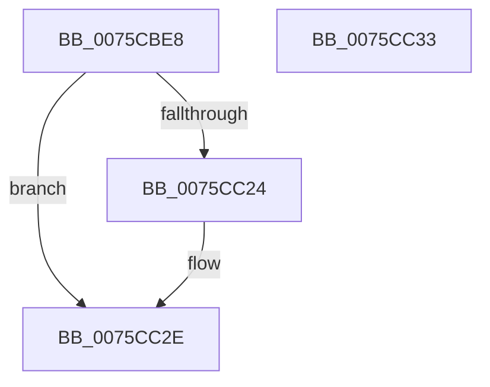

# PopAdjustHiberFile

- RVA: `0x0075CBE8`–`0x0075CC34` (길이 `76` bytes)
- VA: `0x000000014075CBE8`
- 실행 섹션: `PAGE`
- PDB 이름 있음: `예`; PDB Function 태그: `아니요`
- unwind 정보 RVA: `0x000B47B4`
- 디코드: `20`개 명령, `76/76` bytes 표시
- 미해석 바이트: `0` (있으면 어셈블리에 `.byte`로 보존)

> 이 문서는 커널 이미지의 기계어와 PDB 기호를 분석해 생성했습니다. 4번과 5번은 함수 원형과 자료형을 바이너리 사용 방식에서 추정한 C 해석이며 원본 소스 복구 결과는 아닙니다.

## 1. Dependencies

- 직접 호출 지점: **2**; 고유 호출 대상: **2**
- 직접 호출자로 확인된 함수: **1**
- RIP 상대 이미지 참조: **1**

### Outgoing calls
- `0x0075CC09` → [PopCalculateHiberFileSize](PopCalculateHiberFileSize_function_0075CC98.md) (function, `0x0075CC98`)
- `0x0075CC1B` → [PopResizeHiberFile](../A9/PopResizeHiberFile_function_00A90410.md) (function, `0x00A90410`)

### Direct callers
- [PopUnlockAfterSleepWorker](../../pagelk/B7/PopUnlockAfterSleepWorker_function_00B782A0.md) at `0x00B7836A`

### Static image references
- `0x0075CC28` → RVA `0x00F0CED6` (`.data`; write)

## 2. Other-region calls and transfers

- 다른 실행 섹션으로 향하는 call: **0**
- 별도 외부 분기/꼬리 이동을 확인하지 못했습니다.

## 3. Assembly (complete function range)

```asm
0075CBE8  48 8B C4                        mov rax, rsp
0075CBEB  48 89 48 08                     mov qword ptr [rax + 8], rcx
0075CBEF  48 83 EC 28                     sub rsp, 0x28
0075CBF3  48 83 60 18 00                  and qword ptr [rax + 0x18], 0
0075CBF8  48 8D 50 08                     lea rdx, [rax + 8]
0075CBFC  48 83 60 10 00                  and qword ptr [rax + 0x10], 0
0075CC01  48 8D 48 10                     lea rcx, [rax + 0x10]
0075CC05  C6 40 08 00                     mov byte ptr [rax + 8], 0
0075CC09  E8 8A 00 00 00                  call 0x14075cc98
0075CC0E  48 8B 4C 24 38                  mov rcx, qword ptr [rsp + 0x38]
0075CC13  48 8D 54 24 40                  lea rdx, [rsp + 0x40]
0075CC18  45 33 C0                        xor r8d, r8d
0075CC1B  E8 F0 37 33 00                  call 0x140a90410
0075CC20  85 C0                           test eax, eax
0075CC22  78 0A                           js 0x14075cc2e
0075CC24  8A 4C 24 30                     mov cl, byte ptr [rsp + 0x30]
0075CC28  88 0D A8 02 7B 00               mov byte ptr [rip + 0x7b02a8], cl
0075CC2E  48 83 C4 28                     add rsp, 0x28
0075CC32  C3                              ret
0075CC33  CC                              int3
```

## 4. C-style interpretation (structured pseudocode)

```c
__int64 __fastcall PopAdjustHiberFile(__int64 a1, __int64 a2, int a3)
{
    __int64 result;
    __int64 v_rsp;
    unsigned __int64 v_stack_p10;
    unsigned __int64 v_stack_p18;
    unsigned __int8 v_stack_p8;

    *(unsigned __int64 *)(v_rsp + 8) = a1;
    v_rsp = (v_rsp) - (40);
    *(unsigned __int8 *)(v_rsp + 8) = 0;
    result = PopCalculateHiberFileSize(v_rsp + 16, v_rsp + 8, a3, a4);
    a3 = 0;
    result = PopResizeHiberFile(v_stack_p10, v_stack_p18, a3, a4);
    if (!(sign_flag)) {
        a1 = v_stack_p8;
        *(unsigned __int8 *)(v_rip + 8061608) = (unsigned __int8)(a1);
    }
    v_rsp = (v_rsp) + (40);
    return result;
}
```

## 5. (Beta) C Style

```c
int64_t PopAdjustHiberFile(int64_t Arg1, int64_t Arg2, int32_t Arg3)
{
    int64_t result;
    int64_t local_rsp;
    uint64_t v_stack_p10;
    uint64_t v_stack_p18;
    uint8_t v_stack_p8;

    *(uint64_t *)(local_rsp + 0x8) = Arg1;
    local_rsp = (local_rsp) - (40);
    *(uint8_t *)(local_rsp + 0x8) = 0;
    result = PopCalculateHiberFileSize(local_rsp + 16, local_rsp + 8, Arg3, a4);
    Arg3 = 0;
    result = PopResizeHiberFile(v_stack_p10, v_stack_p18, Arg3, a4);
    if (!(sign_flag)) {
        Arg1 = v_stack_p8;
        *(uint8_t *)(v_rip + 0x7B02A8) = (uint8_t)(Arg1);
    }
    local_rsp = (local_rsp) + (40);
    return result;
}
```

## 6. Execution-region graph

[열기: 2D/3D 그래프와 함수 탐색 컨트롤 패널](../../../control-panel.html?section=page&rva=0x0075CBE8&view=graph)

- 2D 그래프는 위에서 아래로 흐르고, 3D 그래프는 빈 공간을 드래그해 회전합니다. Shift+드래그는 이동, 휠은 확대·축소, 함수 노드 선택은 대상 보고서 이동입니다.

### Static fallback


