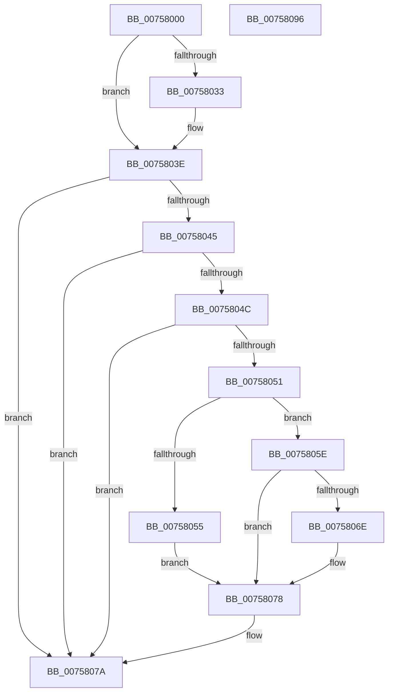

# PopAllowAwayModeSettingCallback

- RVA: `0x00758000`–`0x00758097` (길이 `151` bytes)
- VA: `0x0000000140758000`
- 실행 섹션: `PAGE`
- PDB 이름 있음: `예`; PDB Function 태그: `아니요`
- unwind 정보 RVA: `0x0005C954`
- 디코드: `42`개 명령, `151/151` bytes 표시
- 미해석 바이트: `0` (있으면 어셈블리에 `.byte`로 보존)

> 이 문서는 커널 이미지의 기계어와 PDB 기호를 분석해 생성했습니다. 4번과 5번은 함수 원형과 자료형을 바이너리 사용 방식에서 추정한 C 해석이며 원본 소스 복구 결과는 아닙니다.

## 1. Dependencies

- 직접 호출 지점: **3**; 고유 호출 대상: **3**
- 직접 호출자로 확인된 함수: **0**
- RIP 상대 이미지 참조: **4**

### Outgoing calls
- `0x00758022` → [PopAcquirePolicyLock](../../pagelk/B7/PopAcquirePolicyLock_function_00B783C0.md) (function, `0x00B783C0`)
- `0x00758073` → [PopSetSystemState](../../text/48/PopSetSystemState_function_00482A98.md) (function, `0x00482A98`)
- `0x0075807A` → [PopReleasePolicyLock](../../pagelk/B7/PopReleasePolicyLock_function_00B78410.md) (function, `0x00B78410`)

### Direct callers
- 이 함수 시작 RVA로 연결되는 직접 call은 확인되지 않았습니다. 간접 호출은 완전히 역산할 수 없습니다.

### Static image references
- `0x00758027` → RVA `0x00024998` (`.rdata`; read)
- `0x00758033` → RVA `0x000249A0` (`.rdata`; read)
- `0x00758055` → RVA `0x00F0CE12` (`.data`; write)
- `0x0075805E` → RVA `0x00F0CE11` (`.data`; read)

## 2. Other-region calls and transfers

- 다른 실행 섹션으로 향하는 call: **3**
  - `0x00758022` → [PopAcquirePolicyLock](../../pagelk/B7/PopAcquirePolicyLock_function_00B783C0.md) (`PAGE` → `PAGELK`)
  - `0x00758073` → [PopSetSystemState](../../text/48/PopSetSystemState_function_00482A98.md) (`PAGE` → `.text`)
  - `0x0075807A` → [PopReleasePolicyLock](../../pagelk/B7/PopReleasePolicyLock_function_00B78410.md) (`PAGE` → `PAGELK`)
- 별도 외부 분기/꼬리 이동을 확인하지 못했습니다.

## 3. Assembly (complete function range)

```asm
00758000  48 89 5C 24 08                  mov qword ptr [rsp + 8], rbx
00758005  48 89 6C 24 10                  mov qword ptr [rsp + 0x10], rbp
0075800A  48 89 74 24 18                  mov qword ptr [rsp + 0x18], rsi
0075800F  57                              push rdi
00758010  48 83 EC 20                     sub rsp, 0x20
00758014  41 8B E8                        mov ebp, r8d
00758017  48 8B FA                        mov rdi, rdx
0075801A  48 8B F1                        mov rsi, rcx
0075801D  BB 0D 00 00 C0                  mov ebx, 0xc000000d
00758022  E8 99 03 42 00                  call 0x140b783c0
00758027  4C 8B 0D 6A C9 8C FF            mov r9, qword ptr [rip - 0x733696]
0075802E  4C 2B 0E                        sub r9, qword ptr [rsi]
00758031  75 0B                           jne 0x14075803e
00758033  4C 8B 0D 66 C9 8C FF            mov r9, qword ptr [rip - 0x73369a]
0075803A  4C 2B 4E 08                     sub r9, qword ptr [rsi + 8]
0075803E  33 F6                           xor esi, esi
00758040  4D 85 C9                        test r9, r9
00758043  75 35                           jne 0x14075807a
00758045  8D 4E 04                        lea ecx, [rsi + 4]
00758048  3B E9                           cmp ebp, ecx
0075804A  75 2E                           jne 0x14075807a
0075804C  48 85 FF                        test rdi, rdi
0075804F  74 29                           je 0x14075807a
00758051  39 37                           cmp dword ptr [rdi], esi
00758053  74 09                           je 0x14075805e
00758055  C6 05 B6 4D 7B 00 01            mov byte ptr [rip + 0x7b4db6], 1
0075805C  EB 1A                           jmp 0x140758078
0075805E  40 38 35 AC 4D 7B 00            cmp byte ptr [rip + 0x7b4dac], sil
00758065  40 88 35 A6 4D 7B 00            mov byte ptr [rip + 0x7b4da6], sil
0075806C  74 0A                           je 0x140758078
0075806E  BA 07 00 00 00                  mov edx, 7
00758073  E8 20 AA D2 FF                  call 0x140482a98
00758078  8B DE                           mov ebx, esi
0075807A  E8 91 03 42 00                  call 0x140b78410
0075807F  48 8B 6C 24 38                  mov rbp, qword ptr [rsp + 0x38]
00758084  8B C3                           mov eax, ebx
00758086  48 8B 5C 24 30                  mov rbx, qword ptr [rsp + 0x30]
0075808B  48 8B 74 24 40                  mov rsi, qword ptr [rsp + 0x40]
00758090  48 83 C4 20                     add rsp, 0x20
00758094  5F                              pop rdi
00758095  C3                              ret
00758096  CC                              int3
```

## 4. C-style interpretation (structured pseudocode)

```c
__int64 __fastcall PopAllowAwayModeSettingCallback(__int64 a1, __int64 a2, int a3)
{
    __int64 result;
    __int64 v_rsi;
    __int64 v_rsp;
    unsigned __int64 v_stack_p10;
    unsigned __int64 v_stack_p18;
    unsigned __int64 v_stack_p8;

    v_stack_p8 = v_rbx;
    v_stack_p10 = v_rbp;
    v_stack_p18 = v_rsi;
    v_rsp = (v_rsp) - (32);
    result = PopAcquirePolicyLock(a1, a2, a3, a4);
    a4 = (*(unsigned __int64 *)(v_rip - 7550614)) - (*(unsigned __int64 *)(a1));
    if (!(condition_is_not_equal)) {
        a4 = *(unsigned __int64 *)(v_rip - 7550618);
        a4 = (a4) - (*(unsigned __int64 *)(a1 + 8));
    }
    v_rsi = 0;
    if (a4 != 0) goto loc_0075807A;
    if (((unsigned int)((unsigned int)(a3))) != ((unsigned int)(v_rsi + 4))) goto loc_0075807A;
    if (a2 == 0) goto loc_0075807A;
    if ((*(unsigned int *)(a2)) == 0) goto loc_0075805E;
    *(unsigned __int8 *)(v_rip + 8080822) = 1;
    goto loc_00758078;
loc_0075805E:
    *(unsigned __int8 *)(v_rip + 8080806) = 0;
    if ((*(unsigned __int8 *)(v_rip + 8080812)) != 0) {
        a2 = 7;
        result = PopSetSystemState(v_rsi + 4, a2, a3, a4);
    }
loc_0075807A:
    result = PopReleasePolicyLock(v_rsi + 4, a2, a3, a4);
    v_rsp = (v_rsp) + (32);
    return 0;
}
```

## 5. (Beta) C Style

```c
int64_t PopAllowAwayModeSettingCallback(void *Arg1, int64_t Arg2, int32_t Arg3)
{
    uint8_t *arg1 = (uint8_t *)Arg1;

    int64_t result;
    int64_t local_rsi;
    int64_t local_rsp;
    uint64_t v_stack_p10;
    uint64_t v_stack_p18;
    uint64_t v_stack_p8;

    v_stack_p8 = local_rbx;
    v_stack_p10 = local_rbp;
    v_stack_p18 = local_rsi;
    local_rsp = (local_rsp) - (32);
    result = PopAcquirePolicyLock(Arg1, Arg2, Arg3, a4);
    a4 = (*(uint64_t *)(v_rip - 0x733696)) - (*(uint64_t *)(arg1));
    if (!(condition_is_not_equal)) {
        a4 = *(uint64_t *)(v_rip - 0x73369A);
        a4 = (a4) - (*(uint64_t *)(arg1 + 0x8));
    }
    local_rsi = 0;
    if (a4 != 0) goto loc_0075807A;
    if (((uint32_t)((uint32_t)(Arg3))) != ((uint32_t)(local_rsi + 4))) goto loc_0075807A;
    if (Arg2 == 0) goto loc_0075807A;
    if ((*(uint32_t *)(Arg2)) == 0) goto loc_0075805E;
    *(uint8_t *)(v_rip + 0x7B4DB6) = 1;
    goto loc_00758078;
loc_0075805E:
    *(uint8_t *)(v_rip + 0x7B4DA6) = 0;
    if ((*(uint8_t *)(v_rip + 0x7B4DAC)) != 0) {
        Arg2 = 7;
        result = PopSetSystemState(local_rsi + 4, Arg2, Arg3, a4);
    }
loc_0075807A:
    result = PopReleasePolicyLock(local_rsi + 4, Arg2, Arg3, a4);
    local_rsp = (local_rsp) + (32);
    return 0;
}
```

### 관측된 메모리 오프셋

구조체 형식이 확인되지 않은 접근은 인자 기준의 오프셋으로만 기록했습니다.

| 기준 인자 | 오프셋 표현 | 폭 (bit) | 접근 |
|---|---:|---:|---|
| `Arg1` | `+ 0x0` | `64` | `R` |
| `Arg1` | `+ 0x8` | `64` | `R` |

## 6. Execution-region graph

[열기: 2D/3D 그래프와 함수 탐색 컨트롤 패널](../../../control-panel.html?section=page&rva=0x00758000&view=graph)

- 2D 그래프는 위에서 아래로 흐르고, 3D 그래프는 빈 공간을 드래그해 회전합니다. Shift+드래그는 이동, 휠은 확대·축소, 함수 노드 선택은 대상 보고서 이동입니다.

### Static fallback


