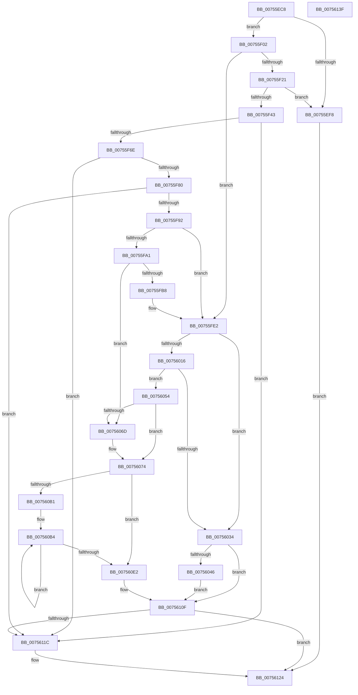

# PopAssociatePowerLimitRequest

- RVA: `0x00755EC8`–`0x00756140` (길이 `632` bytes)
- VA: `0x0000000140755EC8`
- 실행 섹션: `PAGE`
- PDB 이름 있음: `예`; PDB Function 태그: `아니요`
- unwind 정보 RVA: `0x000BF7E0`
- 디코드: `165`개 명령, `632/632` bytes 표시
- 미해석 바이트: `0` (있으면 어셈블리에 `.byte`로 보존)

> 이 문서는 커널 이미지의 기계어와 PDB 기호를 분석해 생성했습니다. 4번과 5번은 함수 원형과 자료형을 바이너리 사용 방식에서 추정한 C 해석이며 원본 소스 복구 결과는 아닙니다.

## 1. Dependencies

- 직접 호출 지점: **19**; 고유 호출 대상: **12**
- 직접 호출자로 확인된 함수: **1**
- RIP 상대 이미지 참조: **6**

### Outgoing calls
- `0x00755EEB` → [PopGetDope](../../text/4C/PopGetDope_function_004CB77C.md) (function, `0x004CB77C`)
- `0x00755F0C` → [PopAcquireRwLockExclusive](../../text/43/PopAcquireRwLockExclusive_function_00430B44.md) (function, `0x00430B44`)
- `0x00755F24` → [PopReleaseRwLock](../../text/2D/PopReleaseRwLock_function_002DFBBC.md) (function, `0x002DFBBC`)
- `0x00755F36` → [ExAllocatePool2](../../poolcode/B8/ExAllocatePool2_function_00B820F0.md) (function, `0x00B820F0`)
- `0x00755F5F` → [PopAcquirePowerLimitInterface](PopAcquirePowerLimitInterface_function_00755E10.md) (function, `0x00755E10`)
- `0x00755F71` → [PopQueryPowerLimitAttributes](PopQueryPowerLimitAttributes_function_00756928.md) (function, `0x00756928`)
- `0x00755F83` → [PopRegisterTargetDeviceProtection](PopRegisterTargetDeviceProtection_function_00756A94.md) (function, `0x00756A94`)
- `0x00755F95` → [PopAcquireRwLockExclusive](../../text/43/PopAcquireRwLockExclusive_function_00430B44.md) (function, `0x00430B44`)
- `0x00755FDB` → [PopDiagTracePowerLimitExtension](../76/PopDiagTracePowerLimitExtension_function_0076233C.md) (function, `0x0076233C`)
- `0x00755FEA` → [PopAcquireRwLockExclusive](../../text/43/PopAcquireRwLockExclusive_function_00430B44.md) (function, `0x00430B44`)
- `0x00756008` → [ExAllocatePool2](../../poolcode/B8/ExAllocatePool2_function_00B820F0.md) (function, `0x00B820F0`)
- `0x00756026` → [ExAllocatePool2](../../poolcode/B8/ExAllocatePool2_function_00B820F0.md) (function, `0x00B820F0`)
- `0x0075604A` → [PopReleaseRwLock](../../text/2D/PopReleaseRwLock_function_002DFBBC.md) (function, `0x002DFBBC`)
- `0x00756096` → [memcpy](../../text/6C/memcpy_function_006C6840.md) (function, `0x006C6840`)
- `0x007560EC` → [PopThermalUpdateTelemetryClientCount](../../text/5D/PopThermalUpdateTelemetryClientCount_function_005D58C4.md) (function, `0x005D58C4`)
- `0x007560FB` → [PopDiagTracePowerLimitRequest](../76/PopDiagTracePowerLimitRequest_function_007626D0.md) (function, `0x007626D0`)
- `0x00756108` → [PopReleaseRwLock](../../text/2D/PopReleaseRwLock_function_002DFBBC.md) (function, `0x002DFBBC`)
- `0x00756112` → [PopReleaseRwLock](../../text/2D/PopReleaseRwLock_function_002DFBBC.md) (function, `0x002DFBBC`)
- `0x0075611F` → [PopCleanPowerLimitExtension](../../text/5D/PopCleanPowerLimitExtension_function_005D0DD4.md) (function, `0x005D0DD4`)

### Direct callers
- [PoCreatePowerLimitRequest](PoCreatePowerLimitRequest_function_00755960.md) at `0x007559EF`

### Static image references
- `0x00755F02` → RVA `0x00F0BB50` (`.data`; read)
- `0x00755FA1` → RVA `0x00F0BB68` (`.data`; read)
- `0x00755FA8` → RVA `0x00F0BB60` (`.data`; read)
- `0x00755FBB` → RVA `0x00022208` (`.rdata`; read)
- `0x00755FCC` → RVA `0x00F0BB68` (`.data`; write)
- `0x007560F1` → RVA `0x000232B0` (`.rdata`; read)

## 2. Other-region calls and transfers

- 다른 실행 섹션으로 향하는 call: **14**
  - `0x00755EEB` → [PopGetDope](../../text/4C/PopGetDope_function_004CB77C.md) (`PAGE` → `.text`)
  - `0x00755F0C` → [PopAcquireRwLockExclusive](../../text/43/PopAcquireRwLockExclusive_function_00430B44.md) (`PAGE` → `.text`)
  - `0x00755F24` → [PopReleaseRwLock](../../text/2D/PopReleaseRwLock_function_002DFBBC.md) (`PAGE` → `.text`)
  - `0x00755F36` → [ExAllocatePool2](../../poolcode/B8/ExAllocatePool2_function_00B820F0.md) (`PAGE` → `POOLCODE`)
  - `0x00755F95` → [PopAcquireRwLockExclusive](../../text/43/PopAcquireRwLockExclusive_function_00430B44.md) (`PAGE` → `.text`)
  - `0x00755FEA` → [PopAcquireRwLockExclusive](../../text/43/PopAcquireRwLockExclusive_function_00430B44.md) (`PAGE` → `.text`)
  - `0x00756008` → [ExAllocatePool2](../../poolcode/B8/ExAllocatePool2_function_00B820F0.md) (`PAGE` → `POOLCODE`)
  - `0x00756026` → [ExAllocatePool2](../../poolcode/B8/ExAllocatePool2_function_00B820F0.md) (`PAGE` → `POOLCODE`)
  - `0x0075604A` → [PopReleaseRwLock](../../text/2D/PopReleaseRwLock_function_002DFBBC.md) (`PAGE` → `.text`)
  - `0x00756096` → [memcpy](../../text/6C/memcpy_function_006C6840.md) (`PAGE` → `.text`)
  - `0x007560EC` → [PopThermalUpdateTelemetryClientCount](../../text/5D/PopThermalUpdateTelemetryClientCount_function_005D58C4.md) (`PAGE` → `.text`)
  - `0x00756108` → [PopReleaseRwLock](../../text/2D/PopReleaseRwLock_function_002DFBBC.md) (`PAGE` → `.text`)
  - `0x00756112` → [PopReleaseRwLock](../../text/2D/PopReleaseRwLock_function_002DFBBC.md) (`PAGE` → `.text`)
  - `0x0075611F` → [PopCleanPowerLimitExtension](../../text/5D/PopCleanPowerLimitExtension_function_005D0DD4.md) (`PAGE` → `.text`)
- 별도 외부 분기/꼬리 이동을 확인하지 못했습니다.

## 3. Assembly (complete function range)

```asm
00755EC8  48 89 5C 24 08                  mov qword ptr [rsp + 8], rbx
00755ECD  48 89 6C 24 10                  mov qword ptr [rsp + 0x10], rbp
00755ED2  48 89 74 24 18                  mov qword ptr [rsp + 0x18], rsi
00755ED7  57                              push rdi
00755ED8  41 55                           push r13
00755EDA  41 56                           push r14
00755EDC  48 83 EC 20                     sub rsp, 0x20
00755EE0  48 8B F1                        mov rsi, rcx
00755EE3  48 8B DA                        mov rbx, rdx
00755EE6  48 8B CA                        mov rcx, rdx
00755EE9  33 FF                           xor edi, edi
00755EEB  E8 8C 58 D7 FF                  call 0x1404cb77c
00755EF0  48 8B E8                        mov rbp, rax
00755EF3  48 85 C0                        test rax, rax
00755EF6  75 0A                           jne 0x140755f02
00755EF8  BB 9A 00 00 C0                  mov ebx, 0xc000009a
00755EFD  E9 22 02 00 00                  jmp 0x140756124
00755F02  4C 8D 35 47 5C 7B 00            lea r14, [rip + 0x7b5c47]
00755F09  49 8B CE                        mov rcx, r14
00755F0C  E8 33 AC CD FF                  call 0x140430b44
00755F11  41 BD 00 01 00 00               mov r13d, 0x100
00755F17  48 39 7D 48                     cmp qword ptr [rbp + 0x48], rdi
00755F1B  0F 85 C1 00 00 00               jne 0x140755fe2
00755F21  49 8B CE                        mov rcx, r14
00755F24  E8 93 9C B8 FF                  call 0x1402dfbbc
00755F29  41 8D 55 C8                     lea edx, [r13 - 0x38]
00755F2D  41 B8 50 50 6C 6D               mov r8d, 0x6d6c5050
00755F33  41 8B CD                        mov ecx, r13d
00755F36  E8 B5 C1 42 00                  call 0x140b820f0
00755F3B  48 8B F8                        mov rdi, rax
00755F3E  48 85 C0                        test rax, rax
00755F41  74 B5                           je 0x140755ef8
00755F43  48 83 C0 10                     add rax, 0x10
00755F47  48 8B CF                        mov rcx, rdi
00755F4A  48 89 40 08                     mov qword ptr [rax + 8], rax
00755F4E  48 89 00                        mov qword ptr [rax], rax
00755F51  48 83 67 28 00                  and qword ptr [rdi + 0x28], 0
00755F56  48 83 67 20 00                  and qword ptr [rdi + 0x20], 0
00755F5B  48 89 5F 38                     mov qword ptr [rdi + 0x38], rbx
00755F5F  E8 AC FE FF FF                  call 0x140755e10
00755F64  8B D8                           mov ebx, eax
00755F66  85 C0                           test eax, eax
00755F68  0F 88 AE 01 00 00               js 0x14075611c
00755F6E  48 8B CF                        mov rcx, rdi
00755F71  E8 B2 09 00 00                  call 0x140756928
00755F76  8B D8                           mov ebx, eax
00755F78  85 C0                           test eax, eax
00755F7A  0F 88 9C 01 00 00               js 0x14075611c
00755F80  48 8B CF                        mov rcx, rdi
00755F83  E8 0C 0B 00 00                  call 0x140756a94
00755F88  8B D8                           mov ebx, eax
00755F8A  85 C0                           test eax, eax
00755F8C  0F 88 8A 01 00 00               js 0x14075611c
00755F92  49 8B CE                        mov rcx, r14
00755F95  E8 AA AB CD FF                  call 0x140430b44
00755F9A  48 83 7D 48 00                  cmp qword ptr [rbp + 0x48], 0
00755F9F  75 41                           jne 0x140755fe2
00755FA1  48 8B 05 C0 5B 7B 00            mov rax, qword ptr [rip + 0x7b5bc0]
00755FA8  48 8D 0D B1 5B 7B 00            lea rcx, [rip + 0x7b5bb1]
00755FAF  48 39 08                        cmp qword ptr [rax], rcx
00755FB2  0F 85 B5 00 00 00               jne 0x14075606d
00755FB8  48 89 0F                        mov qword ptr [rdi], rcx
00755FBB  48 8D 15 46 C2 8C FF            lea rdx, [rip - 0x733dba]
00755FC2  48 89 47 08                     mov qword ptr [rdi + 8], rax
00755FC6  48 8B CF                        mov rcx, rdi
00755FC9  48 89 38                        mov qword ptr [rax], rdi
00755FCC  48 89 3D 95 5B 7B 00            mov qword ptr [rip + 0x7b5b95], rdi
00755FD3  48 89 7D 48                     mov qword ptr [rbp + 0x48], rdi
00755FD7  C6 47 30 01                     mov byte ptr [rdi + 0x30], 1
00755FDB  E8 5C C3 00 00                  call 0x14076233c
00755FE0  33 FF                           xor edi, edi
00755FE2  48 8B 4D 48                     mov rcx, qword ptr [rbp + 0x48]
00755FE6  48 83 C1 20                     add rcx, 0x20
00755FEA  E8 55 AB CD FF                  call 0x140430b44
00755FEF  48 8B 45 48                     mov rax, qword ptr [rbp + 0x48]
00755FF3  41 B8 50 50 6C 6D               mov r8d, 0x6d6c5050
00755FF9  8B 48 48                        mov ecx, dword ptr [rax + 0x48]
00755FFC  8B D1                           mov edx, ecx
00755FFE  89 4E 20                        mov dword ptr [rsi + 0x20], ecx
00756001  48 C1 E2 04                     shl rdx, 4
00756005  49 8B CD                        mov rcx, r13
00756008  E8 E3 C0 42 00                  call 0x140b820f0
0075600D  48 89 46 28                     mov qword ptr [rsi + 0x28], rax
00756011  48 85 C0                        test rax, rax
00756014  74 1E                           je 0x140756034
00756016  8B 46 20                        mov eax, dword ptr [rsi + 0x20]
00756019  41 B8 50 50 6C 6D               mov r8d, 0x6d6c5050
0075601F  48 6B D0 68                     imul rdx, rax, 0x68
00756023  49 8B CD                        mov rcx, r13
00756026  E8 C5 C0 42 00                  call 0x140b820f0
0075602B  48 89 46 38                     mov qword ptr [rsi + 0x38], rax
0075602F  48 85 C0                        test rax, rax
00756032  75 20                           jne 0x140756054
00756034  48 8B 4D 48                     mov rcx, qword ptr [rbp + 0x48]
00756038  BB 9A 00 00 C0                  mov ebx, 0xc000009a
0075603D  48 85 C9                        test rcx, rcx
00756040  0F 84 C9 00 00 00               je 0x14075610f
00756046  48 83 C1 20                     add rcx, 0x20
0075604A  E8 6D 9B B8 FF                  call 0x1402dfbbc
0075604F  E9 BB 00 00 00                  jmp 0x14075610f
00756054  48 8B 45 48                     mov rax, qword ptr [rbp + 0x48]
00756058  48 89 46 40                     mov qword ptr [rsi + 0x40], rax
0075605C  48 8B 45 48                     mov rax, qword ptr [rbp + 0x48]
00756060  48 83 C0 10                     add rax, 0x10
00756064  48 8B 48 08                     mov rcx, qword ptr [rax + 8]
00756068  48 39 01                        cmp qword ptr [rcx], rax
0075606B  74 07                           je 0x140756074
0075606D  B9 03 00 00 00                  mov ecx, 3
00756072  CD 29                           int 0x29
00756074  48 89 06                        mov qword ptr [rsi], rax
00756077  48 89 4E 08                     mov qword ptr [rsi + 8], rcx
0075607B  48 89 31                        mov qword ptr [rcx], rsi
0075607E  48 89 70 08                     mov qword ptr [rax + 8], rsi
00756082  48 8B 56 40                     mov rdx, qword ptr [rsi + 0x40]
00756086  44 8B 46 20                     mov r8d, dword ptr [rsi + 0x20]
0075608A  48 8B 4E 28                     mov rcx, qword ptr [rsi + 0x28]
0075608E  49 C1 E0 04                     shl r8, 4
00756092  48 8B 52 58                     mov rdx, qword ptr [rdx + 0x58]
00756096  E8 A5 07 F7 FF                  call 0x1406c6840
0075609B  49 BA 08 00 00 00 80 F7 FF FF   movabs r10, 0xfffff78000000008
007560A5  45 33 C9                        xor r9d, r9d
007560A8  4D 8B 12                        mov r10, qword ptr [r10]
007560AB  44 39 4E 20                     cmp dword ptr [rsi + 0x20], r9d
007560AF  76 31                           jbe 0x1407560e2
007560B1  83 C9 FF                        or ecx, 0xffffffff
007560B4  48 8B 46 28                     mov rax, qword ptr [rsi + 0x28]
007560B8  41 8B D1                        mov edx, r9d
007560BB  48 03 D2                        add rdx, rdx
007560BE  45 8B C1                        mov r8d, r9d
007560C1  41 FF C1                        inc r9d
007560C4  89 4C D0 08                     mov dword ptr [rax + rdx*8 + 8], ecx
007560C8  48 8B 46 28                     mov rax, qword ptr [rsi + 0x28]
007560CC  89 4C D0 0C                     mov dword ptr [rax + rdx*8 + 0xc], ecx
007560D0  48 8B 46 38                     mov rax, qword ptr [rsi + 0x38]
007560D4  49 6B D0 68                     imul rdx, r8, 0x68
007560D8  4C 89 14 02                     mov qword ptr [rdx + rax], r10
007560DC  44 3B 4E 20                     cmp r9d, dword ptr [rsi + 0x20]
007560E0  72 D2                           jb 0x1407560b4
007560E2  B1 01                           mov cl, 1
007560E4  C6 46 10 01                     mov byte ptr [rsi + 0x10], 1
007560E8  C6 46 30 01                     mov byte ptr [rsi + 0x30], 1
007560EC  E8 D3 F7 E7 FF                  call 0x1405d58c4
007560F1  48 8D 15 B8 D1 8C FF            lea rdx, [rip - 0x732e48]
007560F8  48 8B CE                        mov rcx, rsi
007560FB  E8 D0 C5 00 00                  call 0x1407626d0
00756100  48 8B 4D 48                     mov rcx, qword ptr [rbp + 0x48]
00756104  48 83 C1 20                     add rcx, 0x20
00756108  E8 AF 9A B8 FF                  call 0x1402dfbbc
0075610D  33 DB                           xor ebx, ebx
0075610F  49 8B CE                        mov rcx, r14
00756112  E8 A5 9A B8 FF                  call 0x1402dfbbc
00756117  48 85 FF                        test rdi, rdi
0075611A  74 08                           je 0x140756124
0075611C  48 8B CF                        mov rcx, rdi
0075611F  E8 B0 AC E7 FF                  call 0x1405d0dd4
00756124  48 8B 6C 24 48                  mov rbp, qword ptr [rsp + 0x48]
00756129  8B C3                           mov eax, ebx
0075612B  48 8B 5C 24 40                  mov rbx, qword ptr [rsp + 0x40]
00756130  48 8B 74 24 50                  mov rsi, qword ptr [rsp + 0x50]
00756135  48 83 C4 20                     add rsp, 0x20
00756139  41 5E                           pop r14
0075613B  41 5D                           pop r13
0075613D  5F                              pop rdi
0075613E  C3                              ret
0075613F  CC                              int3
```

## 4. C-style interpretation (structured pseudocode)

```c
__int64 __fastcall PopAssociatePowerLimitRequest(__int64 a1, __int64 a2, __int64 a3, int a4)
{
    __int64 result;
    __int64 v_rbx;
    __int64 v_rdi;
    __int64 v_rsp;
    unsigned __int64 v_stack_p10;
    unsigned __int64 v_stack_p18;
    unsigned __int64 v_stack_p8;

    v_stack_p8 = v_rbx;
    v_stack_p10 = v_rbp;
    v_stack_p18 = v_rsi;
    v_rsp = (v_rsp) - (32);
    v_rdi = 0;
    result = PopGetDope(a2, a2, a3, a4);
    if (result != 0) goto loc_00755F02;
loc_00755EF8:
    goto loc_00756124;
loc_00755F02:
    result = PopAcquireRwLockExclusive(v_rip + 8084551, a2, a3, a4);
    if ((*(unsigned __int64 *)(result + 72)) != 0) goto loc_00755FE2;
    result = PopReleaseRwLock(v_rip + 8084551, a2, a3, a4);
    result = ExAllocatePool2(256, 256 - 56, (unsigned int)(0x6D6C5050ULL), a4);
    if (result == 0) goto loc_00755EF8;
    result = (result) + (16);
    *(unsigned __int64 *)(result + 8) = result;
    *(unsigned __int64 *)(result) = result;
    *(unsigned __int64 *)(result + 56) = (unsigned int)(0xC000009AULL);
    result = PopAcquirePowerLimitInterface(result, 256 - 56, (unsigned int)(0x6D6C5050ULL), a4);
    if (sign_flag) goto loc_0075611C;
    result = PopQueryPowerLimitAttributes(result, 256 - 56, (unsigned int)(0x6D6C5050ULL), a4);
    if (sign_flag) goto loc_0075611C;
    result = PopRegisterTargetDeviceProtection(result, 256 - 56, (unsigned int)(0x6D6C5050ULL), a4);
    if (sign_flag) goto loc_0075611C;
    result = PopAcquireRwLockExclusive(v_rip + 8084551, 256 - 56, (unsigned int)(0x6D6C5050ULL), a4);
    if ((*(unsigned __int64 *)(result + 72)) != 0) goto loc_00755FE2;
    if ((*(unsigned __int64 *)(*(unsigned __int64 *)(v_rip + 8084416))) != (v_rip + 8084401)) goto loc_0075606D;
    *(unsigned __int64 *)(result) = v_rip + 8084401;
    *(unsigned __int64 *)(result + 8) = *(unsigned __int64 *)(v_rip + 8084416);
    *(unsigned __int64 *)(*(unsigned __int64 *)(v_rip + 8084416)) = result;
    *(unsigned __int64 *)(v_rip + 8084373) = result;
    *(unsigned __int64 *)(result + 72) = result;
    *(unsigned __int8 *)(result + 48) = 1;
    result = PopDiagTracePowerLimitExtension(result, v_rip - 7552442, (unsigned int)(0x6D6C5050ULL), a4);
    v_rdi = 0;
loc_00755FE2:
    a1 = (*(unsigned __int64 *)(result + 72)) + (32);
    result = PopAcquireRwLockExclusive(a1, v_rip - 7552442, (unsigned int)(0x6D6C5050ULL), a4);
    *(unsigned int *)(a1 + 32) = (unsigned int)((unsigned int)(*(unsigned int *)(*(unsigned __int64 *)(result + 72) + 72)));
    a2 = ((unsigned int)((unsigned int)((unsigned int)(*(unsigned int *)(*(unsigned __int64 *)(result + 72) + 72))))) << (4);
    result = ExAllocatePool2(256, a2, (unsigned int)(0x6D6C5050ULL), a4);
    *(unsigned __int64 *)(a1 + 40) = result;
    if (result == 0) goto loc_00756034;
    a2 = (a2) * ((unsigned int)(*(unsigned int *)(a1 + 32)));
    result = ExAllocatePool2(256, a2, (unsigned int)(0x6D6C5050ULL), a4);
    *(unsigned __int64 *)(a1 + 56) = result;
    if (result != 0) goto loc_00756054;
loc_00756034:
    if (*(unsigned __int64 *)(result + 72) == 0) goto loc_0075610F;
    a1 = (*(unsigned __int64 *)(result + 72)) + (32);
    result = PopReleaseRwLock(a1, a2, (unsigned int)(0x6D6C5050ULL), a4);
    goto loc_0075610F;
loc_00756054:
    *(unsigned __int64 *)(a1 + 64) = *(unsigned __int64 *)(result + 72);
    result = (*(unsigned __int64 *)(result + 72)) + (16);
    if ((*(unsigned __int64 *)(*(unsigned __int64 *)(result + 8))) != result) {
        a1 = 3;
    }
    *(unsigned __int64 *)(a1) = result;
    *(unsigned __int64 *)(a1 + 8) = a1;
    *(unsigned __int64 *)(a1) = a1;
    *(unsigned __int64 *)(result + 8) = a1;
    a3 = ((unsigned int)(*(unsigned int *)(a1 + 32))) << (4);
    result = memcpy(*(unsigned __int64 *)(a1 + 40), *(unsigned __int64 *)(*(unsigned __int64 *)(a1 + 64) + 88), a3, a4);
    a4 = 0;
    if ((*(unsigned int *)(a1 + 32)) <= 0) goto loc_007560E2;
    a1 = (unsigned int)((*(unsigned __int64 *)(a1 + 40)) | (0xFFFFFFFFULL));
loc_007560B4:
    a2 = (0) + (0);
    a4 = (unsigned int)((a4) + 1);
    *(unsigned int *)(*(unsigned __int64 *)(a1 + 40) + a2 * 8 + 8) = (unsigned int)(a1);
    *(unsigned int *)(*(unsigned __int64 *)(a1 + 40) + a2 * 8 + 12) = (unsigned int)(a1);
    a2 = (a2) * (0);
    *(unsigned __int64 *)(a2 + *(unsigned __int64 *)(a1 + 56) * 1) = *(unsigned __int64 *)(v_r10);
    if (a4 < (*(unsigned int *)(a1 + 32))) goto loc_007560B4;
loc_007560E2:
    *(unsigned __int8 *)(a1 + 16) = 1;
    *(unsigned __int8 *)(a1 + 48) = 1;
    result = PopThermalUpdateTelemetryClientCount(1, a2, 0, a4);
    result = PopDiagTracePowerLimitRequest(a1, v_rip - 7548488, 0, a4);
    a1 = (*(unsigned __int64 *)(result + 72)) + (32);
    result = PopReleaseRwLock(a1, v_rip - 7548488, 0, a4);
    v_rbx = 0;
loc_0075610F:
    result = PopReleaseRwLock(v_rip + 8084551, v_rip - 7548488, 0, a4);
    if (0 != 0) {
        a1 = 0;
        result = PopCleanPowerLimitExtension(a1, v_rip - 7548488, 0, a4);
    }
    v_rsp = (v_rsp) + (32);
    return 0;
}
```

## 5. (Beta) C Style

```c
int64_t PopAssociatePowerLimitRequest(void *Arg1, int64_t Arg2, int64_t Arg3, int32_t Arg4)
{
    uint8_t *arg1 = (uint8_t *)Arg1;

    int64_t result;
    int64_t local_rbx;
    int64_t local_rdi;
    int64_t local_rsp;
    uint64_t v_stack_p10;
    uint64_t v_stack_p18;
    uint64_t v_stack_p8;

    v_stack_p8 = local_rbx;
    v_stack_p10 = local_rbp;
    v_stack_p18 = local_rsi;
    local_rsp = (local_rsp) - (32);
    local_rdi = 0;
    result = PopGetDope(Arg2, Arg2, Arg3, Arg4);
    if (result != 0) goto loc_00755F02;
loc_00755EF8:
    goto loc_00756124;
loc_00755F02:
    result = PopAcquireRwLockExclusive(v_rip + 8084551, Arg2, Arg3, Arg4);
    if ((*(uint64_t *)(result + 0x48)) != 0) goto loc_00755FE2;
    result = PopReleaseRwLock(v_rip + 8084551, Arg2, Arg3, Arg4);
    result = ExAllocatePool2(256, 256 - 56, (uint32_t)(0x6D6C5050ULL), Arg4);
    if (result == 0) goto loc_00755EF8;
    result = (result) + (16);
    *(uint64_t *)(result + 0x8) = result;
    *(uint64_t *)(result) = result;
    *(uint64_t *)(result + 0x38) = (uint32_t)(0xC000009AULL);
    result = PopAcquirePowerLimitInterface(result, 256 - 56, (uint32_t)(0x6D6C5050ULL), Arg4);
    if (sign_flag) goto loc_0075611C;
    result = PopQueryPowerLimitAttributes(result, 256 - 56, (uint32_t)(0x6D6C5050ULL), Arg4);
    if (sign_flag) goto loc_0075611C;
    result = PopRegisterTargetDeviceProtection(result, 256 - 56, (uint32_t)(0x6D6C5050ULL), Arg4);
    if (sign_flag) goto loc_0075611C;
    result = PopAcquireRwLockExclusive(v_rip + 8084551, 256 - 56, (uint32_t)(0x6D6C5050ULL), Arg4);
    if ((*(uint64_t *)(result + 0x48)) != 0) goto loc_00755FE2;
    if ((*(uint64_t *)(*(uint64_t *)(v_rip + 0x7B5BC0))) != (v_rip + 8084401)) goto loc_0075606D;
    *(uint64_t *)(result) = v_rip + 8084401;
    *(uint64_t *)(result + 0x8) = *(uint64_t *)(v_rip + 0x7B5BC0);
    *(uint64_t *)(*(uint64_t *)(v_rip + 0x7B5BC0)) = result;
    *(uint64_t *)(v_rip + 0x7B5B95) = result;
    *(uint64_t *)(result + 0x48) = result;
    *(uint8_t *)(result + 0x30) = 1;
    result = PopDiagTracePowerLimitExtension(result, v_rip - 7552442, (uint32_t)(0x6D6C5050ULL), Arg4);
    local_rdi = 0;
loc_00755FE2:
    Arg1 = (*(uint64_t *)(result + 0x48)) + (32);
    result = PopAcquireRwLockExclusive(Arg1, v_rip - 7552442, (uint32_t)(0x6D6C5050ULL), Arg4);
    *(uint32_t *)(arg1 + 0x20) = (uint32_t)((uint32_t)(*(uint32_t *)(*(uint64_t *)(result + 0x48) + 0x48)));
    Arg2 = ((uint32_t)((uint32_t)((uint32_t)(*(uint32_t *)(*(uint64_t *)(result + 0x48) + 0x48))))) << (4);
    result = ExAllocatePool2(256, Arg2, (uint32_t)(0x6D6C5050ULL), Arg4);
    *(uint64_t *)(arg1 + 0x28) = result;
    if (result == 0) goto loc_00756034;
    Arg2 = (Arg2) * ((uint32_t)(*(uint32_t *)(arg1 + 0x20)));
    result = ExAllocatePool2(256, Arg2, (uint32_t)(0x6D6C5050ULL), Arg4);
    *(uint64_t *)(arg1 + 0x38) = result;
    if (result != 0) goto loc_00756054;
loc_00756034:
    if (*(uint64_t *)(result + 0x48) == 0) goto loc_0075610F;
    Arg1 = (*(uint64_t *)(result + 0x48)) + (32);
    result = PopReleaseRwLock(Arg1, Arg2, (uint32_t)(0x6D6C5050ULL), Arg4);
    goto loc_0075610F;
loc_00756054:
    *(uint64_t *)(arg1 + 0x40) = *(uint64_t *)(result + 0x48);
    result = (*(uint64_t *)(result + 0x48)) + (16);
    if ((*(uint64_t *)(*(uint64_t *)(result + 0x8))) != result) {
        Arg1 = 3;
    }
    *(uint64_t *)(arg1) = result;
    *(void **)(arg1 + 0x8) = Arg1;
    *(void **)(arg1) = Arg1;
    *(void **)(result + 0x8) = Arg1;
    Arg3 = ((uint32_t)(*(uint32_t *)(arg1 + 0x20))) << (4);
    result = memcpy(*(uint64_t *)(arg1 + 0x28), *(uint64_t *)(*(uint64_t *)(arg1 + 0x40) + 0x58), Arg3, Arg4);
    Arg4 = 0;
    if ((*(uint32_t *)(arg1 + 0x20)) <= 0) goto loc_007560E2;
    Arg1 = (uint32_t)((*(uint64_t *)(arg1 + 0x28)) | (0xFFFFFFFFULL));
loc_007560B4:
    Arg2 = (0) + (0);
    Arg4 = (uint32_t)((Arg4) + 1);
    *(uint32_t *)(*(uint64_t *)(arg1 + 0x28) + Arg2 * 8 + 0x8) = (uint32_t)(Arg1);
    *(uint32_t *)(*(uint64_t *)(arg1 + 0x28) + Arg2 * 8 + 0xC) = (uint32_t)(Arg1);
    Arg2 = (Arg2) * (0);
    *(uint64_t *)(Arg2 + *(uint64_t *)(arg1 + 0x38) * 1) = *(uint64_t *)(local_r10);
    if (Arg4 < (*(uint32_t *)(arg1 + 0x20))) goto loc_007560B4;
loc_007560E2:
    *(uint8_t *)(arg1 + 0x10) = 1;
    *(uint8_t *)(arg1 + 0x30) = 1;
    result = PopThermalUpdateTelemetryClientCount(1, Arg2, 0, Arg4);
    result = PopDiagTracePowerLimitRequest(Arg1, v_rip - 7548488, 0, Arg4);
    Arg1 = (*(uint64_t *)(result + 0x48)) + (32);
    result = PopReleaseRwLock(Arg1, v_rip - 7548488, 0, Arg4);
    local_rbx = 0;
loc_0075610F:
    result = PopReleaseRwLock(v_rip + 8084551, v_rip - 7548488, 0, Arg4);
    if (0 != 0) {
        Arg1 = 0;
        result = PopCleanPowerLimitExtension(Arg1, v_rip - 7548488, 0, Arg4);
    }
    local_rsp = (local_rsp) + (32);
    return 0;
}
```

### 관측된 메모리 오프셋

구조체 형식이 확인되지 않은 접근은 인자 기준의 오프셋으로만 기록했습니다.

| 기준 인자 | 오프셋 표현 | 폭 (bit) | 접근 |
|---|---:|---:|---|
| `Arg1` | `+ 0x0` | `64` | `W` |
| `Arg1` | `+ 0x8` | `64` | `W` |
| `Arg1` | `+ 0x10` | `8` | `W` |
| `Arg1` | `+ 0x20` | `32` | `R` |
| `Arg1` | `+ 0x20` | `32` | `W` |
| `Arg1` | `+ 0x28` | `64` | `R` |
| `Arg1` | `+ 0x28` | `64` | `W` |
| `Arg1` | `+ 0x30` | `8` | `W` |
| `Arg1` | `+ 0x38` | `64` | `R` |
| `Arg1` | `+ 0x38` | `64` | `W` |
| `Arg1` | `+ 0x40` | `64` | `R` |
| `Arg1` | `+ 0x40` | `64` | `W` |

## 6. Execution-region graph

[열기: 2D/3D 그래프와 함수 탐색 컨트롤 패널](../../../control-panel.html?section=page&rva=0x00755EC8&view=graph)

- 2D 그래프는 위에서 아래로 흐르고, 3D 그래프는 빈 공간을 드래그해 회전합니다. Shift+드래그는 이동, 휠은 확대·축소, 함수 노드 선택은 대상 보고서 이동입니다.

### Static fallback


