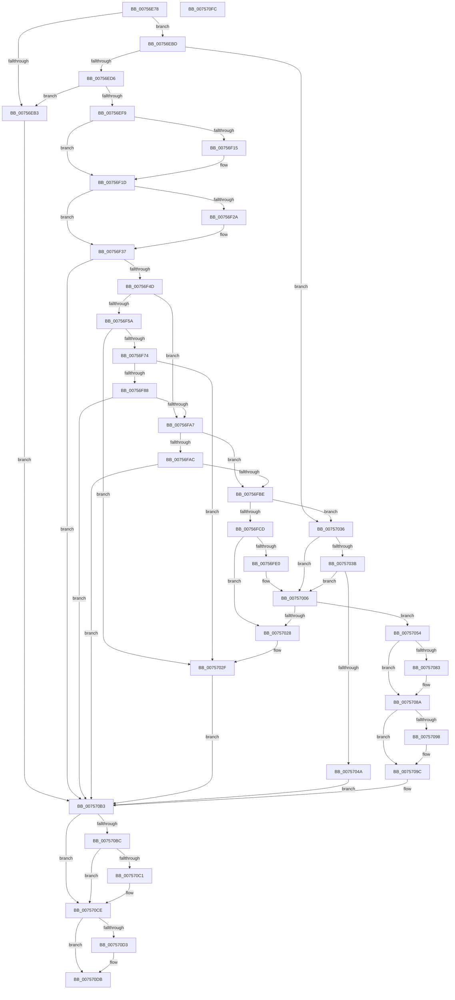

# PopAssociateThermalRequest

- RVA: `0x00756E78`–`0x007570FD` (길이 `645` bytes)
- VA: `0x0000000140756E78`
- 실행 섹션: `PAGE`
- PDB 이름 있음: `예`; PDB Function 태그: `아니요`
- unwind 정보 RVA: `0x0008A350`
- 디코드: `172`개 명령, `645/645` bytes 표시
- 미해석 바이트: `0` (있으면 어셈블리에 `.byte`로 보존)

> 이 문서는 커널 이미지의 기계어와 PDB 기호를 분석해 생성했습니다. 4번과 5번은 함수 원형과 자료형을 바이너리 사용 방식에서 추정한 C 해석이며 원본 소스 복구 결과는 아닙니다.

## 1. Dependencies

- 직접 호출 지점: **24**; 고유 호출 대상: **15**
- 직접 호출자로 확인된 함수: **1**
- RIP 상대 이미지 참조: **6**

### Outgoing calls
- `0x00756EA6` → [PopGetDope](../../text/4C/PopGetDope_function_004CB77C.md) (function, `0x004CB77C`)
- `0x00756EC7` → [PopAcquireRwLockExclusive](../../text/43/PopAcquireRwLockExclusive_function_00430B44.md) (function, `0x00430B44`)
- `0x00756ED9` → [PopReleaseRwLock](../../text/2D/PopReleaseRwLock_function_002DFBBC.md) (function, `0x002DFBBC`)
- `0x00756EEC` → [ExAllocatePool2](../../poolcode/B8/ExAllocatePool2_function_00B820F0.md) (function, `0x00B820F0`)
- `0x00756F0C` → [Feature_Servicing_CoolingFrameworkDeviceCleanupFix__private_IsEnabledDeviceUsageNoInline](../../text/5D/Feature_Servicing_CoolingFrameworkDeviceCleanupFix__private_IsEnabledDeviceUsageNoInline_function_005D1004.md) (function, `0x005D1004`)
- `0x00756F21` → [Feature_Servicing_CoolingFrameworkDeviceCleanupFix__private_IsEnabledDeviceUsageNoInline](../../text/5D/Feature_Servicing_CoolingFrameworkDeviceCleanupFix__private_IsEnabledDeviceUsageNoInline_function_005D1004.md) (function, `0x005D1004`)
- `0x00756F32` → [ObfReferenceObjectWithTag](../../text/21/ObfReferenceObjectWithTag_function_00210710.md) (function, `0x00210710`)
- `0x00756F3E` → [PopAcquireCoolingInterface](PopAcquireCoolingInterface_function_00756DF0.md) (function, `0x00756DF0`)
- `0x00756F51` → [Feature_Servicing_CoolingFrameworkDeviceCleanupFix__private_IsEnabledDeviceUsageNoInline](../../text/5D/Feature_Servicing_CoolingFrameworkDeviceCleanupFix__private_IsEnabledDeviceUsageNoInline_function_005D1004.md) (function, `0x005D1004`)
- `0x00756F63` → [IoGetDeviceAttachmentBaseRefWithTag](../../text/27/IoGetDeviceAttachmentBaseRefWithTag_function_00272788.md) (function, `0x00272788`)
- `0x00756F98` → [RtlDuplicateUnicodeString](../93/RtlDuplicateUnicodeString_function_009321F0.md) (function, `0x009321F0`)
- `0x00756FAF` → [PopRegisterCoolingExtensionProtection](PopRegisterCoolingExtensionProtection_function_007575D0.md) (function, `0x007575D0`)
- `0x00756FC1` → [PopAcquireRwLockExclusive](../../text/43/PopAcquireRwLockExclusive_function_00430B44.md) (function, `0x00430B44`)
- `0x00756FFF` → [PopDiagTraceCoolingExtension](../A3/PopDiagTraceCoolingExtension_function_00A39C28.md) (function, `0x00A39C28`)
- `0x0075700E` → [PopAcquireRwLockExclusive](../../text/43/PopAcquireRwLockExclusive_function_00430B44.md) (function, `0x00430B44`)
- `0x0075703F` → [PopRegisterCoolingExtensionProtection](PopRegisterCoolingExtensionProtection_function_007575D0.md) (function, `0x007575D0`)
- `0x0075704D` → [PopReleaseRwLock](../../text/2D/PopReleaseRwLock_function_002DFBBC.md) (function, `0x002DFBBC`)
- `0x00757070` → [PopDiagTraceThermalRequest](../AD/PopDiagTraceThermalRequest_function_00ADF828.md) (function, `0x00ADF828`)
- `0x00757085` → [PopThermalUpdateTelemetryClientCount](../../text/5D/PopThermalUpdateTelemetryClientCount_function_005D58C4.md) (function, `0x005D58C4`)
- `0x007570A4` → [PopReleaseRwLock](../../text/2D/PopReleaseRwLock_function_002DFBBC.md) (function, `0x002DFBBC`)
- `0x007570AC` → [PopReleaseRwLock](../../text/2D/PopReleaseRwLock_function_002DFBBC.md) (function, `0x002DFBBC`)
- `0x007570B3` → [Feature_Servicing_CoolingFrameworkDeviceCleanupFix__private_IsEnabledDeviceUsageNoInline](../../text/5D/Feature_Servicing_CoolingFrameworkDeviceCleanupFix__private_IsEnabledDeviceUsageNoInline_function_005D1004.md) (function, `0x005D1004`)
- `0x007570C9` → [ObfDereferenceObjectWithTag](../../text/2F/ObfDereferenceObjectWithTag_function_002F78E0.md) (function, `0x002F78E0`)
- `0x007570D6` → [PopCleanCoolingExtension](../AD/PopCleanCoolingExtension_function_00ADF580.md) (function, `0x00ADF580`)

### Direct callers
- [PoCreateThermalRequest](PoCreateThermalRequest_function_00756BF0.md) at `0x00756CB0`

### Static image references
- `0x00756EBD` → RVA `0x00F0BB30` (`.data`; read)
- `0x00756FCD` → RVA `0x00F0BB48` (`.data`; read)
- `0x00756FD4` → RVA `0x00F0BB40` (`.data`; read)
- `0x00756FE3` → RVA `0x000231A8` (`.rdata`; read)
- `0x00756FF4` → RVA `0x00F0BB48` (`.data`; write)
- `0x00757058` → RVA `0x00021F18` (`.rdata`; read)

## 2. Other-region calls and transfers

- 다른 실행 섹션으로 향하는 call: **17**
  - `0x00756EA6` → [PopGetDope](../../text/4C/PopGetDope_function_004CB77C.md) (`PAGE` → `.text`)
  - `0x00756EC7` → [PopAcquireRwLockExclusive](../../text/43/PopAcquireRwLockExclusive_function_00430B44.md) (`PAGE` → `.text`)
  - `0x00756ED9` → [PopReleaseRwLock](../../text/2D/PopReleaseRwLock_function_002DFBBC.md) (`PAGE` → `.text`)
  - `0x00756EEC` → [ExAllocatePool2](../../poolcode/B8/ExAllocatePool2_function_00B820F0.md) (`PAGE` → `POOLCODE`)
  - `0x00756F0C` → [Feature_Servicing_CoolingFrameworkDeviceCleanupFix__private_IsEnabledDeviceUsageNoInline](../../text/5D/Feature_Servicing_CoolingFrameworkDeviceCleanupFix__private_IsEnabledDeviceUsageNoInline_function_005D1004.md) (`PAGE` → `.text`)
  - `0x00756F21` → [Feature_Servicing_CoolingFrameworkDeviceCleanupFix__private_IsEnabledDeviceUsageNoInline](../../text/5D/Feature_Servicing_CoolingFrameworkDeviceCleanupFix__private_IsEnabledDeviceUsageNoInline_function_005D1004.md) (`PAGE` → `.text`)
  - `0x00756F32` → [ObfReferenceObjectWithTag](../../text/21/ObfReferenceObjectWithTag_function_00210710.md) (`PAGE` → `.text`)
  - `0x00756F51` → [Feature_Servicing_CoolingFrameworkDeviceCleanupFix__private_IsEnabledDeviceUsageNoInline](../../text/5D/Feature_Servicing_CoolingFrameworkDeviceCleanupFix__private_IsEnabledDeviceUsageNoInline_function_005D1004.md) (`PAGE` → `.text`)
  - `0x00756F63` → [IoGetDeviceAttachmentBaseRefWithTag](../../text/27/IoGetDeviceAttachmentBaseRefWithTag_function_00272788.md) (`PAGE` → `.text`)
  - `0x00756FC1` → [PopAcquireRwLockExclusive](../../text/43/PopAcquireRwLockExclusive_function_00430B44.md) (`PAGE` → `.text`)
  - `0x0075700E` → [PopAcquireRwLockExclusive](../../text/43/PopAcquireRwLockExclusive_function_00430B44.md) (`PAGE` → `.text`)
  - `0x0075704D` → [PopReleaseRwLock](../../text/2D/PopReleaseRwLock_function_002DFBBC.md) (`PAGE` → `.text`)
  - `0x00757085` → [PopThermalUpdateTelemetryClientCount](../../text/5D/PopThermalUpdateTelemetryClientCount_function_005D58C4.md) (`PAGE` → `.text`)
  - `0x007570A4` → [PopReleaseRwLock](../../text/2D/PopReleaseRwLock_function_002DFBBC.md) (`PAGE` → `.text`)
  - `0x007570AC` → [PopReleaseRwLock](../../text/2D/PopReleaseRwLock_function_002DFBBC.md) (`PAGE` → `.text`)
  - `0x007570B3` → [Feature_Servicing_CoolingFrameworkDeviceCleanupFix__private_IsEnabledDeviceUsageNoInline](../../text/5D/Feature_Servicing_CoolingFrameworkDeviceCleanupFix__private_IsEnabledDeviceUsageNoInline_function_005D1004.md) (`PAGE` → `.text`)
  - `0x007570C9` → [ObfDereferenceObjectWithTag](../../text/2F/ObfDereferenceObjectWithTag_function_002F78E0.md) (`PAGE` → `.text`)
- 별도 외부 분기/꼬리 이동을 확인하지 못했습니다.

## 3. Assembly (complete function range)

```asm
00756E78  48 8B C4                        mov rax, rsp
00756E7B  48 89 58 08                     mov qword ptr [rax + 8], rbx
00756E7F  48 89 68 10                     mov qword ptr [rax + 0x10], rbp
00756E83  48 89 70 18                     mov qword ptr [rax + 0x18], rsi
00756E87  48 89 78 20                     mov qword ptr [rax + 0x20], rdi
00756E8B  41 55                           push r13
00756E8D  41 56                           push r14
00756E8F  41 57                           push r15
00756E91  48 83 EC 20                     sub rsp, 0x20
00756E95  48 8B F1                        mov rsi, rcx
00756E98  45 8A F8                        mov r15b, r8b
00756E9B  48 8B CA                        mov rcx, rdx
00756E9E  48 8B DA                        mov rbx, rdx
00756EA1  33 FF                           xor edi, edi
00756EA3  45 33 F6                        xor r14d, r14d
00756EA6  E8 D1 48 D7 FF                  call 0x1404cb77c
00756EAB  48 8B E8                        mov rbp, rax
00756EAE  48 85 C0                        test rax, rax
00756EB1  75 0A                           jne 0x140756ebd
00756EB3  BB 9A 00 00 C0                  mov ebx, 0xc000009a
00756EB8  E9 F6 01 00 00                  jmp 0x1407570b3
00756EBD  4C 8D 2D 6C 4C 7B 00            lea r13, [rip + 0x7b4c6c]
00756EC4  49 8B CD                        mov rcx, r13
00756EC7  E8 78 9C CD FF                  call 0x140430b44
00756ECC  48 39 7D 40                     cmp qword ptr [rbp + 0x40], rdi
00756ED0  0F 85 60 01 00 00               jne 0x140757036
00756ED6  49 8B CD                        mov rcx, r13
00756ED9  E8 DE 8C B8 FF                  call 0x1402dfbbc
00756EDE  BA D8 00 00 00                  mov edx, 0xd8
00756EE3  41 B8 50 43 6F 6C               mov r8d, 0x6c6f4350
00756EE9  8D 4A 28                        lea ecx, [rdx + 0x28]
00756EEC  E8 FF B1 42 00                  call 0x140b820f0
00756EF1  48 8B F8                        mov rdi, rax
00756EF4  48 85 C0                        test rax, rax
00756EF7  74 BA                           je 0x140756eb3
00756EF9  48 83 C0 10                     add rax, 0x10
00756EFD  48 89 40 08                     mov qword ptr [rax + 8], rax
00756F01  48 89 00                        mov qword ptr [rax], rax
00756F04  4C 21 77 28                     and qword ptr [rdi + 0x28], r14
00756F08  4C 21 77 20                     and qword ptr [rdi + 0x20], r14
00756F0C  E8 F3 A0 E7 FF                  call 0x1405d1004
00756F11  85 C0                           test eax, eax
00756F13  74 08                           je 0x140756f1d
00756F15  4C 21 77 38                     and qword ptr [rdi + 0x38], r14
00756F19  4C 21 77 30                     and qword ptr [rdi + 0x30], r14
00756F1D  C6 47 52 64                     mov byte ptr [rdi + 0x52], 0x64
00756F21  E8 DE A0 E7 FF                  call 0x1405d1004
00756F26  85 C0                           test eax, eax
00756F28  74 0D                           je 0x140756f37
00756F2A  BA 50 6F 44 67                  mov edx, 0x67446f50
00756F2F  48 8B CB                        mov rcx, rbx
00756F32  E8 D9 97 AB FF                  call 0x140210710
00756F37  48 8B CF                        mov rcx, rdi
00756F3A  48 89 5F 40                     mov qword ptr [rdi + 0x40], rbx
00756F3E  E8 AD FE FF FF                  call 0x140756df0
00756F43  8B D8                           mov ebx, eax
00756F45  85 C0                           test eax, eax
00756F47  0F 88 66 01 00 00               js 0x1407570b3
00756F4D  C6 47 50 01                     mov byte ptr [rdi + 0x50], 1
00756F51  E8 AE A0 E7 FF                  call 0x1405d1004
00756F56  85 C0                           test eax, eax
00756F58  74 4D                           je 0x140756fa7
00756F5A  48 8B 4F 40                     mov rcx, qword ptr [rdi + 0x40]
00756F5E  BA 50 6F 44 67                  mov edx, 0x67446f50
00756F63  E8 20 B8 B1 FF                  call 0x140272788
00756F68  4C 8B F0                        mov r14, rax
00756F6B  48 85 C0                        test rax, rax
00756F6E  0F 84 BB 00 00 00               je 0x14075702f
00756F74  48 8B 88 38 01 00 00            mov rcx, qword ptr [rax + 0x138]
00756F7B  48 8B 51 28                     mov rdx, qword ptr [rcx + 0x28]
00756F7F  48 85 D2                        test rdx, rdx
00756F82  0F 84 A7 00 00 00               je 0x14075702f
00756F88  4C 8D 87 A0 00 00 00            lea r8, [rdi + 0xa0]
00756F8F  48 83 EA 80                     sub rdx, -0x80
00756F93  B9 01 00 00 00                  mov ecx, 1
00756F98  E8 53 B2 1D 00                  call 0x1409321f0
00756F9D  8B D8                           mov ebx, eax
00756F9F  85 C0                           test eax, eax
00756FA1  0F 88 0C 01 00 00               js 0x1407570b3
00756FA7  45 84 FF                        test r15b, r15b
00756FAA  74 12                           je 0x140756fbe
00756FAC  48 8B CF                        mov rcx, rdi
00756FAF  E8 1C 06 00 00                  call 0x1407575d0
00756FB4  8B D8                           mov ebx, eax
00756FB6  85 C0                           test eax, eax
00756FB8  0F 88 F5 00 00 00               js 0x1407570b3
00756FBE  49 8B CD                        mov rcx, r13
00756FC1  E8 7E 9B CD FF                  call 0x140430b44
00756FC6  48 83 7D 40 00                  cmp qword ptr [rbp + 0x40], 0
00756FCB  75 69                           jne 0x140757036
00756FCD  48 8B 05 74 4B 7B 00            mov rax, qword ptr [rip + 0x7b4b74]
00756FD4  48 8D 0D 65 4B 7B 00            lea rcx, [rip + 0x7b4b65]
00756FDB  48 39 08                        cmp qword ptr [rax], rcx
00756FDE  75 48                           jne 0x140757028
00756FE0  48 89 0F                        mov qword ptr [rdi], rcx
00756FE3  48 8D 15 BE C1 8C FF            lea rdx, [rip - 0x733e42]
00756FEA  48 89 47 08                     mov qword ptr [rdi + 8], rax
00756FEE  48 8B CF                        mov rcx, rdi
00756FF1  48 89 38                        mov qword ptr [rax], rdi
00756FF4  48 89 3D 4D 4B 7B 00            mov qword ptr [rip + 0x7b4b4d], rdi
00756FFB  48 89 7D 40                     mov qword ptr [rbp + 0x40], rdi
00756FFF  E8 24 2C 2E 00                  call 0x140a39c28
00757004  33 FF                           xor edi, edi
00757006  48 8B 4D 40                     mov rcx, qword ptr [rbp + 0x40]
0075700A  48 83 C1 20                     add rcx, 0x20
0075700E  E8 31 9B CD FF                  call 0x140430b44
00757013  48 8B 45 40                     mov rax, qword ptr [rbp + 0x40]
00757017  48 89 46 20                     mov qword ptr [rsi + 0x20], rax
0075701B  48 83 C0 10                     add rax, 0x10
0075701F  48 8B 48 08                     mov rcx, qword ptr [rax + 8]
00757023  48 39 01                        cmp qword ptr [rcx], rax
00757026  74 2C                           je 0x140757054
00757028  B9 03 00 00 00                  mov ecx, 3
0075702D  CD 29                           int 0x29
0075702F  BB 08 00 00 C0                  mov ebx, 0xc0000008
00757034  EB 7D                           jmp 0x1407570b3
00757036  45 84 FF                        test r15b, r15b
00757039  74 CB                           je 0x140757006
0075703B  48 8B 4D 40                     mov rcx, qword ptr [rbp + 0x40]
0075703F  E8 8C 05 00 00                  call 0x1407575d0
00757044  8B D8                           mov ebx, eax
00757046  85 C0                           test eax, eax
00757048  79 BC                           jns 0x140757006
0075704A  49 8B CD                        mov rcx, r13
0075704D  E8 6A 8B B8 FF                  call 0x1402dfbbc
00757052  EB 5F                           jmp 0x1407570b3
00757054  48 89 4E 08                     mov qword ptr [rsi + 8], rcx
00757058  48 8D 15 B9 AE 8C FF            lea rdx, [rip - 0x735147]
0075705F  48 89 06                        mov qword ptr [rsi], rax
00757062  48 89 31                        mov qword ptr [rcx], rsi
00757065  48 8B CE                        mov rcx, rsi
00757068  48 89 70 08                     mov qword ptr [rax + 8], rsi
0075706C  C6 46 12 01                     mov byte ptr [rsi + 0x12], 1
00757070  E8 B3 87 38 00                  call 0x140adf828
00757075  48 8B 46 20                     mov rax, qword ptr [rsi + 0x20]
00757079  48 83 B8 98 00 00 00 00         cmp qword ptr [rax + 0x98], 0
00757081  74 07                           je 0x14075708a
00757083  B1 01                           mov cl, 1
00757085  E8 3A E8 E7 FF                  call 0x1405d58c4
0075708A  48 8B 46 20                     mov rax, qword ptr [rsi + 0x20]
0075708E  48 83 B8 90 00 00 00 00         cmp qword ptr [rax + 0x90], 0
00757096  74 04                           je 0x14075709c
00757098  C6 46 29 01                     mov byte ptr [rsi + 0x29], 1
0075709C  48 8B 4D 40                     mov rcx, qword ptr [rbp + 0x40]
007570A0  48 83 C1 20                     add rcx, 0x20
007570A4  E8 13 8B B8 FF                  call 0x1402dfbbc
007570A9  49 8B CD                        mov rcx, r13
007570AC  E8 0B 8B B8 FF                  call 0x1402dfbbc
007570B1  33 DB                           xor ebx, ebx
007570B3  E8 4C 9F E7 FF                  call 0x1405d1004
007570B8  85 C0                           test eax, eax
007570BA  74 12                           je 0x1407570ce
007570BC  4D 85 F6                        test r14, r14
007570BF  74 0D                           je 0x1407570ce
007570C1  BA 50 6F 44 67                  mov edx, 0x67446f50
007570C6  49 8B CE                        mov rcx, r14
007570C9  E8 12 08 BA FF                  call 0x1402f78e0
007570CE  48 85 FF                        test rdi, rdi
007570D1  74 08                           je 0x1407570db
007570D3  48 8B CF                        mov rcx, rdi
007570D6  E8 A5 84 38 00                  call 0x140adf580
007570DB  48 8B 6C 24 48                  mov rbp, qword ptr [rsp + 0x48]
007570E0  8B C3                           mov eax, ebx
007570E2  48 8B 5C 24 40                  mov rbx, qword ptr [rsp + 0x40]
007570E7  48 8B 74 24 50                  mov rsi, qword ptr [rsp + 0x50]
007570EC  48 8B 7C 24 58                  mov rdi, qword ptr [rsp + 0x58]
007570F1  48 83 C4 20                     add rsp, 0x20
007570F5  41 5F                           pop r15
007570F7  41 5E                           pop r14
007570F9  41 5D                           pop r13
007570FB  C3                              ret
007570FC  CC                              int3
```

## 4. C-style interpretation (structured pseudocode)

```c
__int64 __fastcall PopAssociateThermalRequest(__int64 a1, __int64 a2, unsigned __int8 a3)
{
    __int64 result;
    __int64 v_r14;
    __int64 v_rbx;
    __int64 v_rdi;
    __int64 v_rsp;
    unsigned __int64 v_stack_p10;
    unsigned __int64 v_stack_p18;
    unsigned __int64 v_stack_p20;
    unsigned __int64 v_stack_p8;

    *(unsigned __int64 *)(v_rsp + 8) = v_rbx;
    *(unsigned __int64 *)(v_rsp + 16) = v_rbp;
    *(unsigned __int64 *)(v_rsp + 24) = v_rsi;
    *(unsigned __int64 *)(v_rsp + 32) = v_rdi;
    v_rsp = (v_rsp) - (32);
    v_rdi = 0;
    v_r14 = 0;
    result = PopGetDope(a2, a2, a3, a4);
    if (result != 0) goto loc_00756EBD;
loc_00756EB3:
    goto loc_007570B3;
loc_00756EBD:
    result = PopAcquireRwLockExclusive(v_rip + 8080492, a2, a3, a4);
    if ((*(unsigned __int64 *)(result + 64)) != 0) goto loc_00757036;
    result = PopReleaseRwLock(v_rip + 8080492, a2, a3, a4);
    result = ExAllocatePool2(216 + 40, 216, (unsigned int)(0x6C6F4350ULL), a4);
    if (result == 0) goto loc_00756EB3;
    result = (result) + (16);
    *(unsigned __int64 *)(result + 8) = result;
    *(unsigned __int64 *)(result) = result;
    result = Feature_Servicing_CoolingFrameworkDeviceCleanupFix__private_IsEnabledDeviceUsageNoInline(216 + 40, 216, (unsigned int)(0x6C6F4350ULL), a4);
    if ((unsigned int)(result) != 0) {
    }
    *(unsigned __int8 *)(result + 82) = 100;
    result = Feature_Servicing_CoolingFrameworkDeviceCleanupFix__private_IsEnabledDeviceUsageNoInline(216 + 40, 216, (unsigned int)(0x6C6F4350ULL), a4);
    if ((unsigned int)(result) != 0) {
        a2 = 0x67446F50ULL;
        a1 = (unsigned int)(0xC000009AULL);
        result = ObfReferenceObjectWithTag(a1, a2, (unsigned int)(0x6C6F4350ULL), a4);
    }
    *(unsigned __int64 *)(result + 64) = (unsigned int)(0xC000009AULL);
    result = PopAcquireCoolingInterface(result, a2, (unsigned int)(0x6C6F4350ULL), a4);
    if (sign_flag) goto loc_007570B3;
    *(unsigned __int8 *)(result + 80) = 1;
    result = Feature_Servicing_CoolingFrameworkDeviceCleanupFix__private_IsEnabledDeviceUsageNoInline(result, a2, (unsigned int)(0x6C6F4350ULL), a4);
    if ((unsigned int)(result) == 0) goto loc_00756FA7;
    result = IoGetDeviceAttachmentBaseRefWithTag(*(unsigned __int64 *)(result + 64), (unsigned int)(0x67446F50ULL), (unsigned int)(0x6C6F4350ULL), a4);
    if (result == 0) goto loc_0075702F;
    if (*(unsigned __int64 *)(*(unsigned __int64 *)(result + 312) + 40) == 0) goto loc_0075702F;
    a2 = (*(unsigned __int64 *)(*(unsigned __int64 *)(result + 312) + 40)) - (-128);
    result = RtlDuplicateUnicodeString(1, a2, result + 160, a4);
    if (sign_flag) goto loc_007570B3;
loc_00756FA7:
    if (a3 == 0) goto loc_00756FBE;
    result = PopRegisterCoolingExtensionProtection(result, a2, result + 160, a4);
    if (sign_flag) goto loc_007570B3;
loc_00756FBE:
    result = PopAcquireRwLockExclusive(v_rip + 8080492, a2, result + 160, a4);
    if ((*(unsigned __int64 *)(result + 64)) != 0) goto loc_00757036;
    if ((*(unsigned __int64 *)(*(unsigned __int64 *)(v_rip + 8080244))) != (v_rip + 8080229)) goto loc_00757028;
    *(unsigned __int64 *)(result) = v_rip + 8080229;
    *(unsigned __int64 *)(result + 8) = *(unsigned __int64 *)(v_rip + 8080244);
    *(unsigned __int64 *)(*(unsigned __int64 *)(v_rip + 8080244)) = result;
    *(unsigned __int64 *)(v_rip + 8080205) = result;
    *(unsigned __int64 *)(result + 64) = result;
    result = PopDiagTraceCoolingExtension(result, v_rip - 7552578, result + 160, a4);
    v_rdi = 0;
loc_00757006:
    a1 = (*(unsigned __int64 *)(result + 64)) + (32);
    result = PopAcquireRwLockExclusive(a1, v_rip - 7552578, result + 160, a4);
    *(unsigned __int64 *)(a1 + 32) = *(unsigned __int64 *)(result + 64);
    result = (*(unsigned __int64 *)(result + 64)) + (16);
    if ((*(unsigned __int64 *)(*(unsigned __int64 *)(result + 8))) == result) goto loc_00757054;
loc_00757028:
loc_0075702F:
    goto loc_007570B3;
loc_00757036:
    if (a3 == 0) goto loc_00757006;
    result = PopRegisterCoolingExtensionProtection(*(unsigned __int64 *)(result + 64), v_rip - 7552578, result + 160, a4);
    if (!sign_flag) goto loc_00757006;
    result = PopReleaseRwLock(v_rip + 8080492, v_rip - 7552578, result + 160, a4);
    goto loc_007570B3;
loc_00757054:
    *(unsigned __int64 *)(a1 + 8) = v_rip + 8080492;
    *(unsigned __int64 *)(a1) = result;
    *(unsigned __int64 *)(v_rip + 8080492) = a1;
    *(unsigned __int64 *)(result + 8) = a1;
    *(unsigned __int8 *)(a1 + 18) = 1;
    result = PopDiagTraceThermalRequest(a1, v_rip - 7557447, result + 160, a4);
    result = *(unsigned __int64 *)(a1 + 32);
    if ((*(unsigned __int64 *)(*(unsigned __int64 *)(a1 + 32) + 152)) != 0) {
        a1 = 1;
        result = PopThermalUpdateTelemetryClientCount(a1, v_rip - 7557447, result + 160, a4);
    }
    if ((*(unsigned __int64 *)(*(unsigned __int64 *)(a1 + 32) + 144)) != 0) {
        *(unsigned __int8 *)(a1 + 41) = 1;
    }
    a1 = (*(unsigned __int64 *)(result + 64)) + (32);
    result = PopReleaseRwLock(a1, v_rip - 7557447, result + 160, a4);
    result = PopReleaseRwLock(v_rip + 8080492, v_rip - 7557447, result + 160, a4);
    v_rbx = 0;
loc_007570B3:
    result = Feature_Servicing_CoolingFrameworkDeviceCleanupFix__private_IsEnabledDeviceUsageNoInline(v_rip + 8080492, v_rip - 7557447, result + 160, a4);
    if ((unsigned int)(result) == 0) goto loc_007570CE;
    if (result != 0) {
        a2 = 0x67446F50ULL;
        a1 = result;
        result = ObfDereferenceObjectWithTag(a1, a2, result + 160, a4);
    }
    if (0 != 0) {
        a1 = 0;
        result = PopCleanCoolingExtension(a1, a2, result + 160, a4);
    }
    v_rsp = (v_rsp) + (32);
    return 0;
}
```

## 5. (Beta) C Style

```c
int64_t PopAssociateThermalRequest(void *Arg1, int64_t Arg2, uint8_t Arg3)
{
    uint8_t *arg1 = (uint8_t *)Arg1;

    int64_t result;
    int64_t local_r14;
    int64_t local_rbx;
    int64_t local_rdi;
    int64_t local_rsp;
    uint64_t v_stack_p10;
    uint64_t v_stack_p18;
    uint64_t v_stack_p20;
    uint64_t v_stack_p8;

    *(uint64_t *)(local_rsp + 0x8) = local_rbx;
    *(uint64_t *)(local_rsp + 0x10) = local_rbp;
    *(uint64_t *)(local_rsp + 0x18) = local_rsi;
    *(uint64_t *)(local_rsp + 0x20) = local_rdi;
    local_rsp = (local_rsp) - (32);
    local_rdi = 0;
    local_r14 = 0;
    result = PopGetDope(Arg2, Arg2, Arg3, a4);
    if (result != 0) goto loc_00756EBD;
loc_00756EB3:
    goto loc_007570B3;
loc_00756EBD:
    result = PopAcquireRwLockExclusive(v_rip + 8080492, Arg2, Arg3, a4);
    if ((*(uint64_t *)(result + 0x40)) != 0) goto loc_00757036;
    result = PopReleaseRwLock(v_rip + 8080492, Arg2, Arg3, a4);
    result = ExAllocatePool2(216 + 40, 216, (uint32_t)(0x6C6F4350ULL), a4);
    if (result == 0) goto loc_00756EB3;
    result = (result) + (16);
    *(uint64_t *)(result + 0x8) = result;
    *(uint64_t *)(result) = result;
    result = Feature_Servicing_CoolingFrameworkDeviceCleanupFix__private_IsEnabledDeviceUsageNoInline(216 + 40, 216, (uint32_t)(0x6C6F4350ULL), a4);
    if ((uint32_t)(result) != 0) {
    }
    *(uint8_t *)(result + 0x52) = 100;
    result = Feature_Servicing_CoolingFrameworkDeviceCleanupFix__private_IsEnabledDeviceUsageNoInline(216 + 40, 216, (uint32_t)(0x6C6F4350ULL), a4);
    if ((uint32_t)(result) != 0) {
        Arg2 = 0x67446F50ULL;
        Arg1 = (uint32_t)(0xC000009AULL);
        result = ObfReferenceObjectWithTag(Arg1, Arg2, (uint32_t)(0x6C6F4350ULL), a4);
    }
    *(uint64_t *)(result + 0x40) = (uint32_t)(0xC000009AULL);
    result = PopAcquireCoolingInterface(result, Arg2, (uint32_t)(0x6C6F4350ULL), a4);
    if (sign_flag) goto loc_007570B3;
    *(uint8_t *)(result + 0x50) = 1;
    result = Feature_Servicing_CoolingFrameworkDeviceCleanupFix__private_IsEnabledDeviceUsageNoInline(result, Arg2, (uint32_t)(0x6C6F4350ULL), a4);
    if ((uint32_t)(result) == 0) goto loc_00756FA7;
    result = IoGetDeviceAttachmentBaseRefWithTag(*(uint64_t *)(result + 0x40), (uint32_t)(0x67446F50ULL), (uint32_t)(0x6C6F4350ULL), a4);
    if (result == 0) goto loc_0075702F;
    if (*(uint64_t *)(*(uint64_t *)(result + 0x138) + 0x28) == 0) goto loc_0075702F;
    Arg2 = (*(uint64_t *)(*(uint64_t *)(result + 0x138) + 0x28)) - (-128);
    result = RtlDuplicateUnicodeString(1, Arg2, result + 160, a4);
    if (sign_flag) goto loc_007570B3;
loc_00756FA7:
    if (Arg3 == 0) goto loc_00756FBE;
    result = PopRegisterCoolingExtensionProtection(result, Arg2, result + 160, a4);
    if (sign_flag) goto loc_007570B3;
loc_00756FBE:
    result = PopAcquireRwLockExclusive(v_rip + 8080492, Arg2, result + 160, a4);
    if ((*(uint64_t *)(result + 0x40)) != 0) goto loc_00757036;
    if ((*(uint64_t *)(*(uint64_t *)(v_rip + 0x7B4B74))) != (v_rip + 8080229)) goto loc_00757028;
    *(uint64_t *)(result) = v_rip + 8080229;
    *(uint64_t *)(result + 0x8) = *(uint64_t *)(v_rip + 0x7B4B74);
    *(uint64_t *)(*(uint64_t *)(v_rip + 0x7B4B74)) = result;
    *(uint64_t *)(v_rip + 0x7B4B4D) = result;
    *(uint64_t *)(result + 0x40) = result;
    result = PopDiagTraceCoolingExtension(result, v_rip - 7552578, result + 160, a4);
    local_rdi = 0;
loc_00757006:
    Arg1 = (*(uint64_t *)(result + 0x40)) + (32);
    result = PopAcquireRwLockExclusive(Arg1, v_rip - 7552578, result + 160, a4);
    *(uint64_t *)(arg1 + 0x20) = *(uint64_t *)(result + 0x40);
    result = (*(uint64_t *)(result + 0x40)) + (16);
    if ((*(uint64_t *)(*(uint64_t *)(result + 0x8))) == result) goto loc_00757054;
loc_00757028:
loc_0075702F:
    goto loc_007570B3;
loc_00757036:
    if (Arg3 == 0) goto loc_00757006;
    result = PopRegisterCoolingExtensionProtection(*(uint64_t *)(result + 0x40), v_rip - 7552578, result + 160, a4);
    if (!sign_flag) goto loc_00757006;
    result = PopReleaseRwLock(v_rip + 8080492, v_rip - 7552578, result + 160, a4);
    goto loc_007570B3;
loc_00757054:
    *(uint64_t *)(arg1 + 0x8) = v_rip + 8080492;
    *(uint64_t *)(arg1) = result;
    *(void **)(v_rip + 0x7B4C6C) = Arg1;
    *(void **)(result + 0x8) = Arg1;
    *(uint8_t *)(arg1 + 0x12) = 1;
    result = PopDiagTraceThermalRequest(Arg1, v_rip - 7557447, result + 160, a4);
    result = *(uint64_t *)(arg1 + 0x20);
    if ((*(uint64_t *)(*(uint64_t *)(arg1 + 0x20) + 0x98)) != 0) {
        Arg1 = 1;
        result = PopThermalUpdateTelemetryClientCount(Arg1, v_rip - 7557447, result + 160, a4);
    }
    if ((*(uint64_t *)(*(uint64_t *)(arg1 + 0x20) + 0x90)) != 0) {
        *(uint8_t *)(arg1 + 0x29) = 1;
    }
    Arg1 = (*(uint64_t *)(result + 0x40)) + (32);
    result = PopReleaseRwLock(Arg1, v_rip - 7557447, result + 160, a4);
    result = PopReleaseRwLock(v_rip + 8080492, v_rip - 7557447, result + 160, a4);
    local_rbx = 0;
loc_007570B3:
    result = Feature_Servicing_CoolingFrameworkDeviceCleanupFix__private_IsEnabledDeviceUsageNoInline(v_rip + 8080492, v_rip - 7557447, result + 160, a4);
    if ((uint32_t)(result) == 0) goto loc_007570CE;
    if (result != 0) {
        Arg2 = 0x67446F50ULL;
        Arg1 = result;
        result = ObfDereferenceObjectWithTag(Arg1, Arg2, result + 160, a4);
    }
    if (0 != 0) {
        Arg1 = 0;
        result = PopCleanCoolingExtension(Arg1, Arg2, result + 160, a4);
    }
    local_rsp = (local_rsp) + (32);
    return 0;
}
```

### 관측된 메모리 오프셋

구조체 형식이 확인되지 않은 접근은 인자 기준의 오프셋으로만 기록했습니다.

| 기준 인자 | 오프셋 표현 | 폭 (bit) | 접근 |
|---|---:|---:|---|
| `Arg1` | `+ 0x0` | `64` | `W` |
| `Arg1` | `+ 0x8` | `64` | `W` |
| `Arg1` | `+ 0x12` | `8` | `W` |
| `Arg1` | `+ 0x20` | `64` | `R` |
| `Arg1` | `+ 0x20` | `64` | `W` |
| `Arg1` | `+ 0x29` | `8` | `W` |

## 6. Execution-region graph

[열기: 2D/3D 그래프와 함수 탐색 컨트롤 패널](../../../control-panel.html?section=page&rva=0x00756E78&view=graph)

- 2D 그래프는 위에서 아래로 흐르고, 3D 그래프는 빈 공간을 드래그해 회전합니다. Shift+드래그는 이동, 휠은 확대·축소, 함수 노드 선택은 대상 보고서 이동입니다.

### Static fallback


