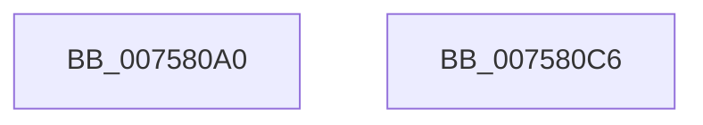

# PopBatteryAlarmPowerSettingCallback

- RVA: `0x007580A0`–`0x007580C7` (길이 `39` bytes)
- VA: `0x00000001407580A0`
- 실행 섹션: `PAGE`
- PDB 이름 있음: `예`; PDB Function 태그: `아니요`
- unwind 정보 RVA: `0x0005CF00`
- 디코드: `14`개 명령, `39/39` bytes 표시
- 미해석 바이트: `0` (있으면 어셈블리에 `.byte`로 보존)

> 이 문서는 커널 이미지의 기계어와 PDB 기호를 분석해 생성했습니다. 4번과 5번은 함수 원형과 자료형을 바이너리 사용 방식에서 추정한 C 해석이며 원본 소스 복구 결과는 아닙니다.

## 1. Dependencies

- 직접 호출 지점: **3**; 고유 호출 대상: **3**
- 직접 호출자로 확인된 함수: **0**
- RIP 상대 이미지 참조: **0**

### Outgoing calls
- `0x007580A9` → [PopAcquirePolicyLock](../../pagelk/B7/PopAcquirePolicyLock_function_00B783C0.md) (function, `0x00B783C0`)
- `0x007580B2` → [PopBatteryUpdateAlarms](../91/PopBatteryUpdateAlarms_function_00910058.md) (function, `0x00910058`)
- `0x007580B9` → [PopReleasePolicyLock](../../pagelk/B7/PopReleasePolicyLock_function_00B78410.md) (function, `0x00B78410`)

### Direct callers
- 이 함수 시작 RVA로 연결되는 직접 call은 확인되지 않았습니다. 간접 호출은 완전히 역산할 수 없습니다.

### Static image references
- 디코드된 RIP-relative 메모리 참조가 없습니다.

## 2. Other-region calls and transfers

- 다른 실행 섹션으로 향하는 call: **2**
  - `0x007580A9` → [PopAcquirePolicyLock](../../pagelk/B7/PopAcquirePolicyLock_function_00B783C0.md) (`PAGE` → `PAGELK`)
  - `0x007580B9` → [PopReleasePolicyLock](../../pagelk/B7/PopReleasePolicyLock_function_00B78410.md) (`PAGE` → `PAGELK`)
- 별도 외부 분기/꼬리 이동을 확인하지 못했습니다.

## 3. Assembly (complete function range)

```asm
007580A0  40 53                           push rbx
007580A2  48 83 EC 20                     sub rsp, 0x20
007580A6  49 8B D9                        mov rbx, r9
007580A9  E8 12 03 42 00                  call 0x140b783c0
007580AE  8B D3                           mov edx, ebx
007580B0  33 C9                           xor ecx, ecx
007580B2  E8 A1 7F 1B 00                  call 0x140910058
007580B7  8B D8                           mov ebx, eax
007580B9  E8 52 03 42 00                  call 0x140b78410
007580BE  8B C3                           mov eax, ebx
007580C0  48 83 C4 20                     add rsp, 0x20
007580C4  5B                              pop rbx
007580C5  C3                              ret
007580C6  CC                              int3
```

## 4. C-style interpretation (structured pseudocode)

```c
__int64 __fastcall PopBatteryAlarmPowerSettingCallback(int a1, __int64 a2, __int64 a3, __int64 a4)
{
    __int64 result;
    __int64 v_rsp;

    v_rsp = (v_rsp) - (32);
    result = PopAcquirePolicyLock(a1, a2, a3, a4);
    a1 = 0;
    result = PopBatteryUpdateAlarms(a1, (unsigned int)((unsigned int)(a4)), a3, a4);
    result = PopReleasePolicyLock(a1, (unsigned int)((unsigned int)(a4)), a3, a4);
    v_rsp = (v_rsp) + (32);
    return (unsigned int)((unsigned int)((unsigned int)((unsigned int)(result))));
}
```

## 5. (Beta) C Style

```c
int64_t PopBatteryAlarmPowerSettingCallback(int32_t Arg1, int64_t Arg2, int64_t Arg3, int64_t Arg4)
{
    int64_t result;
    int64_t local_rsp;

    local_rsp = (local_rsp) - (32);
    result = PopAcquirePolicyLock(Arg1, Arg2, Arg3, Arg4);
    Arg1 = 0;
    result = PopBatteryUpdateAlarms(Arg1, (uint32_t)((uint32_t)(Arg4)), Arg3, Arg4);
    result = PopReleasePolicyLock(Arg1, (uint32_t)((uint32_t)(Arg4)), Arg3, Arg4);
    local_rsp = (local_rsp) + (32);
    return (uint32_t)((uint32_t)((uint32_t)((uint32_t)(result))));
}
```

## 6. Execution-region graph

[열기: 2D/3D 그래프와 함수 탐색 컨트롤 패널](../../../control-panel.html?section=page&rva=0x007580A0&view=graph)

- 2D 그래프는 위에서 아래로 흐르고, 3D 그래프는 빈 공간을 드래그해 회전합니다. Shift+드래그는 이동, 휠은 확대·축소, 함수 노드 선택은 대상 보고서 이동입니다.

### Static fallback


