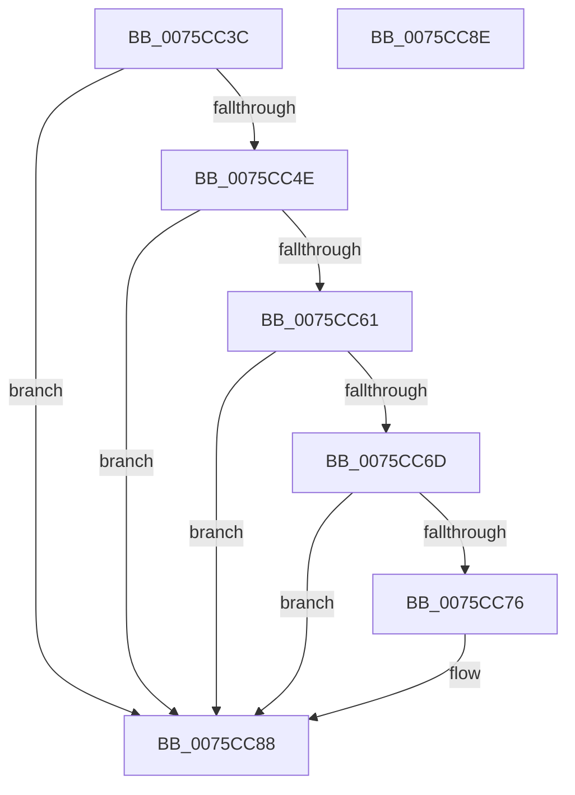

# PopBootLoaderTraceProcess

- RVA: `0x0075CC3C`–`0x0075CC8F` (길이 `83` bytes)
- VA: `0x000000014075CC3C`
- 실행 섹션: `PAGE`
- PDB 이름 있음: `예`; PDB Function 태그: `아니요`
- unwind 정보 RVA: `0x0005CF00`
- 디코드: `24`개 명령, `83/83` bytes 표시
- 미해석 바이트: `0` (있으면 어셈블리에 `.byte`로 보존)

> 이 문서는 커널 이미지의 기계어와 PDB 기호를 분석해 생성했습니다. 4번과 5번은 함수 원형과 자료형을 바이너리 사용 방식에서 추정한 C 해석이며 원본 소스 복구 결과는 아닙니다.

## 1. Dependencies

- 직접 호출 지점: **2**; 고유 호출 대상: **2**
- 직접 호출자로 확인된 함수: **1**
- RIP 상대 이미지 참조: **2**

### Outgoing calls
- `0x0075CC50` → [BapdRecordFirmwareBootStats](../../pagelk/B7/BapdRecordFirmwareBootStats_function_00B72474.md) (function, `0x00B72474`)
- `0x0075CC83` → [BapdWriteEtwEvents](../../text/4A/BapdWriteEtwEvents_function_004AE884.md) (function, `0x004AE884`)

### Direct callers
- [PopTransitionSystemPowerStateEx](../../pagelk/B7/PopTransitionSystemPowerStateEx_function_00B7E8C0.md) at `0x00B7FB0D`

### Static image references
- `0x0075CC42` → RVA `0x00F0BD90` (`.data`; read)
- `0x0075CC79` → RVA `0x00EFF040` (`.data`; read)

## 2. Other-region calls and transfers

- 다른 실행 섹션으로 향하는 call: **2**
  - `0x0075CC50` → [BapdRecordFirmwareBootStats](../../pagelk/B7/BapdRecordFirmwareBootStats_function_00B72474.md) (`PAGE` → `PAGELK`)
  - `0x0075CC83` → [BapdWriteEtwEvents](../../text/4A/BapdWriteEtwEvents_function_004AE884.md) (`PAGE` → `.text`)
- 별도 외부 분기/꼬리 이동을 확인하지 못했습니다.

## 3. Assembly (complete function range)

```asm
0075CC3C  40 53                           push rbx
0075CC3E  48 83 EC 20                     sub rsp, 0x20
0075CC42  48 8B 1D 47 F1 7A 00            mov rbx, qword ptr [rip + 0x7af147]
0075CC49  48 85 DB                        test rbx, rbx
0075CC4C  74 3A                           je 0x14075cc88
0075CC4E  33 C9                           xor ecx, ecx
0075CC50  E8 1F 58 41 00                  call 0x140b72474
0075CC55  48 8B 83 E8 00 00 00            mov rax, qword ptr [rbx + 0xe8]
0075CC5C  48 85 C0                        test rax, rax
0075CC5F  74 27                           je 0x14075cc88
0075CC61  48 8B 40 20                     mov rax, qword ptr [rax + 0x20]
0075CC65  81 38 48 69 62 4C               cmp dword ptr [rax], 0x4c626948
0075CC6B  75 1B                           jne 0x14075cc88
0075CC6D  44 8B 40 0C                     mov r8d, dword ptr [rax + 0xc]
0075CC71  45 85 C0                        test r8d, r8d
0075CC74  74 12                           je 0x14075cc88
0075CC76  8B 50 08                        mov edx, dword ptr [rax + 8]
0075CC79  48 8D 0D C0 23 7A 00            lea rcx, [rip + 0x7a23c0]
0075CC80  48 03 D0                        add rdx, rax
0075CC83  E8 FC 1B D5 FF                  call 0x1404ae884
0075CC88  48 83 C4 20                     add rsp, 0x20
0075CC8C  5B                              pop rbx
0075CC8D  C3                              ret
0075CC8E  CC                              int3
```

## 4. C-style interpretation (structured pseudocode)

```c
__int64 __fastcall PopBootLoaderTraceProcess(int a1)
{
    __int64 result;
    __int64 v_rsp;

    v_rsp = (v_rsp) - (32);
    if (*(unsigned __int64 *)(v_rip + 8057159) == 0) goto loc_0075CC88;
    a1 = 0;
    result = BapdRecordFirmwareBootStats(a1, a2, a3, a4);
    if (*(unsigned __int64 *)(*(unsigned __int64 *)(v_rip + 8057159) + 232) == 0) goto loc_0075CC88;
    if ((*(unsigned int *)(*(unsigned __int64 *)(*(unsigned __int64 *)(*(unsigned __int64 *)(v_rip + 8057159) + 232) + 32))) != 0x4C626948ULL) goto loc_0075CC88;
    result = *(unsigned __int64 *)(*(unsigned __int64 *)(*(unsigned __int64 *)(v_rip + 8057159) + 232) + 32);
    if ((unsigned int)((unsigned int)(*(unsigned int *)(*(unsigned __int64 *)(*(unsigned __int64 *)(*(unsigned __int64 *)(v_rip + 8057159) + 232) + 32) + 12))) != 0) {
        a2 = *(unsigned int *)(*(unsigned __int64 *)(*(unsigned __int64 *)(*(unsigned __int64 *)(v_rip + 8057159) + 232) + 32) + 8);
        a1 = v_rip + 8004544;
        a2 = (a2) + (*(unsigned __int64 *)(*(unsigned __int64 *)(*(unsigned __int64 *)(v_rip + 8057159) + 232) + 32));
        result = BapdWriteEtwEvents(a1, a2, (unsigned int)(*(unsigned int *)(*(unsigned __int64 *)(*(unsigned __int64 *)(*(unsigned __int64 *)(v_rip + 8057159) + 232) + 32) + 12)), a4);
    }
    v_rsp = (v_rsp) + (32);
    return result;
}
```

## 5. (Beta) C Style

```c
int64_t PopBootLoaderTraceProcess(int32_t Arg1)
{
    int64_t result;
    int64_t local_rsp;

    local_rsp = (local_rsp) - (32);
    if (*(uint64_t *)(v_rip + 0x7AF147) == 0) goto loc_0075CC88;
    Arg1 = 0;
    result = BapdRecordFirmwareBootStats(Arg1, a2, a3, a4);
    if (*(uint64_t *)(*(uint64_t *)(v_rip + 0x7AF147) + 0xE8) == 0) goto loc_0075CC88;
    if ((*(uint32_t *)(*(uint64_t *)(*(uint64_t *)(*(uint64_t *)(v_rip + 0x7AF147) + 0xE8) + 0x20))) != 0x4C626948ULL) goto loc_0075CC88;
    result = *(uint64_t *)(*(uint64_t *)(*(uint64_t *)(v_rip + 0x7AF147) + 0xE8) + 0x20);
    if ((uint32_t)((uint32_t)(*(uint32_t *)(*(uint64_t *)(*(uint64_t *)(*(uint64_t *)(v_rip + 0x7AF147) + 0xE8) + 0x20) + 0xC))) != 0) {
        a2 = *(uint32_t *)(*(uint64_t *)(*(uint64_t *)(*(uint64_t *)(v_rip + 0x7AF147) + 0xE8) + 0x20) + 0x8);
        Arg1 = v_rip + 8004544;
        a2 = (a2) + (*(uint64_t *)(*(uint64_t *)(*(uint64_t *)(v_rip + 0x7AF147) + 0xE8) + 0x20));
        result = BapdWriteEtwEvents(Arg1, a2, (uint32_t)(*(uint32_t *)(*(uint64_t *)(*(uint64_t *)(*(uint64_t *)(v_rip + 0x7AF147) + 0xE8) + 0x20) + 0xC)), a4);
    }
    local_rsp = (local_rsp) + (32);
    return result;
}
```

## 6. Execution-region graph

[열기: 2D/3D 그래프와 함수 탐색 컨트롤 패널](../../../control-panel.html?section=page&rva=0x0075CC3C&view=graph)

- 2D 그래프는 위에서 아래로 흐르고, 3D 그래프는 빈 공간을 드래그해 회전합니다. Shift+드래그는 이동, 휠은 확대·축소, 함수 노드 선택은 대상 보고서 이동입니다.

### Static fallback


