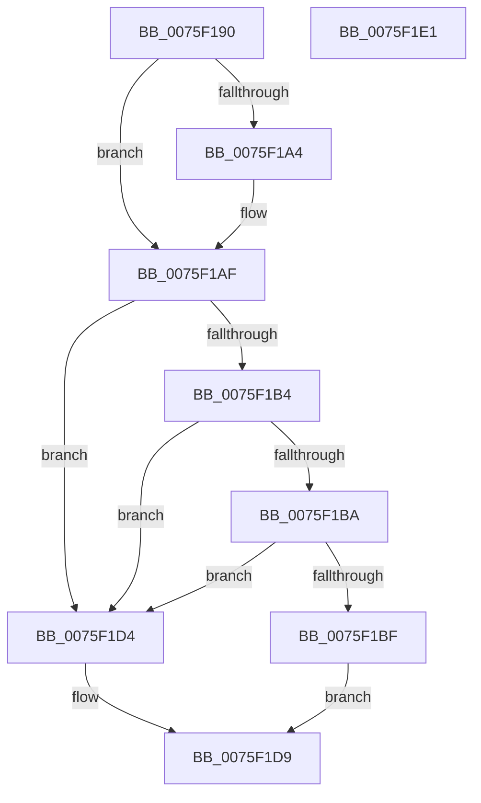

# PopBroadcastLegacyLidSwitchChangeCallback

- RVA: `0x0075F190`–`0x0075F1E2` (길이 `82` bytes)
- VA: `0x000000014075F190`
- 실행 섹션: `PAGE`
- PDB 이름 있음: `예`; PDB Function 태그: `아니요`
- unwind 정보 RVA: `0x0005CF00`
- 디코드: `25`개 명령, `82/82` bytes 표시
- 미해석 바이트: `0` (있으면 어셈블리에 `.byte`로 보존)

> 이 문서는 커널 이미지의 기계어와 PDB 기호를 분석해 생성했습니다. 4번과 5번은 함수 원형과 자료형을 바이너리 사용 방식에서 추정한 C 해석이며 원본 소스 복구 결과는 아닙니다.

## 1. Dependencies

- 직접 호출 지점: **1**; 고유 호출 대상: **1**
- 직접 호출자로 확인된 함수: **0**
- RIP 상대 이미지 참조: **3**

### Outgoing calls
- `0x0075F1CD` → [ExNotifyCallback](../../text/39/ExNotifyCallback_function_003926B0.md) (function, `0x003926B0`)

### Direct callers
- 이 함수 시작 RVA로 연결되는 직접 call은 확인되지 않았습니다. 간접 호출은 완전히 역산할 수 없습니다.

### Static image references
- `0x0075F196` → RVA `0x0001E2D8` (`.rdata`; read)
- `0x0075F1A4` → RVA `0x0001E2E0` (`.rdata`; read)
- `0x0075F1C6` → RVA `0x00EFEDA8` (`.data`; read)

## 2. Other-region calls and transfers

- 다른 실행 섹션으로 향하는 call: **1**
  - `0x0075F1CD` → [ExNotifyCallback](../../text/39/ExNotifyCallback_function_003926B0.md) (`PAGE` → `.text`)
- 별도 외부 분기/꼬리 이동을 확인하지 못했습니다.

## 3. Assembly (complete function range)

```asm
0075F190  40 53                           push rbx
0075F192  48 83 EC 20                     sub rsp, 0x20
0075F196  4C 8B 0D 3B F1 8B FF            mov r9, qword ptr [rip - 0x740ec5]
0075F19D  33 DB                           xor ebx, ebx
0075F19F  4C 2B 09                        sub r9, qword ptr [rcx]
0075F1A2  75 0B                           jne 0x14075f1af
0075F1A4  4C 8B 0D 35 F1 8B FF            mov r9, qword ptr [rip - 0x740ecb]
0075F1AB  4C 2B 49 08                     sub r9, qword ptr [rcx + 8]
0075F1AF  4D 85 C9                        test r9, r9
0075F1B2  75 20                           jne 0x14075f1d4
0075F1B4  41 83 F8 04                     cmp r8d, 4
0075F1B8  75 1A                           jne 0x14075f1d4
0075F1BA  48 85 D2                        test rdx, rdx
0075F1BD  74 15                           je 0x14075f1d4
0075F1BF  44 8B 02                        mov r8d, dword ptr [rdx]
0075F1C2  41 8D 51 04                     lea edx, [r9 + 4]
0075F1C6  48 8B 0D DB FB 79 00            mov rcx, qword ptr [rip + 0x79fbdb]
0075F1CD  E8 DE 34 C3 FF                  call 0x1403926b0
0075F1D2  EB 05                           jmp 0x14075f1d9
0075F1D4  BB 0D 00 00 C0                  mov ebx, 0xc000000d
0075F1D9  8B C3                           mov eax, ebx
0075F1DB  48 83 C4 20                     add rsp, 0x20
0075F1DF  5B                              pop rbx
0075F1E0  C3                              ret
0075F1E1  CC                              int3
```

## 4. C-style interpretation (structured pseudocode)

```c
__int64 __fastcall PopBroadcastLegacyLidSwitchChangeCallback(__int64 a1, __int64 a2, int a3)
{
    __int64 result;
    __int64 v_rbx;
    __int64 v_rsp;

    v_rsp = (v_rsp) - (32);
    v_rbx = 0;
    a4 = (*(unsigned __int64 *)(v_rip - 7605957)) - (*(unsigned __int64 *)(a1));
    if (!(condition_is_not_equal)) {
        a4 = *(unsigned __int64 *)(v_rip - 7605963);
        a4 = (a4) - (*(unsigned __int64 *)(a1 + 8));
    }
    if (a4 != 0) goto loc_0075F1D4;
    if (a3 != 4) goto loc_0075F1D4;
    if (a2 == 0) goto loc_0075F1D4;
    result = ExNotifyCallback(*(unsigned __int64 *)(v_rip + 7994331), a4 + 4, (unsigned int)(*(unsigned int *)(a2)), a4);
    goto loc_0075F1D9;
loc_0075F1D4:
loc_0075F1D9:
    v_rsp = (v_rsp) + (32);
    return (unsigned int)((unsigned int)((unsigned int)(0xC000000DULL)));
}
```

## 5. (Beta) C Style

```c
int64_t PopBroadcastLegacyLidSwitchChangeCallback(void *Arg1, int64_t Arg2, int32_t Arg3)
{
    uint8_t *arg1 = (uint8_t *)Arg1;

    int64_t result;
    int64_t local_rbx;
    int64_t local_rsp;

    local_rsp = (local_rsp) - (32);
    local_rbx = 0;
    a4 = (*(uint64_t *)(v_rip - 0x740EC5)) - (*(uint64_t *)(arg1));
    if (!(condition_is_not_equal)) {
        a4 = *(uint64_t *)(v_rip - 0x740ECB);
        a4 = (a4) - (*(uint64_t *)(arg1 + 0x8));
    }
    if (a4 != 0) goto loc_0075F1D4;
    if (Arg3 != 4) goto loc_0075F1D4;
    if (Arg2 == 0) goto loc_0075F1D4;
    result = ExNotifyCallback(*(uint64_t *)(v_rip + 0x79FBDB), a4 + 4, (uint32_t)(*(uint32_t *)(Arg2)), a4);
    goto loc_0075F1D9;
loc_0075F1D4:
loc_0075F1D9:
    local_rsp = (local_rsp) + (32);
    return (uint32_t)((uint32_t)((uint32_t)(0xC000000DULL)));
}
```

### 관측된 메모리 오프셋

구조체 형식이 확인되지 않은 접근은 인자 기준의 오프셋으로만 기록했습니다.

| 기준 인자 | 오프셋 표현 | 폭 (bit) | 접근 |
|---|---:|---:|---|
| `Arg1` | `+ 0x0` | `64` | `R` |
| `Arg1` | `+ 0x8` | `64` | `R` |

## 6. Execution-region graph

[열기: 2D/3D 그래프와 함수 탐색 컨트롤 패널](../../../control-panel.html?section=page&rva=0x0075F190&view=graph)

- 2D 그래프는 위에서 아래로 흐르고, 3D 그래프는 빈 공간을 드래그해 회전합니다. Shift+드래그는 이동, 휠은 확대·축소, 함수 노드 선택은 대상 보고서 이동입니다.

### Static fallback


