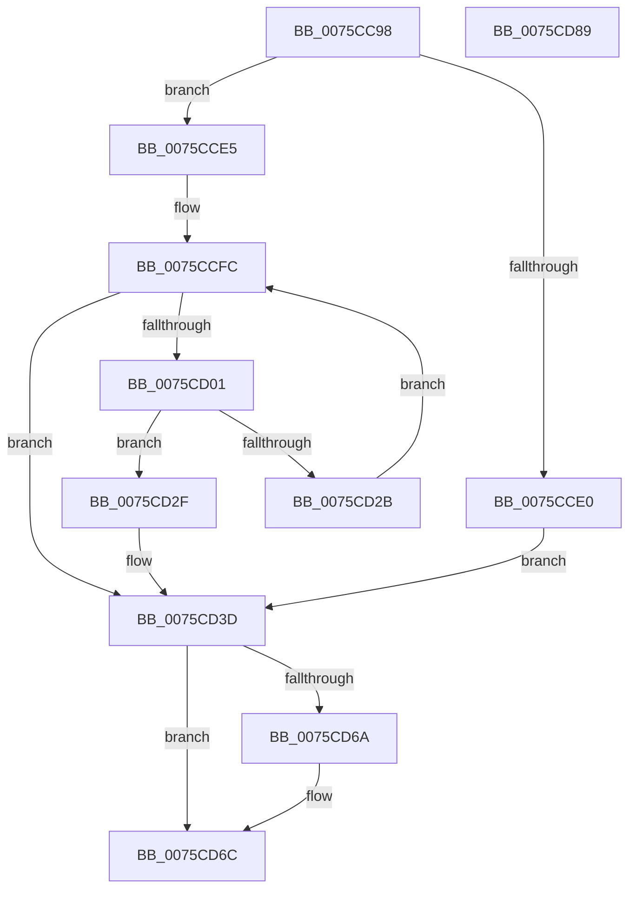

# PopCalculateHiberFileSize

- RVA: `0x0075CC98`–`0x0075CD8A` (길이 `242` bytes)
- VA: `0x000000014075CC98`
- 실행 섹션: `PAGE`
- PDB 이름 있음: `예`; PDB Function 태그: `아니요`
- unwind 정보 RVA: `0x000C4D64`
- 디코드: `67`개 명령, `242/242` bytes 표시
- 미해석 바이트: `0` (있으면 어셈블리에 `.byte`로 보존)

> 이 문서는 커널 이미지의 기계어와 PDB 기호를 분석해 생성했습니다. 4번과 5번은 함수 원형과 자료형을 바이너리 사용 방식에서 추정한 C 해석이며 원본 소스 복구 결과는 아닙니다.

## 1. Dependencies

- 직접 호출 지점: **2**; 고유 호출 대상: **2**
- 직접 호출자로 확인된 함수: **5**
- RIP 상대 이미지 참조: **4**

### Outgoing calls
- `0x0075CCC0` → [MmGetNumberOfPhysicalPages](../../text/46/MmGetNumberOfPhysicalPages_function_00467F80.md) (function, `0x00467F80`)
- `0x0075CD74` → [_security_check_cookie](../../text/6A/_security_check_cookie_function_006AC640.md) (function, `0x006AC640`)

### Direct callers
- [PopSetHiberFileType](../70/PopSetHiberFileType_function_00703268.md) at `0x007032B7`
- [PopSetHiberFileSize](../70/PopSetHiberFileSize_function_00703974.md) at `0x007039B1`
- [PopAdjustHiberFile](PopAdjustHiberFile_function_0075CBE8.md) at `0x0075CC09`
- [PopHiberInitializeResources](PopHiberInitializeResources_function_0075D5FC.md) at `0x0075D731`
- [PopEnableHiberFile](../90/PopEnableHiberFile_function_0090F850.md) at `0x0090FC03`

### Static image references
- `0x0075CCA7` → RVA `0x00E0A740` (`.data`; read)
- `0x0075CCC5` → RVA `0x00FC5070` (`ALMOSTRO`; read)
- `0x0075CCE5` → RVA `0x00FC5074` (`ALMOSTRO`; read)
- `0x0075CD01` → RVA `0x00FC5680` (`ALMOSTRO`; read)

## 2. Other-region calls and transfers

- 다른 실행 섹션으로 향하는 call: **2**
  - `0x0075CCC0` → [MmGetNumberOfPhysicalPages](../../text/46/MmGetNumberOfPhysicalPages_function_00467F80.md) (`PAGE` → `.text`)
  - `0x0075CD74` → [_security_check_cookie](../../text/6A/_security_check_cookie_function_006AC640.md) (`PAGE` → `.text`)
- 별도 외부 분기/꼬리 이동을 확인하지 못했습니다.

## 3. Assembly (complete function range)

```asm
0075CC98  48 89 5C 24 18                  mov qword ptr [rsp + 0x18], rbx
0075CC9D  48 89 74 24 20                  mov qword ptr [rsp + 0x20], rsi
0075CCA2  57                              push rdi
0075CCA3  48 83 EC 40                     sub rsp, 0x40
0075CCA7  48 8B 05 92 DA 6A 00            mov rax, qword ptr [rip + 0x6ada92]
0075CCAE  48 33 C4                        xor rax, rsp
0075CCB1  48 89 44 24 38                  mov qword ptr [rsp + 0x38], rax
0075CCB6  48 8B F1                        mov rsi, rcx
0075CCB9  48 8B FA                        mov rdi, rdx
0075CCBC  33 C9                           xor ecx, ecx
0075CCBE  B3 02                           mov bl, 2
0075CCC0  E8 BB B2 D0 FF                  call 0x140467f80
0075CCC5  8B 0D A5 83 86 00               mov ecx, dword ptr [rip + 0x8683a5]
0075CCCB  4C 8B C8                        mov r9, rax
0075CCCE  49 C1 E1 0C                     shl r9, 0xc
0075CCD2  4C 8B D0                        mov r10, rax
0075CCD5  41 B8 64 00 00 00               mov r8d, 0x64
0075CCDB  83 F9 28                        cmp ecx, 0x28
0075CCDE  72 05                           jb 0x14075cce5
0075CCE0  44 8B C1                        mov r8d, ecx
0075CCE3  EB 58                           jmp 0x14075cd3d
0075CCE5  8B 05 89 83 86 00               mov eax, dword ptr [rip + 0x868389]
0075CCEB  0F B6 DB                        movzx ebx, bl
0075CCEE  0F B6 C8                        movzx ecx, al
0075CCF1  8D 50 FF                        lea edx, [rax - 1]
0075CCF4  83 FA 01                        cmp edx, 1
0075CCF7  0F 46 D9                        cmovbe ebx, ecx
0075CCFA  33 D2                           xor edx, edx
0075CCFC  83 FA 07                        cmp edx, 7
0075CCFF  73 3C                           jae 0x14075cd3d
0075CD01  48 8D 05 78 89 86 00            lea rax, [rip + 0x868978]
0075CD08  48 8D 0C 52                     lea rcx, [rdx + rdx*2]
0075CD0C  0F 10 0C C8                     movups xmm1, xmmword ptr [rax + rcx*8]
0075CD10  F2 0F 10 44 C8 10               movsd xmm0, qword ptr [rax + rcx*8 + 0x10]
0075CD16  66 48 0F 7E C8                  movq rax, xmm1
0075CD1B  F2 0F 11 44 24 30               movsd qword ptr [rsp + 0x30], xmm0
0075CD21  0F 11 4C 24 20                  movups xmmword ptr [rsp + 0x20], xmm1
0075CD26  4C 3B C8                        cmp r9, rax
0075CD29  76 04                           jbe 0x14075cd2f
0075CD2B  FF C2                           inc edx
0075CD2D  EB CD                           jmp 0x14075ccfc
0075CD2F  0F B6 C3                        movzx eax, bl
0075CD32  8B 4C 84 28                     mov ecx, dword ptr [rsp + rax*4 + 0x28]
0075CD36  41 3B C8                        cmp ecx, r8d
0075CD39  44 0F 42 C1                     cmovb r8d, ecx
0075CD3D  41 8B C8                        mov ecx, r8d
0075CD40  48 B8 15 AE 47 E1 7A 14 AE 47   movabs rax, 0x47ae147ae147ae15
0075CD4A  49 0F AF CA                     imul rcx, r10
0075CD4E  48 F7 E1                        mul rcx
0075CD51  48 2B CA                        sub rcx, rdx
0075CD54  48 D1 E9                        shr rcx, 1
0075CD57  48 03 CA                        add rcx, rdx
0075CD5A  48 C1 E9 06                     shr rcx, 6
0075CD5E  48 C1 E1 0C                     shl rcx, 0xc
0075CD62  48 89 0E                        mov qword ptr [rsi], rcx
0075CD65  48 85 FF                        test rdi, rdi
0075CD68  74 02                           je 0x14075cd6c
0075CD6A  88 1F                           mov byte ptr [rdi], bl
0075CD6C  48 8B 4C 24 38                  mov rcx, qword ptr [rsp + 0x38]
0075CD71  48 33 CC                        xor rcx, rsp
0075CD74  E8 C7 F8 F4 FF                  call 0x1406ac640
0075CD79  48 8B 5C 24 60                  mov rbx, qword ptr [rsp + 0x60]
0075CD7E  48 8B 74 24 68                  mov rsi, qword ptr [rsp + 0x68]
0075CD83  48 83 C4 40                     add rsp, 0x40
0075CD87  5F                              pop rdi
0075CD88  C3                              ret
0075CD89  CC                              int3
```

## 4. C-style interpretation (structured pseudocode)

```c
__int64 __fastcall PopCalculateHiberFileSize(__int64 a1, __int64 a2)
{
    __int64 result;
    __int64 v_rbx;
    __int64 v_rsp;
    unsigned __int64 v_stack_m10;
    unsigned __int64 v_stack_m18;
    unsigned __int64 v_stack_m28;
    unsigned __int64 v_stack_p18;
    unsigned __int64 v_stack_p20;

    v_stack_p18 = v_rbx;
    v_stack_p20 = v_rsi;
    v_rsp = (v_rsp) - (64);
    result = (*(unsigned __int64 *)(v_rip + 7002770)) ^ (v_rsp);
    v_stack_m10 = result;
    a1 = 0;
    result = MmGetNumberOfPhysicalPages(a1, a2, a3, a4);
    a4 = (result) << (12);
    if (((unsigned int)((unsigned int)(*(unsigned int *)(v_rip + 8815525)))) < 40) goto loc_0075CCE5;
    goto loc_0075CD3D;
loc_0075CCE5:
    v_rbx = 2;
    if (((unsigned int)((unsigned int)(*(unsigned int *)(v_rip + 8815497)) - 1)) <= 1) { v_rbx = (unsigned int)((unsigned __int8)((unsigned int)(*(unsigned int *)(v_rip + 8815497)))); }
    a2 = 0;
loc_0075CCFC:
    if (0 >= 7) goto loc_0075CD3D;
    v_stack_m18 = v_xmm0;
    v_stack_m28 = v_xmm1;
    if (a4 <= (v_rip + 8817016)) goto loc_0075CD2F;
    a2 = (unsigned int)((a2) + 1);
    goto loc_0075CCFC;
loc_0075CD2F:
    a3 = (unsigned int)((unsigned int)((unsigned int)(*(unsigned int *)(v_rip + 8815525))));
    if (((unsigned int)((unsigned int)(*(unsigned int *)(v_rsp + (unsigned __int8)(v_rbx) * 4 + 40)))) < ((unsigned int)((unsigned int)((unsigned int)((unsigned int)(*(unsigned int *)(v_rip + 8815525))))))) { a3 = (unsigned int)((unsigned int)(*(unsigned int *)(v_rsp + (unsigned __int8)(v_rbx) * 4 + 40))); }
loc_0075CD3D:
    a1 = ((unsigned int)((unsigned int)(a3))) * (result);
    a1 = (a1) - (a2);
    a1 = (a1) >> (1);
    a1 = (a1) + (a2);
    a1 = (a1) >> (6);
    a1 = (a1) << (12);
    *(unsigned __int64 *)(a1) = a1;
    if (a2 != 0) {
        *(unsigned __int8 *)(a2) = (unsigned __int8)(v_rbx);
    }
    a1 = (v_stack_m10) ^ (v_rsp);
    result = _security_check_cookie(a1, a2, a3, a4);
    v_rsp = (v_rsp) + (64);
    return result;
}
```

## 5. (Beta) C Style

```c
int64_t PopCalculateHiberFileSize(void *Arg1, int64_t Arg2)
{
    uint8_t *arg1 = (uint8_t *)Arg1;

    int64_t result;
    int64_t local_rbx;
    int64_t local_rsp;
    uint64_t v_stack_m10;
    uint64_t v_stack_m18;
    uint64_t v_stack_m28;
    uint64_t v_stack_p18;
    uint64_t v_stack_p20;

    v_stack_p18 = local_rbx;
    v_stack_p20 = local_rsi;
    local_rsp = (local_rsp) - (64);
    result = (*(uint64_t *)(v_rip + 0x6ADA92)) ^ (local_rsp);
    v_stack_m10 = result;
    Arg1 = 0;
    result = MmGetNumberOfPhysicalPages(Arg1, Arg2, a3, a4);
    a4 = (result) << (12);
    if (((uint32_t)((uint32_t)(*(uint32_t *)(v_rip + 0x8683A5)))) < 40) goto loc_0075CCE5;
    goto loc_0075CD3D;
loc_0075CCE5:
    local_rbx = 2;
    if (((uint32_t)((uint32_t)(*(uint32_t *)(v_rip + 0x868389)) - 1)) <= 1) { local_rbx = (uint32_t)((uint8_t)((uint32_t)(*(uint32_t *)(v_rip + 0x868389)))); }
    Arg2 = 0;
loc_0075CCFC:
    if (0 >= 7) goto loc_0075CD3D;
    v_stack_m18 = v_xmm0;
    v_stack_m28 = v_xmm1;
    if (a4 <= (v_rip + 8817016)) goto loc_0075CD2F;
    Arg2 = (uint32_t)((Arg2) + 1);
    goto loc_0075CCFC;
loc_0075CD2F:
    a3 = (uint32_t)((uint32_t)((uint32_t)(*(uint32_t *)(v_rip + 0x8683A5))));
    if (((uint32_t)((uint32_t)(*(uint32_t *)(local_rsp + (uint8_t)(local_rbx) * 4 + 0x28)))) < ((uint32_t)((uint32_t)((uint32_t)((uint32_t)(*(uint32_t *)(v_rip + 0x8683A5))))))) { a3 = (uint32_t)((uint32_t)(*(uint32_t *)(local_rsp + (uint8_t)(local_rbx) * 4 + 0x28))); }
loc_0075CD3D:
    Arg1 = ((uint32_t)((uint32_t)(a3))) * (result);
    Arg1 = (Arg1) - (Arg2);
    Arg1 = (Arg1) >> (1);
    Arg1 = (Arg1) + (Arg2);
    Arg1 = (Arg1) >> (6);
    Arg1 = (Arg1) << (12);
    *(void **)(arg1) = Arg1;
    if (Arg2 != 0) {
        *(uint8_t *)(Arg2) = (uint8_t)(local_rbx);
    }
    Arg1 = (v_stack_m10) ^ (local_rsp);
    result = _security_check_cookie(Arg1, Arg2, a3, a4);
    local_rsp = (local_rsp) + (64);
    return result;
}
```

### 관측된 메모리 오프셋

구조체 형식이 확인되지 않은 접근은 인자 기준의 오프셋으로만 기록했습니다.

| 기준 인자 | 오프셋 표현 | 폭 (bit) | 접근 |
|---|---:|---:|---|
| `Arg1` | `+ 0x0` | `64` | `W` |

## 6. Execution-region graph

[열기: 2D/3D 그래프와 함수 탐색 컨트롤 패널](../../../control-panel.html?section=page&rva=0x0075CC98&view=graph)

- 2D 그래프는 위에서 아래로 흐르고, 3D 그래프는 빈 공간을 드래그해 회전합니다. Shift+드래그는 이동, 휠은 확대·축소, 함수 노드 선택은 대상 보고서 이동입니다.

### Static fallback


