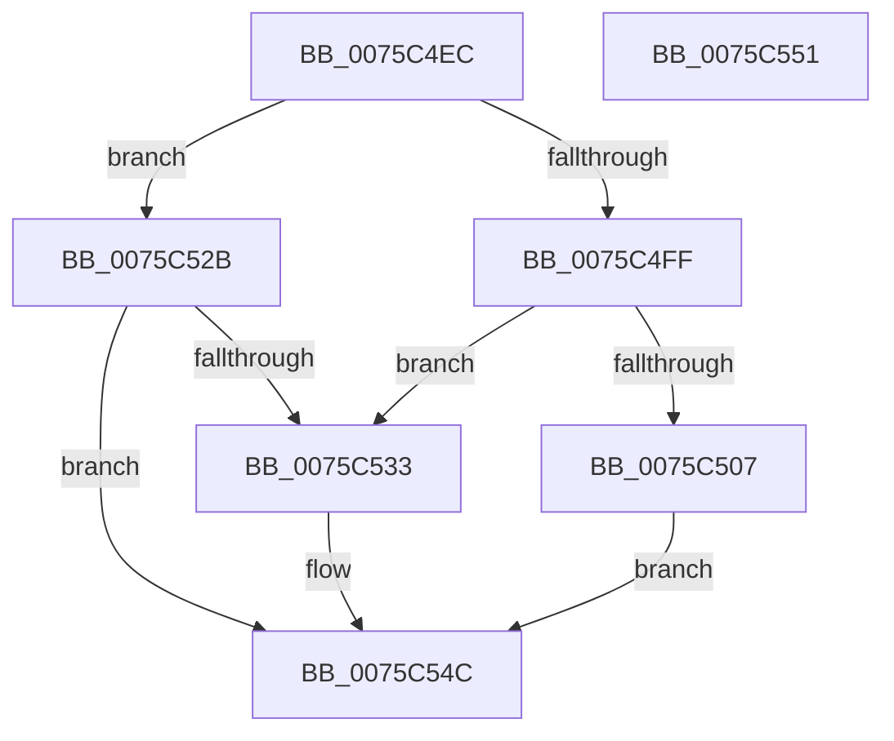

# PopCalculateWakeTimeAdjustment

- RVA: `0x0075C4EC`–`0x0075C552` (길이 `102` bytes)
- VA: `0x000000014075C4EC`
- 실행 섹션: `PAGE`
- PDB 이름 있음: `예`; PDB Function 태그: `아니요`
- unwind 정보 RVA: `0x0005D2F4`
- 디코드: `26`개 명령, `102/102` bytes 표시
- 미해석 바이트: `0` (있으면 어셈블리에 `.byte`로 보존)

> 이 문서는 커널 이미지의 기계어와 PDB 기호를 분석해 생성했습니다. 4번과 5번은 함수 원형과 자료형을 바이너리 사용 방식에서 추정한 C 해석이며 원본 소스 복구 결과는 아닙니다.

## 1. Dependencies

- 직접 호출 지점: **2**; 고유 호출 대상: **2**
- 직접 호출자로 확인된 함수: **1**
- RIP 상대 이미지 참조: **4**

### Outgoing calls
- `0x0075C520` → [PopPowerTransitionTimesInMs](../../text/4B/PopPowerTransitionTimesInMs_function_004B5C18.md) (function, `0x004B5C18`)
- `0x0075C547` → [PpmConvertTime](../../text/44/PpmConvertTime_function_00447530.md) (function, `0x00447530`)

### Direct callers
- [PopValidateRTCWake](../../pagelk/B7/PopValidateRTCWake_function_00B7CDE4.md) at `0x00B7CED2`

### Static image references
- `0x0075C4F2` → RVA `0x00F0BD6C` (`.data`; read)
- `0x0075C4FF` → RVA `0x00F0C680` (`.data`; read)
- `0x0075C533` → RVA `0x00FC6BE0` (`ALMOSTRO`; read)
- `0x0075C540` → RVA `0x00F0C4A8` (`.data`; read)

## 2. Other-region calls and transfers

- 다른 실행 섹션으로 향하는 call: **2**
  - `0x0075C520` → [PopPowerTransitionTimesInMs](../../text/4B/PopPowerTransitionTimesInMs_function_004B5C18.md) (`PAGE` → `.text`)
  - `0x0075C547` → [PpmConvertTime](../../text/44/PpmConvertTime_function_00447530.md) (`PAGE` → `.text`)
- 별도 외부 분기/꼬리 이동을 확인하지 못했습니다.

## 3. Assembly (complete function range)

```asm
0075C4EC  48 83 EC 38                     sub rsp, 0x38
0075C4F0  33 C0                           xor eax, eax
0075C4F2  83 3D 73 F8 7A 00 04            cmp dword ptr [rip + 0x7af873], 4
0075C4F9  89 44 24 40                     mov dword ptr [rsp + 0x40], eax
0075C4FD  75 2C                           jne 0x14075c52b
0075C4FF  38 05 7B 01 7B 00               cmp byte ptr [rip + 0x7b017b], al
0075C505  75 2C                           jne 0x14075c533
0075C507  48 89 44 24 28                  mov qword ptr [rsp + 0x28], rax
0075C50C  45 33 C9                        xor r9d, r9d
0075C50F  48 8D 44 24 40                  lea rax, [rsp + 0x40]
0075C514  45 33 C0                        xor r8d, r8d
0075C517  33 D2                           xor edx, edx
0075C519  48 89 44 24 20                  mov qword ptr [rsp + 0x20], rax
0075C51E  33 C9                           xor ecx, ecx
0075C520  E8 F3 96 D5 FF                  call 0x1404b5c18
0075C525  8B 44 24 40                     mov eax, dword ptr [rsp + 0x40]
0075C529  EB 21                           jmp 0x14075c54c
0075C52B  38 05 4F 01 7B 00               cmp byte ptr [rip + 0x7b014f], al
0075C531  74 19                           je 0x14075c54c
0075C533  48 8B 15 A6 A6 86 00            mov rdx, qword ptr [rip + 0x86a6a6]
0075C53A  41 B8 E8 03 00 00               mov r8d, 0x3e8
0075C540  48 8B 0D 61 FF 7A 00            mov rcx, qword ptr [rip + 0x7aff61]
0075C547  E8 E4 AF CE FF                  call 0x140447530
0075C54C  48 83 C4 38                     add rsp, 0x38
0075C550  C3                              ret
0075C551  CC                              int3
```

## 4. C-style interpretation (structured pseudocode)

```c
__int64 __fastcall PopCalculateWakeTimeAdjustment(int a1, int a2, int a3, int a4)
{
    __int64 result;
    __int64 v_rsp;
    unsigned __int64 v_stack_m10;
    unsigned __int64 v_stack_m18;
    unsigned int v_stack_p8;

    v_rsp = (v_rsp) - (56);
    result = 0;
    v_stack_p8 = 0;
    if ((*(unsigned int *)(v_rip + 8058995)) != 4) goto loc_0075C52B;
    if ((*(unsigned __int8 *)(v_rip + 8061307)) != 0) goto loc_0075C533;
    v_stack_m10 = 0;
    a4 = 0;
    a3 = 0;
    a2 = 0;
    v_stack_m18 = v_stack_p8;
    a1 = 0;
    result = PopPowerTransitionTimesInMs(a1, a2, a3, a4);
    goto loc_0075C54C;
loc_0075C52B:
    result = (unsigned int)(v_stack_p8);
    if ((*(unsigned __int8 *)(v_rip + 8061263)) != ((unsigned __int8)((unsigned int)(v_stack_p8)))) {
        a2 = *(unsigned __int64 *)(v_rip + 8824486);
        a3 = 1000;
        a1 = *(unsigned __int64 *)(v_rip + 8060769);
        result = PpmConvertTime(a1, a2, a3, a4);
    }
    v_rsp = (v_rsp) + (56);
    return result;
}
```

## 5. (Beta) C Style

```c
int64_t PopCalculateWakeTimeAdjustment(int32_t Arg1, int32_t Arg2, int32_t Arg3, int32_t Arg4)
{
    int64_t result;
    int64_t local_rsp;
    uint64_t v_stack_m10;
    uint64_t v_stack_m18;
    uint32_t v_stack_p8;

    local_rsp = (local_rsp) - (56);
    result = 0;
    v_stack_p8 = 0;
    if ((*(uint32_t *)(v_rip + 0x7AF873)) != 4) goto loc_0075C52B;
    if ((*(uint8_t *)(v_rip + 0x7B017B)) != 0) goto loc_0075C533;
    v_stack_m10 = 0;
    Arg4 = 0;
    Arg3 = 0;
    Arg2 = 0;
    v_stack_m18 = v_stack_p8;
    Arg1 = 0;
    result = PopPowerTransitionTimesInMs(Arg1, Arg2, Arg3, Arg4);
    goto loc_0075C54C;
loc_0075C52B:
    result = (uint32_t)(v_stack_p8);
    if ((*(uint8_t *)(v_rip + 0x7B014F)) != ((uint8_t)((uint32_t)(v_stack_p8)))) {
        Arg2 = *(uint64_t *)(v_rip + 0x86A6A6);
        Arg3 = 1000;
        Arg1 = *(uint64_t *)(v_rip + 0x7AFF61);
        result = PpmConvertTime(Arg1, Arg2, Arg3, Arg4);
    }
    local_rsp = (local_rsp) + (56);
    return result;
}
```

## 6. Execution-region graph

[열기: 2D/3D 그래프와 함수 탐색 컨트롤 패널](../../../control-panel.html?section=page&rva=0x0075C4EC&view=graph)

- 2D 그래프는 위에서 아래로 흐르고, 3D 그래프는 빈 공간을 드래그해 회전합니다. Shift+드래그는 이동, 휠은 확대·축소, 함수 노드 선택은 대상 보고서 이동입니다.

### Static fallback


