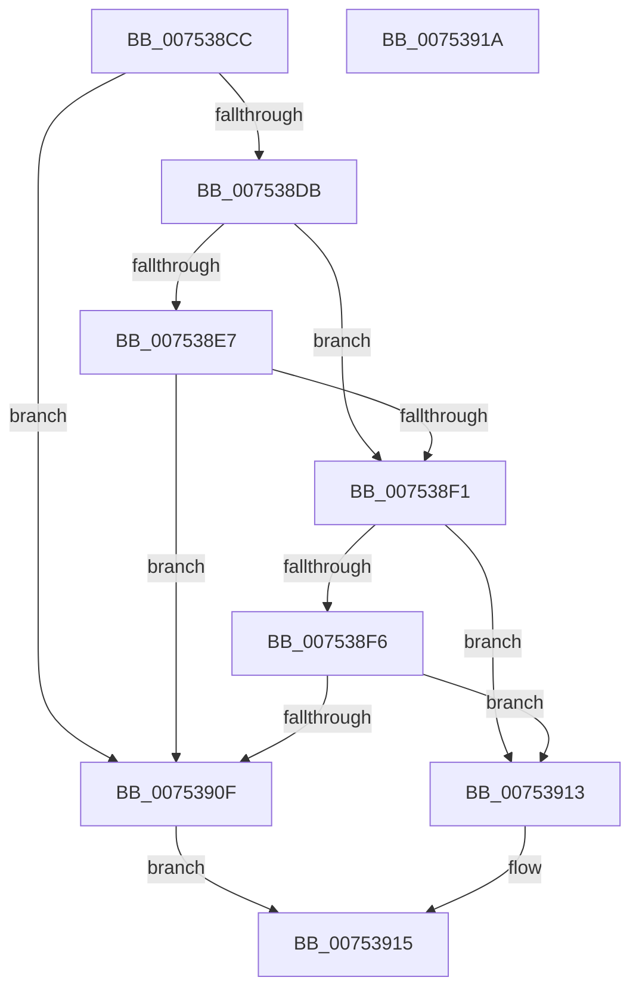

# PopCheckSkipTick

- RVA: `0x007538CC`–`0x0075391B` (길이 `79` bytes)
- VA: `0x00000001407538CC`
- 실행 섹션: `PAGE`
- PDB 이름 있음: `예`; PDB Function 태그: `아니요`
- unwind 정보 RVA: `0x0005C788`
- 디코드: `24`개 명령, `79/79` bytes 표시
- 미해석 바이트: `0` (있으면 어셈블리에 `.byte`로 보존)

> 이 문서는 커널 이미지의 기계어와 PDB 기호를 분석해 생성했습니다. 4번과 5번은 함수 원형과 자료형을 바이너리 사용 방식에서 추정한 C 해석이며 원본 소스 복구 결과는 아닙니다.

## 1. Dependencies

- 직접 호출 지점: **1**; 고유 호출 대상: **1**
- 직접 호출자로 확인된 함수: **2**
- RIP 상대 이미지 참조: **4**

### Outgoing calls
- `0x007538FB` → [KeQueryActiveProcessorCountEx](../../text/24/KeQueryActiveProcessorCountEx_function_00249EF0.md) (function, `0x00249EF0`)

### Direct callers
- [PopNewProcessorCallback](PopNewProcessorCallback_function_007539A0.md) at `0x007539BB`
- [PoInitSystem](../../init/C7/PoInitSystem_function_00C72358.md) at `0x00C72F70`

### Static image references
- `0x007538D0` → RVA `0x00FC5190` (`ALMOSTRO`; read)
- `0x007538DB` → RVA `0x00FC6AB8` (`ALMOSTRO`; read)
- `0x007538E7` → RVA `0x00FC6A90` (`ALMOSTRO`; read)
- `0x00753902` → RVA `0x00FC5360` (`ALMOSTRO`; read)

## 2. Other-region calls and transfers

- 다른 실행 섹션으로 향하는 call: **1**
  - `0x007538FB` → [KeQueryActiveProcessorCountEx](../../text/24/KeQueryActiveProcessorCountEx_function_00249EF0.md) (`PAGE` → `.text`)
- 별도 외부 분기/꼬리 이동을 확인하지 못했습니다.

## 3. Assembly (complete function range)

```asm
007538CC  48 83 EC 28                     sub rsp, 0x28
007538D0  8B 0D BA 18 87 00               mov ecx, dword ptr [rip + 0x8718ba]
007538D6  83 F9 02                        cmp ecx, 2
007538D9  74 34                           je 0x14075390f
007538DB  F7 05 D3 31 87 00 00 40 00 00   test dword ptr [rip + 0x8731d3], 0x4000
007538E5  74 0A                           je 0x1407538f1
007538E7  8B 05 A3 31 87 00               mov eax, dword ptr [rip + 0x8731a3]
007538ED  A8 02                           test al, 2
007538EF  74 1E                           je 0x14075390f
007538F1  83 F9 03                        cmp ecx, 3
007538F4  75 1D                           jne 0x140753913
007538F6  B9 FF FF 00 00                  mov ecx, 0xffff
007538FB  E8 F0 65 AF FF                  call 0x140249ef0
00753900  8B C8                           mov ecx, eax
00753902  8B 05 58 1A 87 00               mov eax, dword ptr [rip + 0x871a58]
00753908  C1 E0 03                        shl eax, 3
0075390B  3B C8                           cmp ecx, eax
0075390D  77 04                           ja 0x140753913
0075390F  B0 01                           mov al, 1
00753911  EB 02                           jmp 0x140753915
00753913  32 C0                           xor al, al
00753915  48 83 C4 28                     add rsp, 0x28
00753919  C3                              ret
0075391A  CC                              int3
```

## 4. C-style interpretation (structured pseudocode)

```c
__int64 __fastcall PopCheckSkipTick(void)
{
    __int64 result;
    __int64 v_rsp;

    v_rsp = (v_rsp) - (40);
    if (((unsigned int)((unsigned int)(*(unsigned int *)(v_rip + 8853690)))) == 2) goto loc_0075390F;
    if (((*(unsigned int *)(v_rip + 8860115)) & (0x4000ULL)) == 0) goto loc_007538F1;
    if ((((unsigned __int8)((unsigned int)(*(unsigned int *)(v_rip + 8860067)))) & (2)) == 0) goto loc_0075390F;
loc_007538F1:
    if (((unsigned int)((unsigned int)(*(unsigned int *)(v_rip + 8853690)))) != 3) goto loc_00753913;
    result = KeQueryActiveProcessorCountEx((unsigned int)(0xFFFFULL), a2, a3, a4);
    result = (unsigned int)(((unsigned int)(*(unsigned int *)(v_rip + 8854104))) << (3));
    if (((unsigned int)((unsigned int)((unsigned int)(result)))) > ((unsigned int)(result))) goto loc_00753913;
loc_0075390F:
    goto loc_00753915;
loc_00753913:
    result = 0;
loc_00753915:
    v_rsp = (v_rsp) + (40);
    return result;
}
```

## 5. (Beta) C Style

```c
void PopCheckSkipTick(void)
{
    int64_t result;
    int64_t local_rsp;

    local_rsp = (local_rsp) - (40);
    if (((uint32_t)((uint32_t)(*(uint32_t *)(v_rip + 0x8718BA)))) == 2) goto loc_0075390F;
    if (((*(uint32_t *)(v_rip + 0x8731D3)) & (0x4000ULL)) == 0) goto loc_007538F1;
    if ((((uint8_t)((uint32_t)(*(uint32_t *)(v_rip + 0x8731A3)))) & (2)) == 0) goto loc_0075390F;
loc_007538F1:
    if (((uint32_t)((uint32_t)(*(uint32_t *)(v_rip + 0x8718BA)))) != 3) goto loc_00753913;
    result = KeQueryActiveProcessorCountEx((uint32_t)(0xFFFFULL), a2, a3, a4);
    result = (uint32_t)(((uint32_t)(*(uint32_t *)(v_rip + 0x871A58))) << (3));
    if (((uint32_t)((uint32_t)((uint32_t)(result)))) > ((uint32_t)(result))) goto loc_00753913;
loc_0075390F:
    goto loc_00753915;
loc_00753913:
    result = 0;
loc_00753915:
    local_rsp = (local_rsp) + (40);
    return result;
}
```

## 6. Execution-region graph

[열기: 2D/3D 그래프와 함수 탐색 컨트롤 패널](../../../control-panel.html?section=page&rva=0x007538CC&view=graph)

- 2D 그래프는 위에서 아래로 흐르고, 3D 그래프는 빈 공간을 드래그해 회전합니다. Shift+드래그는 이동, 휠은 확대·축소, 함수 노드 선택은 대상 보고서 이동입니다.

### Static fallback


