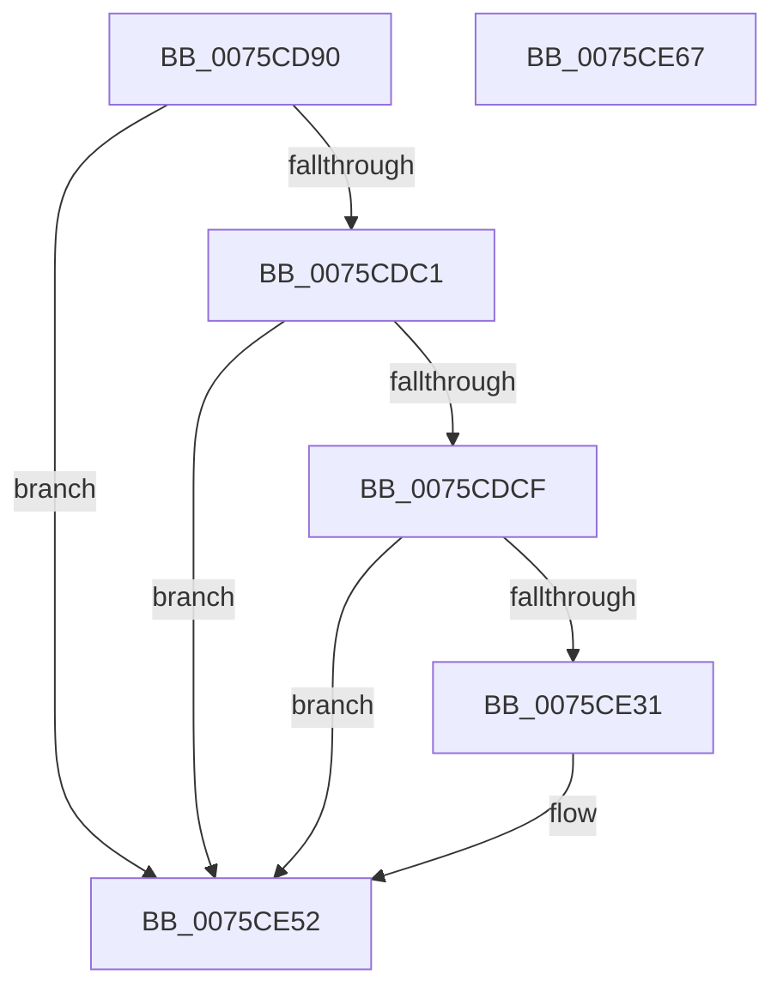

# PopClearHiberFileSignature

- RVA: `0x0075CD90`–`0x0075CE68` (길이 `216` bytes)
- VA: `0x000000014075CD90`
- 실행 섹션: `PAGE`
- PDB 이름 있음: `예`; PDB Function 태그: `아니요`
- unwind 정보 RVA: `0x000CC4CC`
- 디코드: `43`개 명령, `216/216` bytes 표시
- 미해석 바이트: `0` (있으면 어셈블리에 `.byte`로 보존)

> 이 문서는 커널 이미지의 기계어와 PDB 기호를 분석해 생성했습니다. 4번과 5번은 함수 원형과 자료형을 바이너리 사용 방식에서 추정한 C 해석이며 원본 소스 복구 결과는 아닙니다.

## 1. Dependencies

- 직접 호출 지점: **3**; 고유 호출 대상: **3**
- 직접 호출자로 확인된 함수: **2**
- RIP 상대 이미지 참조: **4**

### Outgoing calls
- `0x0075CE25` → [ZwFsControlFile](../../text/6A/ZwFsControlFile_function_006AD7F0.md) (function, `0x006AD7F0`)
- `0x0075CE4D` → [KeWaitForSingleObject](../../text/20/KeWaitForSingleObject_function_0020E6B0.md) (function, `0x0020E6B0`)
- `0x0075CE5A` → [_security_check_cookie](../../text/6A/_security_check_cookie_function_006AC640.md) (function, `0x006AC640`)

### Direct callers
- [PopFreeHiberContext](../70/PopFreeHiberContext_function_00704F1C.md) at `0x00705082`
- [PopEnableHiberFile](../90/PopEnableHiberFile_function_0090F850.md) at `0x0090FCF5`

### Static image references
- `0x0075CD9A` → RVA `0x00E0A740` (`.data`; read)
- `0x0075CDA9` → RVA `0x00F0C2E0` (`.data`; read)
- `0x0075CDC1` → RVA `0x00F0BF28` (`.data`; read)
- `0x0075CDE8` → RVA `0x00F0BF20` (`.data`; read)

## 2. Other-region calls and transfers

- 다른 실행 섹션으로 향하는 call: **3**
  - `0x0075CE25` → [ZwFsControlFile](../../text/6A/ZwFsControlFile_function_006AD7F0.md) (`PAGE` → `.text`)
  - `0x0075CE4D` → [KeWaitForSingleObject](../../text/20/KeWaitForSingleObject_function_0020E6B0.md) (`PAGE` → `.text`)
  - `0x0075CE5A` → [_security_check_cookie](../../text/6A/_security_check_cookie_function_006AC640.md) (`PAGE` → `.text`)
- 별도 외부 분기/꼬리 이동을 확인하지 못했습니다.

## 3. Assembly (complete function range)

```asm
0075CD90  4C 8B DC                        mov r11, rsp
0075CD93  48 81 EC 88 00 00 00            sub rsp, 0x88
0075CD9A  48 8B 05 9F D9 6A 00            mov rax, qword ptr [rip + 0x6ad99f]
0075CDA1  48 33 C4                        xor rax, rsp
0075CDA4  48 89 44 24 78                  mov qword ptr [rsp + 0x78], rax
0075CDA9  F7 05 2D F5 7A 00 00 02 00 00   test dword ptr [rip + 0x7af52d], 0x200
0075CDB3  0F 57 C0                        xorps xmm0, xmm0
0075CDB6  0F 11 44 24 50                  movups xmmword ptr [rsp + 0x50], xmm0
0075CDBB  0F 85 91 00 00 00               jne 0x14075ce52
0075CDC1  48 83 3D 5F F1 7A 00 00         cmp qword ptr [rip + 0x7af15f], 0
0075CDC9  0F 84 83 00 00 00               je 0x14075ce52
0075CDCF  83 64 24 48 00                  and dword ptr [rsp + 0x48], 0
0075CDD4  49 8D 43 D8                     lea rax, [r11 - 0x28]
0075CDD8  49 83 63 B8 00                  and qword ptr [r11 - 0x48], 0
0075CDDD  45 33 C9                        xor r9d, r9d
0075CDE0  83 64 24 60 00                  and dword ptr [rsp + 0x60], 0
0075CDE5  45 33 C0                        xor r8d, r8d
0075CDE8  48 8B 0D 31 F1 7A 00            mov rcx, qword ptr [rip + 0x7af131]
0075CDEF  33 D2                           xor edx, edx
0075CDF1  C7 44 24 38 18 00 00 00         mov dword ptr [rsp + 0x38], 0x18
0075CDF9  49 89 43 A8                     mov qword ptr [r11 - 0x58], rax
0075CDFD  49 8D 43 C8                     lea rax, [r11 - 0x38]
0075CE01  C7 44 24 64 01 00 00 00         mov dword ptr [rsp + 0x64], 1
0075CE09  C7 44 24 28 08 82 09 00         mov dword ptr [rsp + 0x28], 0x98208
0075CE11  49 89 43 98                     mov qword ptr [r11 - 0x68], rax
0075CE15  49 C7 43 E0 00 10 00 00         mov qword ptr [r11 - 0x20], 0x1000
0075CE1D  49 C7 43 E8 FF EF FF FF         mov qword ptr [r11 - 0x18], 0xffffffffffffefff
0075CE25  E8 C6 09 F5 FF                  call 0x1406ad7f0
0075CE2A  3D 03 01 00 00                  cmp eax, 0x103
0075CE2F  75 21                           jne 0x14075ce52
0075CE31  48 8B 0D F0 F0 7A 00            mov rcx, qword ptr [rip + 0x7af0f0]
0075CE38  45 33 C9                        xor r9d, r9d
0075CE3B  48 83 64 24 20 00               and qword ptr [rsp + 0x20], 0
0075CE41  48 81 C1 98 00 00 00            add rcx, 0x98
0075CE48  45 33 C0                        xor r8d, r8d
0075CE4B  33 D2                           xor edx, edx
0075CE4D  E8 5E 18 AB FF                  call 0x14020e6b0
0075CE52  48 8B 4C 24 78                  mov rcx, qword ptr [rsp + 0x78]
0075CE57  48 33 CC                        xor rcx, rsp
0075CE5A  E8 E1 F7 F4 FF                  call 0x1406ac640
0075CE5F  48 81 C4 88 00 00 00            add rsp, 0x88
0075CE66  C3                              ret
0075CE67  CC                              int3
```

## 4. C-style interpretation (structured pseudocode)

```c
__int64 __fastcall PopClearHiberFileSignature(__int64 a1, int a2, int a3, int a4)
{
    __int64 result;
    __int64 v_rsp;
    unsigned __int64 v_stack_m10;
    unsigned int v_stack_m24;
    unsigned int v_stack_m28;
    unsigned __int64 v_stack_m38;
    unsigned int v_stack_m40;
    unsigned int v_stack_m50;
    unsigned int v_stack_m60;
    unsigned __int64 v_stack_m68;

    v_rsp = (v_rsp) - (136);
    result = (*(unsigned __int64 *)(v_rip + 7002527)) ^ (v_rsp);
    v_stack_m10 = result;
    v_stack_m38 = v_xmm0;
    if (((*(unsigned int *)(v_rip + 8058157)) & (512)) != 0) goto loc_0075CE52;
    if ((*(unsigned __int64 *)(v_rip + 8057183)) == 0) goto loc_0075CE52;
    a4 = 0;
    a3 = 0;
    a2 = 0;
    v_stack_m50 = 24;
    *(unsigned __int64 *)(v_rsp - 88) = v_rsp - 40;
    v_stack_m24 = 1;
    v_stack_m60 = 0x98208ULL;
    *(unsigned __int64 *)(v_rsp - 104) = v_rsp - 56;
    *(unsigned __int64 *)(v_rsp - 32) = 0x1000ULL;
    *(unsigned __int64 *)(v_rsp - 24) = 0xFFFFFFFFFFFFEFFFULL;
    result = ZwFsControlFile(*(unsigned __int64 *)(v_rip + 8057137), a2, a3, a4);
    if (((unsigned int)(result)) == 259) {
        a1 = *(unsigned __int64 *)(v_rip + 8057072);
        a4 = 0;
        a1 = (a1) + (152);
        a3 = 0;
        a2 = 0;
        result = KeWaitForSingleObject(a1, a2, a3, a4);
    }
    a1 = (v_stack_m10) ^ (v_rsp);
    result = _security_check_cookie(a1, a2, a3, a4);
    v_rsp = (v_rsp) + (136);
    return result;
}
```

## 5. (Beta) C Style

```c
int64_t PopClearHiberFileSignature(int64_t Arg1, int32_t Arg2, int32_t Arg3, int32_t Arg4)
{
    int64_t result;
    int64_t local_rsp;
    uint64_t v_stack_m10;
    uint32_t v_stack_m24;
    uint32_t v_stack_m28;
    uint64_t v_stack_m38;
    uint32_t v_stack_m40;
    uint32_t v_stack_m50;
    uint32_t v_stack_m60;
    uint64_t v_stack_m68;

    local_rsp = (local_rsp) - (136);
    result = (*(uint64_t *)(v_rip + 0x6AD99F)) ^ (local_rsp);
    v_stack_m10 = result;
    v_stack_m38 = v_xmm0;
    if (((*(uint32_t *)(v_rip + 0x7AF52D)) & (512)) != 0) goto loc_0075CE52;
    if ((*(uint64_t *)(v_rip + 0x7AF15F)) == 0) goto loc_0075CE52;
    Arg4 = 0;
    Arg3 = 0;
    Arg2 = 0;
    v_stack_m50 = 24;
    *(uint64_t *)(local_rsp - 0x58) = local_rsp - 40;
    v_stack_m24 = 1;
    v_stack_m60 = 0x98208ULL;
    *(uint64_t *)(local_rsp - 0x68) = local_rsp - 56;
    *(uint64_t *)(local_rsp - 0x20) = 0x1000ULL;
    *(uint64_t *)(local_rsp - 0x18) = 0xFFFFFFFFFFFFEFFFULL;
    result = ZwFsControlFile(*(uint64_t *)(v_rip + 0x7AF131), Arg2, Arg3, Arg4);
    if (((uint32_t)(result)) == 259) {
        Arg1 = *(uint64_t *)(v_rip + 0x7AF0F0);
        Arg4 = 0;
        Arg1 = (Arg1) + (152);
        Arg3 = 0;
        Arg2 = 0;
        result = KeWaitForSingleObject(Arg1, Arg2, Arg3, Arg4);
    }
    Arg1 = (v_stack_m10) ^ (local_rsp);
    result = _security_check_cookie(Arg1, Arg2, Arg3, Arg4);
    local_rsp = (local_rsp) + (136);
    return result;
}
```

## 6. Execution-region graph

[열기: 2D/3D 그래프와 함수 탐색 컨트롤 패널](../../../control-panel.html?section=page&rva=0x0075CD90&view=graph)

- 2D 그래프는 위에서 아래로 흐르고, 3D 그래프는 빈 공간을 드래그해 회전합니다. Shift+드래그는 이동, 휠은 확대·축소, 함수 노드 선택은 대상 보고서 이동입니다.

### Static fallback


