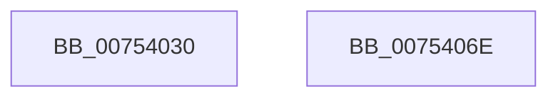

# PopClearUserShutdownMarkerWorker

- RVA: `0x00754030`–`0x0075406F` (길이 `63` bytes)
- VA: `0x0000000140754030`
- 실행 섹션: `PAGE`
- PDB 이름 있음: `예`; PDB Function 태그: `아니요`
- unwind 정보 RVA: `0x0005C788`
- 디코드: `13`개 명령, `63/63` bytes 표시
- 미해석 바이트: `0` (있으면 어셈블리에 `.byte`로 보존)

> 이 문서는 커널 이미지의 기계어와 PDB 기호를 분석해 생성했습니다. 4번과 5번은 함수 원형과 자료형을 바이너리 사용 방식에서 추정한 C 해석이며 원본 소스 복구 결과는 아닙니다.

## 1. Dependencies

- 직접 호출 지점: **4**; 고유 호출 대상: **4**
- 직접 호출자로 확인된 함수: **0**
- RIP 상대 이미지 참조: **3**

### Outgoing calls
- `0x0075403B` → [PopAcquireRwLockExclusive](../../text/43/PopAcquireRwLockExclusive_function_00430B44.md) (function, `0x00430B44`)
- `0x0075404C` → [PopBsdHandleRequest](../../text/4B/PopBsdHandleRequest_function_004B27A0.md) (function, `0x004B27A0`)
- `0x00754058` → [PopOkayToQueueNextWorkItem](../../text/4A/PopOkayToQueueNextWorkItem_function_004AED54.md) (function, `0x004AED54`)
- `0x00754064` → [PopReleaseRwLock](../../text/2D/PopReleaseRwLock_function_002DFBBC.md) (function, `0x002DFBBC`)

### Direct callers
- 이 함수 시작 RVA로 연결되는 직접 call은 확인되지 않았습니다. 간접 호출은 완전히 역산할 수 없습니다.

### Static image references
- `0x00754034` → RVA `0x00F0F1E0` (`.data`; read)
- `0x00754040` → RVA `0x00E67418` (`.data`; read/write)
- `0x00754051` → RVA `0x00F0F140` (`.data`; read)

## 2. Other-region calls and transfers

- 다른 실행 섹션으로 향하는 call: **4**
  - `0x0075403B` → [PopAcquireRwLockExclusive](../../text/43/PopAcquireRwLockExclusive_function_00430B44.md) (`PAGE` → `.text`)
  - `0x0075404C` → [PopBsdHandleRequest](../../text/4B/PopBsdHandleRequest_function_004B27A0.md) (`PAGE` → `.text`)
  - `0x00754058` → [PopOkayToQueueNextWorkItem](../../text/4A/PopOkayToQueueNextWorkItem_function_004AED54.md) (`PAGE` → `.text`)
  - `0x00754064` → [PopReleaseRwLock](../../text/2D/PopReleaseRwLock_function_002DFBBC.md) (`PAGE` → `.text`)
- 별도 외부 분기/꼬리 이동을 확인하지 못했습니다.

## 3. Assembly (complete function range)

```asm
00754030  48 83 EC 28                     sub rsp, 0x28
00754034  48 8D 0D A5 B1 7B 00            lea rcx, [rip + 0x7bb1a5]
0075403B  E8 04 CB CD FF                  call 0x140430b44
00754040  80 25 D1 33 71 00 FB            and byte ptr [rip + 0x7133d1], 0xfb
00754047  B9 09 00 00 00                  mov ecx, 9
0075404C  E8 4F E7 D5 FF                  call 0x1404b27a0
00754051  48 8D 0D E8 B0 7B 00            lea rcx, [rip + 0x7bb0e8]
00754058  E8 F7 AC D5 FF                  call 0x1404aed54
0075405D  48 8D 0D 7C B1 7B 00            lea rcx, [rip + 0x7bb17c]
00754064  E8 53 BB B8 FF                  call 0x1402dfbbc
00754069  48 83 C4 28                     add rsp, 0x28
0075406D  C3                              ret
0075406E  CC                              int3
```

## 4. C-style interpretation (structured pseudocode)

```c
__int64 __fastcall PopClearUserShutdownMarkerWorker(void)
{
    __int64 result;
    __int64 v_rsp;

    v_rsp = (v_rsp) - (40);
    result = PopAcquireRwLockExclusive(v_rip + 8106405, a2, a3, a4);
    result = PopBsdHandleRequest(9, a2, a3, a4);
    result = PopOkayToQueueNextWorkItem(v_rip + 8106216, a2, a3, a4);
    result = PopReleaseRwLock(v_rip + 8106364, a2, a3, a4);
    v_rsp = (v_rsp) + (40);
    return result;
}
```

## 5. (Beta) C Style

```c
void PopClearUserShutdownMarkerWorker(void)
{
    int64_t result;
    int64_t local_rsp;

    local_rsp = (local_rsp) - (40);
    result = PopAcquireRwLockExclusive(v_rip + 8106405, a2, a3, a4);
    result = PopBsdHandleRequest(9, a2, a3, a4);
    result = PopOkayToQueueNextWorkItem(v_rip + 8106216, a2, a3, a4);
    result = PopReleaseRwLock(v_rip + 8106364, a2, a3, a4);
    local_rsp = (local_rsp) + (40);
    return result;
}
```

## 6. Execution-region graph

[열기: 2D/3D 그래프와 함수 탐색 컨트롤 패널](../../../control-panel.html?section=page&rva=0x00754030&view=graph)

- 2D 그래프는 위에서 아래로 흐르고, 3D 그래프는 빈 공간을 드래그해 회전합니다. Shift+드래그는 이동, 휠은 확대·축소, 함수 노드 선택은 대상 보고서 이동입니다.

### Static fallback


