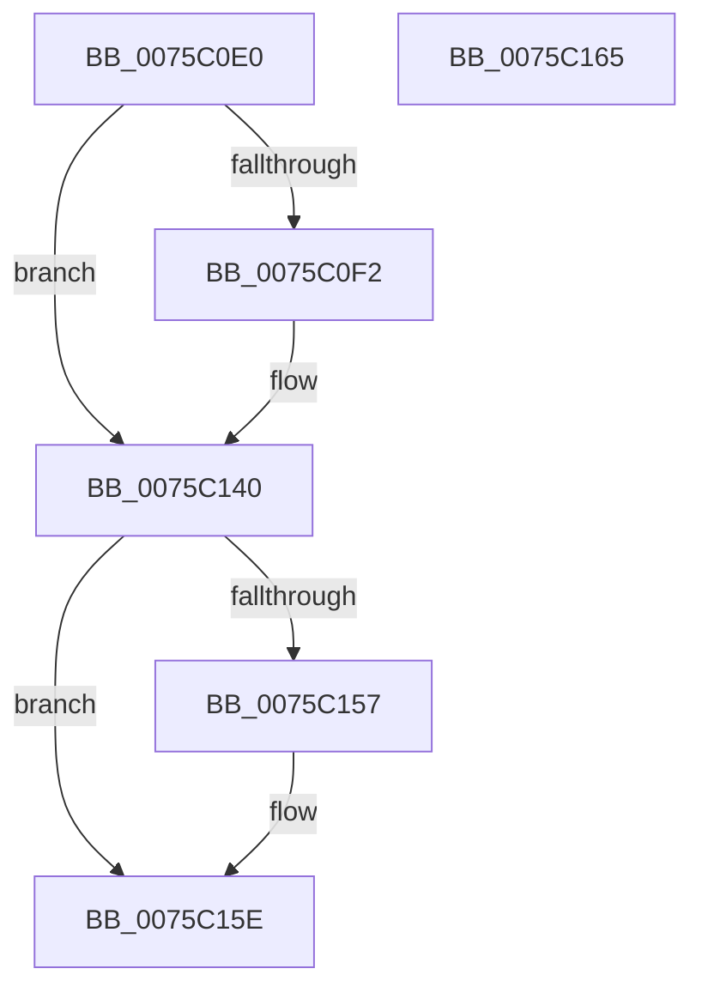

# PopCoalescingNotify

- RVA: `0x0075C0E0`–`0x0075C166` (길이 `134` bytes)
- VA: `0x000000014075C0E0`
- 실행 섹션: `PAGE`
- PDB 이름 있음: `예`; PDB Function 태그: `아니요`
- unwind 정보 RVA: `0x0005C788`
- 디코드: `27`개 명령, `134/134` bytes 표시
- 미해석 바이트: `0` (있으면 어셈블리에 `.byte`로 보존)

> 이 문서는 커널 이미지의 기계어와 PDB 기호를 분석해 생성했습니다. 4번과 5번은 함수 원형과 자료형을 바이너리 사용 방식에서 추정한 C 해석이며 원본 소스 복구 결과는 아닙니다.

## 1. Dependencies

- 직접 호출 지점: **7**; 고유 호출 대상: **7**
- 직접 호출자로 확인된 함수: **0**
- RIP 상대 이미지 참조: **6**

### Outgoing calls
- `0x0075C0E4` → [PopAcquirePolicyLock](../../pagelk/B7/PopAcquirePolicyLock_function_00B783C0.md) (function, `0x00B783C0`)
- `0x0075C0F9` → [KeCancelTimer](../../text/23/KeCancelTimer_function_002327E0.md) (function, `0x002327E0`)
- `0x0075C105` → [PopEnsureCoalescingWorkerWillRun](../../text/4C/PopEnsureCoalescingWorkerWillRun_function_004C266C.md) (function, `0x004C266C`)
- `0x0075C116` → [PopPrintEx](../../text/48/PopPrintEx_function_0048EF24.md) (function, `0x0048EF24`)
- `0x0075C122` → [PopDiagTraceEventNoPayload](../../text/49/PopDiagTraceEventNoPayload_function_004982F8.md) (function, `0x004982F8`)
- `0x0075C13B` → [PopCoalescingSetTimer](../../text/48/PopCoalescingSetTimer_function_0048EEC0.md) (function, `0x0048EEC0`)
- `0x0075C140` → [PopReleasePolicyLock](../../pagelk/B7/PopReleasePolicyLock_function_00B78410.md) (function, `0x00B78410`)

### Direct callers
- 이 함수 시작 RVA로 연결되는 직접 call은 확인되지 않았습니다. 간접 호출은 완전히 역산할 수 없습니다.

### Static image references
- `0x0075C0E9` → RVA `0x00F0E068` (`.data`; read)
- `0x0075C0F2` → RVA `0x00F0E000` (`.data`; read)
- `0x0075C0FE` → RVA `0x00F0E068` (`.data`; read/write)
- `0x0075C10A` → RVA `0x00B02280` (` ?? ::NNGAKEGL::`string'`; read)
- `0x0075C11B` → RVA `0x000215A8` (`.rdata`; read)
- `0x0075C134` → RVA `0x00F0E060` (`.data`; write)

## 2. Other-region calls and transfers

- 다른 실행 섹션으로 향하는 call: **7**
  - `0x0075C0E4` → [PopAcquirePolicyLock](../../pagelk/B7/PopAcquirePolicyLock_function_00B783C0.md) (`PAGE` → `PAGELK`)
  - `0x0075C0F9` → [KeCancelTimer](../../text/23/KeCancelTimer_function_002327E0.md) (`PAGE` → `.text`)
  - `0x0075C105` → [PopEnsureCoalescingWorkerWillRun](../../text/4C/PopEnsureCoalescingWorkerWillRun_function_004C266C.md) (`PAGE` → `.text`)
  - `0x0075C116` → [PopPrintEx](../../text/48/PopPrintEx_function_0048EF24.md) (`PAGE` → `.text`)
  - `0x0075C122` → [PopDiagTraceEventNoPayload](../../text/49/PopDiagTraceEventNoPayload_function_004982F8.md) (`PAGE` → `.text`)
  - `0x0075C13B` → [PopCoalescingSetTimer](../../text/48/PopCoalescingSetTimer_function_0048EEC0.md) (`PAGE` → `.text`)
  - `0x0075C140` → [PopReleasePolicyLock](../../pagelk/B7/PopReleasePolicyLock_function_00B78410.md) (`PAGE` → `PAGELK`)
- 별도 외부 분기/꼬리 이동을 확인하지 못했습니다.

## 3. Assembly (complete function range)

```asm
0075C0E0  48 83 EC 28                     sub rsp, 0x28
0075C0E4  E8 D7 C2 41 00                  call 0x140b783c0
0075C0E9  F6 05 78 1F 7B 00 02            test byte ptr [rip + 0x7b1f78], 2
0075C0F0  74 4E                           je 0x14075c140
0075C0F2  48 8D 0D 07 1F 7B 00            lea rcx, [rip + 0x7b1f07]
0075C0F9  E8 E2 66 AD FF                  call 0x1402327e0
0075C0FE  80 0D 63 1F 7B 00 04            or byte ptr [rip + 0x7b1f63], 4
0075C105  E8 62 65 D6 FF                  call 0x1404c266c
0075C10A  48 8D 15 6F 61 3A 00            lea rdx, [rip + 0x3a616f]
0075C111  B9 03 00 00 00                  mov ecx, 3
0075C116  E8 09 2E D3 FF                  call 0x14048ef24
0075C11B  48 8D 0D 86 54 8C FF            lea rcx, [rip - 0x73ab7a]
0075C122  E8 D1 C1 D3 FF                  call 0x1404982f8
0075C127  48 B8 08 00 00 00 80 F7 FF FF   movabs rax, 0xfffff78000000008
0075C131  48 8B 00                        mov rax, qword ptr [rax]
0075C134  48 89 05 25 1F 7B 00            mov qword ptr [rip + 0x7b1f25], rax
0075C13B  E8 80 2D D3 FF                  call 0x14048eec0
0075C140  E8 CB C2 41 00                  call 0x140b78410
0075C145  65 48 8B 04 25 88 01 00 00      mov rax, qword ptr gs:[0x188]
0075C14E  83 B8 E4 01 00 00 00            cmp dword ptr [rax + 0x1e4], 0
0075C155  74 07                           je 0x14075c15e
0075C157  B9 20 00 00 00                  mov ecx, 0x20
0075C15C  CD 29                           int 0x29
0075C15E  33 C0                           xor eax, eax
0075C160  48 83 C4 28                     add rsp, 0x28
0075C164  C3                              ret
0075C165  CC                              int3
```

## 4. C-style interpretation (structured pseudocode)

```c
__int64 __fastcall PopCoalescingNotify(void)
{
    __int64 result;
    __int64 v_rsp;

    v_rsp = (v_rsp) - (40);
    result = PopAcquirePolicyLock(a1, a2, a3, a4);
    if (((*(unsigned __int8 *)(v_rip + 8068984)) & (2)) != 0) {
        a1 = v_rip + 8068871;
        result = KeCancelTimer(a1, a2, a3, a4);
        result = PopEnsureCoalescingWorkerWillRun(a1, a2, a3, a4);
        a2 = v_rip + 3826031;
        a1 = 3;
        result = PopPrintEx(a1, a2, a3, a4);
        a1 = v_rip - 7580538;
        result = PopDiagTraceEventNoPayload(a1, a2, a3, a4);
        result = *(unsigned __int64 *)(result);
        *(unsigned __int64 *)(v_rip + 8068901) = result;
        result = PopCoalescingSetTimer(a1, a2, a3, a4);
    }
    result = PopReleasePolicyLock(a1, a2, a3, a4);
    if ((*(unsigned int *)(*(unsigned __int64 *)(gs_base + (0 + 392)) + 484)) != 0) {
        a1 = 32;
    }
    result = 0;
    v_rsp = (v_rsp) + (40);
    return result;
}
```

## 5. (Beta) C Style

```c
void PopCoalescingNotify(void)
{
    int64_t result;
    int64_t local_rsp;

    local_rsp = (local_rsp) - (40);
    result = PopAcquirePolicyLock(a1, a2, a3, a4);
    if (((*(uint8_t *)(v_rip + 0x7B1F78)) & (2)) != 0) {
        a1 = v_rip + 8068871;
        result = KeCancelTimer(a1, a2, a3, a4);
        result = PopEnsureCoalescingWorkerWillRun(a1, a2, a3, a4);
        a2 = v_rip + 3826031;
        a1 = 3;
        result = PopPrintEx(a1, a2, a3, a4);
        a1 = v_rip - 7580538;
        result = PopDiagTraceEventNoPayload(a1, a2, a3, a4);
        result = *(uint64_t *)(result);
        *(uint64_t *)(v_rip + 0x7B1F25) = result;
        result = PopCoalescingSetTimer(a1, a2, a3, a4);
    }
    result = PopReleasePolicyLock(a1, a2, a3, a4);
    if ((*(uint32_t *)(*(uint64_t *)(gs_base + (0 + 0x188)) + 0x1E4)) != 0) {
        a1 = 32;
    }
    result = 0;
    local_rsp = (local_rsp) + (40);
    return result;
}
```

## 6. Execution-region graph

[열기: 2D/3D 그래프와 함수 탐색 컨트롤 패널](../../../control-panel.html?section=page&rva=0x0075C0E0&view=graph)

- 2D 그래프는 위에서 아래로 흐르고, 3D 그래프는 빈 공간을 드래그해 회전합니다. Shift+드래그는 이동, 휠은 확대·축소, 함수 노드 선택은 대상 보고서 이동입니다.

### Static fallback


