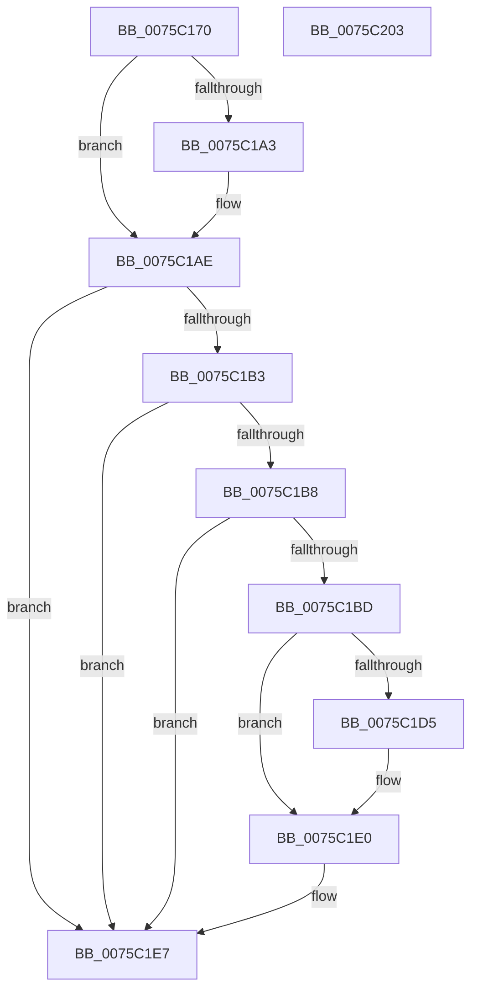

# PopCoalescingPowerSettingCallback

- RVA: `0x0075C170`–`0x0075C204` (길이 `148` bytes)
- VA: `0x000000014075C170`
- 실행 섹션: `PAGE`
- PDB 이름 있음: `예`; PDB Function 태그: `아니요`
- unwind 정보 RVA: `0x0005C954`
- 디코드: `41`개 명령, `148/148` bytes 표시
- 미해석 바이트: `0` (있으면 어셈블리에 `.byte`로 보존)

> 이 문서는 커널 이미지의 기계어와 PDB 기호를 분석해 생성했습니다. 4번과 5번은 함수 원형과 자료형을 바이너리 사용 방식에서 추정한 C 해석이며 원본 소스 복구 결과는 아닙니다.

## 1. Dependencies

- 직접 호출 지점: **4**; 고유 호출 대상: **4**
- 직접 호출자로 확인된 함수: **0**
- RIP 상대 이미지 참조: **5**

### Outgoing calls
- `0x0075C192` → [PopAcquirePolicyLock](../../pagelk/B7/PopAcquirePolicyLock_function_00B783C0.md) (function, `0x00B783C0`)
- `0x0075C1DB` → [PopUpdateDiskIdleTimeoutSetting](../91/PopUpdateDiskIdleTimeoutSetting_function_00912E30.md) (function, `0x00912E30`)
- `0x0075C1E0` → [PopCheckResiliencyScenarios](../A3/PopCheckResiliencyScenarios_function_00A31718.md) (function, `0x00A31718`)
- `0x0075C1E7` → [PopReleasePolicyLock](../../pagelk/B7/PopReleasePolicyLock_function_00B78410.md) (function, `0x00B78410`)

### Direct callers
- 이 함수 시작 RVA로 연결되는 직접 call은 확인되지 않았습니다. 간접 호출은 완전히 역산할 수 없습니다.

### Static image references
- `0x0075C197` → RVA `0x00024A18` (`.rdata`; read)
- `0x0075C1A3` → RVA `0x00024A20` (`.rdata`; read)
- `0x0075C1C4` → RVA `0x00FC6E38` (`ALMOSTRO`; write)
- `0x0075C1CD` → RVA `0x00E0B540` (`.data`; read)
- `0x0075C1D5` → RVA `0x00E0B540` (`.data`; write)

## 2. Other-region calls and transfers

- 다른 실행 섹션으로 향하는 call: **2**
  - `0x0075C192` → [PopAcquirePolicyLock](../../pagelk/B7/PopAcquirePolicyLock_function_00B783C0.md) (`PAGE` → `PAGELK`)
  - `0x0075C1E7` → [PopReleasePolicyLock](../../pagelk/B7/PopReleasePolicyLock_function_00B78410.md) (`PAGE` → `PAGELK`)
- 별도 외부 분기/꼬리 이동을 확인하지 못했습니다.

## 3. Assembly (complete function range)

```asm
0075C170  48 89 5C 24 08                  mov qword ptr [rsp + 8], rbx
0075C175  48 89 6C 24 10                  mov qword ptr [rsp + 0x10], rbp
0075C17A  48 89 74 24 18                  mov qword ptr [rsp + 0x18], rsi
0075C17F  57                              push rdi
0075C180  48 83 EC 20                     sub rsp, 0x20
0075C184  41 8B E8                        mov ebp, r8d
0075C187  48 8B FA                        mov rdi, rdx
0075C18A  48 8B F1                        mov rsi, rcx
0075C18D  BB 0D 00 00 C0                  mov ebx, 0xc000000d
0075C192  E8 29 C2 41 00                  call 0x140b783c0
0075C197  4C 8B 0D 7A 88 8C FF            mov r9, qword ptr [rip - 0x737786]
0075C19E  4C 2B 0E                        sub r9, qword ptr [rsi]
0075C1A1  75 0B                           jne 0x14075c1ae
0075C1A3  4C 8B 0D 76 88 8C FF            mov r9, qword ptr [rip - 0x73778a]
0075C1AA  4C 2B 4E 08                     sub r9, qword ptr [rsi + 8]
0075C1AE  4D 85 C9                        test r9, r9
0075C1B1  75 34                           jne 0x14075c1e7
0075C1B3  83 FD 04                        cmp ebp, 4
0075C1B6  75 2F                           jne 0x14075c1e7
0075C1B8  48 85 FF                        test rdi, rdi
0075C1BB  74 2A                           je 0x14075c1e7
0075C1BD  8B 07                           mov eax, dword ptr [rdi]
0075C1BF  83 C9 FF                        or ecx, 0xffffffff
0075C1C2  85 C0                           test eax, eax
0075C1C4  89 05 6E AC 86 00               mov dword ptr [rip + 0x86ac6e], eax
0075C1CA  0F 44 C1                        cmove eax, ecx
0075C1CD  3B 05 6D F3 6A 00               cmp eax, dword ptr [rip + 0x6af36d]
0075C1D3  74 0B                           je 0x14075c1e0
0075C1D5  89 05 65 F3 6A 00               mov dword ptr [rip + 0x6af365], eax
0075C1DB  E8 50 6C 1B 00                  call 0x140912e30
0075C1E0  E8 33 55 2D 00                  call 0x140a31718
0075C1E5  33 DB                           xor ebx, ebx
0075C1E7  E8 24 C2 41 00                  call 0x140b78410
0075C1EC  48 8B 6C 24 38                  mov rbp, qword ptr [rsp + 0x38]
0075C1F1  8B C3                           mov eax, ebx
0075C1F3  48 8B 5C 24 30                  mov rbx, qword ptr [rsp + 0x30]
0075C1F8  48 8B 74 24 40                  mov rsi, qword ptr [rsp + 0x40]
0075C1FD  48 83 C4 20                     add rsp, 0x20
0075C201  5F                              pop rdi
0075C202  C3                              ret
0075C203  CC                              int3
```

## 4. C-style interpretation (structured pseudocode)

```c
__int64 __fastcall PopCoalescingPowerSettingCallback(__int64 a1, __int64 a2, int a3)
{
    __int64 result;
    __int64 v_rbx;
    __int64 v_rsp;
    unsigned __int64 v_stack_p10;
    unsigned __int64 v_stack_p18;
    unsigned __int64 v_stack_p8;

    v_stack_p8 = v_rbx;
    v_stack_p10 = v_rbp;
    v_stack_p18 = v_rsi;
    v_rsp = (v_rsp) - (32);
    result = PopAcquirePolicyLock(a1, a2, a3, a4);
    a4 = (*(unsigned __int64 *)(v_rip - 7567238)) - (*(unsigned __int64 *)(a1));
    if (!(condition_is_not_equal)) {
        a4 = *(unsigned __int64 *)(v_rip - 7567242);
        a4 = (a4) - (*(unsigned __int64 *)(a1 + 8));
    }
    if (a4 != 0) goto loc_0075C1E7;
    if (((unsigned int)((unsigned int)(a3))) != 4) goto loc_0075C1E7;
    if (a2 == 0) goto loc_0075C1E7;
    a1 = (unsigned int)((a1) | (0xFFFFFFFFULL));
    *(unsigned int *)(v_rip + 8825966) = (unsigned int)((unsigned int)(*(unsigned int *)(a2)));
    result = (unsigned int)(*(unsigned int *)(a2));
    if ((unsigned int)((unsigned int)(*(unsigned int *)(a2))) == 0) { result = (unsigned int)(a1); }
    if (((unsigned int)(result)) != (*(unsigned int *)(v_rip + 7009133))) {
        *(unsigned int *)(v_rip + 7009125) = (unsigned int)(result);
        result = PopUpdateDiskIdleTimeoutSetting(a1, a2, a3, a4);
    }
    result = PopCheckResiliencyScenarios(a1, a2, a3, a4);
    v_rbx = 0;
loc_0075C1E7:
    result = PopReleasePolicyLock(a1, a2, a3, a4);
    v_rsp = (v_rsp) + (32);
    return 0;
}
```

## 5. (Beta) C Style

```c
int64_t PopCoalescingPowerSettingCallback(void *Arg1, int64_t Arg2, int32_t Arg3)
{
    uint8_t *arg1 = (uint8_t *)Arg1;

    int64_t result;
    int64_t local_rbx;
    int64_t local_rsp;
    uint64_t v_stack_p10;
    uint64_t v_stack_p18;
    uint64_t v_stack_p8;

    v_stack_p8 = local_rbx;
    v_stack_p10 = local_rbp;
    v_stack_p18 = local_rsi;
    local_rsp = (local_rsp) - (32);
    result = PopAcquirePolicyLock(Arg1, Arg2, Arg3, a4);
    a4 = (*(uint64_t *)(v_rip - 0x737786)) - (*(uint64_t *)(arg1));
    if (!(condition_is_not_equal)) {
        a4 = *(uint64_t *)(v_rip - 0x73778A);
        a4 = (a4) - (*(uint64_t *)(arg1 + 0x8));
    }
    if (a4 != 0) goto loc_0075C1E7;
    if (((uint32_t)((uint32_t)(Arg3))) != 4) goto loc_0075C1E7;
    if (Arg2 == 0) goto loc_0075C1E7;
    Arg1 = (uint32_t)((Arg1) | (0xFFFFFFFFULL));
    *(uint32_t *)(v_rip + 0x86AC6E) = (uint32_t)((uint32_t)(*(uint32_t *)(Arg2)));
    result = (uint32_t)(*(uint32_t *)(Arg2));
    if ((uint32_t)((uint32_t)(*(uint32_t *)(Arg2))) == 0) { result = (uint32_t)(Arg1); }
    if (((uint32_t)(result)) != (*(uint32_t *)(v_rip + 0x6AF36D))) {
        *(uint32_t *)(v_rip + 0x6AF365) = (uint32_t)(result);
        result = PopUpdateDiskIdleTimeoutSetting(Arg1, Arg2, Arg3, a4);
    }
    result = PopCheckResiliencyScenarios(Arg1, Arg2, Arg3, a4);
    local_rbx = 0;
loc_0075C1E7:
    result = PopReleasePolicyLock(Arg1, Arg2, Arg3, a4);
    local_rsp = (local_rsp) + (32);
    return 0;
}
```

### 관측된 메모리 오프셋

구조체 형식이 확인되지 않은 접근은 인자 기준의 오프셋으로만 기록했습니다.

| 기준 인자 | 오프셋 표현 | 폭 (bit) | 접근 |
|---|---:|---:|---|
| `Arg1` | `+ 0x0` | `64` | `R` |
| `Arg1` | `+ 0x8` | `64` | `R` |

## 6. Execution-region graph

[열기: 2D/3D 그래프와 함수 탐색 컨트롤 패널](../../../control-panel.html?section=page&rva=0x0075C170&view=graph)

- 2D 그래프는 위에서 아래로 흐르고, 3D 그래프는 빈 공간을 드래그해 회전합니다. Shift+드래그는 이동, 휠은 확대·축소, 함수 노드 선택은 대상 보고서 이동입니다.

### Static fallback


