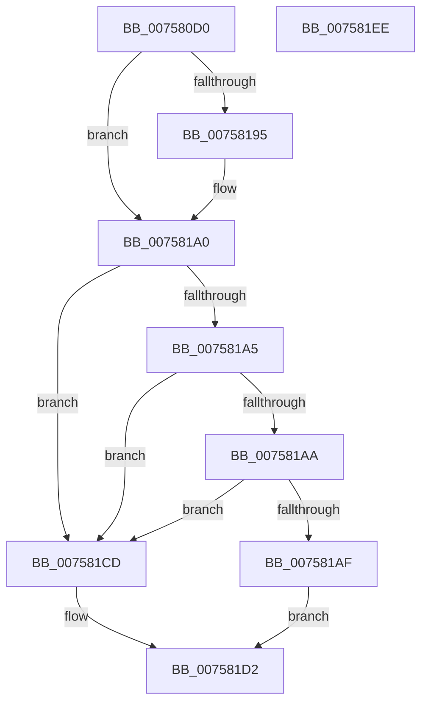

# PopConsoleLockPowerSettingCallback

- RVA: `0x007580D0`–`0x007581EF` (길이 `287` bytes)
- VA: `0x00000001407580D0`
- 실행 섹션: `PAGE`
- PDB 이름 있음: `예`; PDB Function 태그: `아니요`
- unwind 정보 RVA: `0x000BCF74`
- 디코드: `73`개 명령, `287/287` bytes 표시
- 미해석 바이트: `0` (있으면 어셈블리에 `.byte`로 보존)

> 이 문서는 커널 이미지의 기계어와 PDB 기호를 분석해 생성했습니다. 4번과 5번은 함수 원형과 자료형을 바이너리 사용 방식에서 추정한 C 해석이며 원본 소스 복구 결과는 아닙니다.

## 1. Dependencies

- 직접 호출 지점: **3**; 고유 호출 대상: **3**
- 직접 호출자로 확인된 함수: **0**
- RIP 상대 이미지 참조: **3**

### Outgoing calls
- `0x007580EB` → [PopAcquirePolicyLock](../../pagelk/B7/PopAcquirePolicyLock_function_00B783C0.md) (function, `0x00B783C0`)
- `0x007581C4` → [PopApplyPolicy](../91/PopApplyPolicy_function_009107B0.md) (function, `0x009107B0`)
- `0x007581D2` → [PopReleasePolicyLock](../../pagelk/B7/PopReleasePolicyLock_function_00B78410.md) (function, `0x00B78410`)

### Direct callers
- 이 함수 시작 RVA로 연결되는 직접 call은 확인되지 않았습니다. 간접 호출은 완전히 역산할 수 없습니다.

### Static image references
- `0x007580F0` → RVA `0x00F0CE68` (`.data`; read)
- `0x00758148` → RVA `0x00024D18` (`.rdata`; read)
- `0x00758195` → RVA `0x00024D20` (`.rdata`; read)

## 2. Other-region calls and transfers

- 다른 실행 섹션으로 향하는 call: **2**
  - `0x007580EB` → [PopAcquirePolicyLock](../../pagelk/B7/PopAcquirePolicyLock_function_00B783C0.md) (`PAGE` → `PAGELK`)
  - `0x007581D2` → [PopReleasePolicyLock](../../pagelk/B7/PopReleasePolicyLock_function_00B78410.md) (`PAGE` → `PAGELK`)
- 별도 외부 분기/꼬리 이동을 확인하지 못했습니다.

## 3. Assembly (complete function range)

```asm
007580D0  48 89 5C 24 08                  mov qword ptr [rsp + 8], rbx
007580D5  48 89 74 24 10                  mov qword ptr [rsp + 0x10], rsi
007580DA  57                              push rdi
007580DB  48 81 EC 10 01 00 00            sub rsp, 0x110
007580E2  41 8B F0                        mov esi, r8d
007580E5  48 8B DA                        mov rbx, rdx
007580E8  48 8B F9                        mov rdi, rcx
007580EB  E8 D0 02 42 00                  call 0x140b783c0
007580F0  48 8B 05 71 4D 7B 00            mov rax, qword ptr [rip + 0x7b4d71]
007580F7  4C 8D 4C 24 20                  lea r9, [rsp + 0x20]
007580FC  B9 80 00 00 00                  mov ecx, 0x80
00758101  0F 10 00                        movups xmm0, xmmword ptr [rax]
00758104  0F 10 48 10                     movups xmm1, xmmword ptr [rax + 0x10]
00758108  41 0F 11 01                     movups xmmword ptr [r9], xmm0
0075810C  0F 10 40 20                     movups xmm0, xmmword ptr [rax + 0x20]
00758110  41 0F 11 49 10                  movups xmmword ptr [r9 + 0x10], xmm1
00758115  0F 10 48 30                     movups xmm1, xmmword ptr [rax + 0x30]
00758119  41 0F 11 41 20                  movups xmmword ptr [r9 + 0x20], xmm0
0075811E  0F 10 40 40                     movups xmm0, xmmword ptr [rax + 0x40]
00758122  41 0F 11 49 30                  movups xmmword ptr [r9 + 0x30], xmm1
00758127  0F 10 48 50                     movups xmm1, xmmword ptr [rax + 0x50]
0075812B  41 0F 11 41 40                  movups xmmword ptr [r9 + 0x40], xmm0
00758130  0F 10 40 60                     movups xmm0, xmmword ptr [rax + 0x60]
00758134  41 0F 11 49 50                  movups xmmword ptr [r9 + 0x50], xmm1
00758139  41 0F 11 41 60                  movups xmmword ptr [r9 + 0x60], xmm0
0075813E  4C 03 C9                        add r9, rcx
00758141  0F 10 40 70                     movups xmm0, xmmword ptr [rax + 0x70]
00758145  48 03 C1                        add rax, rcx
00758148  48 8B 0D C9 CB 8C FF            mov rcx, qword ptr [rip - 0x733437]
0075814F  41 0F 11 41 F0                  movups xmmword ptr [r9 - 0x10], xmm0
00758154  0F 10 08                        movups xmm1, xmmword ptr [rax]
00758157  0F 10 40 10                     movups xmm0, xmmword ptr [rax + 0x10]
0075815B  41 0F 11 09                     movups xmmword ptr [r9], xmm1
0075815F  0F 10 48 20                     movups xmm1, xmmword ptr [rax + 0x20]
00758163  41 0F 11 41 10                  movups xmmword ptr [r9 + 0x10], xmm0
00758168  0F 10 40 30                     movups xmm0, xmmword ptr [rax + 0x30]
0075816C  41 0F 11 49 20                  movups xmmword ptr [r9 + 0x20], xmm1
00758171  0F 10 48 40                     movups xmm1, xmmword ptr [rax + 0x40]
00758175  41 0F 11 41 30                  movups xmmword ptr [r9 + 0x30], xmm0
0075817A  0F 10 40 50                     movups xmm0, xmmword ptr [rax + 0x50]
0075817E  48 8B 40 60                     mov rax, qword ptr [rax + 0x60]
00758182  41 0F 11 49 40                  movups xmmword ptr [r9 + 0x40], xmm1
00758187  41 0F 11 41 50                  movups xmmword ptr [r9 + 0x50], xmm0
0075818C  49 89 41 60                     mov qword ptr [r9 + 0x60], rax
00758190  48 2B 0F                        sub rcx, qword ptr [rdi]
00758193  75 0B                           jne 0x1407581a0
00758195  48 8B 0D 84 CB 8C FF            mov rcx, qword ptr [rip - 0x73347c]
0075819C  48 2B 4F 08                     sub rcx, qword ptr [rdi + 8]
007581A0  48 85 C9                        test rcx, rcx
007581A3  75 28                           jne 0x1407581cd
007581A5  83 FE 04                        cmp esi, 4
007581A8  75 23                           jne 0x1407581cd
007581AA  48 85 DB                        test rbx, rbx
007581AD  74 1E                           je 0x1407581cd
007581AF  8B 03                           mov eax, dword ptr [rbx]
007581B1  4C 8D 44 24 20                  lea r8, [rsp + 0x20]
007581B6  41 B9 E8 00 00 00               mov r9d, 0xe8
007581BC  89 44 24 70                     mov dword ptr [rsp + 0x70], eax
007581C0  33 D2                           xor edx, edx
007581C2  B1 01                           mov cl, 1
007581C4  E8 E7 85 1B 00                  call 0x1409107b0
007581C9  8B D8                           mov ebx, eax
007581CB  EB 05                           jmp 0x1407581d2
007581CD  BB 0D 00 00 C0                  mov ebx, 0xc000000d
007581D2  E8 39 02 42 00                  call 0x140b78410
007581D7  4C 8D 9C 24 10 01 00 00         lea r11, [rsp + 0x110]
007581DF  8B C3                           mov eax, ebx
007581E1  49 8B 5B 10                     mov rbx, qword ptr [r11 + 0x10]
007581E5  49 8B 73 18                     mov rsi, qword ptr [r11 + 0x18]
007581E9  49 8B E3                        mov rsp, r11
007581EC  5F                              pop rdi
007581ED  C3                              ret
007581EE  CC                              int3
```

## 4. C-style interpretation (structured pseudocode)

```c
__int64 __fastcall PopConsoleLockPowerSettingCallback(__int64 a1, __int64 a2, int a3)
{
    __int64 result;
    __int64 v_rsp;
    unsigned __int64 v_stack_m8;
    unsigned int v_stack_mA8;
    unsigned __int64 v_stack_mF8;
    unsigned __int64 v_stack_p10;
    unsigned __int64 v_stack_p8;

    v_stack_p8 = v_rbx;
    v_stack_p10 = v_rsi;
    v_rsp = (v_rsp) - (272);
    result = PopAcquirePolicyLock(a1, a2, a3, a4);
    *(unsigned __int64 *)(v_stack_mF8) = v_xmm0;
    *(unsigned __int64 *)(v_stack_mF8 + 16) = v_xmm1;
    *(unsigned __int64 *)(v_stack_mF8 + 32) = v_xmm0;
    *(unsigned __int64 *)(v_stack_mF8 + 48) = v_xmm1;
    *(unsigned __int64 *)(v_stack_mF8 + 64) = v_xmm0;
    *(unsigned __int64 *)(v_stack_mF8 + 80) = v_xmm1;
    *(unsigned __int64 *)(v_stack_mF8 + 96) = v_xmm0;
    a4 = (v_stack_mF8) + (128);
    result = (*(unsigned __int64 *)(v_rip + 8080753)) + (128);
    *(unsigned __int64 *)(a4 - 16) = v_xmm0;
    *(unsigned __int64 *)(a4) = v_xmm1;
    *(unsigned __int64 *)(a4 + 16) = v_xmm0;
    *(unsigned __int64 *)(a4 + 32) = v_xmm1;
    *(unsigned __int64 *)(a4 + 48) = v_xmm0;
    *(unsigned __int64 *)(a4 + 64) = v_xmm1;
    *(unsigned __int64 *)(a4 + 80) = v_xmm0;
    *(unsigned __int64 *)(a4 + 96) = *(unsigned __int64 *)(result + 96);
    a1 = (*(unsigned __int64 *)(v_rip - 7550007)) - (*(unsigned __int64 *)(a1));
    if (!(condition_is_not_equal)) {
        a1 = *(unsigned __int64 *)(v_rip - 7550076);
        a1 = (a1) - (*(unsigned __int64 *)(a1 + 8));
    }
    if (a1 != 0) goto loc_007581CD;
    if (((unsigned int)((unsigned int)(a3))) != 4) goto loc_007581CD;
    if (a2 == 0) goto loc_007581CD;
    v_stack_mA8 = (unsigned int)((unsigned int)(*(unsigned int *)(a2)));
    a2 = 0;
    result = PopApplyPolicy(1, a2, v_stack_mF8, 232);
    goto loc_007581D2;
loc_007581CD:
loc_007581D2:
    result = PopReleasePolicyLock(1, a2, v_stack_mF8, 232);
    return (unsigned int)((unsigned int)((unsigned int)(0xC000000DULL)));
}
```

## 5. (Beta) C Style

```c
int64_t PopConsoleLockPowerSettingCallback(void *Arg1, int64_t Arg2, int32_t Arg3)
{
    uint8_t *arg1 = (uint8_t *)Arg1;

    int64_t result;
    int64_t local_rsp;
    uint64_t v_stack_m8;
    uint32_t v_stack_mA8;
    uint64_t v_stack_mF8;
    uint64_t v_stack_p10;
    uint64_t v_stack_p8;

    v_stack_p8 = local_rbx;
    v_stack_p10 = local_rsi;
    local_rsp = (local_rsp) - (272);
    result = PopAcquirePolicyLock(Arg1, Arg2, Arg3, a4);
    *(uint64_t *)(v_stack_mF8) = v_xmm0;
    *(uint64_t *)(v_stack_mF8 + 0x10) = v_xmm1;
    *(uint64_t *)(v_stack_mF8 + 0x20) = v_xmm0;
    *(uint64_t *)(v_stack_mF8 + 0x30) = v_xmm1;
    *(uint64_t *)(v_stack_mF8 + 0x40) = v_xmm0;
    *(uint64_t *)(v_stack_mF8 + 0x50) = v_xmm1;
    *(uint64_t *)(v_stack_mF8 + 0x60) = v_xmm0;
    a4 = (v_stack_mF8) + (128);
    result = (*(uint64_t *)(v_rip + 0x7B4D71)) + (128);
    *(uint64_t *)(a4 - 0x10) = v_xmm0;
    *(uint64_t *)(a4) = v_xmm1;
    *(uint64_t *)(a4 + 0x10) = v_xmm0;
    *(uint64_t *)(a4 + 0x20) = v_xmm1;
    *(uint64_t *)(a4 + 0x30) = v_xmm0;
    *(uint64_t *)(a4 + 0x40) = v_xmm1;
    *(uint64_t *)(a4 + 0x50) = v_xmm0;
    *(uint64_t *)(a4 + 0x60) = *(uint64_t *)(result + 0x60);
    Arg1 = (*(uint64_t *)(v_rip - 0x733437)) - (*(uint64_t *)(arg1));
    if (!(condition_is_not_equal)) {
        Arg1 = *(uint64_t *)(v_rip - 0x73347C);
        Arg1 = (Arg1) - (*(uint64_t *)(arg1 + 0x8));
    }
    if (Arg1 != NULL) goto loc_007581CD;
    if (((uint32_t)((uint32_t)(Arg3))) != 4) goto loc_007581CD;
    if (Arg2 == 0) goto loc_007581CD;
    v_stack_mA8 = (uint32_t)((uint32_t)(*(uint32_t *)(Arg2)));
    Arg2 = 0;
    result = PopApplyPolicy(1, Arg2, v_stack_mF8, 232);
    goto loc_007581D2;
loc_007581CD:
loc_007581D2:
    result = PopReleasePolicyLock(1, Arg2, v_stack_mF8, 232);
    return (uint32_t)((uint32_t)((uint32_t)(0xC000000DULL)));
}
```

### 관측된 메모리 오프셋

구조체 형식이 확인되지 않은 접근은 인자 기준의 오프셋으로만 기록했습니다.

| 기준 인자 | 오프셋 표현 | 폭 (bit) | 접근 |
|---|---:|---:|---|
| `Arg1` | `+ 0x0` | `64` | `R` |
| `Arg1` | `+ 0x8` | `64` | `R` |

## 6. Execution-region graph

[열기: 2D/3D 그래프와 함수 탐색 컨트롤 패널](../../../control-panel.html?section=page&rva=0x007580D0&view=graph)

- 2D 그래프는 위에서 아래로 흐르고, 3D 그래프는 빈 공간을 드래그해 회전합니다. Shift+드래그는 이동, 휠은 확대·축소, 함수 노드 선택은 대상 보고서 이동입니다.

### Static fallback


