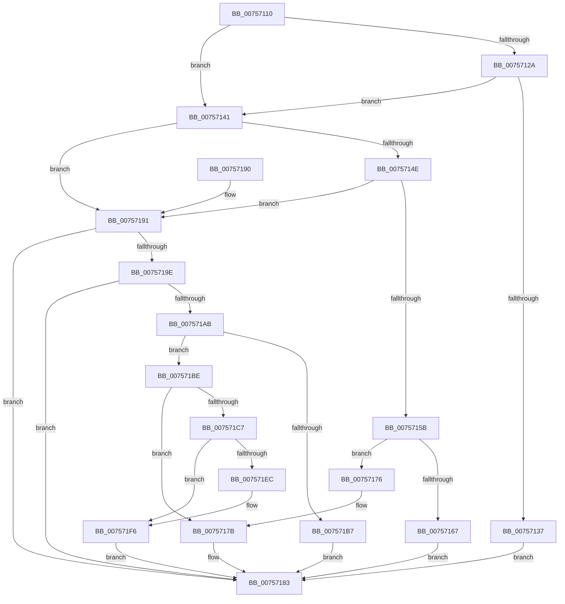

# PopCoolingExtensionPnpNotification

- RVA: `0x00757110`–`0x00757201` (길이 `241` bytes)
- VA: `0x0000000140757110`
- 실행 섹션: `PAGE`
- PDB 이름 있음: `예`; PDB Function 태그: `아니요`
- unwind 정보 RVA: `0x0006C008`
- 디코드: `66`개 명령, `241/241` bytes 표시
- 미해석 바이트: `0` (있으면 어셈블리에 `.byte`로 보존)

> 이 문서는 커널 이미지의 기계어와 PDB 기호를 분석해 생성했습니다. 4번과 5번은 함수 원형과 자료형을 바이너리 사용 방식에서 추정한 C 해석이며 원본 소스 복구 결과는 아닙니다.

## 1. Dependencies

- 직접 호출 지점: **13**; 고유 호출 대상: **10**
- 직접 호출자로 확인된 함수: **0**
- RIP 상대 이미지 참조: **7**

### Outgoing calls
- `0x0075713A` → [PopDisableCoolingExtension](PopDisableCoolingExtension_function_00757208.md) (function, `0x00757208`)
- `0x0075715B` → [Feature_Servicing_CoolingFrameworkDeviceCleanupFix__private_IsEnabledDeviceUsageNoInline](../../text/5D/Feature_Servicing_CoolingFrameworkDeviceCleanupFix__private_IsEnabledDeviceUsageNoInline_function_005D1004.md) (function, `0x005D1004`)
- `0x00757167` → [PopOrphanCoolingExtension](PopOrphanCoolingExtension_function_00757474.md) (function, `0x00757474`)
- `0x0075716F` → [PopUnregisterCoolingNotification](PopUnregisterCoolingNotification_function_00757854.md) (function, `0x00757854`)
- `0x00757176` → [PopDisableCoolingExtension](PopDisableCoolingExtension_function_00757208.md) (function, `0x00757208`)
- `0x0075717E` → [PopOrphanCoolingExtension](PopOrphanCoolingExtension_function_00757474.md) (function, `0x00757474`)
- `0x007571AB` → [Feature_Servicing_CoolingFrameworkDeviceCleanupFix__private_IsEnabledDeviceUsageNoInline](../../text/5D/Feature_Servicing_CoolingFrameworkDeviceCleanupFix__private_IsEnabledDeviceUsageNoInline_function_005D1004.md) (function, `0x005D1004`)
- `0x007571B7` → [PopHandleCancelQueryRemove](PopHandleCancelQueryRemove_function_0075730C.md) (function, `0x0075730C`)
- `0x007571BE` → [PopAcquireCoolingInterface](PopAcquireCoolingInterface_function_00756DF0.md) (function, `0x00756DF0`)
- `0x007571CB` → [PopAcquireRwLockExclusive](../../text/43/PopAcquireRwLockExclusive_function_00430B44.md) (function, `0x00430B44`)
- `0x007571DE` → [PopDiagTraceCoolingExtension](../A3/PopDiagTraceCoolingExtension_function_00A39C28.md) (function, `0x00A39C28`)
- `0x007571F1` → [PopPropogateCoolingChange](../../text/4E/PopPropogateCoolingChange_function_004E8FA0.md) (function, `0x004E8FA0`)
- `0x007571FA` → [PopReleaseRwLock](../../text/2D/PopReleaseRwLock_function_002DFBBC.md) (function, `0x002DFBBC`)

### Direct callers
- 이 함수 시작 RVA로 연결되는 직접 call은 확인되지 않았습니다. 간접 호출은 완전히 역산할 수 없습니다.

### Static image references
- `0x00757121` → RVA `0x0001A210` (`.rdata`; read)
- `0x0075712E` → RVA `0x0001A218` (`.rdata`; read)
- `0x00757145` → RVA `0x0001A220` (`.rdata`; read)
- `0x00757152` → RVA `0x0001A228` (`.rdata`; read)
- `0x00757195` → RVA `0x00012320` (`.rdata`; read)
- `0x007571A2` → RVA `0x00012328` (`.rdata`; read)
- `0x007571D0` → RVA `0x000231A8` (`.rdata`; read)

## 2. Other-region calls and transfers

- 다른 실행 섹션으로 향하는 call: **5**
  - `0x0075715B` → [Feature_Servicing_CoolingFrameworkDeviceCleanupFix__private_IsEnabledDeviceUsageNoInline](../../text/5D/Feature_Servicing_CoolingFrameworkDeviceCleanupFix__private_IsEnabledDeviceUsageNoInline_function_005D1004.md) (`PAGE` → `.text`)
  - `0x007571AB` → [Feature_Servicing_CoolingFrameworkDeviceCleanupFix__private_IsEnabledDeviceUsageNoInline](../../text/5D/Feature_Servicing_CoolingFrameworkDeviceCleanupFix__private_IsEnabledDeviceUsageNoInline_function_005D1004.md) (`PAGE` → `.text`)
  - `0x007571CB` → [PopAcquireRwLockExclusive](../../text/43/PopAcquireRwLockExclusive_function_00430B44.md) (`PAGE` → `.text`)
  - `0x007571F1` → [PopPropogateCoolingChange](../../text/4E/PopPropogateCoolingChange_function_004E8FA0.md) (`PAGE` → `.text`)
  - `0x007571FA` → [PopReleaseRwLock](../../text/2D/PopReleaseRwLock_function_002DFBBC.md) (`PAGE` → `.text`)
- 별도 외부 분기/꼬리 이동을 확인하지 못했습니다.

## 3. Assembly (complete function range)

```asm
00757110  48 89 5C 24 08                  mov qword ptr [rsp + 8], rbx
00757115  57                              push rdi
00757116  48 83 EC 20                     sub rsp, 0x20
0075711A  48 8B 41 04                     mov rax, qword ptr [rcx + 4]
0075711E  48 8B DA                        mov rbx, rdx
00757121  48 3B 05 E8 30 8C FF            cmp rax, qword ptr [rip - 0x73cf18]
00757128  75 17                           jne 0x140757141
0075712A  48 8B 41 0C                     mov rax, qword ptr [rcx + 0xc]
0075712E  48 3B 05 E3 30 8C FF            cmp rax, qword ptr [rip - 0x73cf1d]
00757135  75 0A                           jne 0x140757141
00757137  48 8B CA                        mov rcx, rdx
0075713A  E8 C9 00 00 00                  call 0x140757208
0075713F  EB 42                           jmp 0x140757183
00757141  48 8B 41 04                     mov rax, qword ptr [rcx + 4]
00757145  48 3B 05 D4 30 8C FF            cmp rax, qword ptr [rip - 0x73cf2c]
0075714C  75 43                           jne 0x140757191
0075714E  48 8B 41 0C                     mov rax, qword ptr [rcx + 0xc]
00757152  48 3B 05 CF 30 8C FF            cmp rax, qword ptr [rip - 0x73cf31]
00757159  75 36                           jne 0x140757191
0075715B  E8 A4 9E E7 FF                  call 0x1405d1004
00757160  48 8B CB                        mov rcx, rbx
00757163  85 C0                           test eax, eax
00757165  74 0F                           je 0x140757176
00757167  E8 08 03 00 00                  call 0x140757474
0075716C  48 8B CB                        mov rcx, rbx
0075716F  E8 E0 06 00 00                  call 0x140757854
00757174  EB 0D                           jmp 0x140757183
00757176  E8 8D 00 00 00                  call 0x140757208
0075717B  48 8B CB                        mov rcx, rbx
0075717E  E8 F1 02 00 00                  call 0x140757474
00757183  48 8B 5C 24 30                  mov rbx, qword ptr [rsp + 0x30]
00757188  33 C0                           xor eax, eax
0075718A  48 83 C4 20                     add rsp, 0x20
0075718E  5F                              pop rdi
0075718F  C3                              ret
00757190  CC                              int3
00757191  48 8B 41 04                     mov rax, qword ptr [rcx + 4]
00757195  48 3B 05 84 B1 8B FF            cmp rax, qword ptr [rip - 0x744e7c]
0075719C  75 E5                           jne 0x140757183
0075719E  48 8B 41 0C                     mov rax, qword ptr [rcx + 0xc]
007571A2  48 3B 05 7F B1 8B FF            cmp rax, qword ptr [rip - 0x744e81]
007571A9  75 D8                           jne 0x140757183
007571AB  E8 54 9E E7 FF                  call 0x1405d1004
007571B0  48 8B CB                        mov rcx, rbx
007571B3  85 C0                           test eax, eax
007571B5  74 07                           je 0x1407571be
007571B7  E8 50 01 00 00                  call 0x14075730c
007571BC  EB C5                           jmp 0x140757183
007571BE  E8 2D FC FF FF                  call 0x140756df0
007571C3  85 C0                           test eax, eax
007571C5  78 B4                           js 0x14075717b
007571C7  48 8D 4B 20                     lea rcx, [rbx + 0x20]
007571CB  E8 74 99 CD FF                  call 0x140430b44
007571D0  48 8D 15 D1 BF 8C FF            lea rdx, [rip - 0x73402f]
007571D7  C6 43 50 01                     mov byte ptr [rbx + 0x50], 1
007571DB  48 8B CB                        mov rcx, rbx
007571DE  E8 45 2A 2E 00                  call 0x140a39c28
007571E3  48 8D 43 10                     lea rax, [rbx + 0x10]
007571E7  48 39 00                        cmp qword ptr [rax], rax
007571EA  74 0A                           je 0x1407571f6
007571EC  33 D2                           xor edx, edx
007571EE  48 8B CB                        mov rcx, rbx
007571F1  E8 AA 1D D9 FF                  call 0x1404e8fa0
007571F6  48 8D 4B 20                     lea rcx, [rbx + 0x20]
007571FA  E8 BD 89 B8 FF                  call 0x1402dfbbc
007571FF  EB 82                           jmp 0x140757183
```

## 4. C-style interpretation (structured pseudocode)

```c
__int64 __fastcall PopCoolingExtensionPnpNotification(__int64 a1, __int64 a2)
{
    __int64 result;
    __int64 v_rsp;
    unsigned __int64 v_stack_p8;

    v_stack_p8 = v_rbx;
    v_rsp = (v_rsp) - (32);
    if ((*(unsigned __int64 *)(a1 + 4)) != (*(unsigned __int64 *)(v_rip - 7589656))) goto loc_00757141;
    if ((*(unsigned __int64 *)(a1 + 12)) != (*(unsigned __int64 *)(v_rip - 7589661))) goto loc_00757141;
    result = PopDisableCoolingExtension(a2, a2, a3, a4);
    goto loc_00757183;
loc_00757141:
    if ((*(unsigned __int64 *)(a2 + 4)) != (*(unsigned __int64 *)(v_rip - 7589676))) goto loc_00757191;
    if ((*(unsigned __int64 *)(a2 + 12)) != (*(unsigned __int64 *)(v_rip - 7589681))) goto loc_00757191;
    result = Feature_Servicing_CoolingFrameworkDeviceCleanupFix__private_IsEnabledDeviceUsageNoInline(a2, a2, a3, a4);
    if ((unsigned int)(result) == 0) goto loc_00757176;
    result = PopOrphanCoolingExtension(a2, a2, a3, a4);
    result = PopUnregisterCoolingNotification(a2, a2, a3, a4);
    goto loc_00757183;
loc_00757176:
    result = PopDisableCoolingExtension(a2, a2, a3, a4);
loc_0075717B:
    result = PopOrphanCoolingExtension(a2, a2, a3, a4);
loc_00757183:
    result = 0;
    v_rsp = (v_rsp) + (32);
    return result;
loc_00757191:
    if ((*(unsigned __int64 *)(a2 + 4)) != (*(unsigned __int64 *)(v_rip - 7622268))) goto loc_00757183;
    if ((*(unsigned __int64 *)(a2 + 12)) != (*(unsigned __int64 *)(v_rip - 7622273))) goto loc_00757183;
    result = Feature_Servicing_CoolingFrameworkDeviceCleanupFix__private_IsEnabledDeviceUsageNoInline(a2, a2, a3, a4);
    if ((unsigned int)(result) == 0) goto loc_007571BE;
    result = PopHandleCancelQueryRemove(v_stack_p8, a2, a3, a4);
    goto loc_00757183;
loc_007571BE:
    result = PopAcquireCoolingInterface(v_stack_p8, a2, a3, a4);
    if (sign_flag) goto loc_0075717B;
    result = PopAcquireRwLockExclusive(v_stack_p8 + 32, a2, a3, a4);
    *(unsigned __int8 *)(v_stack_p8 + 80) = 1;
    result = PopDiagTraceCoolingExtension(v_stack_p8, v_rip - 7553071, a3, a4);
    result = v_stack_p8 + 16;
    if ((*(unsigned __int64 *)(v_stack_p8 + 16)) != (v_stack_p8 + 16)) {
        a2 = 0;
        a1 = v_stack_p8;
        result = PopPropogateCoolingChange(a1, a2, a3, a4);
    }
    result = PopReleaseRwLock(v_stack_p8 + 32, a2, a3, a4);
    goto loc_00757183;
}
```

## 5. (Beta) C Style

```c
int64_t PopCoolingExtensionPnpNotification(void *Arg1, void *Arg2)
{
    uint8_t *arg1 = (uint8_t *)Arg1;
    uint8_t *arg2 = (uint8_t *)Arg2;

    int64_t result;
    int64_t local_rsp;
    uint64_t v_stack_p8;

    v_stack_p8 = local_rbx;
    local_rsp = (local_rsp) - (32);
    if ((*(uint64_t *)(arg1 + 0x4)) != (*(uint64_t *)(v_rip - 0x73CF18))) goto loc_00757141;
    if ((*(uint64_t *)(arg1 + 0xC)) != (*(uint64_t *)(v_rip - 0x73CF1D))) goto loc_00757141;
    result = PopDisableCoolingExtension(Arg2, Arg2, a3, a4);
    goto loc_00757183;
loc_00757141:
    if ((*(uint64_t *)(arg2 + 0x4)) != (*(uint64_t *)(v_rip - 0x73CF2C))) goto loc_00757191;
    if ((*(uint64_t *)(arg2 + 0xC)) != (*(uint64_t *)(v_rip - 0x73CF31))) goto loc_00757191;
    result = Feature_Servicing_CoolingFrameworkDeviceCleanupFix__private_IsEnabledDeviceUsageNoInline(Arg2, Arg2, a3, a4);
    if ((uint32_t)(result) == 0) goto loc_00757176;
    result = PopOrphanCoolingExtension(Arg2, Arg2, a3, a4);
    result = PopUnregisterCoolingNotification(Arg2, Arg2, a3, a4);
    goto loc_00757183;
loc_00757176:
    result = PopDisableCoolingExtension(Arg2, Arg2, a3, a4);
loc_0075717B:
    result = PopOrphanCoolingExtension(Arg2, Arg2, a3, a4);
loc_00757183:
    result = 0;
    local_rsp = (local_rsp) + (32);
    return result;
loc_00757191:
    if ((*(uint64_t *)(arg2 + 0x4)) != (*(uint64_t *)(v_rip - 0x744E7C))) goto loc_00757183;
    if ((*(uint64_t *)(arg2 + 0xC)) != (*(uint64_t *)(v_rip - 0x744E81))) goto loc_00757183;
    result = Feature_Servicing_CoolingFrameworkDeviceCleanupFix__private_IsEnabledDeviceUsageNoInline(Arg2, Arg2, a3, a4);
    if ((uint32_t)(result) == 0) goto loc_007571BE;
    result = PopHandleCancelQueryRemove(v_stack_p8, Arg2, a3, a4);
    goto loc_00757183;
loc_007571BE:
    result = PopAcquireCoolingInterface(v_stack_p8, Arg2, a3, a4);
    if (sign_flag) goto loc_0075717B;
    result = PopAcquireRwLockExclusive(v_stack_p8 + 32, Arg2, a3, a4);
    *(uint8_t *)(v_stack_p8 + 0x50) = 1;
    result = PopDiagTraceCoolingExtension(v_stack_p8, v_rip - 7553071, a3, a4);
    result = v_stack_p8 + 16;
    if ((*(uint64_t *)(v_stack_p8 + 0x10)) != (v_stack_p8 + 16)) {
        Arg2 = 0;
        Arg1 = v_stack_p8;
        result = PopPropogateCoolingChange(Arg1, Arg2, a3, a4);
    }
    result = PopReleaseRwLock(v_stack_p8 + 32, Arg2, a3, a4);
    goto loc_00757183;
}
```

### 관측된 메모리 오프셋

구조체 형식이 확인되지 않은 접근은 인자 기준의 오프셋으로만 기록했습니다.

| 기준 인자 | 오프셋 표현 | 폭 (bit) | 접근 |
|---|---:|---:|---|
| `Arg1` | `+ 0x4` | `64` | `R` |
| `Arg1` | `+ 0xC` | `64` | `R` |
| `Arg2` | `+ 0x0` | `64` | `R` |
| `Arg2` | `+ 0x10` | `64` | `R` |
| `Arg2` | `+ 0x20` | `64` | `R` |
| `Arg2` | `+ 0x50` | `8` | `W` |

## 6. Execution-region graph

[열기: 2D/3D 그래프와 함수 탐색 컨트롤 패널](../../../control-panel.html?section=page&rva=0x00757110&view=graph)

- 2D 그래프는 위에서 아래로 흐르고, 3D 그래프는 빈 공간을 드래그해 회전합니다. Shift+드래그는 이동, 휠은 확대·축소, 함수 노드 선택은 대상 보고서 이동입니다.

### Static fallback


