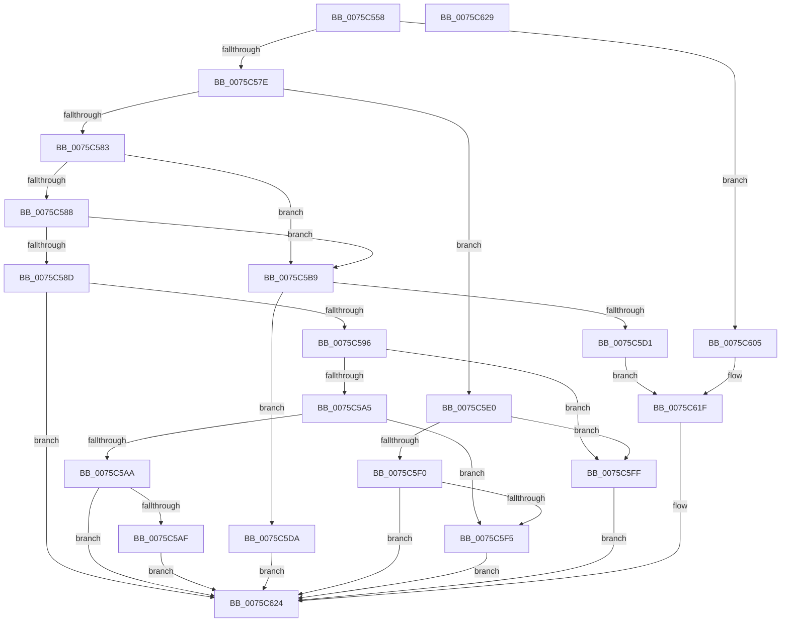

# PopCopyWakeSource

- RVA: `0x0075C558`–`0x0075C62A` (길이 `210` bytes)
- VA: `0x000000014075C558`
- 실행 섹션: `PAGE`
- PDB 이름 있음: `예`; PDB Function 태그: `아니요`
- unwind 정보 RVA: `0x0005C788`
- 디코드: `62`개 명령, `210/210` bytes 표시
- 미해석 바이트: `0` (있으면 어셈블리에 `.byte`로 보존)

> 이 문서는 커널 이미지의 기계어와 PDB 기호를 분석해 생성했습니다. 4번과 5번은 함수 원형과 자료형을 바이너리 사용 방식에서 추정한 C 해석이며 원본 소스 복구 결과는 아닙니다.

## 1. Dependencies

- 직접 호출 지점: **2**; 고유 호출 대상: **2**
- 직접 호출자로 확인된 함수: **1**
- RIP 상대 이미지 참조: **0**

### Outgoing calls
- `0x0075C565` → [PopWakeSourceSize](../AD/PopWakeSourceSize_function_00ADA884.md) (function, `0x00ADA884`)
- `0x0075C61F` → [memcpy](../../text/6C/memcpy_function_006C6840.md) (function, `0x006C6840`)

### Direct callers
- [PopGetWakeSource](../AB/PopGetWakeSource_function_00ABDB68.md) at `0x00ABDCC9`

### Static image references
- 디코드된 RIP-relative 메모리 참조가 없습니다.

## 2. Other-region calls and transfers

- 다른 실행 섹션으로 향하는 call: **1**
  - `0x0075C61F` → [memcpy](../../text/6C/memcpy_function_006C6840.md) (`PAGE` → `.text`)
- 별도 외부 분기/꼬리 이동을 확인하지 못했습니다.

## 3. Assembly (complete function range)

```asm
0075C558  48 83 EC 28                     sub rsp, 0x28
0075C55C  4C 8B C9                        mov r9, rcx
0075C55F  4D 8B D0                        mov r10, r8
0075C562  49 8B C8                        mov rcx, r8
0075C565  E8 1A E3 37 00                  call 0x140ada884
0075C56A  41 89 41 04                     mov dword ptr [r9 + 4], eax
0075C56E  45 33 C0                        xor r8d, r8d
0075C571  8B 51 10                        mov edx, dword ptr [rcx + 0x10]
0075C574  8B CA                           mov ecx, edx
0075C576  85 D2                           test edx, edx
0075C578  0F 84 87 00 00 00               je 0x14075c605
0075C57E  83 E9 01                        sub ecx, 1
0075C581  74 5D                           je 0x14075c5e0
0075C583  83 E9 01                        sub ecx, 1
0075C586  74 31                           je 0x14075c5b9
0075C588  83 E9 01                        sub ecx, 1
0075C58B  74 2C                           je 0x14075c5b9
0075C58D  83 F9 01                        cmp ecx, 1
0075C590  0F 85 8E 00 00 00               jne 0x14075c624
0075C596  41 C7 01 04 00 00 00            mov dword ptr [r9], 4
0075C59D  41 8B 4A 18                     mov ecx, dword ptr [r10 + 0x18]
0075C5A1  85 C9                           test ecx, ecx
0075C5A3  74 5A                           je 0x14075c5ff
0075C5A5  83 E9 01                        sub ecx, 1
0075C5A8  74 4B                           je 0x14075c5f5
0075C5AA  83 F9 01                        cmp ecx, 1
0075C5AD  75 75                           jne 0x14075c624
0075C5AF  41 C7 41 08 02 00 00 00         mov dword ptr [r9 + 8], 2
0075C5B7  EB 6B                           jmp 0x14075c624
0075C5B9  83 FA 02                        cmp edx, 2
0075C5BC  41 8B C0                        mov eax, r8d
0075C5BF  0F 95 C0                        setne al
0075C5C2  83 C0 02                        add eax, 2
0075C5C5  41 89 01                        mov dword ptr [r9], eax
0075C5C8  49 8B 52 18                     mov rdx, qword ptr [r10 + 0x18]
0075C5CC  48 85 D2                        test rdx, rdx
0075C5CF  74 09                           je 0x14075c5da
0075C5D1  4C 8B 02                        mov r8, qword ptr [rdx]
0075C5D4  49 8D 49 08                     lea rcx, [r9 + 8]
0075C5D8  EB 45                           jmp 0x14075c61f
0075C5DA  4D 89 41 08                     mov qword ptr [r9 + 8], r8
0075C5DE  EB 44                           jmp 0x14075c624
0075C5E0  41 C7 01 01 00 00 00            mov dword ptr [r9], 1
0075C5E7  41 8B 4A 18                     mov ecx, dword ptr [r10 + 0x18]
0075C5EB  83 E9 01                        sub ecx, 1
0075C5EE  74 0F                           je 0x14075c5ff
0075C5F0  83 F9 01                        cmp ecx, 1
0075C5F3  75 2F                           jne 0x14075c624
0075C5F5  41 C7 41 08 01 00 00 00         mov dword ptr [r9 + 8], 1
0075C5FD  EB 25                           jmp 0x14075c624
0075C5FF  45 89 41 08                     mov dword ptr [r9 + 8], r8d
0075C603  EB 1F                           jmp 0x14075c624
0075C605  45 89 01                        mov dword ptr [r9], r8d
0075C608  49 8D 49 0A                     lea rcx, [r9 + 0xa]
0075C60C  41 0F B7 42 18                  movzx eax, word ptr [r10 + 0x18]
0075C611  66 41 89 41 08                  mov word ptr [r9 + 8], ax
0075C616  45 0F B7 42 18                  movzx r8d, word ptr [r10 + 0x18]
0075C61B  49 8B 52 20                     mov rdx, qword ptr [r10 + 0x20]
0075C61F  E8 1C A2 F6 FF                  call 0x1406c6840
0075C624  48 83 C4 28                     add rsp, 0x28
0075C628  C3                              ret
0075C629  CC                              int3
```

## 4. C-style interpretation (structured pseudocode)

```c
__int64 __fastcall PopCopyWakeSource(__int64 a1, __int64 a2, __int64 a3)
{
    __int64 result;
    __int64 v_rsp;

    v_rsp = (v_rsp) - (40);
    result = PopWakeSourceSize(a3, a2, a3, a1);
    *(unsigned int *)(a1 + 4) = (unsigned int)(result);
    a3 = 0;
    if ((unsigned int)((unsigned int)(*(unsigned int *)(a3 + 16))) == 0) goto loc_0075C605;
    a1 = (unsigned int)(((unsigned int)((unsigned int)((unsigned int)(*(unsigned int *)(a3 + 16))))) - (1));
    if (condition_is_equal) goto loc_0075C5E0;
    a1 = (unsigned int)((a1) - (1));
    if (condition_is_equal) goto loc_0075C5B9;
    a1 = (unsigned int)((a1) - (1));
    if (condition_is_equal) goto loc_0075C5B9;
    if (((unsigned int)(a1)) != 1) goto loc_0075C624;
    *(unsigned int *)(a1) = 4;
    if ((unsigned int)((unsigned int)(*(unsigned int *)(a3 + 24))) == 0) goto loc_0075C5FF;
    a1 = (unsigned int)(((unsigned int)(*(unsigned int *)(a3 + 24))) - (1));
    if (condition_is_equal) goto loc_0075C5F5;
    if (((unsigned int)(a1)) != 1) goto loc_0075C624;
    *(unsigned int *)(a1 + 8) = 2;
    goto loc_0075C624;
loc_0075C5B9:
    result = (((unsigned int)((unsigned int)(*(unsigned int *)(a3 + 16)))) != 2) ? 1 : 0;
    result = (unsigned int)((result) + (2));
    *(unsigned int *)(a1) = (unsigned int)(result);
    if (*(unsigned __int64 *)(a3 + 24) == 0) goto loc_0075C5DA;
    goto loc_0075C61F;
loc_0075C5DA:
    *(unsigned __int64 *)(a1 + 8) = *(unsigned __int64 *)(*(unsigned __int64 *)(a3 + 24));
    goto loc_0075C624;
loc_0075C5E0:
    *(unsigned int *)(a1) = 1;
    a1 = (unsigned int)(((unsigned int)(*(unsigned int *)(a3 + 24))) - (1));
    if (condition_is_equal) goto loc_0075C5FF;
    if (((unsigned int)(a1)) != 1) goto loc_0075C624;
loc_0075C5F5:
    *(unsigned int *)(a1 + 8) = 1;
    goto loc_0075C624;
loc_0075C5FF:
    *(unsigned int *)(a1 + 8) = (unsigned int)(*(unsigned __int64 *)(*(unsigned __int64 *)(a3 + 24)));
    goto loc_0075C624;
loc_0075C605:
    *(unsigned int *)(a1) = (unsigned int)(*(unsigned __int64 *)(*(unsigned __int64 *)(a3 + 24)));
    *(unsigned __int16 *)(a1 + 8) = (unsigned __int16)(*(unsigned __int16 *)(a3 + 24));
loc_0075C61F:
    result = memcpy(a1 + 10, *(unsigned __int64 *)(a3 + 32), *(unsigned __int16 *)(a3 + 24), a1);
loc_0075C624:
    v_rsp = (v_rsp) + (40);
    return result;
}
```

## 5. (Beta) C Style

```c
int64_t PopCopyWakeSource(int64_t Arg1, int64_t Arg2, int64_t Arg3)
{
    int64_t result;
    int64_t local_rsp;

    local_rsp = (local_rsp) - (40);
    result = PopWakeSourceSize(Arg3, Arg2, Arg3, Arg1);
    *(uint32_t *)(Arg1 + 0x4) = (uint32_t)(result);
    Arg3 = 0;
    if ((uint32_t)((uint32_t)(*(uint32_t *)(Arg3 + 0x10))) == 0) goto loc_0075C605;
    Arg1 = (uint32_t)(((uint32_t)((uint32_t)((uint32_t)(*(uint32_t *)(Arg3 + 0x10))))) - (1));
    if (condition_is_equal) goto loc_0075C5E0;
    Arg1 = (uint32_t)((Arg1) - (1));
    if (condition_is_equal) goto loc_0075C5B9;
    Arg1 = (uint32_t)((Arg1) - (1));
    if (condition_is_equal) goto loc_0075C5B9;
    if (((uint32_t)(Arg1)) != 1) goto loc_0075C624;
    *(uint32_t *)(Arg1) = 4;
    if ((uint32_t)((uint32_t)(*(uint32_t *)(Arg3 + 0x18))) == 0) goto loc_0075C5FF;
    Arg1 = (uint32_t)(((uint32_t)(*(uint32_t *)(Arg3 + 0x18))) - (1));
    if (condition_is_equal) goto loc_0075C5F5;
    if (((uint32_t)(Arg1)) != 1) goto loc_0075C624;
    *(uint32_t *)(Arg1 + 0x8) = 2;
    goto loc_0075C624;
loc_0075C5B9:
    result = (((uint32_t)((uint32_t)(*(uint32_t *)(Arg3 + 0x10)))) != 2) ? 1 : 0;
    result = (uint32_t)((result) + (2));
    *(uint32_t *)(Arg1) = (uint32_t)(result);
    if (*(uint64_t *)(Arg3 + 0x18) == 0) goto loc_0075C5DA;
    goto loc_0075C61F;
loc_0075C5DA:
    *(uint64_t *)(Arg1 + 0x8) = *(uint64_t *)(*(uint64_t *)(Arg3 + 0x18));
    goto loc_0075C624;
loc_0075C5E0:
    *(uint32_t *)(Arg1) = 1;
    Arg1 = (uint32_t)(((uint32_t)(*(uint32_t *)(Arg3 + 0x18))) - (1));
    if (condition_is_equal) goto loc_0075C5FF;
    if (((uint32_t)(Arg1)) != 1) goto loc_0075C624;
loc_0075C5F5:
    *(uint32_t *)(Arg1 + 0x8) = 1;
    goto loc_0075C624;
loc_0075C5FF:
    *(uint32_t *)(Arg1 + 0x8) = (uint32_t)(*(uint64_t *)(*(uint64_t *)(Arg3 + 0x18)));
    goto loc_0075C624;
loc_0075C605:
    *(uint32_t *)(Arg1) = (uint32_t)(*(uint64_t *)(*(uint64_t *)(Arg3 + 0x18)));
    *(uint16_t *)(Arg1 + 0x8) = (uint16_t)(*(uint16_t *)(Arg3 + 0x18));
loc_0075C61F:
    result = memcpy(Arg1 + 10, *(uint64_t *)(Arg3 + 0x20), *(uint16_t *)(Arg3 + 0x18), Arg1);
loc_0075C624:
    local_rsp = (local_rsp) + (40);
    return result;
}
```

## 6. Execution-region graph

[열기: 2D/3D 그래프와 함수 탐색 컨트롤 패널](../../../control-panel.html?section=page&rva=0x0075C558&view=graph)

- 2D 그래프는 위에서 아래로 흐르고, 3D 그래프는 빈 공간을 드래그해 회전합니다. Shift+드래그는 이동, 휠은 확대·축소, 함수 노드 선택은 대상 보고서 이동입니다.

### Static fallback


