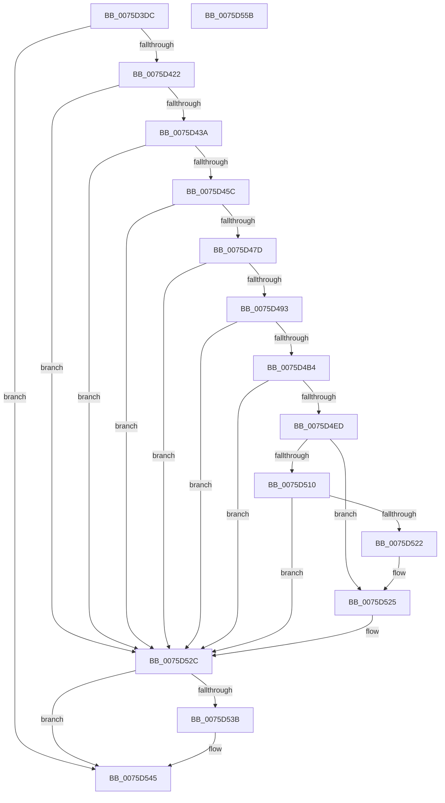

# PopCreateHiberFileSecurityDescriptor

- RVA: `0x0075D3DC`–`0x0075D55C` (길이 `384` bytes)
- VA: `0x000000014075D3DC`
- 실행 섹션: `PAGE`
- PDB 이름 있음: `예`; PDB Function 태그: `아니요`
- unwind 정보 RVA: `0x000CC304`
- 디코드: `108`개 명령, `384/384` bytes 표시
- 미해석 바이트: `0` (있으면 어셈블리에 `.byte`로 보존)

> 이 문서는 커널 이미지의 기계어와 PDB 기호를 분석해 생성했습니다. 4번과 5번은 함수 원형과 자료형을 바이너리 사용 방식에서 추정한 C 해석이며 원본 소스 복구 결과는 아닙니다.

## 1. Dependencies

- 직접 호출 지점: **15**; 고유 호출 대상: **11**
- 직접 호출자로 확인된 함수: **1**
- RIP 상대 이미지 참조: **0**

### Outgoing calls
- `0x0075D3FF` → [RtlLengthRequiredSid](../9C/RtlLengthRequiredSid_function_009CA4D0.md) (function, `0x009CA4D0`)
- `0x0075D411` → [ExAllocatePool2](../../poolcode/B8/ExAllocatePool2_function_00B820F0.md) (function, `0x00B820F0`)
- `0x0075D42D` → [RtlInitializeSid](../9E/RtlInitializeSid_function_009EB720.md) (function, `0x009EB720`)
- `0x0075D43F` → [RtlSubAuthoritySid](../../text/45/RtlSubAuthoritySid_function_00456D10.md) (function, `0x00456D10`)
- `0x0075D46C` → [ExAllocatePool2](../../poolcode/B8/ExAllocatePool2_function_00B820F0.md) (function, `0x00B820F0`)
- `0x0075D486` → [RtlCreateAcl](../91/RtlCreateAcl_function_00916F00.md) (function, `0x00916F00`)
- `0x0075D4AB` → [RtlpAddKnownAce](../92/RtlpAddKnownAce_function_00929A20.md) (function, `0x00929A20`)
- `0x0075D4C3` → [RtlGetAce](../../text/40/RtlGetAce_function_0040FAF0.md) (function, `0x0040FAF0`)
- `0x0075D4E0` → [ExAllocatePool2](../../poolcode/B8/ExAllocatePool2_function_00B820F0.md) (function, `0x00B820F0`)
- `0x0075D4F7` → [memcpy](../../text/6C/memcpy_function_006C6840.md) (function, `0x006C6840`)
- `0x0075D504` → [RtlCreateSecurityDescriptor](../9F/RtlCreateSecurityDescriptor_function_009F1DF0.md) (function, `0x009F1DF0`)
- `0x0075D519` → [RtlSetDaclSecurityDescriptor](../9E/RtlSetDaclSecurityDescriptor_function_009EC210.md) (function, `0x009EC210`)
- `0x0075D527` → [ExFreePoolWithTag](../../poolcode/B8/ExFreePoolWithTag_function_00B82870.md) (function, `0x00B82870`)
- `0x0075D531` → [ExFreePoolWithTag](../../poolcode/B8/ExFreePoolWithTag_function_00B82870.md) (function, `0x00B82870`)
- `0x0075D540` → [ExFreePoolWithTag](../../poolcode/B8/ExFreePoolWithTag_function_00B82870.md) (function, `0x00B82870`)

### Direct callers
- [PopCreateHiberFile](PopCreateHiberFile_function_0075CE70.md) at `0x0075CF6D`

### Static image references
- 디코드된 RIP-relative 메모리 참조가 없습니다.

## 2. Other-region calls and transfers

- 다른 실행 섹션으로 향하는 call: **9**
  - `0x0075D411` → [ExAllocatePool2](../../poolcode/B8/ExAllocatePool2_function_00B820F0.md) (`PAGE` → `POOLCODE`)
  - `0x0075D43F` → [RtlSubAuthoritySid](../../text/45/RtlSubAuthoritySid_function_00456D10.md) (`PAGE` → `.text`)
  - `0x0075D46C` → [ExAllocatePool2](../../poolcode/B8/ExAllocatePool2_function_00B820F0.md) (`PAGE` → `POOLCODE`)
  - `0x0075D4C3` → [RtlGetAce](../../text/40/RtlGetAce_function_0040FAF0.md) (`PAGE` → `.text`)
  - `0x0075D4E0` → [ExAllocatePool2](../../poolcode/B8/ExAllocatePool2_function_00B820F0.md) (`PAGE` → `POOLCODE`)
  - `0x0075D4F7` → [memcpy](../../text/6C/memcpy_function_006C6840.md) (`PAGE` → `.text`)
  - `0x0075D527` → [ExFreePoolWithTag](../../poolcode/B8/ExFreePoolWithTag_function_00B82870.md) (`PAGE` → `POOLCODE`)
  - `0x0075D531` → [ExFreePoolWithTag](../../poolcode/B8/ExFreePoolWithTag_function_00B82870.md) (`PAGE` → `POOLCODE`)
  - `0x0075D540` → [ExFreePoolWithTag](../../poolcode/B8/ExFreePoolWithTag_function_00B82870.md) (`PAGE` → `POOLCODE`)
- 별도 외부 분기/꼬리 이동을 확인하지 못했습니다.

## 3. Assembly (complete function range)

```asm
0075D3DC  48 8B C4                        mov rax, rsp
0075D3DF  48 89 58 10                     mov qword ptr [rax + 0x10], rbx
0075D3E3  48 89 68 18                     mov qword ptr [rax + 0x18], rbp
0075D3E7  56                              push rsi
0075D3E8  57                              push rdi
0075D3E9  41 56                           push r14
0075D3EB  48 83 EC 30                     sub rsp, 0x30
0075D3EF  33 DB                           xor ebx, ebx
0075D3F1  66 C7 40 0C 00 01               mov word ptr [rax + 0xc], 0x100
0075D3F7  33 FF                           xor edi, edi
0075D3F9  89 58 08                        mov dword ptr [rax + 8], ebx
0075D3FC  8D 4B 01                        lea ecx, [rbx + 1]
0075D3FF  E8 CC D0 26 00                  call 0x1409ca4d0
0075D404  8B D0                           mov edx, eax
0075D406  B9 00 01 00 00                  mov ecx, 0x100
0075D40B  41 B8 68 69 62 72               mov r8d, 0x72626968
0075D411  E8 DA 4C 42 00                  call 0x140b820f0
0075D416  48 8B F0                        mov rsi, rax
0075D419  48 85 C0                        test rax, rax
0075D41C  0F 84 23 01 00 00               je 0x14075d545
0075D422  41 B0 01                        mov r8b, 1
0075D425  48 8D 54 24 50                  lea rdx, [rsp + 0x50]
0075D42A  48 8B C8                        mov rcx, rax
0075D42D  E8 EE E2 28 00                  call 0x1409eb720
0075D432  85 C0                           test eax, eax
0075D434  0F 88 F2 00 00 00               js 0x14075d52c
0075D43A  33 D2                           xor edx, edx
0075D43C  48 8B CE                        mov rcx, rsi
0075D43F  E8 CC 98 CF FF                  call 0x140456d10
0075D444  21 18                           and dword ptr [rax], ebx
0075D446  0F B6 46 01                     movzx eax, byte ptr [rsi + 1]
0075D44A  8D 04 85 10 00 00 00            lea eax, [rax*4 + 0x10]
0075D451  8D 68 08                        lea ebp, [rax + 8]
0075D454  3B E8                           cmp ebp, eax
0075D456  0F 82 D0 00 00 00               jb 0x14075d52c
0075D45C  41 B8 68 69 62 72               mov r8d, 0x72626968
0075D462  8B D5                           mov edx, ebp
0075D464  B9 00 01 00 00                  mov ecx, 0x100
0075D469  44 8B F5                        mov r14d, ebp
0075D46C  E8 7F 4C 42 00                  call 0x140b820f0
0075D471  48 8B F8                        mov rdi, rax
0075D474  48 85 C0                        test rax, rax
0075D477  0F 84 AF 00 00 00               je 0x14075d52c
0075D47D  44 8D 43 02                     lea r8d, [rbx + 2]
0075D481  8B D5                           mov edx, ebp
0075D483  48 8B C8                        mov rcx, rax
0075D486  E8 75 9A 1B 00                  call 0x140916f00
0075D48B  85 C0                           test eax, eax
0075D48D  0F 88 99 00 00 00               js 0x14075d52c
0075D493  88 5C 24 28                     mov byte ptr [rsp + 0x28], bl
0075D497  8D 53 02                        lea edx, [rbx + 2]
0075D49A  41 B9 00 00 01 00               mov r9d, 0x10000
0075D4A0  48 89 74 24 20                  mov qword ptr [rsp + 0x20], rsi
0075D4A5  45 33 C0                        xor r8d, r8d
0075D4A8  48 8B CF                        mov rcx, rdi
0075D4AB  E8 70 C5 1C 00                  call 0x140929a20
0075D4B0  85 C0                           test eax, eax
0075D4B2  78 78                           js 0x14075d52c
0075D4B4  48 21 5C 24 50                  and qword ptr [rsp + 0x50], rbx
0075D4B9  4C 8D 44 24 50                  lea r8, [rsp + 0x50]
0075D4BE  33 D2                           xor edx, edx
0075D4C0  48 8B CF                        mov rcx, rdi
0075D4C3  E8 28 26 CB FF                  call 0x14040faf0
0075D4C8  48 8B 44 24 50                  mov rax, qword ptr [rsp + 0x50]
0075D4CD  48 8D 55 28                     lea rdx, [rbp + 0x28]
0075D4D1  B9 00 01 00 00                  mov ecx, 0x100
0075D4D6  41 B8 68 69 62 72               mov r8d, 0x72626968
0075D4DC  80 48 01 02                     or byte ptr [rax + 1], 2
0075D4E0  E8 0B 4C 42 00                  call 0x140b820f0
0075D4E5  48 8B D8                        mov rbx, rax
0075D4E8  48 85 C0                        test rax, rax
0075D4EB  74 3F                           je 0x14075d52c
0075D4ED  45 8B C6                        mov r8d, r14d
0075D4F0  48 8D 48 28                     lea rcx, [rax + 0x28]
0075D4F4  48 8B D7                        mov rdx, rdi
0075D4F7  E8 44 93 F6 FF                  call 0x1406c6840
0075D4FC  BA 01 00 00 00                  mov edx, 1
0075D501  48 8B CB                        mov rcx, rbx
0075D504  E8 E7 48 29 00                  call 0x1409f1df0
0075D509  48 8B CB                        mov rcx, rbx
0075D50C  85 C0                           test eax, eax
0075D50E  78 15                           js 0x14075d525
0075D510  45 33 C9                        xor r9d, r9d
0075D513  4C 8D 43 28                     lea r8, [rbx + 0x28]
0075D517  B2 01                           mov dl, 1
0075D519  E8 F2 EC 28 00                  call 0x1409ec210
0075D51E  85 C0                           test eax, eax
0075D520  79 0A                           jns 0x14075d52c
0075D522  48 8B CB                        mov rcx, rbx
0075D525  33 D2                           xor edx, edx
0075D527  E8 44 53 42 00                  call 0x140b82870
0075D52C  33 D2                           xor edx, edx
0075D52E  48 8B CE                        mov rcx, rsi
0075D531  E8 3A 53 42 00                  call 0x140b82870
0075D536  48 85 FF                        test rdi, rdi
0075D539  74 0A                           je 0x14075d545
0075D53B  33 D2                           xor edx, edx
0075D53D  48 8B CF                        mov rcx, rdi
0075D540  E8 2B 53 42 00                  call 0x140b82870
0075D545  48 8B 6C 24 60                  mov rbp, qword ptr [rsp + 0x60]
0075D54A  48 8B C3                        mov rax, rbx
0075D54D  48 8B 5C 24 58                  mov rbx, qword ptr [rsp + 0x58]
0075D552  48 83 C4 30                     add rsp, 0x30
0075D556  41 5E                           pop r14
0075D558  5F                              pop rdi
0075D559  5E                              pop rsi
0075D55A  C3                              ret
0075D55B  CC                              int3
```

## 4. C-style interpretation (structured pseudocode)

```c
__int64 __fastcall PopCreateHiberFileSecurityDescriptor(void)
{
    __int64 result;
    __int64 v_rbx;
    __int64 v_rdi;
    __int64 v_rsp;
    unsigned __int8 v_stack_m20;
    unsigned __int64 v_stack_m28;
    unsigned __int64 v_stack_p10;
    unsigned __int64 v_stack_p18;
    unsigned __int64 v_stack_p8;

    *(unsigned __int64 *)(v_rsp + 16) = v_rbx;
    *(unsigned __int64 *)(v_rsp + 24) = v_rbp;
    v_rsp = (v_rsp) - (48);
    v_rbx = 0;
    *(unsigned __int16 *)(v_rsp + 12) = 256;
    v_rdi = 0;
    *(unsigned int *)(v_rsp + 8) = 0;
    result = RtlLengthRequiredSid(v_rbx + 1, a2, a3, a4);
    result = ExAllocatePool2(256, (unsigned int)((unsigned int)(result)), (unsigned int)(0x72626968ULL), a4);
    if (result == 0) goto loc_0075D545;
    result = RtlInitializeSid(result, v_stack_p8, 1, a4);
    if (sign_flag) goto loc_0075D52C;
    a2 = 0;
    result = RtlSubAuthoritySid(result, a2, 1, a4);
    if (((unsigned int)(*(unsigned __int8 *)(result + 1) * 4 + 16 + 8)) < ((unsigned int)(*(unsigned __int8 *)(result + 1) * 4 + 16))) goto loc_0075D52C;
    result = ExAllocatePool2(256, (unsigned int)((unsigned int)(*(unsigned __int8 *)(result + 1) * 4 + 16 + 8)), (unsigned int)(0x72626968ULL), a4);
    if (result == 0) goto loc_0075D52C;
    result = RtlCreateAcl(result, (unsigned int)((unsigned int)(*(unsigned __int8 *)(result + 1) * 4 + 16 + 8)), v_rbx + 2, a4);
    if (sign_flag) goto loc_0075D52C;
    v_stack_m20 = 0;
    v_stack_m28 = result;
    a3 = 0;
    result = RtlpAddKnownAce(result, v_rbx + 2, a3, (unsigned int)(0x10000ULL));
    if (sign_flag) goto loc_0075D52C;
    a2 = 0;
    result = RtlGetAce(result, a2, v_stack_p8, (unsigned int)(0x10000ULL));
    result = ExAllocatePool2(256, *(unsigned __int8 *)(result + 1) * 4 + 16 + 8 + 40, (unsigned int)(0x72626968ULL), (unsigned int)(0x10000ULL));
    if (result == 0) goto loc_0075D52C;
    result = memcpy(result + 40, result, (unsigned int)((unsigned int)((unsigned int)((unsigned int)(*(unsigned __int8 *)(result + 1) * 4 + 16 + 8)))), (unsigned int)(0x10000ULL));
    result = RtlCreateSecurityDescriptor(result, 1, (unsigned int)((unsigned int)((unsigned int)((unsigned int)(*(unsigned __int8 *)(result + 1) * 4 + 16 + 8)))), (unsigned int)(0x10000ULL));
    if (sign_flag) goto loc_0075D525;
    a4 = 0;
    result = RtlSetDaclSecurityDescriptor(result, 1, result + 40, a4);
    if (!sign_flag) goto loc_0075D52C;
loc_0075D525:
    a2 = 0;
    result = ExFreePoolWithTag(result, a2, result + 40, a4);
loc_0075D52C:
    a2 = 0;
    result = ExFreePoolWithTag(result, a2, result + 40, a4);
    if (result != 0) {
        a2 = 0;
        a1 = result;
        result = ExFreePoolWithTag(a1, a2, result + 40, a4);
    }
    v_rsp = (v_rsp) + (48);
    return result;
}
```

## 5. (Beta) C Style

```c
void PopCreateHiberFileSecurityDescriptor(void)
{
    int64_t result;
    int64_t local_rbx;
    int64_t local_rdi;
    int64_t local_rsp;
    uint8_t v_stack_m20;
    uint64_t v_stack_m28;
    uint64_t v_stack_p10;
    uint64_t v_stack_p18;
    uint64_t v_stack_p8;

    *(uint64_t *)(local_rsp + 0x10) = local_rbx;
    *(uint64_t *)(local_rsp + 0x18) = local_rbp;
    local_rsp = (local_rsp) - (48);
    local_rbx = 0;
    *(uint16_t *)(local_rsp + 0xC) = 256;
    local_rdi = 0;
    *(uint32_t *)(local_rsp + 0x8) = 0;
    result = RtlLengthRequiredSid(local_rbx + 1, a2, a3, a4);
    result = ExAllocatePool2(256, (uint32_t)((uint32_t)(result)), (uint32_t)(0x72626968ULL), a4);
    if (result == 0) goto loc_0075D545;
    result = RtlInitializeSid(result, v_stack_p8, 1, a4);
    if (sign_flag) goto loc_0075D52C;
    a2 = 0;
    result = RtlSubAuthoritySid(result, a2, 1, a4);
    if (((uint32_t)(*(uint8_t *)(result + 0x1) * 4 + 16 + 8)) < ((uint32_t)(*(uint8_t *)(result + 0x1) * 4 + 16))) goto loc_0075D52C;
    result = ExAllocatePool2(256, (uint32_t)((uint32_t)(*(uint8_t *)(result + 0x1) * 4 + 16 + 8)), (uint32_t)(0x72626968ULL), a4);
    if (result == 0) goto loc_0075D52C;
    result = RtlCreateAcl(result, (uint32_t)((uint32_t)(*(uint8_t *)(result + 0x1) * 4 + 16 + 8)), local_rbx + 2, a4);
    if (sign_flag) goto loc_0075D52C;
    v_stack_m20 = 0;
    v_stack_m28 = result;
    a3 = 0;
    result = RtlpAddKnownAce(result, local_rbx + 2, a3, (uint32_t)(0x10000ULL));
    if (sign_flag) goto loc_0075D52C;
    a2 = 0;
    result = RtlGetAce(result, a2, v_stack_p8, (uint32_t)(0x10000ULL));
    result = ExAllocatePool2(256, *(uint8_t *)(result + 0x1) * 4 + 16 + 8 + 40, (uint32_t)(0x72626968ULL), (uint32_t)(0x10000ULL));
    if (result == 0) goto loc_0075D52C;
    result = memcpy(result + 40, result, (uint32_t)((uint32_t)((uint32_t)((uint32_t)(*(uint8_t *)(result + 0x1) * 4 + 16 + 8)))), (uint32_t)(0x10000ULL));
    result = RtlCreateSecurityDescriptor(result, 1, (uint32_t)((uint32_t)((uint32_t)((uint32_t)(*(uint8_t *)(result + 0x1) * 4 + 16 + 8)))), (uint32_t)(0x10000ULL));
    if (sign_flag) goto loc_0075D525;
    a4 = 0;
    result = RtlSetDaclSecurityDescriptor(result, 1, result + 40, a4);
    if (!sign_flag) goto loc_0075D52C;
loc_0075D525:
    a2 = 0;
    result = ExFreePoolWithTag(result, a2, result + 40, a4);
loc_0075D52C:
    a2 = 0;
    result = ExFreePoolWithTag(result, a2, result + 40, a4);
    if (result != 0) {
        a2 = 0;
        a1 = result;
        result = ExFreePoolWithTag(a1, a2, result + 40, a4);
    }
    local_rsp = (local_rsp) + (48);
    return result;
}
```

## 6. Execution-region graph

[열기: 2D/3D 그래프와 함수 탐색 컨트롤 패널](../../../control-panel.html?section=page&rva=0x0075D3DC&view=graph)

- 2D 그래프는 위에서 아래로 흐르고, 3D 그래프는 빈 공간을 드래그해 회전합니다. Shift+드래그는 이동, 휠은 확대·축소, 함수 노드 선택은 대상 보고서 이동입니다.

### Static fallback


