# PopCreateHiberFile

- RVA: `0x0075CE70`–`0x0075D3D4` (길이 `1,380` bytes)
- VA: `0x000000014075CE70`
- 실행 섹션: `PAGE`
- PDB 이름 있음: `예`; PDB Function 태그: `아니요`
- unwind 정보 RVA: `0x000CC4E0`
- 디코드: `330`개 명령, `1,380/1,380` bytes 표시
- 미해석 바이트: `0` (있으면 어셈블리에 `.byte`로 보존)

> 이 문서는 커널 이미지의 기계어와 PDB 기호를 분석해 생성했습니다. 4번과 5번은 함수 원형과 자료형을 바이너리 사용 방식에서 추정한 C 해석이며 원본 소스 복구 결과는 아닙니다.

## 1. Dependencies

- 직접 호출 지점: **28**; 고유 호출 대상: **18**
- 직접 호출자로 확인된 함수: **1**
- RIP 상대 이미지 참조: **10**

### Outgoing calls
- `0x0075CF11` → [RtlInitUnicodeString](../../text/42/RtlInitUnicodeString_function_0042A780.md) (function, `0x0042A780`)
- `0x0075CF38` → [ExAllocatePool2](../../poolcode/B8/ExAllocatePool2_function_00B820F0.md) (function, `0x00B820F0`)
- `0x0075CF5B` → [RtlAppendUnicodeStringToString](../../text/40/RtlAppendUnicodeStringToString_function_0040FA50.md) (function, `0x0040FA50`)
- `0x0075CF68` → [RtlAppendUnicodeStringToString](../../text/40/RtlAppendUnicodeStringToString_function_0040FA50.md) (function, `0x0040FA50`)
- `0x0075CF6D` → [PopCreateHiberFileSecurityDescriptor](PopCreateHiberFileSecurityDescriptor_function_0075D3DC.md) (function, `0x0075D3DC`)
- `0x0075D006` → [IopCreateFile](../8A/IopCreateFile_function_008AB298.md) (function, `0x008AB298`)
- `0x0075D03C` → [ZwQueryInformationFile](../../text/6A/ZwQueryInformationFile_function_006AD2F0.md) (function, `0x006AD2F0`)
- `0x0075D0AB` → [ZwFsControlFile](../../text/6A/ZwFsControlFile_function_006AD7F0.md) (function, `0x006AD7F0`)
- `0x0075D0D1` → [ZwSetInformationFile](../../text/6A/ZwSetInformationFile_function_006AD5B0.md) (function, `0x006AD5B0`)
- `0x0075D10D` → [ObpReferenceObjectByHandleWithTag](../86/ObpReferenceObjectByHandleWithTag_function_00869650.md) (function, `0x00869650`)
- `0x0075D140` → [ZwSetInformationFile](../../text/6A/ZwSetInformationFile_function_006AD5B0.md) (function, `0x006AD5B0`)
- `0x0075D16B` → [KeWaitForSingleObject](../../text/20/KeWaitForSingleObject_function_0020E6B0.md) (function, `0x0020E6B0`)
- `0x0075D19A` → [ZwSetInformationFile](../../text/6A/ZwSetInformationFile_function_006AD5B0.md) (function, `0x006AD5B0`)
- `0x0075D1C1` → [KeWaitForSingleObject](../../text/20/KeWaitForSingleObject_function_0020E6B0.md) (function, `0x0020E6B0`)
- `0x0075D232` → [IopCreateFile](../8A/IopCreateFile_function_008AB298.md) (function, `0x008AB298`)
- `0x0075D245` → [ZwClose](../../text/6A/ZwClose_function_006AD2B0.md) (function, `0x006AD2B0`)
- `0x0075D29A` → [ZwFsControlFile](../../text/6A/ZwFsControlFile_function_006AD7F0.md) (function, `0x006AD7F0`)
- `0x0075D2B9` → [KeWaitForSingleObject](../../text/20/KeWaitForSingleObject_function_0020E6B0.md) (function, `0x0020E6B0`)
- `0x0075D2D1` → [ZwFlushBuffersFile](../../text/6A/ZwFlushBuffersFile_function_006ADA30.md) (function, `0x006ADA30`)
- `0x0075D2EE` → [KeWaitForSingleObject](../../text/20/KeWaitForSingleObject_function_0020E6B0.md) (function, `0x0020E6B0`)
- `0x0075D30B` → [PopSanityCheckHiberFile](../A9/PopSanityCheckHiberFile_function_00A90840.md) (function, `0x00A90840`)
- `0x0075D31D` → [PopSetHiberFileMcb](../A9/PopSetHiberFileMcb_function_00A905DC.md) (function, `0x00A905DC`)
- `0x0075D34F` → [FsRtlIssueFileNotificationFsctl](../71/FsRtlIssueFileNotificationFsctl_function_007161D8.md) (function, `0x007161D8`)
- `0x0075D36E` → [ZwClose](../../text/6A/ZwClose_function_006AD2B0.md) (function, `0x006AD2B0`)
- `0x0075D380` → [ObfDereferenceObjectWithTag](../../text/2F/ObfDereferenceObjectWithTag_function_002F78E0.md) (function, `0x002F78E0`)
- `0x0075D38F` → [ExFreePoolWithTag](../../poolcode/B8/ExFreePoolWithTag_function_00B82870.md) (function, `0x00B82870`)
- `0x0075D39F` → [ExFreePoolWithTag](../../poolcode/B8/ExFreePoolWithTag_function_00B82870.md) (function, `0x00B82870`)
- `0x0075D3AD` → [_security_check_cookie](../../text/6A/_security_check_cookie_function_006AC640.md) (function, `0x006AC640`)

### Direct callers
- [PopEnableHiberFile](../90/PopEnableHiberFile_function_0090F850.md) at `0x0090FC0C`

### Static image references
- `0x0075CE94` → RVA `0x00E0A740` (`.data`; read)
- `0x0075CEC5` → RVA `0x00B01F00` (` ?? ::NNGAKEGL::`string'`; read)
- `0x0075CF1F` → RVA `0x00F0CFD0` (`.data`; read)
- `0x0075D05A` → RVA `0x00F0C2E0` (`.data`; read)
- `0x0075D0E0` → RVA `0x00FC6AE0` (`ALMOSTRO`; read)
- `0x0075D150` → RVA `0x00F0BF28` (`.data`; read)
- `0x0075D32C` → RVA `0x0002AF40` (`.rdata`; read)
- `0x0075D333` → RVA `0x00F0BF20` (`.data`; write)
- `0x0075D341` → RVA `0x00F0BF30` (`.data`; write)
- `0x0075D348` → RVA `0x00F0BF28` (`.data`; write)

## 2. Other-region calls and transfers

- 다른 실행 섹션으로 향하는 call: **21**
  - `0x0075CF11` → [RtlInitUnicodeString](../../text/42/RtlInitUnicodeString_function_0042A780.md) (`PAGE` → `.text`)
  - `0x0075CF38` → [ExAllocatePool2](../../poolcode/B8/ExAllocatePool2_function_00B820F0.md) (`PAGE` → `POOLCODE`)
  - `0x0075CF5B` → [RtlAppendUnicodeStringToString](../../text/40/RtlAppendUnicodeStringToString_function_0040FA50.md) (`PAGE` → `.text`)
  - `0x0075CF68` → [RtlAppendUnicodeStringToString](../../text/40/RtlAppendUnicodeStringToString_function_0040FA50.md) (`PAGE` → `.text`)
  - `0x0075D03C` → [ZwQueryInformationFile](../../text/6A/ZwQueryInformationFile_function_006AD2F0.md) (`PAGE` → `.text`)
  - `0x0075D0AB` → [ZwFsControlFile](../../text/6A/ZwFsControlFile_function_006AD7F0.md) (`PAGE` → `.text`)
  - `0x0075D0D1` → [ZwSetInformationFile](../../text/6A/ZwSetInformationFile_function_006AD5B0.md) (`PAGE` → `.text`)
  - `0x0075D140` → [ZwSetInformationFile](../../text/6A/ZwSetInformationFile_function_006AD5B0.md) (`PAGE` → `.text`)
  - `0x0075D16B` → [KeWaitForSingleObject](../../text/20/KeWaitForSingleObject_function_0020E6B0.md) (`PAGE` → `.text`)
  - `0x0075D19A` → [ZwSetInformationFile](../../text/6A/ZwSetInformationFile_function_006AD5B0.md) (`PAGE` → `.text`)
  - `0x0075D1C1` → [KeWaitForSingleObject](../../text/20/KeWaitForSingleObject_function_0020E6B0.md) (`PAGE` → `.text`)
  - `0x0075D245` → [ZwClose](../../text/6A/ZwClose_function_006AD2B0.md) (`PAGE` → `.text`)
  - `0x0075D29A` → [ZwFsControlFile](../../text/6A/ZwFsControlFile_function_006AD7F0.md) (`PAGE` → `.text`)
  - `0x0075D2B9` → [KeWaitForSingleObject](../../text/20/KeWaitForSingleObject_function_0020E6B0.md) (`PAGE` → `.text`)
  - `0x0075D2D1` → [ZwFlushBuffersFile](../../text/6A/ZwFlushBuffersFile_function_006ADA30.md) (`PAGE` → `.text`)
  - `0x0075D2EE` → [KeWaitForSingleObject](../../text/20/KeWaitForSingleObject_function_0020E6B0.md) (`PAGE` → `.text`)
  - `0x0075D36E` → [ZwClose](../../text/6A/ZwClose_function_006AD2B0.md) (`PAGE` → `.text`)
  - `0x0075D380` → [ObfDereferenceObjectWithTag](../../text/2F/ObfDereferenceObjectWithTag_function_002F78E0.md) (`PAGE` → `.text`)
  - `0x0075D38F` → [ExFreePoolWithTag](../../poolcode/B8/ExFreePoolWithTag_function_00B82870.md) (`PAGE` → `POOLCODE`)
  - `0x0075D39F` → [ExFreePoolWithTag](../../poolcode/B8/ExFreePoolWithTag_function_00B82870.md) (`PAGE` → `POOLCODE`)
  - `0x0075D3AD` → [_security_check_cookie](../../text/6A/_security_check_cookie_function_006AC640.md) (`PAGE` → `.text`)
- 별도 외부 분기/꼬리 이동을 확인하지 못했습니다.

## 3. Assembly (complete function range)

```asm
0075CE70  48 89 5C 24 10                  mov qword ptr [rsp + 0x10], rbx
0075CE75  48 89 74 24 18                  mov qword ptr [rsp + 0x18], rsi
0075CE7A  48 89 7C 24 20                  mov qword ptr [rsp + 0x20], rdi
0075CE7F  55                              push rbp
0075CE80  41 54                           push r12
0075CE82  41 55                           push r13
0075CE84  41 56                           push r14
0075CE86  41 57                           push r15
0075CE88  48 8D 6C 24 80                  lea rbp, [rsp - 0x80]
0075CE8D  48 81 EC 80 01 00 00            sub rsp, 0x180
0075CE94  48 8B 05 A5 D8 6A 00            mov rax, qword ptr [rip + 0x6ad8a5]
0075CE9B  48 33 C4                        xor rax, rsp
0075CE9E  48 89 45 70                     mov qword ptr [rbp + 0x70], rax
0075CEA2  45 33 E4                        xor r12d, r12d
0075CEA5  48 89 4D 98                     mov qword ptr [rbp - 0x68], rcx
0075CEA9  0F 57 C0                        xorps xmm0, xmm0
0075CEAC  4C 89 65 C0                     mov qword ptr [rbp - 0x40], r12
0075CEB0  33 C0                           xor eax, eax
0075CEB2  44 89 65 B4                     mov dword ptr [rbp - 0x4c], r12d
0075CEB6  0F 57 C9                        xorps xmm1, xmm1
0075CEB9  48 89 45 68                     mov qword ptr [rbp + 0x68], rax
0075CEBD  48 8D 4D 08                     lea rcx, [rbp + 8]
0075CEC1  48 89 45 40                     mov qword ptr [rbp + 0x40], rax
0075CEC5  48 8D 15 34 50 3A 00            lea rdx, [rip + 0x3a5034]
0075CECC  48 89 45 F8                     mov qword ptr [rbp - 8], rax
0075CED0  0F 11 45 08                     movups xmmword ptr [rbp + 8], xmm0
0075CED4  89 45 00                        mov dword ptr [rbp], eax
0075CED7  41 8B FC                        mov edi, r12d
0075CEDA  0F 11 45 48                     movups xmmword ptr [rbp + 0x48], xmm0
0075CEDE  4C 89 65 C8                     mov qword ptr [rbp - 0x38], r12
0075CEE2  45 8B FC                        mov r15d, r12d
0075CEE5  0F 11 45 58                     movups xmmword ptr [rbp + 0x58], xmm0
0075CEE9  44 89 65 A0                     mov dword ptr [rbp - 0x60], r12d
0075CEED  0F 11 45 30                     movups xmmword ptr [rbp + 0x30], xmm0
0075CEF1  48 89 45 28                     mov qword ptr [rbp + 0x28], rax
0075CEF5  0F 11 45 D8                     movups xmmword ptr [rbp - 0x28], xmm0
0075CEF9  4C 89 65 80                     mov qword ptr [rbp - 0x80], r12
0075CEFD  0F 11 45 E8                     movups xmmword ptr [rbp - 0x18], xmm0
0075CF01  4C 89 65 A8                     mov qword ptr [rbp - 0x58], r12
0075CF05  0F 11 45 88                     movups xmmword ptr [rbp - 0x78], xmm0
0075CF09  4C 89 65 D0                     mov qword ptr [rbp - 0x30], r12
0075CF0D  0F 11 4D 18                     movups xmmword ptr [rbp + 0x18], xmm1
0075CF11  E8 6A D8 CC FF                  call 0x14042a780
0075CF16  0F B7 45 08                     movzx eax, word ptr [rbp + 8]
0075CF1A  B9 00 01 00 00                  mov ecx, 0x100
0075CF1F  66 03 05 AA 00 7B 00            add ax, word ptr [rip + 0x7b00aa]
0075CF26  41 B8 68 69 62 72               mov r8d, 0x72626968
0075CF2C  0F B7 D0                        movzx edx, ax
0075CF2F  66 89 55 B2                     mov word ptr [rbp - 0x4e], dx
0075CF33  66 44 89 65 B0                  mov word ptr [rbp - 0x50], r12w
0075CF38  E8 B3 51 42 00                  call 0x140b820f0
0075CF3D  48 89 45 B8                     mov qword ptr [rbp - 0x48], rax
0075CF41  48 85 C0                        test rax, rax
0075CF44  75 0A                           jne 0x14075cf50
0075CF46  BB 9A 00 00 C0                  mov ebx, 0xc000009a
0075CF4B  E9 15 04 00 00                  jmp 0x14075d365
0075CF50  48 8D 15 79 00 7B 00            lea rdx, [rip + 0x7b0079]
0075CF57  48 8D 4D B0                     lea rcx, [rbp - 0x50]
0075CF5B  E8 F0 2A CB FF                  call 0x14040fa50
0075CF60  48 8D 55 08                     lea rdx, [rbp + 8]
0075CF64  48 8D 4D B0                     lea rcx, [rbp - 0x50]
0075CF68  E8 E3 2A CB FF                  call 0x14040fa50
0075CF6D  E8 6A 04 00 00                  call 0x14075d3dc
0075CF72  4C 8B F8                        mov r15, rax
0075CF75  C7 45 D8 30 00 00 00            mov dword ptr [rbp - 0x28], 0x30
0075CF7C  48 8D 45 B0                     lea rax, [rbp - 0x50]
0075CF80  4C 89 65 E0                     mov qword ptr [rbp - 0x20], r12
0075CF84  48 89 45 E8                     mov qword ptr [rbp - 0x18], rax
0075CF88  41 8B F4                        mov esi, r12d
0075CF8B  C7 45 F0 40 02 00 00            mov dword ptr [rbp - 0x10], 0x240
0075CF92  41 BD 01 00 00 00               mov r13d, 1
0075CF98  4C 89 7D F8                     mov qword ptr [rbp - 8], r15
0075CF9C  4C 89 65 00                     mov qword ptr [rbp], r12
0075CFA0  83 FE 03                        cmp esi, 3
0075CFA3  0F 83 07 01 00 00               jae 0x14075d0b0
0075CFA9  4C 89 64 24 78                  mov qword ptr [rsp + 0x78], r12
0075CFAE  48 8D 45 98                     lea rax, [rbp - 0x68]
0075CFB2  44 89 64 24 70                  mov dword ptr [rsp + 0x70], r12d
0075CFB7  4C 8D 4D 88                     lea r9, [rbp - 0x78]
0075CFBB  C7 44 24 68 02 01 00 00         mov dword ptr [rsp + 0x68], 0x102
0075CFC3  4C 8D 45 D8                     lea r8, [rbp - 0x28]
0075CFC7  4C 89 64 24 60                  mov qword ptr [rsp + 0x60], r12
0075CFCC  48 8D 4D 80                     lea rcx, [rbp - 0x80]
0075CFD0  44 89 64 24 58                  mov dword ptr [rsp + 0x58], r12d
0075CFD5  BA 03 00 10 00                  mov edx, 0x100003
0075CFDA  44 89 64 24 50                  mov dword ptr [rsp + 0x50], r12d
0075CFDF  4C 89 64 24 48                  mov qword ptr [rsp + 0x48], r12
0075CFE4  C7 44 24 40 48 90 00 00         mov dword ptr [rsp + 0x40], 0x9048
0075CFEC  C7 44 24 38 03 00 00 00         mov dword ptr [rsp + 0x38], 3
0075CFF4  44 89 64 24 30                  mov dword ptr [rsp + 0x30], r12d
0075CFF9  C7 44 24 28 06 20 00 00         mov dword ptr [rsp + 0x28], 0x2006
0075D001  48 89 44 24 20                  mov qword ptr [rsp + 0x20], rax
0075D006  E8 8D E2 14 00                  call 0x1408ab298
0075D00B  8B D8                           mov ebx, eax
0075D00D  85 C0                           test eax, eax
0075D00F  0F 88 BB 01 00 00               js 0x14075d1d0
0075D015  48 83 7D 90 02                  cmp qword ptr [rbp - 0x70], 2
0075D01A  4C 8D 45 30                     lea r8, [rbp + 0x30]
0075D01E  48 8B 4D 80                     mov rcx, qword ptr [rbp - 0x80]
0075D022  48 8D 55 88                     lea rdx, [rbp - 0x78]
0075D026  45 0F B6 F4                     movzx r14d, r12b
0075D02A  41 B9 18 00 00 00               mov r9d, 0x18
0075D030  45 0F 44 F5                     cmove r14d, r13d
0075D034  C7 44 24 20 05 00 00 00         mov dword ptr [rsp + 0x20], 5
0075D03C  E8 AF 02 F5 FF                  call 0x1406ad2f0
0075D041  8B D8                           mov ebx, eax
0075D043  85 C0                           test eax, eax
0075D045  0F 88 1A 03 00 00               js 0x14075d365
0075D04B  44 39 6D 40                     cmp dword ptr [rbp + 0x40], r13d
0075D04F  0F 87 EC 01 00 00               ja 0x14075d241
0075D055  45 84 F6                        test r14b, r14b
0075D058  75 56                           jne 0x14075d0b0
0075D05A  F7 05 7C F2 7A 00 00 02 00 00   test dword ptr [rip + 0x7af27c], 0x200
0075D064  75 4A                           jne 0x14075d0b0
0075D066  48 83 4D 28 FF                  or qword ptr [rbp + 0x28], 0xffffffffffffffff
0075D06B  48 8D 45 18                     lea rax, [rbp + 0x18]
0075D06F  48 8B 4D 80                     mov rcx, qword ptr [rbp - 0x80]
0075D073  45 33 C9                        xor r9d, r9d
0075D076  44 89 64 24 48                  mov dword ptr [rsp + 0x48], r12d
0075D07B  45 33 C0                        xor r8d, r8d
0075D07E  4C 89 64 24 40                  mov qword ptr [rsp + 0x40], r12
0075D083  33 D2                           xor edx, edx
0075D085  C7 44 24 38 18 00 00 00         mov dword ptr [rsp + 0x38], 0x18
0075D08D  48 89 44 24 30                  mov qword ptr [rsp + 0x30], rax
0075D092  48 8D 45 88                     lea rax, [rbp - 0x78]
0075D096  C7 44 24 28 08 82 09 00         mov dword ptr [rsp + 0x28], 0x98208
0075D09E  48 89 44 24 20                  mov qword ptr [rsp + 0x20], rax
0075D0A3  44 89 6D 1C                     mov dword ptr [rbp + 0x1c], r13d
0075D0A7  4C 89 65 20                     mov qword ptr [rbp + 0x20], r12
0075D0AB  E8 40 07 F5 FF                  call 0x1406ad7f0
0075D0B0  48 8B 4D 80                     mov rcx, qword ptr [rbp - 0x80]
0075D0B4  4C 8D 45 48                     lea r8, [rbp + 0x48]
0075D0B8  41 B9 28 00 00 00               mov r9d, 0x28
0075D0BE  C7 45 68 06 20 00 00            mov dword ptr [rbp + 0x68], 0x2006
0075D0C5  48 8D 55 88                     lea rdx, [rbp - 0x78]
0075D0C9  C7 44 24 20 04 00 00 00         mov dword ptr [rsp + 0x20], 4
0075D0D1  E8 DA 04 F5 FF                  call 0x1406ad5b0
0075D0D6  8B D8                           mov ebx, eax
0075D0D8  85 C0                           test eax, eax
0075D0DA  0F 88 85 02 00 00               js 0x14075d365
0075D0E0  4C 8B 05 F9 99 86 00            mov r8, qword ptr [rip + 0x8699f9]
0075D0E7  48 8D 45 A8                     lea rax, [rbp - 0x58]
0075D0EB  48 8B 4D 80                     mov rcx, qword ptr [rbp - 0x80]
0075D0EF  45 33 C9                        xor r9d, r9d
0075D0F2  4C 89 64 24 38                  mov qword ptr [rsp + 0x38], r12
0075D0F7  4C 89 64 24 30                  mov qword ptr [rsp + 0x30], r12
0075D0FC  48 89 44 24 28                  mov qword ptr [rsp + 0x28], rax
0075D101  41 8D 51 03                     lea edx, [r9 + 3]
0075D105  C7 44 24 20 50 6F 48 62         mov dword ptr [rsp + 0x20], 0x62486f50
0075D10D  E8 3E C5 10 00                  call 0x140869650
0075D112  8B D8                           mov ebx, eax
0075D114  85 C0                           test eax, eax
0075D116  0F 88 45 02 00 00               js 0x14075d361
0075D11C  48 8B 45 98                     mov rax, qword ptr [rbp - 0x68]
0075D120  4C 8D 45 C0                     lea r8, [rbp - 0x40]
0075D124  48 8B 4D 80                     mov rcx, qword ptr [rbp - 0x80]
0075D128  48 8D 55 88                     lea rdx, [rbp - 0x78]
0075D12C  BF 08 00 00 00                  mov edi, 8
0075D131  48 89 45 C0                     mov qword ptr [rbp - 0x40], rax
0075D135  44 8B CF                        mov r9d, edi
0075D138  C7 44 24 20 13 00 00 00         mov dword ptr [rsp + 0x20], 0x13
0075D140  E8 6B 04 F5 FF                  call 0x1406ad5b0
0075D145  BE 03 01 00 00                  mov esi, 0x103
0075D14A  8B D8                           mov ebx, eax
0075D14C  3B C6                           cmp eax, esi
0075D14E  75 23                           jne 0x14075d173
0075D150  48 8B 0D D1 ED 7A 00            mov rcx, qword ptr [rip + 0x7aedd1]
0075D157  45 33 C9                        xor r9d, r9d
0075D15A  48 81 C1 98 00 00 00            add rcx, 0x98
0075D161  4C 89 64 24 20                  mov qword ptr [rsp + 0x20], r12
0075D166  45 33 C0                        xor r8d, r8d
0075D169  33 D2                           xor edx, edx
0075D16B  E8 40 15 AB FF                  call 0x14020e6b0
0075D170  8B 5D 88                        mov ebx, dword ptr [rbp - 0x78]
0075D173  85 DB                           test ebx, ebx
0075D175  0F 88 E6 01 00 00               js 0x14075d361
0075D17B  48 8B 45 98                     mov rax, qword ptr [rbp - 0x68]
0075D17F  4C 8D 45 C8                     lea r8, [rbp - 0x38]
0075D183  48 8B 4D 80                     mov rcx, qword ptr [rbp - 0x80]
0075D187  48 8D 55 88                     lea rdx, [rbp - 0x78]
0075D18B  44 8B CF                        mov r9d, edi
0075D18E  48 89 45 C8                     mov qword ptr [rbp - 0x38], rax
0075D192  C7 44 24 20 14 00 00 00         mov dword ptr [rsp + 0x20], 0x14
0075D19A  E8 11 04 F5 FF                  call 0x1406ad5b0
0075D19F  48 8B 7D A8                     mov rdi, qword ptr [rbp - 0x58]
0075D1A3  8B D8                           mov ebx, eax
0075D1A5  3B C6                           cmp eax, esi
0075D1A7  0F 85 A9 00 00 00               jne 0x14075d256
0075D1AD  48 8D 8F 98 00 00 00            lea rcx, [rdi + 0x98]
0075D1B4  4C 89 64 24 20                  mov qword ptr [rsp + 0x20], r12
0075D1B9  45 33 C9                        xor r9d, r9d
0075D1BC  45 33 C0                        xor r8d, r8d
0075D1BF  33 D2                           xor edx, edx
0075D1C1  E8 EA 14 AB FF                  call 0x14020e6b0
0075D1C6  8B 45 88                        mov eax, dword ptr [rbp - 0x78]
0075D1C9  8B D8                           mov ebx, eax
0075D1CB  E9 89 00 00 00                  jmp 0x14075d259
0075D1D0  3D BA 00 00 C0                  cmp eax, 0xc00000ba
0075D1D5  0F 85 8A 01 00 00               jne 0x14075d365
0075D1DB  4C 89 64 24 78                  mov qword ptr [rsp + 0x78], r12
0075D1E0  48 8D 45 98                     lea rax, [rbp - 0x68]
0075D1E4  44 89 64 24 70                  mov dword ptr [rsp + 0x70], r12d
0075D1E9  4C 8D 4D 88                     lea r9, [rbp - 0x78]
0075D1ED  C7 44 24 68 00 01 00 00         mov dword ptr [rsp + 0x68], 0x100
0075D1F5  4C 8D 45 D8                     lea r8, [rbp - 0x28]
0075D1F9  4C 89 64 24 60                  mov qword ptr [rsp + 0x60], r12
0075D1FE  48 8D 4D 80                     lea rcx, [rbp - 0x80]
0075D202  44 89 64 24 58                  mov dword ptr [rsp + 0x58], r12d
0075D207  BA 00 00 01 00                  mov edx, 0x10000
0075D20C  44 89 64 24 50                  mov dword ptr [rsp + 0x50], r12d
0075D211  4C 89 64 24 48                  mov qword ptr [rsp + 0x48], r12
0075D216  C7 44 24 40 01 10 20 00         mov dword ptr [rsp + 0x40], 0x201001
0075D21E  44 89 6C 24 38                  mov dword ptr [rsp + 0x38], r13d
0075D223  44 89 64 24 30                  mov dword ptr [rsp + 0x30], r12d
0075D228  44 89 64 24 28                  mov dword ptr [rsp + 0x28], r12d
0075D22D  48 89 44 24 20                  mov qword ptr [rsp + 0x20], rax
0075D232  E8 61 E0 14 00                  call 0x1408ab298
0075D237  8B D8                           mov ebx, eax
0075D239  85 C0                           test eax, eax
0075D23B  0F 88 24 01 00 00               js 0x14075d365
0075D241  48 8B 4D 80                     mov rcx, qword ptr [rbp - 0x80]
0075D245  E8 66 00 F5 FF                  call 0x1406ad2b0
0075D24A  41 03 F5                        add esi, r13d
0075D24D  4C 89 65 80                     mov qword ptr [rbp - 0x80], r12
0075D251  E9 4A FD FF FF                  jmp 0x14075cfa0
0075D256  8B 45 88                        mov eax, dword ptr [rbp - 0x78]
0075D259  85 DB                           test ebx, ebx
0075D25B  0F 88 04 01 00 00               js 0x14075d365
0075D261  85 C0                           test eax, eax
0075D263  0F 88 F4 00 00 00               js 0x14075d35d
0075D269  48 8B 4D 80                     mov rcx, qword ptr [rbp - 0x80]
0075D26D  48 8D 45 88                     lea rax, [rbp - 0x78]
0075D271  44 89 64 24 48                  mov dword ptr [rsp + 0x48], r12d
0075D276  45 33 C9                        xor r9d, r9d
0075D279  4C 89 64 24 40                  mov qword ptr [rsp + 0x40], r12
0075D27E  45 33 C0                        xor r8d, r8d
0075D281  44 89 64 24 38                  mov dword ptr [rsp + 0x38], r12d
0075D286  33 D2                           xor edx, edx
0075D288  4C 89 64 24 30                  mov qword ptr [rsp + 0x30], r12
0075D28D  C7 44 24 28 4F 00 09 00         mov dword ptr [rsp + 0x28], 0x9004f
0075D295  48 89 44 24 20                  mov qword ptr [rsp + 0x20], rax
0075D29A  E8 51 05 F5 FF                  call 0x1406ad7f0
0075D29F  8B D8                           mov ebx, eax
0075D2A1  3B C6                           cmp eax, esi
0075D2A3  75 1C                           jne 0x14075d2c1
0075D2A5  48 8D 8F 98 00 00 00            lea rcx, [rdi + 0x98]
0075D2AC  4C 89 64 24 20                  mov qword ptr [rsp + 0x20], r12
0075D2B1  45 33 C9                        xor r9d, r9d
0075D2B4  45 33 C0                        xor r8d, r8d
0075D2B7  33 D2                           xor edx, edx
0075D2B9  E8 F2 13 AB FF                  call 0x14020e6b0
0075D2BE  8B 5D 88                        mov ebx, dword ptr [rbp - 0x78]
0075D2C1  85 DB                           test ebx, ebx
0075D2C3  0F 88 9C 00 00 00               js 0x14075d365
0075D2C9  48 8B 4D 80                     mov rcx, qword ptr [rbp - 0x80]
0075D2CD  48 8D 55 88                     lea rdx, [rbp - 0x78]
0075D2D1  E8 5A 07 F5 FF                  call 0x1406ada30
0075D2D6  3B C6                           cmp eax, esi
0075D2D8  75 19                           jne 0x14075d2f3
0075D2DA  48 8D 8F 98 00 00 00            lea rcx, [rdi + 0x98]
0075D2E1  4C 89 64 24 20                  mov qword ptr [rsp + 0x20], r12
0075D2E6  45 33 C9                        xor r9d, r9d
0075D2E9  45 33 C0                        xor r8d, r8d
0075D2EC  33 D2                           xor edx, edx
0075D2EE  E8 BD 13 AB FF                  call 0x14020e6b0
0075D2F3  48 8B 4D 80                     mov rcx, qword ptr [rbp - 0x80]
0075D2F7  48 8D 45 A0                     lea rax, [rbp - 0x60]
0075D2FB  4C 8D 4D D0                     lea r9, [rbp - 0x30]
0075D2FF  48 89 44 24 20                  mov qword ptr [rsp + 0x20], rax
0075D304  4C 8D 45 98                     lea r8, [rbp - 0x68]
0075D308  48 8B D7                        mov rdx, rdi
0075D30B  E8 30 35 33 00                  call 0x140a90840
0075D310  8B D8                           mov ebx, eax
0075D312  85 C0                           test eax, eax
0075D314  78 4F                           js 0x14075d365
0075D316  8B 55 A0                        mov edx, dword ptr [rbp - 0x60]
0075D319  48 8B 4D D0                     mov rcx, qword ptr [rbp - 0x30]
0075D31D  E8 BA 32 33 00                  call 0x140a905dc
0075D322  8B D8                           mov ebx, eax
0075D324  85 C0                           test eax, eax
0075D326  78 3D                           js 0x14075d365
0075D328  48 8B 45 80                     mov rax, qword ptr [rbp - 0x80]
0075D32C  4C 8D 05 0D DC 8C FF            lea r8, [rip - 0x7323f3]
0075D333  48 89 05 E6 EB 7A 00            mov qword ptr [rip + 0x7aebe6], rax
0075D33A  48 8B CF                        mov rcx, rdi
0075D33D  48 8B 45 98                     mov rax, qword ptr [rbp - 0x68]
0075D341  48 89 05 E8 EB 7A 00            mov qword ptr [rip + 0x7aebe8], rax
0075D348  48 89 3D D9 EB 7A 00            mov qword ptr [rip + 0x7aebd9], rdi
0075D34F  E8 84 8E FB FF                  call 0x1407161d8
0075D354  4C 89 65 80                     mov qword ptr [rbp - 0x80], r12
0075D358  41 8B DC                        mov ebx, r12d
0075D35B  EB 28                           jmp 0x14075d385
0075D35D  8B D8                           mov ebx, eax
0075D35F  EB 04                           jmp 0x14075d365
0075D361  48 8B 7D A8                     mov rdi, qword ptr [rbp - 0x58]
0075D365  48 8B 4D 80                     mov rcx, qword ptr [rbp - 0x80]
0075D369  48 85 C9                        test rcx, rcx
0075D36C  74 05                           je 0x14075d373
0075D36E  E8 3D FF F4 FF                  call 0x1406ad2b0
0075D373  48 85 FF                        test rdi, rdi
0075D376  74 0D                           je 0x14075d385
0075D378  BA 50 6F 48 62                  mov edx, 0x62486f50
0075D37D  48 8B CF                        mov rcx, rdi
0075D380  E8 5B A5 B9 FF                  call 0x1402f78e0
0075D385  4D 85 FF                        test r15, r15
0075D388  74 0A                           je 0x14075d394
0075D38A  33 D2                           xor edx, edx
0075D38C  49 8B CF                        mov rcx, r15
0075D38F  E8 DC 54 42 00                  call 0x140b82870
0075D394  48 8B 4D B8                     mov rcx, qword ptr [rbp - 0x48]
0075D398  48 85 C9                        test rcx, rcx
0075D39B  74 07                           je 0x14075d3a4
0075D39D  33 D2                           xor edx, edx
0075D39F  E8 CC 54 42 00                  call 0x140b82870
0075D3A4  8B C3                           mov eax, ebx
0075D3A6  48 8B 4D 70                     mov rcx, qword ptr [rbp + 0x70]
0075D3AA  48 33 CC                        xor rcx, rsp
0075D3AD  E8 8E F2 F4 FF                  call 0x1406ac640
0075D3B2  4C 8D 9C 24 80 01 00 00         lea r11, [rsp + 0x180]
0075D3BA  49 8B 5B 38                     mov rbx, qword ptr [r11 + 0x38]
0075D3BE  49 8B 73 40                     mov rsi, qword ptr [r11 + 0x40]
0075D3C2  49 8B 7B 48                     mov rdi, qword ptr [r11 + 0x48]
0075D3C6  49 8B E3                        mov rsp, r11
0075D3C9  41 5F                           pop r15
0075D3CB  41 5E                           pop r14
0075D3CD  41 5D                           pop r13
0075D3CF  41 5C                           pop r12
0075D3D1  5D                              pop rbp
0075D3D2  C3                              ret
0075D3D3  CC                              int3
```

## 4. C-style interpretation (structured pseudocode)

```c
__int64 __fastcall PopCreateHiberFile(__int64 a1)
{
    __int64 result;
    __int64 v_r12;
    __int64 v_r14;
    __int64 v_rbx;
    __int64 v_rsi;
    __int64 v_rsp;
    unsigned __int64 v_stack_m100;
    unsigned int v_stack_m108;
    unsigned __int64 v_stack_m110;
    unsigned __int64 v_stack_m118;
    unsigned __int64 v_stack_m120;
    unsigned __int64 v_stack_m128;
    unsigned __int64 v_stack_m130;
    unsigned int v_stack_m138;
    unsigned int v_stack_m140;
    unsigned __int64 v_stack_m148;
    unsigned int v_stack_m150;
    unsigned int v_stack_m158;
    unsigned __int64 v_stack_m160;
    unsigned int v_stack_m168;
    unsigned int v_stack_m170;
    unsigned int v_stack_m178;
    unsigned int v_stack_m180;
    unsigned __int64 v_stack_m188;
    unsigned __int64 v_stack_m28;
    unsigned __int64 v_stack_m38;
    unsigned __int64 v_stack_m40;
    unsigned __int64 v_stack_m50;
    unsigned __int64 v_stack_m60;
    unsigned __int64 v_stack_m68;
    unsigned __int64 v_stack_m78;
    unsigned __int64 v_stack_m80;
    unsigned __int64 v_stack_m88;
    unsigned int v_stack_m8C;
    unsigned __int64 v_stack_m90;
    unsigned __int64 v_stack_mA0;
    unsigned __int64 v_stack_mA8;
    unsigned __int64 v_stack_mB0;
    unsigned int v_stack_mB8;
    unsigned __int64 v_stack_mC0;
    unsigned __int64 v_stack_mC8;
    unsigned __int64 v_stack_mD0;
    unsigned __int64 v_stack_mD8;
    unsigned __int64 v_stack_mE0;
    unsigned __int64 v_stack_mE8;
    unsigned __int64 v_stack_mF0;
    unsigned int v_stack_mF4;
    unsigned __int16 v_stack_mF6;
    unsigned __int16 v_stack_mF8;
    unsigned __int64 v_stack_p10;
    unsigned __int64 v_stack_p18;
    unsigned __int64 v_stack_p20;

    v_stack_p10 = v_rbx;
    v_stack_p18 = v_rsi;
    v_stack_p20 = v_rdi;
    v_rsp = (v_rsp) - (384);
    result = (*(unsigned __int64 *)(v_rip + 7002277)) ^ (v_rsp);
    v_stack_m38 = result;
    v_r12 = 0;
    v_stack_m110 = a1;
    v_stack_mE8 = 0;
    result = 0;
    v_stack_mF4 = 0;
    v_stack_m40 = 0;
    v_stack_m68 = 0;
    v_stack_mB0 = 0;
    v_stack_mA0 = v_xmm0;
    v_stack_mA8 = 0;
    v_stack_m60 = v_xmm0;
    v_stack_mE0 = 0;
    v_stack_m50 = v_xmm0;
    v_stack_m108 = 0;
    v_stack_m78 = v_xmm0;
    v_stack_m80 = 0;
    v_stack_mD0 = v_xmm0;
    v_stack_m128 = 0;
    v_stack_mC0 = v_xmm0;
    v_stack_m100 = 0;
    v_stack_m120 = v_xmm0;
    v_stack_mD8 = 0;
    v_stack_m90 = v_xmm1;
    result = RtlInitUnicodeString(v_stack_mA0, v_rip + 3821620, a3, a4);
    result = (unsigned __int16)((v_stack_mA0) + (*(unsigned __int16 *)(v_rip + 8061098)));
    v_stack_mF6 = (unsigned __int16)((unsigned __int16)(result));
    v_stack_mF8 = 0;
    result = ExAllocatePool2(256, (unsigned __int16)(result), (unsigned int)(0x72626968ULL), a4);
    v_stack_mF0 = result;
    if (result != 0) goto loc_0075CF50;
    goto loc_0075D365;
loc_0075CF50:
    result = RtlAppendUnicodeStringToString(v_stack_mF8, v_rip + 8061049, (unsigned int)(0x72626968ULL), a4);
    result = RtlAppendUnicodeStringToString(v_stack_mF8, v_stack_mA0, (unsigned int)(0x72626968ULL), a4);
    result = PopCreateHiberFileSecurityDescriptor(v_stack_mF8, v_stack_mA0, (unsigned int)(0x72626968ULL), a4);
    v_stack_mD0 = 48;
    v_stack_mC8 = 0;
    v_stack_mC0 = v_stack_mF8;
    v_stack_mB8 = 576;
    v_stack_mB0 = result;
    v_stack_mA8 = 0;
loc_0075CFA0:
    if (0 >= 3) goto loc_0075D0B0;
    v_stack_m130 = 0;
    v_stack_m138 = 0;
    v_stack_m140 = 258;
    v_stack_m148 = 0;
    v_stack_m150 = 0;
    v_stack_m158 = 0;
    v_stack_m160 = 0;
    v_stack_m168 = 0x9048ULL;
    v_stack_m170 = 3;
    v_stack_m178 = 0;
    v_stack_m180 = 0x2006ULL;
    v_stack_m188 = v_stack_m110;
    result = IopCreateFile(v_stack_m128, (unsigned int)(0x100003ULL), v_stack_mD0, v_stack_m120);
    if (sign_flag) goto loc_0075D1D0;
    v_r14 = 0;
    if (v_stack_m118 == 2) { v_r14 = 1; }
    v_stack_m188 = 5;
    result = ZwQueryInformationFile(v_stack_m128, v_stack_m120, v_stack_m78, 24);
    if (sign_flag) goto loc_0075D365;
    if (v_stack_m68 > 1) goto loc_0075D241;
    if ((unsigned __int8)(v_r14) != 0) goto loc_0075D0B0;
    if (((*(unsigned int *)(v_rip + 8057468)) & (512)) == 0) {
        result = v_stack_m90;
        a1 = v_stack_m128;
        a4 = 0;
        v_stack_m160 = 0;
        a3 = 0;
        v_stack_m168 = 0;
        a2 = 0;
        v_stack_m170 = 24;
        v_stack_m178 = result;
        result = v_stack_m120;
        v_stack_m180 = 0x98208ULL;
        v_stack_m188 = result;
        v_stack_m8C = 1;
        v_stack_m88 = 0;
        result = ZwFsControlFile(a1, a2, a3, a4);
    }
    v_stack_m40 = 0x2006ULL;
    v_stack_m188 = 4;
    result = ZwSetInformationFile(v_stack_m128, v_stack_m120, v_stack_m60, 40);
    if (sign_flag) goto loc_0075D365;
    a4 = 0;
    v_stack_m170 = 0;
    v_stack_m178 = 0;
    v_stack_m180 = v_stack_m100;
    v_stack_m188 = 0x62486F50ULL;
    result = ObpReferenceObjectByHandleWithTag(v_stack_m128, a4 + 3, *(unsigned __int64 *)(v_rip + 8821241), a4);
    if (sign_flag) goto loc_0075D361;
    v_stack_mE8 = v_stack_m110;
    v_stack_m188 = 19;
    result = ZwSetInformationFile(v_stack_m128, v_stack_m120, v_stack_mE8, 8);
    v_rbx = (unsigned int)((unsigned int)(result));
    if (((unsigned int)(result)) == 259) {
        a1 = *(unsigned __int64 *)(v_rip + 8056273);
        a4 = 0;
        a1 = (a1) + (152);
        v_stack_m188 = 0;
        a3 = 0;
        a2 = 0;
        result = KeWaitForSingleObject(a1, a2, a3, a4);
        v_rbx = v_stack_m120;
    }
    if (sign_flag) goto loc_0075D361;
    v_stack_mE0 = v_stack_m110;
    v_stack_m188 = 20;
    result = ZwSetInformationFile(v_stack_m128, v_stack_m120, v_stack_mE0, 8);
    if (((unsigned int)(result)) != 259) goto loc_0075D256;
    v_stack_m188 = 0;
    a4 = 0;
    a3 = 0;
    a2 = 0;
    result = KeWaitForSingleObject(v_stack_m100 + 152, a2, a3, a4);
    goto loc_0075D259;
loc_0075D1D0:
    if (((unsigned int)((unsigned int)(v_stack_m120))) != 0xC00000BAULL) goto loc_0075D365;
    v_stack_m130 = 0;
    v_stack_m138 = 0;
    v_stack_m140 = 256;
    v_stack_m148 = 0;
    v_stack_m150 = 0;
    v_stack_m158 = 0;
    v_stack_m160 = 0;
    v_stack_m168 = 0x201001ULL;
    v_stack_m170 = 1;
    v_stack_m178 = 0;
    v_stack_m180 = 0;
    v_stack_m188 = v_stack_m110;
    result = IopCreateFile(v_stack_m128, (unsigned int)(0x10000ULL), v_stack_mD0, v_stack_m120);
    if (sign_flag) goto loc_0075D365;
loc_0075D241:
    result = ZwClose(v_stack_m128, (unsigned int)(0x10000ULL), v_stack_mD0, v_stack_m120);
    v_rsi = (unsigned int)((259) + (1));
    v_stack_m128 = 0;
    goto loc_0075CFA0;
loc_0075D256:
loc_0075D259:
    if (sign_flag) goto loc_0075D365;
    if (sign_flag) goto loc_0075D35D;
    v_stack_m160 = 0;
    a4 = 0;
    v_stack_m168 = 0;
    a3 = 0;
    v_stack_m170 = 0;
    a2 = 0;
    v_stack_m178 = 0;
    v_stack_m180 = 0x9004FULL;
    v_stack_m188 = v_stack_m120;
    result = ZwFsControlFile(v_stack_m128, a2, a3, a4);
    v_rbx = (unsigned int)((unsigned int)(result));
    if (((unsigned int)(result)) == ((unsigned int)(v_rsi))) {
        a1 = v_stack_m100 + 152;
        v_stack_m188 = 0;
        a4 = 0;
        a3 = 0;
        a2 = 0;
        result = KeWaitForSingleObject(a1, a2, a3, a4);
        v_rbx = v_stack_m120;
    }
    if (sign_flag) goto loc_0075D365;
    result = ZwFlushBuffersFile(v_stack_m128, v_stack_m120, a3, a4);
    if (((unsigned int)(result)) == ((unsigned int)(v_rsi))) {
        a1 = v_stack_m100 + 152;
        v_stack_m188 = 0;
        a4 = 0;
        a3 = 0;
        a2 = 0;
        result = KeWaitForSingleObject(a1, a2, a3, a4);
    }
    v_stack_m188 = v_stack_m108;
    result = PopSanityCheckHiberFile(v_stack_m128, v_stack_m100, v_stack_m110, v_stack_mD8);
    if (sign_flag) goto loc_0075D365;
    result = PopSetHiberFileMcb(v_stack_mD8, (unsigned int)(v_stack_m108), v_stack_m110, v_stack_mD8);
    if (sign_flag) goto loc_0075D365;
    *(unsigned __int64 *)(v_rip + 8055782) = v_stack_m128;
    *(unsigned __int64 *)(v_rip + 8055784) = v_stack_m110;
    *(unsigned __int64 *)(v_rip + 8055769) = v_stack_m100;
    result = FsRtlIssueFileNotificationFsctl(v_stack_m100, (unsigned int)(v_stack_m108), v_rip - 7545843, v_stack_mD8);
    v_stack_m128 = 0;
    goto loc_0075D385;
loc_0075D35D:
    goto loc_0075D365;
loc_0075D361:
loc_0075D365:
    if (v_stack_m128 != 0) {
        result = ZwClose(v_stack_m128, (unsigned int)(v_stack_m108), v_rip - 7545843, v_stack_mD8);
    }
    if (v_stack_m100 != 0) {
        a2 = 0x62486F50ULL;
        a1 = v_stack_m100;
        result = ObfDereferenceObjectWithTag(a1, a2, v_rip - 7545843, v_stack_mD8);
    }
    if (result != 0) {
        a2 = 0;
        a1 = result;
        result = ExFreePoolWithTag(a1, a2, v_rip - 7545843, v_stack_mD8);
    }
    if (v_stack_mF0 != 0) {
        a2 = 0;
        result = ExFreePoolWithTag(v_stack_mF0, a2, v_rip - 7545843, v_stack_mD8);
    }
    a1 = (v_stack_m38) ^ (v_rsp);
    result = _security_check_cookie(a1, a2, v_rip - 7545843, v_stack_mD8);
    return result;
}
```

## 5. (Beta) C Style

```c
int64_t PopCreateHiberFile(int64_t Arg1)
{
    int64_t result;
    int64_t local_r12;
    int64_t local_r14;
    int64_t local_rbx;
    int64_t local_rsi;
    int64_t local_rsp;
    uint64_t v_stack_m100;
    uint32_t v_stack_m108;
    uint64_t v_stack_m110;
    uint64_t v_stack_m118;
    uint64_t v_stack_m120;
    uint64_t v_stack_m128;
    uint64_t v_stack_m130;
    uint32_t v_stack_m138;
    uint32_t v_stack_m140;
    uint64_t v_stack_m148;
    uint32_t v_stack_m150;
    uint32_t v_stack_m158;
    uint64_t v_stack_m160;
    uint32_t v_stack_m168;
    uint32_t v_stack_m170;
    uint32_t v_stack_m178;
    uint32_t v_stack_m180;
    uint64_t v_stack_m188;
    uint64_t v_stack_m28;
    uint64_t v_stack_m38;
    uint64_t v_stack_m40;
    uint64_t v_stack_m50;
    uint64_t v_stack_m60;
    uint64_t v_stack_m68;
    uint64_t v_stack_m78;
    uint64_t v_stack_m80;
    uint64_t v_stack_m88;
    uint32_t v_stack_m8C;
    uint64_t v_stack_m90;
    uint64_t v_stack_mA0;
    uint64_t v_stack_mA8;
    uint64_t v_stack_mB0;
    uint32_t v_stack_mB8;
    uint64_t v_stack_mC0;
    uint64_t v_stack_mC8;
    uint64_t v_stack_mD0;
    uint64_t v_stack_mD8;
    uint64_t v_stack_mE0;
    uint64_t v_stack_mE8;
    uint64_t v_stack_mF0;
    uint32_t v_stack_mF4;
    uint16_t v_stack_mF6;
    uint16_t v_stack_mF8;
    uint64_t v_stack_p10;
    uint64_t v_stack_p18;
    uint64_t v_stack_p20;

    v_stack_p10 = local_rbx;
    v_stack_p18 = local_rsi;
    v_stack_p20 = local_rdi;
    local_rsp = (local_rsp) - (384);
    result = (*(uint64_t *)(v_rip + 0x6AD8A5)) ^ (local_rsp);
    v_stack_m38 = result;
    local_r12 = 0;
    v_stack_m110 = Arg1;
    v_stack_mE8 = 0;
    result = 0;
    v_stack_mF4 = 0;
    v_stack_m40 = 0;
    v_stack_m68 = 0;
    v_stack_mB0 = 0;
    v_stack_mA0 = v_xmm0;
    v_stack_mA8 = 0;
    v_stack_m60 = v_xmm0;
    v_stack_mE0 = 0;
    v_stack_m50 = v_xmm0;
    v_stack_m108 = 0;
    v_stack_m78 = v_xmm0;
    v_stack_m80 = 0;
    v_stack_mD0 = v_xmm0;
    v_stack_m128 = 0;
    v_stack_mC0 = v_xmm0;
    v_stack_m100 = 0;
    v_stack_m120 = v_xmm0;
    v_stack_mD8 = 0;
    v_stack_m90 = v_xmm1;
    result = RtlInitUnicodeString(v_stack_mA0, v_rip + 3821620, a3, a4);
    result = (uint16_t)((v_stack_mA0) + (*(uint16_t *)(v_rip + 0x7B00AA)));
    v_stack_mF6 = (uint16_t)((uint16_t)(result));
    v_stack_mF8 = 0;
    result = ExAllocatePool2(256, (uint16_t)(result), (uint32_t)(0x72626968ULL), a4);
    v_stack_mF0 = result;
    if (result != 0) goto loc_0075CF50;
    goto loc_0075D365;
loc_0075CF50:
    result = RtlAppendUnicodeStringToString(v_stack_mF8, v_rip + 8061049, (uint32_t)(0x72626968ULL), a4);
    result = RtlAppendUnicodeStringToString(v_stack_mF8, v_stack_mA0, (uint32_t)(0x72626968ULL), a4);
    result = PopCreateHiberFileSecurityDescriptor(v_stack_mF8, v_stack_mA0, (uint32_t)(0x72626968ULL), a4);
    v_stack_mD0 = 48;
    v_stack_mC8 = 0;
    v_stack_mC0 = v_stack_mF8;
    v_stack_mB8 = 576;
    v_stack_mB0 = result;
    v_stack_mA8 = 0;
loc_0075CFA0:
    if (0 >= 3) goto loc_0075D0B0;
    v_stack_m130 = 0;
    v_stack_m138 = 0;
    v_stack_m140 = 258;
    v_stack_m148 = 0;
    v_stack_m150 = 0;
    v_stack_m158 = 0;
    v_stack_m160 = 0;
    v_stack_m168 = 0x9048ULL;
    v_stack_m170 = 3;
    v_stack_m178 = 0;
    v_stack_m180 = 0x2006ULL;
    v_stack_m188 = v_stack_m110;
    result = IopCreateFile(v_stack_m128, (uint32_t)(0x100003ULL), v_stack_mD0, v_stack_m120);
    if (sign_flag) goto loc_0075D1D0;
    local_r14 = 0;
    if (v_stack_m118 == 2) { local_r14 = 1; }
    v_stack_m188 = 5;
    result = ZwQueryInformationFile(v_stack_m128, v_stack_m120, v_stack_m78, 24);
    if (sign_flag) goto loc_0075D365;
    if (v_stack_m68 > 1) goto loc_0075D241;
    if ((uint8_t)(local_r14) != 0) goto loc_0075D0B0;
    if (((*(uint32_t *)(v_rip + 0x7AF27C)) & (512)) == 0) {
        result = v_stack_m90;
        Arg1 = v_stack_m128;
        a4 = 0;
        v_stack_m160 = 0;
        a3 = 0;
        v_stack_m168 = 0;
        a2 = 0;
        v_stack_m170 = 24;
        v_stack_m178 = result;
        result = v_stack_m120;
        v_stack_m180 = 0x98208ULL;
        v_stack_m188 = result;
        v_stack_m8C = 1;
        v_stack_m88 = 0;
        result = ZwFsControlFile(Arg1, a2, a3, a4);
    }
    v_stack_m40 = 0x2006ULL;
    v_stack_m188 = 4;
    result = ZwSetInformationFile(v_stack_m128, v_stack_m120, v_stack_m60, 40);
    if (sign_flag) goto loc_0075D365;
    a4 = 0;
    v_stack_m170 = 0;
    v_stack_m178 = 0;
    v_stack_m180 = v_stack_m100;
    v_stack_m188 = 0x62486F50ULL;
    result = ObpReferenceObjectByHandleWithTag(v_stack_m128, a4 + 3, *(uint64_t *)(v_rip + 0x8699F9), a4);
    if (sign_flag) goto loc_0075D361;
    v_stack_mE8 = v_stack_m110;
    v_stack_m188 = 19;
    result = ZwSetInformationFile(v_stack_m128, v_stack_m120, v_stack_mE8, 8);
    local_rbx = (uint32_t)((uint32_t)(result));
    if (((uint32_t)(result)) == 259) {
        Arg1 = *(uint64_t *)(v_rip + 0x7AEDD1);
        a4 = 0;
        Arg1 = (Arg1) + (152);
        v_stack_m188 = 0;
        a3 = 0;
        a2 = 0;
        result = KeWaitForSingleObject(Arg1, a2, a3, a4);
        local_rbx = v_stack_m120;
    }
    if (sign_flag) goto loc_0075D361;
    v_stack_mE0 = v_stack_m110;
    v_stack_m188 = 20;
    result = ZwSetInformationFile(v_stack_m128, v_stack_m120, v_stack_mE0, 8);
    if (((uint32_t)(result)) != 259) goto loc_0075D256;
    v_stack_m188 = 0;
    a4 = 0;
    a3 = 0;
    a2 = 0;
    result = KeWaitForSingleObject(v_stack_m100 + 152, a2, a3, a4);
    goto loc_0075D259;
loc_0075D1D0:
    if (((uint32_t)((uint32_t)(v_stack_m120))) != 0xC00000BAULL) goto loc_0075D365;
    v_stack_m130 = 0;
    v_stack_m138 = 0;
    v_stack_m140 = 256;
    v_stack_m148 = 0;
    v_stack_m150 = 0;
    v_stack_m158 = 0;
    v_stack_m160 = 0;
    v_stack_m168 = 0x201001ULL;
    v_stack_m170 = 1;
    v_stack_m178 = 0;
    v_stack_m180 = 0;
    v_stack_m188 = v_stack_m110;
    result = IopCreateFile(v_stack_m128, (uint32_t)(0x10000ULL), v_stack_mD0, v_stack_m120);
    if (sign_flag) goto loc_0075D365;
loc_0075D241:
    result = ZwClose(v_stack_m128, (uint32_t)(0x10000ULL), v_stack_mD0, v_stack_m120);
    local_rsi = (uint32_t)((259) + (1));
    v_stack_m128 = 0;
    goto loc_0075CFA0;
loc_0075D256:
loc_0075D259:
    if (sign_flag) goto loc_0075D365;
    if (sign_flag) goto loc_0075D35D;
    v_stack_m160 = 0;
    a4 = 0;
    v_stack_m168 = 0;
    a3 = 0;
    v_stack_m170 = 0;
    a2 = 0;
    v_stack_m178 = 0;
    v_stack_m180 = 0x9004FULL;
    v_stack_m188 = v_stack_m120;
    result = ZwFsControlFile(v_stack_m128, a2, a3, a4);
    local_rbx = (uint32_t)((uint32_t)(result));
    if (((uint32_t)(result)) == ((uint32_t)(local_rsi))) {
        Arg1 = v_stack_m100 + 152;
        v_stack_m188 = 0;
        a4 = 0;
        a3 = 0;
        a2 = 0;
        result = KeWaitForSingleObject(Arg1, a2, a3, a4);
        local_rbx = v_stack_m120;
    }
    if (sign_flag) goto loc_0075D365;
    result = ZwFlushBuffersFile(v_stack_m128, v_stack_m120, a3, a4);
    if (((uint32_t)(result)) == ((uint32_t)(local_rsi))) {
        Arg1 = v_stack_m100 + 152;
        v_stack_m188 = 0;
        a4 = 0;
        a3 = 0;
        a2 = 0;
        result = KeWaitForSingleObject(Arg1, a2, a3, a4);
    }
    v_stack_m188 = v_stack_m108;
    result = PopSanityCheckHiberFile(v_stack_m128, v_stack_m100, v_stack_m110, v_stack_mD8);
    if (sign_flag) goto loc_0075D365;
    result = PopSetHiberFileMcb(v_stack_mD8, (uint32_t)(v_stack_m108), v_stack_m110, v_stack_mD8);
    if (sign_flag) goto loc_0075D365;
    *(uint64_t *)(v_rip + 0x7AEBE6) = v_stack_m128;
    *(uint64_t *)(v_rip + 0x7AEBE8) = v_stack_m110;
    *(uint64_t *)(v_rip + 0x7AEBD9) = v_stack_m100;
    result = FsRtlIssueFileNotificationFsctl(v_stack_m100, (uint32_t)(v_stack_m108), v_rip - 7545843, v_stack_mD8);
    v_stack_m128 = 0;
    goto loc_0075D385;
loc_0075D35D:
    goto loc_0075D365;
loc_0075D361:
loc_0075D365:
    if (v_stack_m128 != 0) {
        result = ZwClose(v_stack_m128, (uint32_t)(v_stack_m108), v_rip - 7545843, v_stack_mD8);
    }
    if (v_stack_m100 != 0) {
        a2 = 0x62486F50ULL;
        Arg1 = v_stack_m100;
        result = ObfDereferenceObjectWithTag(Arg1, a2, v_rip - 7545843, v_stack_mD8);
    }
    if (result != 0) {
        a2 = 0;
        Arg1 = result;
        result = ExFreePoolWithTag(Arg1, a2, v_rip - 7545843, v_stack_mD8);
    }
    if (v_stack_mF0 != 0) {
        a2 = 0;
        result = ExFreePoolWithTag(v_stack_mF0, a2, v_rip - 7545843, v_stack_mD8);
    }
    Arg1 = (v_stack_m38) ^ (local_rsp);
    result = _security_check_cookie(Arg1, a2, v_rip - 7545843, v_stack_mD8);
    return result;
}
```

## 6. Execution-region graph

[열기: 2D/3D 그래프와 함수 탐색 컨트롤 패널](../../../control-panel.html?section=page&rva=0x0075CE70&view=graph)

- 2D 그래프는 위에서 아래로 흐르고, 3D 그래프는 빈 공간을 드래그해 회전합니다. Shift+드래그는 이동, 휠은 확대·축소, 함수 노드 선택은 대상 보고서 이동입니다.

### Static fallback

```mermaid
flowchart TD
  bb_0075CE70[BB_0075CE70]
  bb_0075CF46[BB_0075CF46]
  bb_0075CF50[BB_0075CF50]
  bb_0075CFA0[BB_0075CFA0]
  bb_0075CFA9[BB_0075CFA9]
  bb_0075D015[BB_0075D015]
  bb_0075D04B[BB_0075D04B]
  bb_0075D055[BB_0075D055]
  bb_0075D05A[BB_0075D05A]
  bb_0075D066[BB_0075D066]
  bb_0075D0B0[BB_0075D0B0]
  bb_0075D0E0[BB_0075D0E0]
  bb_0075D11C[BB_0075D11C]
  bb_0075D150[BB_0075D150]
  bb_0075D173[BB_0075D173]
  bb_0075D17B[BB_0075D17B]
  bb_0075D1AD[BB_0075D1AD]
  bb_0075D1D0[BB_0075D1D0]
  bb_0075D1DB[BB_0075D1DB]
  bb_0075D241[BB_0075D241]
  bb_0075D256[BB_0075D256]
  bb_0075D259[BB_0075D259]
  bb_0075D261[BB_0075D261]
  bb_0075D269[BB_0075D269]
  bb_0075D2A5[BB_0075D2A5]
  bb_0075D2C1[BB_0075D2C1]
  bb_0075D2C9[BB_0075D2C9]
  bb_0075D2DA[BB_0075D2DA]
  bb_0075D2F3[BB_0075D2F3]
  bb_0075D316[BB_0075D316]
  bb_0075D328[BB_0075D328]
  bb_0075D35D[BB_0075D35D]
  bb_0075D361[BB_0075D361]
  bb_0075D365[BB_0075D365]
  bb_0075D36E[BB_0075D36E]
  bb_0075D373[BB_0075D373]
  bb_0075D378[BB_0075D378]
  bb_0075D385[BB_0075D385]
  bb_0075D38A[BB_0075D38A]
  bb_0075D394[BB_0075D394]
  bb_0075D39D[BB_0075D39D]
  bb_0075D3A4[BB_0075D3A4]
  bb_0075D3D3[BB_0075D3D3]
  bb_0075CE70 -->|branch| bb_0075CF50
  bb_0075CE70 -->|fallthrough| bb_0075CF46
  bb_0075CF46 -->|branch| bb_0075D365
  bb_0075CF50 -->|flow| bb_0075CFA0
  bb_0075CFA0 -->|branch| bb_0075D0B0
  bb_0075CFA0 -->|fallthrough| bb_0075CFA9
  bb_0075CFA9 -->|branch| bb_0075D1D0
  bb_0075CFA9 -->|fallthrough| bb_0075D015
  bb_0075D015 -->|branch| bb_0075D365
  bb_0075D015 -->|fallthrough| bb_0075D04B
  bb_0075D04B -->|branch| bb_0075D241
  bb_0075D04B -->|fallthrough| bb_0075D055
  bb_0075D055 -->|branch| bb_0075D0B0
  bb_0075D055 -->|fallthrough| bb_0075D05A
  bb_0075D05A -->|branch| bb_0075D0B0
  bb_0075D05A -->|fallthrough| bb_0075D066
  bb_0075D066 -->|flow| bb_0075D0B0
  bb_0075D0B0 -->|branch| bb_0075D365
  bb_0075D0B0 -->|fallthrough| bb_0075D0E0
  bb_0075D0E0 -->|branch| bb_0075D361
  bb_0075D0E0 -->|fallthrough| bb_0075D11C
  bb_0075D11C -->|branch| bb_0075D173
  bb_0075D11C -->|fallthrough| bb_0075D150
  bb_0075D150 -->|flow| bb_0075D173
  bb_0075D173 -->|branch| bb_0075D361
  bb_0075D173 -->|fallthrough| bb_0075D17B
  bb_0075D17B -->|branch| bb_0075D256
  bb_0075D17B -->|fallthrough| bb_0075D1AD
  bb_0075D1AD -->|branch| bb_0075D259
  bb_0075D1D0 -->|branch| bb_0075D365
  bb_0075D1D0 -->|fallthrough| bb_0075D1DB
  bb_0075D1DB -->|branch| bb_0075D365
  bb_0075D1DB -->|fallthrough| bb_0075D241
  bb_0075D241 -->|branch| bb_0075CFA0
  bb_0075D256 -->|flow| bb_0075D259
  bb_0075D259 -->|branch| bb_0075D365
  bb_0075D259 -->|fallthrough| bb_0075D261
  bb_0075D261 -->|branch| bb_0075D35D
  bb_0075D261 -->|fallthrough| bb_0075D269
  bb_0075D269 -->|branch| bb_0075D2C1
  bb_0075D269 -->|fallthrough| bb_0075D2A5
  bb_0075D2A5 -->|flow| bb_0075D2C1
  bb_0075D2C1 -->|branch| bb_0075D365
  bb_0075D2C1 -->|fallthrough| bb_0075D2C9
  bb_0075D2C9 -->|branch| bb_0075D2F3
  bb_0075D2C9 -->|fallthrough| bb_0075D2DA
  bb_0075D2DA -->|flow| bb_0075D2F3
  bb_0075D2F3 -->|branch| bb_0075D365
  bb_0075D2F3 -->|fallthrough| bb_0075D316
  bb_0075D316 -->|branch| bb_0075D365
  bb_0075D316 -->|fallthrough| bb_0075D328
  bb_0075D328 -->|branch| bb_0075D385
  bb_0075D35D -->|branch| bb_0075D365
  bb_0075D361 -->|flow| bb_0075D365
  bb_0075D365 -->|branch| bb_0075D373
  bb_0075D365 -->|fallthrough| bb_0075D36E
  bb_0075D36E -->|flow| bb_0075D373
  bb_0075D373 -->|branch| bb_0075D385
  bb_0075D373 -->|fallthrough| bb_0075D378
  bb_0075D378 -->|flow| bb_0075D385
  bb_0075D385 -->|branch| bb_0075D394
  bb_0075D385 -->|fallthrough| bb_0075D38A
  bb_0075D38A -->|flow| bb_0075D394
  bb_0075D394 -->|branch| bb_0075D3A4
  bb_0075D394 -->|fallthrough| bb_0075D39D
  bb_0075D39D -->|flow| bb_0075D3A4
```


