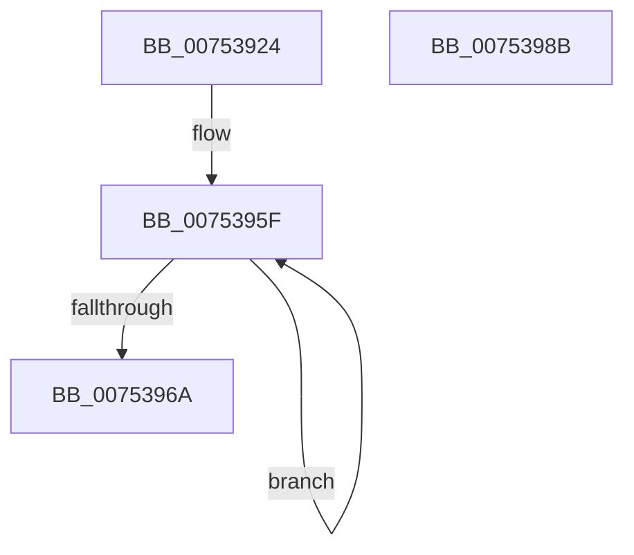

# PopDefaultPolicy

- RVA: `0x00753924`–`0x0075398C` (길이 `104` bytes)
- VA: `0x0000000140753924`
- 실행 섹션: `PAGE`
- PDB 이름 있음: `예`; PDB Function 태그: `아니요`
- unwind 정보 RVA: `0x0005CF00`
- 디코드: `31`개 명령, `104/104` bytes 표시
- 미해석 바이트: `0` (있으면 어셈블리에 `.byte`로 보존)

> 이 문서는 커널 이미지의 기계어와 PDB 기호를 분석해 생성했습니다. 4번과 5번은 함수 원형과 자료형을 바이너리 사용 방식에서 추정한 C 해석이며 원본 소스 복구 결과는 아닙니다.

## 1. Dependencies

- 직접 호출 지점: **1**; 고유 호출 대상: **1**
- 직접 호출자로 확인된 함수: **2**
- RIP 상대 이미지 참조: **0**

### Outgoing calls
- `0x00753935` → [memset](../../text/6C/memset_function_006C6C40.md) (function, `0x006C6C40`)

### Direct callers
- [PopResetCurrentPolicies](../90/PopResetCurrentPolicies_function_0090FF64.md) at `0x0090FFFD`
- [PoInitSystem](../../init/C7/PoInitSystem_function_00C72358.md) at `0x00C72951`

### Static image references
- 디코드된 RIP-relative 메모리 참조가 없습니다.

## 2. Other-region calls and transfers

- 다른 실행 섹션으로 향하는 call: **1**
  - `0x00753935` → [memset](../../text/6C/memset_function_006C6C40.md) (`PAGE` → `.text`)
- 별도 외부 분기/꼬리 이동을 확인하지 못했습니다.

## 3. Assembly (complete function range)

```asm
00753924  40 53                           push rbx
00753926  48 83 EC 20                     sub rsp, 0x20
0075392A  33 D2                           xor edx, edx
0075392C  41 B8 E8 00 00 00               mov r8d, 0xe8
00753932  48 8B D9                        mov rbx, rcx
00753935  E8 06 33 F7 FF                  call 0x1406c6c40
0075393A  41 B8 01 00 00 00               mov r8d, 1
00753940  48 8D 43 74                     lea rax, [rbx + 0x74]
00753944  44 89 03                        mov dword ptr [rbx], r8d
00753947  44 89 43 28                     mov dword ptr [rbx + 0x28], r8d
0075394B  44 89 43 5C                     mov dword ptr [rbx + 0x5c], r8d
0075394F  41 8D 50 01                     lea edx, [r8 + 1]
00753953  8D 4A 02                        lea ecx, [rdx + 2]
00753956  89 53 44                        mov dword ptr [rbx + 0x44], edx
00753959  89 4B 48                        mov dword ptr [rbx + 0x48], ecx
0075395C  89 53 4C                        mov dword ptr [rbx + 0x4c], edx
0075395F  89 10                           mov dword ptr [rax], edx
00753961  48 8D 40 18                     lea rax, [rax + 0x18]
00753965  49 2B C8                        sub rcx, r8
00753968  75 F5                           jne 0x14075395f
0075396A  33 C0                           xor eax, eax
0075396C  48 89 43 08                     mov qword ptr [rbx + 8], rax
00753970  C7 43 04 06 00 00 00            mov dword ptr [rbx + 4], 6
00753977  48 89 43 14                     mov qword ptr [rbx + 0x14], rax
0075397B  89 53 10                        mov dword ptr [rbx + 0x10], edx
0075397E  48 89 43 20                     mov qword ptr [rbx + 0x20], rax
00753982  89 43 1C                        mov dword ptr [rbx + 0x1c], eax
00753985  48 83 C4 20                     add rsp, 0x20
00753989  5B                              pop rbx
0075398A  C3                              ret
0075398B  CC                              int3
```

## 4. C-style interpretation (structured pseudocode)

```c
__int64 __fastcall PopDefaultPolicy(__int64 a1, int a2)
{
    __int64 result;
    __int64 v_rsp;

    v_rsp = (v_rsp) - (32);
    a2 = 0;
    result = memset(a1, a2, 232, a4);
    *(unsigned int *)(a1) = 1;
    *(unsigned int *)(a1 + 40) = 1;
    *(unsigned int *)(a1 + 92) = 1;
    *(unsigned int *)(a1 + 68) = (unsigned int)(1 + 1);
    *(unsigned int *)(a1 + 72) = (unsigned int)(1 + 1 + 2);
    *(unsigned int *)(a1 + 76) = (unsigned int)(1 + 1);
loc_0075395F:
    *(unsigned int *)(a1 + 116) = (unsigned int)(1 + 1);
    a1 = (1 + 1 + 2) - (1);
    if (condition_is_not_equal) goto loc_0075395F;
    result = 0;
    *(unsigned __int64 *)(a1 + 8) = 0;
    *(unsigned int *)(a1 + 4) = 6;
    *(unsigned __int64 *)(a1 + 20) = 0;
    *(unsigned int *)(a1 + 16) = (unsigned int)(1 + 1);
    *(unsigned __int64 *)(a1 + 32) = 0;
    *(unsigned int *)(a1 + 28) = 0;
    v_rsp = (v_rsp) + (32);
    return result;
}
```

## 5. (Beta) C Style

```c
int64_t PopDefaultPolicy(void *Arg1, int32_t Arg2)
{
    uint8_t *arg1 = (uint8_t *)Arg1;

    int64_t result;
    int64_t local_rsp;

    local_rsp = (local_rsp) - (32);
    Arg2 = 0;
    result = memset(Arg1, Arg2, 232, a4);
    *(uint32_t *)(arg1) = 1;
    *(uint32_t *)(arg1 + 0x28) = 1;
    *(uint32_t *)(arg1 + 0x5C) = 1;
    *(uint32_t *)(arg1 + 0x44) = (uint32_t)(1 + 1);
    *(uint32_t *)(arg1 + 0x48) = (uint32_t)(1 + 1 + 2);
    *(uint32_t *)(arg1 + 0x4C) = (uint32_t)(1 + 1);
loc_0075395F:
    *(uint32_t *)(arg1 + 0x74) = (uint32_t)(1 + 1);
    Arg1 = (1 + 1 + 2) - (1);
    if (condition_is_not_equal) goto loc_0075395F;
    result = 0;
    *(uint64_t *)(arg1 + 0x8) = 0;
    *(uint32_t *)(arg1 + 0x4) = 6;
    *(uint64_t *)(arg1 + 0x14) = 0;
    *(uint32_t *)(arg1 + 0x10) = (uint32_t)(1 + 1);
    *(uint64_t *)(arg1 + 0x20) = 0;
    *(uint32_t *)(arg1 + 0x1C) = 0;
    local_rsp = (local_rsp) + (32);
    return result;
}
```

### 관측된 메모리 오프셋

구조체 형식이 확인되지 않은 접근은 인자 기준의 오프셋으로만 기록했습니다.

| 기준 인자 | 오프셋 표현 | 폭 (bit) | 접근 |
|---|---:|---:|---|
| `Arg1` | `+ 0x0` | `32` | `W` |
| `Arg1` | `+ 0x4` | `32` | `W` |
| `Arg1` | `+ 0x8` | `64` | `W` |
| `Arg1` | `+ 0x10` | `32` | `W` |
| `Arg1` | `+ 0x14` | `64` | `W` |
| `Arg1` | `+ 0x18` | `64` | `R` |
| `Arg1` | `+ 0x1C` | `32` | `W` |
| `Arg1` | `+ 0x20` | `64` | `W` |
| `Arg1` | `+ 0x28` | `32` | `W` |
| `Arg1` | `+ 0x44` | `32` | `W` |
| `Arg1` | `+ 0x48` | `32` | `W` |
| `Arg1` | `+ 0x4C` | `32` | `W` |
| `Arg1` | `+ 0x5C` | `32` | `W` |
| `Arg1` | `+ 0x74` | `64` | `R` |

## 6. Execution-region graph

[열기: 2D/3D 그래프와 함수 탐색 컨트롤 패널](../../../control-panel.html?section=page&rva=0x00753924&view=graph)

- 2D 그래프는 위에서 아래로 흐르고, 3D 그래프는 빈 공간을 드래그해 회전합니다. Shift+드래그는 이동, 휠은 확대·축소, 함수 노드 선택은 대상 보고서 이동입니다.

### Static fallback


