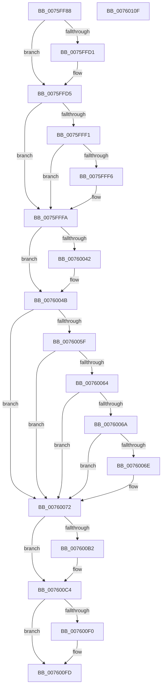

# PopDeferDoze

- RVA: `0x0075FF88`–`0x00760110` (길이 `392` bytes)
- VA: `0x000000014075FF88`
- 실행 섹션: `PAGE`
- PDB 이름 있음: `예`; PDB Function 태그: `아니요`
- unwind 정보 RVA: `0x000CC688`
- 디코드: `117`개 명령, `392/392` bytes 표시
- 미해석 바이트: `0` (있으면 어셈블리에 `.byte`로 보존)

> 이 문서는 커널 이미지의 기계어와 PDB 기호를 분석해 생성했습니다. 4번과 5번은 함수 원형과 자료형을 바이너리 사용 방식에서 추정한 C 해석이며 원본 소스 복구 결과는 아닙니다.

## 1. Dependencies

- 직접 호출 지점: **6**; 고유 호출 대상: **6**
- 직접 호출자로 확인된 함수: **1**
- RIP 상대 이미지 참조: **8**

### Outgoing calls
- `0x00760001` → [PopIsDozeSupported](../AA/PopIsDozeSupported_function_00AA3DC0.md) (function, `0x00AA3DC0`)
- `0x00760036` → [PopQueryPowerSettingUlong](../AC/PopQueryPowerSettingUlong_function_00ACCCC8.md) (function, `0x00ACCCC8`)
- `0x00760096` → [PopIsWakeTimerImmanent](../76/PopIsWakeTimerImmanent_function_00760118.md) (function, `0x00760118`)
- `0x007600BF` → [PopPrintEx](../../text/48/PopPrintEx_function_0048EF24.md) (function, `0x0048EF24`)
- `0x007600E6` → [PopDiagTraceDozeDeferralDecision](../76/PopDiagTraceDozeDeferralDecision_function_007612F0.md) (function, `0x007612F0`)
- `0x007600F8` → [ExFreePoolWithTag](../../poolcode/B8/ExFreePoolWithTag_function_00B82870.md) (function, `0x00B82870`)

### Direct callers
- [PopTransitionSystemPowerStateEx](../../pagelk/B7/PopTransitionSystemPowerStateEx_function_00B7E8C0.md) at `0x00B7FA03`

### Static image references
- `0x0075FFB5` → RVA `0x00FC50FC` (`ALMOSTRO`; read)
- `0x0075FFC8` → RVA `0x00F0BE10` (`.data`; read)
- `0x0075FFDB` → RVA `0x00F0BD4C` (`.data`; read)
- `0x0075FFFA` → RVA `0x00F0CEC0` (`.data`; read)
- `0x00760010` → RVA `0x00024918` (`.rdata`; read)
- `0x00760019` → RVA `0x00F0CE68` (`.data`; read)
- `0x0076009B` → RVA `0x00FC5338` (`ALMOSTRO`; read)
- `0x007600B2` → RVA `0x00B02040` (` ?? ::NNGAKEGL::`string'`; read)

## 2. Other-region calls and transfers

- 다른 실행 섹션으로 향하는 call: **2**
  - `0x007600BF` → [PopPrintEx](../../text/48/PopPrintEx_function_0048EF24.md) (`PAGE` → `.text`)
  - `0x007600F8` → [ExFreePoolWithTag](../../poolcode/B8/ExFreePoolWithTag_function_00B82870.md) (`PAGE` → `POOLCODE`)
- 별도 외부 분기/꼬리 이동을 확인하지 못했습니다.

## 3. Assembly (complete function range)

```asm
0075FF88  40 55                           push rbp
0075FF8A  53                              push rbx
0075FF8B  56                              push rsi
0075FF8C  57                              push rdi
0075FF8D  41 54                           push r12
0075FF8F  41 56                           push r14
0075FF91  41 57                           push r15
0075FF93  48 8B EC                        mov rbp, rsp
0075FF96  48 83 EC 50                     sub rsp, 0x50
0075FF9A  48 83 65 F0 00                  and qword ptr [rbp - 0x10], 0
0075FF9F  33 DB                           xor ebx, ebx
0075FFA1  21 5D 40                        and dword ptr [rbp + 0x40], ebx
0075FFA4  45 33 C9                        xor r9d, r9d
0075FFA7  21 5D 50                        and dword ptr [rbp + 0x50], ebx
0075FFAA  40 32 FF                        xor dil, dil
0075FFAD  48 83 65 58 00                  and qword ptr [rbp + 0x58], 0
0075FFB2  49 8B F0                        mov rsi, r8
0075FFB5  39 1D 41 51 86 00               cmp dword ptr [rip + 0x865141], ebx
0075FFBB  8D 43 01                        lea eax, [rbx + 1]
0075FFBE  44 8B F2                        mov r14d, edx
0075FFC1  44 8B F9                        mov r15d, ecx
0075FFC4  44 0F 44 C8                     cmove r9d, eax
0075FFC8  48 39 1D 41 BE 7A 00            cmp qword ptr [rip + 0x7abe41], rbx
0075FFCF  75 04                           jne 0x14075ffd5
0075FFD1  41 83 C9 02                     or r9d, 2
0075FFD5  41 8B C9                        mov ecx, r9d
0075FFD8  83 C9 04                        or ecx, 4
0075FFDB  F7 05 67 BD 7A 00 00 00 00 40   test dword ptr [rip + 0x7abd67], 0x40000000
0075FFE5  41 0F 44 C9                     cmove ecx, r9d
0075FFE9  44 8B C9                        mov r9d, ecx
0075FFEC  45 85 FF                        test r15d, r15d
0075FFEF  75 09                           jne 0x14075fffa
0075FFF1  45 85 F6                        test r14d, r14d
0075FFF4  75 04                           jne 0x14075fffa
0075FFF6  41 83 C9 08                     or r9d, 8
0075FFFA  48 8D 0D BF CE 7A 00            lea rcx, [rip + 0x7acebf]
00760001  E8 BA 3D 34 00                  call 0x140aa3dc0
00760006  41 8B D1                        mov edx, r9d
00760009  4C 8D 45 50                     lea r8, [rbp + 0x50]
0076000D  83 CA 10                        or edx, 0x10
00760010  48 8D 0D 01 49 8C FF            lea rcx, [rip - 0x73b6ff]
00760017  84 C0                           test al, al
00760019  48 8B 05 48 CE 7A 00            mov rax, qword ptr [rip + 0x7ace48]
00760020  41 0F 45 D1                     cmovne edx, r9d
00760024  44 8B E2                        mov r12d, edx
00760027  41 83 CC 20                     or r12d, 0x20
0076002B  39 58 58                        cmp dword ptr [rax + 0x58], ebx
0076002E  44 0F 45 E2                     cmovne r12d, edx
00760032  48 8D 55 40                     lea rdx, [rbp + 0x40]
00760036  E8 8D CC 36 00                  call 0x140acccc8
0076003B  8B 4D 50                        mov ecx, dword ptr [rbp + 0x50]
0076003E  84 C0                           test al, al
00760040  74 09                           je 0x14076004b
00760042  40 38 3E                        cmp byte ptr [rsi], dil
00760045  8B 5D 40                        mov ebx, dword ptr [rbp + 0x40]
00760048  0F 44 D9                        cmove ebx, ecx
0076004B  41 8B C4                        mov eax, r12d
0076004E  83 C8 40                        or eax, 0x40
00760051  85 DB                           test ebx, ebx
00760053  41 0F 45 C4                     cmovne eax, r12d
00760057  8B D8                           mov ebx, eax
00760059  40 38 7E 03                     cmp byte ptr [rsi + 3], dil
0076005D  74 13                           je 0x140760072
0076005F  40 38 3E                        cmp byte ptr [rsi], dil
00760062  74 0E                           je 0x140760072
00760064  83 7D 40 01                     cmp dword ptr [rbp + 0x40], 1
00760068  75 08                           jne 0x140760072
0076006A  85 C9                           test ecx, ecx
0076006C  75 04                           jne 0x140760072
0076006E  0F BA EB 08                     bts ebx, 8
00760072  48 8D 45 F0                     lea rax, [rbp - 0x10]
00760076  49 BC 08 00 00 00 80 F7 FF FF   movabs r12, 0xfffff78000000008
00760080  4C 8D 4D 58                     lea r9, [rbp + 0x58]
00760084  48 89 44 24 20                  mov qword ptr [rsp + 0x20], rax
00760089  45 8B C6                        mov r8d, r14d
0076008C  41 8B D7                        mov edx, r15d
0076008F  4D 8B 24 24                     mov r12, qword ptr [r12]
00760093  49 8B CC                        mov rcx, r12
00760096  E8 7D 00 00 00                  call 0x140760118
0076009B  8B 35 97 52 86 00               mov esi, dword ptr [rip + 0x865297]
007600A1  8B CB                           mov ecx, ebx
007600A3  0F BA E9 07                     bts ecx, 7
007600A7  F7 D6                           not esi
007600A9  84 C0                           test al, al
007600AB  0F 45 CB                        cmovne ecx, ebx
007600AE  23 F1                           and esi, ecx
007600B0  75 12                           jne 0x1407600c4
007600B2  48 8D 15 87 1F 3A 00            lea rdx, [rip + 0x3a1f87]
007600B9  40 B7 01                        mov dil, 1
007600BC  8D 4E 03                        lea ecx, [rsi + 3]
007600BF  E8 60 EE D2 FF                  call 0x14048ef24
007600C4  48 8B 45 58                     mov rax, qword ptr [rbp + 0x58]
007600C8  4D 8B CC                        mov r9, r12
007600CB  48 8B 5D F0                     mov rbx, qword ptr [rbp - 0x10]
007600CF  8B D6                           mov edx, esi
007600D1  44 89 74 24 30                  mov dword ptr [rsp + 0x30], r14d
007600D6  4C 8B C3                        mov r8, rbx
007600D9  44 89 7C 24 28                  mov dword ptr [rsp + 0x28], r15d
007600DE  40 8A CF                        mov cl, dil
007600E1  48 89 44 24 20                  mov qword ptr [rsp + 0x20], rax
007600E6  E8 05 12 00 00                  call 0x1407612f0
007600EB  48 85 DB                        test rbx, rbx
007600EE  74 0D                           je 0x1407600fd
007600F0  BA 54 72 57 53                  mov edx, 0x53577254
007600F5  48 8B CB                        mov rcx, rbx
007600F8  E8 73 27 42 00                  call 0x140b82870
007600FD  40 8A C7                        mov al, dil
00760100  48 83 C4 50                     add rsp, 0x50
00760104  41 5F                           pop r15
00760106  41 5E                           pop r14
00760108  41 5C                           pop r12
0076010A  5F                              pop rdi
0076010B  5E                              pop rsi
0076010C  5B                              pop rbx
0076010D  5D                              pop rbp
0076010E  C3                              ret
0076010F  CC                              int3
```

## 4. C-style interpretation (structured pseudocode)

```c
__int64 __fastcall PopDeferDoze(int a1, int a2, __int64 a3, int a4)
{
    __int64 result;
    __int64 v_r12;
    __int64 v_rbx;
    __int64 v_rdi;
    __int64 v_rsi;
    __int64 v_rsp;
    unsigned __int64 v_stack_m48;
    unsigned int v_stack_m58;
    unsigned int v_stack_m60;
    unsigned __int64 v_stack_m68;
    unsigned int v_stack_p18;
    unsigned __int64 v_stack_p20;
    unsigned int v_stack_p8;

    v_rsp = (v_rsp) - (80);
    v_rbx = 0;
    a4 = 0;
    v_rdi = 0;
    if ((*(unsigned int *)(v_rip + 8802625)) == 0) { a4 = (unsigned int)(v_rbx + 1); }
    if ((*(unsigned __int64 *)(v_rip + 8044097)) == 0) {
        a4 = (unsigned int)((a4) | (2));
    }
    a1 = (unsigned int)(((unsigned int)(a4)) | (4));
    if (((*(unsigned int *)(v_rip + 8043879)) & (0x40000000ULL)) == 0) { a1 = a4; }
    if ((unsigned int)((unsigned int)(a1)) != 0) goto loc_0075FFFA;
    if ((unsigned int)((unsigned int)(a2)) == 0) {
        a4 = (unsigned int)(((unsigned int)(a1)) | (8));
    }
    result = PopIsDozeSupported(v_rip + 8048319, a2, a3, a4);
    a2 = (unsigned int)(((unsigned int)(a4)) | (16));
    if ((unsigned __int8)(result) != 0) { a2 = a4; }
    v_r12 = (unsigned int)(((unsigned int)(a2)) | (32));
    if ((*(unsigned int *)(*(unsigned __int64 *)(v_rip + 8048200) + 88)) != 0) { v_r12 = a2; }
    result = PopQueryPowerSettingUlong(v_rip - 7583487, v_stack_p8, v_stack_p18, a4);
    if ((unsigned __int8)(result) != 0) {
        v_rbx = v_stack_p8;
        if ((*(unsigned __int8 *)(a3)) == 0) { v_rbx = (unsigned int)((unsigned int)(v_stack_p18)); }
    }
    result = (unsigned int)(((unsigned int)((unsigned int)(v_r12))) | (64));
    if ((unsigned int)(v_rbx) != 0) { result = (unsigned int)(v_r12); }
    if ((*(unsigned __int8 *)(a3 + 3)) == 0) goto loc_00760072;
    if ((*(unsigned __int8 *)(a3)) == 0) goto loc_00760072;
    if (v_stack_p8 != 1) goto loc_00760072;
    if ((unsigned int)((unsigned int)(v_stack_p18)) == 0) {
    }
    v_stack_m68 = v_stack_m48;
    result = PopIsWakeTimerImmanent(*(unsigned __int64 *)(v_r12), (unsigned int)((unsigned int)((unsigned int)(a1))), (unsigned int)((unsigned int)((unsigned int)(a2))), v_stack_p20);
    v_rsi = (unsigned int)(~((unsigned int)(*(unsigned int *)(v_rip + 8802967))));
    a1 = (unsigned int)((unsigned int)((unsigned int)((unsigned int)(result))));
    if ((unsigned __int8)(result) != 0) { a1 = (unsigned int)((unsigned int)((unsigned int)(result))); }
    v_rsi = (unsigned int)((v_rsi) & (a1));
    if (!(condition_is_not_equal)) {
        a2 = v_rip + 3809159;
        v_rdi = 1;
        a1 = v_rsi + 3;
        result = PopPrintEx(a1, a2, (unsigned int)((unsigned int)((unsigned int)(a2))), v_stack_p20);
    }
    v_stack_m58 = (unsigned int)((unsigned int)(a2));
    v_stack_m60 = (unsigned int)((unsigned int)(a1));
    v_stack_m68 = v_stack_p20;
    result = PopDiagTraceDozeDeferralDecision((unsigned __int8)(v_rdi), (unsigned int)((unsigned int)(v_rsi)), v_stack_m48, *(unsigned __int64 *)(v_r12));
    if (v_stack_m48 != 0) {
        a2 = 0x53577254ULL;
        a1 = v_stack_m48;
        result = ExFreePoolWithTag(a1, a2, v_stack_m48, *(unsigned __int64 *)(v_r12));
    }
    v_rsp = (v_rsp) + (80);
    return (unsigned __int8)(v_rdi);
}
```

## 5. (Beta) C Style

```c
int64_t PopDeferDoze(int32_t Arg1, int32_t Arg2, void *Arg3, int32_t Arg4)
{
    uint8_t *arg3 = (uint8_t *)Arg3;

    int64_t result;
    int64_t local_r12;
    int64_t local_rbx;
    int64_t local_rdi;
    int64_t local_rsi;
    int64_t local_rsp;
    uint64_t v_stack_m48;
    uint32_t v_stack_m58;
    uint32_t v_stack_m60;
    uint64_t v_stack_m68;
    uint32_t v_stack_p18;
    uint64_t v_stack_p20;
    uint32_t v_stack_p8;

    local_rsp = (local_rsp) - (80);
    local_rbx = 0;
    Arg4 = 0;
    local_rdi = 0;
    if ((*(uint32_t *)(v_rip + 0x865141)) == 0) { Arg4 = (uint32_t)(local_rbx + 1); }
    if ((*(uint64_t *)(v_rip + 0x7ABE41)) == 0) {
        Arg4 = (uint32_t)((Arg4) | (2));
    }
    Arg1 = (uint32_t)(((uint32_t)(Arg4)) | (4));
    if (((*(uint32_t *)(v_rip + 0x7ABD67)) & (0x40000000ULL)) == 0) { Arg1 = Arg4; }
    if ((uint32_t)((uint32_t)(Arg1)) != 0) goto loc_0075FFFA;
    if ((uint32_t)((uint32_t)(Arg2)) == 0) {
        Arg4 = (uint32_t)(((uint32_t)(Arg1)) | (8));
    }
    result = PopIsDozeSupported(v_rip + 8048319, Arg2, Arg3, Arg4);
    Arg2 = (uint32_t)(((uint32_t)(Arg4)) | (16));
    if ((uint8_t)(result) != 0) { Arg2 = Arg4; }
    local_r12 = (uint32_t)(((uint32_t)(Arg2)) | (32));
    if ((*(uint32_t *)(*(uint64_t *)(v_rip + 0x7ACE48) + 0x58)) != 0) { local_r12 = Arg2; }
    result = PopQueryPowerSettingUlong(v_rip - 7583487, v_stack_p8, v_stack_p18, Arg4);
    if ((uint8_t)(result) != 0) {
        local_rbx = v_stack_p8;
        if ((*(uint8_t *)(arg3)) == 0) { local_rbx = (uint32_t)((uint32_t)(v_stack_p18)); }
    }
    result = (uint32_t)(((uint32_t)((uint32_t)(local_r12))) | (64));
    if ((uint32_t)(local_rbx) != 0) { result = (uint32_t)(local_r12); }
    if ((*(uint8_t *)(arg3 + 0x3)) == 0) goto loc_00760072;
    if ((*(uint8_t *)(arg3)) == 0) goto loc_00760072;
    if (v_stack_p8 != 1) goto loc_00760072;
    if ((uint32_t)((uint32_t)(v_stack_p18)) == 0) {
    }
    v_stack_m68 = v_stack_m48;
    result = PopIsWakeTimerImmanent(*(uint64_t *)(local_r12), (uint32_t)((uint32_t)((uint32_t)(Arg1))), (uint32_t)((uint32_t)((uint32_t)(Arg2))), v_stack_p20);
    local_rsi = (uint32_t)(~((uint32_t)(*(uint32_t *)(v_rip + 0x865297))));
    Arg1 = (uint32_t)((uint32_t)((uint32_t)((uint32_t)(result))));
    if ((uint8_t)(result) != 0) { Arg1 = (uint32_t)((uint32_t)((uint32_t)(result))); }
    local_rsi = (uint32_t)((local_rsi) & (Arg1));
    if (!(condition_is_not_equal)) {
        Arg2 = v_rip + 3809159;
        local_rdi = 1;
        Arg1 = local_rsi + 3;
        result = PopPrintEx(Arg1, Arg2, (uint32_t)((uint32_t)((uint32_t)(Arg2))), v_stack_p20);
    }
    v_stack_m58 = (uint32_t)((uint32_t)(Arg2));
    v_stack_m60 = (uint32_t)((uint32_t)(Arg1));
    v_stack_m68 = v_stack_p20;
    result = PopDiagTraceDozeDeferralDecision((uint8_t)(local_rdi), (uint32_t)((uint32_t)(local_rsi)), v_stack_m48, *(uint64_t *)(local_r12));
    if (v_stack_m48 != 0) {
        Arg2 = 0x53577254ULL;
        Arg1 = v_stack_m48;
        result = ExFreePoolWithTag(Arg1, Arg2, v_stack_m48, *(uint64_t *)(local_r12));
    }
    local_rsp = (local_rsp) + (80);
    return (uint8_t)(local_rdi);
}
```

### 관측된 메모리 오프셋

구조체 형식이 확인되지 않은 접근은 인자 기준의 오프셋으로만 기록했습니다.

| 기준 인자 | 오프셋 표현 | 폭 (bit) | 접근 |
|---|---:|---:|---|
| `Arg3` | `+ 0x0` | `8` | `R` |
| `Arg3` | `+ 0x3` | `8` | `R` |

## 6. Execution-region graph

[열기: 2D/3D 그래프와 함수 탐색 컨트롤 패널](../../../control-panel.html?section=page&rva=0x0075FF88&view=graph)

- 2D 그래프는 위에서 아래로 흐르고, 3D 그래프는 빈 공간을 드래그해 회전합니다. Shift+드래그는 이동, 휠은 확대·축소, 함수 노드 선택은 대상 보고서 이동입니다.

### Static fallback


