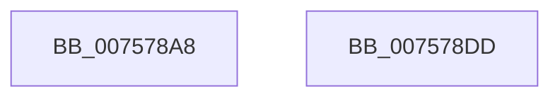

# PopDirectedDripsInitializeDisengageTimer

- RVA: `0x007578A8`–`0x007578DE` (길이 `54` bytes)
- VA: `0x00000001407578A8`
- 실행 섹션: `PAGE`
- PDB 이름 있음: `예`; PDB Function 태그: `아니요`
- unwind 정보 RVA: `0x0005C788`
- 디코드: `15`개 명령, `54/54` bytes 표시
- 미해석 바이트: `0` (있으면 어셈블리에 `.byte`로 보존)

> 이 문서는 커널 이미지의 기계어와 PDB 기호를 분석해 생성했습니다. 4번과 5번은 함수 원형과 자료형을 바이너리 사용 방식에서 추정한 C 해석이며 원본 소스 복구 결과는 아닙니다.

## 1. Dependencies

- 직접 호출 지점: **1**; 고유 호출 대상: **1**
- 직접 호출자로 확인된 함수: **1**
- RIP 상대 이미지 참조: **1**

### Outgoing calls
- `0x007578D3` → [KeInitializeTimer2](../../text/3A/KeInitializeTimer2_function_003A30B0.md) (function, `0x003A30B0`)

### Direct callers
- [PopDirectedDripsInitializePhase0](../../init/C3/PopDirectedDripsInitializePhase0_function_00C3E4BC.md) at `0x00C3E550`
- [PopDirectedDripsInitializePhase0](../../init/C3/PopDirectedDripsInitializePhase0_function_00C3E4BC.md) at `0x00C3E568`

### Static image references
- `0x007578B5` → RVA `0x005D11E0` (`PopDirectedDripsDisengageTimerCallback`; read)

## 2. Other-region calls and transfers

- 다른 실행 섹션으로 향하는 call: **1**
  - `0x007578D3` → [KeInitializeTimer2](../../text/3A/KeInitializeTimer2_function_003A30B0.md) (`PAGE` → `.text`)
- 별도 외부 분기/꼬리 이동을 확인하지 못했습니다.

## 3. Assembly (complete function range)

```asm
007578A8  48 83 EC 28                     sub rsp, 0x28
007578AC  48 8B C1                        mov rax, rcx
007578AF  89 11                           mov dword ptr [rcx], edx
007578B1  44 89 41 04                     mov dword ptr [rcx + 4], r8d
007578B5  48 8D 15 24 99 E7 FF            lea rdx, [rip - 0x1866dc]
007578BC  33 C9                           xor ecx, ecx
007578BE  41 B9 08 00 00 00               mov r9d, 8
007578C4  4C 8B C0                        mov r8, rax
007578C7  48 89 48 08                     mov qword ptr [rax + 8], rcx
007578CB  48 89 48 10                     mov qword ptr [rax + 0x10], rcx
007578CF  48 8D 48 18                     lea rcx, [rax + 0x18]
007578D3  E8 D8 B7 C4 FF                  call 0x1403a30b0
007578D8  48 83 C4 28                     add rsp, 0x28
007578DC  C3                              ret
007578DD  CC                              int3
```

## 4. C-style interpretation (structured pseudocode)

```c
__int64 __fastcall PopDirectedDripsInitializeDisengageTimer(__int64 a1, int a2, int a3)
{
    __int64 result;
    __int64 v_rsp;

    v_rsp = (v_rsp) - (40);
    *(unsigned int *)(a1) = a2;
    *(unsigned int *)(a1 + 4) = a3;
    a1 = 0;
    *(unsigned __int64 *)(a1 + 8) = 0;
    *(unsigned __int64 *)(a1 + 16) = 0;
    result = KeInitializeTimer2(a1 + 24, v_rip - 1599196, 0, 8);
    v_rsp = (v_rsp) + (40);
    return result;
}
```

## 5. (Beta) C Style

```c
int64_t PopDirectedDripsInitializeDisengageTimer(void *Arg1, int32_t Arg2, int32_t Arg3)
{
    uint8_t *arg1 = (uint8_t *)Arg1;

    int64_t result;
    int64_t local_rsp;

    local_rsp = (local_rsp) - (40);
    *(uint32_t *)(arg1) = Arg2;
    *(uint32_t *)(arg1 + 0x4) = Arg3;
    Arg1 = 0;
    *(uint64_t *)(arg1 + 0x8) = 0;
    *(uint64_t *)(arg1 + 0x10) = 0;
    result = KeInitializeTimer2(Arg1 + 24, v_rip - 1599196, 0, 8);
    local_rsp = (local_rsp) + (40);
    return result;
}
```

### 관측된 메모리 오프셋

구조체 형식이 확인되지 않은 접근은 인자 기준의 오프셋으로만 기록했습니다.

| 기준 인자 | 오프셋 표현 | 폭 (bit) | 접근 |
|---|---:|---:|---|
| `Arg1` | `+ 0x0` | `32` | `W` |
| `Arg1` | `+ 0x4` | `32` | `W` |
| `Arg1` | `+ 0x8` | `64` | `W` |
| `Arg1` | `+ 0x10` | `64` | `W` |
| `Arg1` | `+ 0x18` | `64` | `R` |

## 6. Execution-region graph

[열기: 2D/3D 그래프와 함수 탐색 컨트롤 패널](../../../control-panel.html?section=page&rva=0x007578A8&view=graph)

- 2D 그래프는 위에서 아래로 흐르고, 3D 그래프는 빈 공간을 드래그해 회전합니다. Shift+드래그는 이동, 휠은 확대·축소, 함수 노드 선택은 대상 보고서 이동입니다.

### Static fallback


