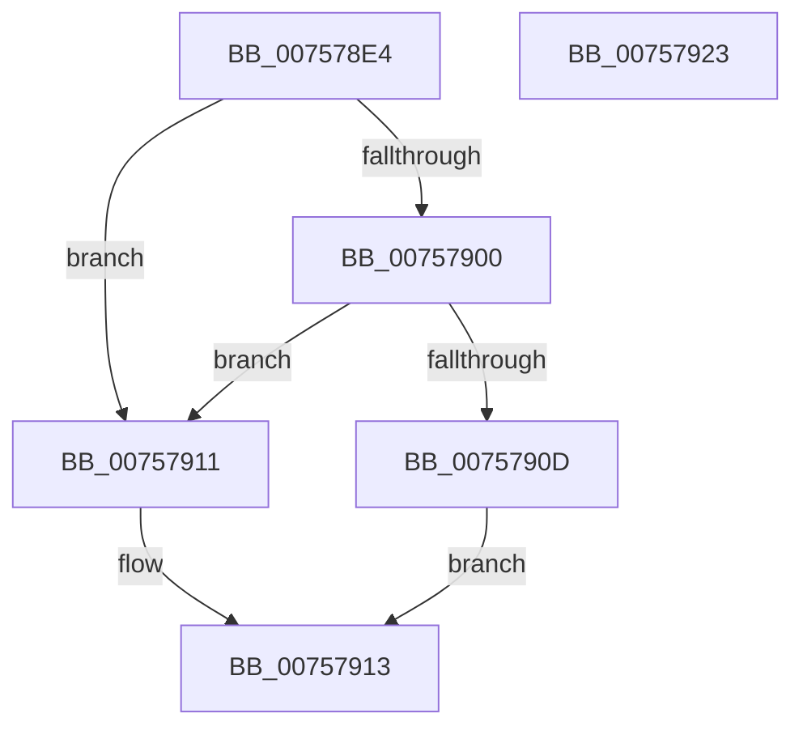

# PopDirectedDripsIsPnpSoftwareDeviceNode

- RVA: `0x007578E4`–`0x00757924` (길이 `64` bytes)
- VA: `0x00000001407578E4`
- 실행 섹션: `PAGE`
- PDB 이름 있음: `예`; PDB Function 태그: `아니요`
- unwind 정보 RVA: `0x0005CF00`
- 디코드: `21`개 명령, `64/64` bytes 표시
- 미해석 바이트: `0` (있으면 어셈블리에 `.byte`로 보존)

> 이 문서는 커널 이미지의 기계어와 PDB 기호를 분석해 생성했습니다. 4번과 5번은 함수 원형과 자료형을 바이너리 사용 방식에서 추정한 C 해석이며 원본 소스 복구 결과는 아닙니다.

## 1. Dependencies

- 직접 호출 지점: **2**; 고유 호출 대상: **2**
- 직접 호출자로 확인된 함수: **2**
- RIP 상대 이미지 참조: **1**

### Outgoing calls
- `0x007578F6` → [IoGetAttachedDeviceReferenceWithTag](../../text/27/IoGetAttachedDeviceReferenceWithTag_function_00273B84.md) (function, `0x00273B84`)
- `0x00757916` → [ObfDereferenceObject](../../text/2F/ObfDereferenceObject_function_002F9350.md) (function, `0x002F9350`)

### Direct callers
- [PopDirectedDripsBuildBroadcastTreeFull](../77/PopDirectedDripsBuildBroadcastTreeFull_function_00771970.md) at `0x00771A3F`
- [PopIssueDirectedPowerTransition](../AD/PopIssueDirectedPowerTransition_function_00AD158C.md) at `0x00AD15AE`

### Static image references
- `0x00757900` → RVA `0x00F8AC08` (`.data`; read)

## 2. Other-region calls and transfers

- 다른 실행 섹션으로 향하는 call: **2**
  - `0x007578F6` → [IoGetAttachedDeviceReferenceWithTag](../../text/27/IoGetAttachedDeviceReferenceWithTag_function_00273B84.md) (`PAGE` → `.text`)
  - `0x00757916` → [ObfDereferenceObject](../../text/2F/ObfDereferenceObject_function_002F9350.md) (`PAGE` → `.text`)
- 별도 외부 분기/꼬리 이동을 확인하지 못했습니다.

## 3. Assembly (complete function range)

```asm
007578E4  40 53                           push rbx
007578E6  48 83 EC 20                     sub rsp, 0x20
007578EA  48 8B 59 20                     mov rbx, qword ptr [rcx + 0x20]
007578EE  BA 50 6F 46 78                  mov edx, 0x78466f50
007578F3  48 8B CB                        mov rcx, rbx
007578F6  E8 89 C2 B1 FF                  call 0x140273b84
007578FB  48 3B D8                        cmp rbx, rax
007578FE  75 11                           jne 0x140757911
00757900  48 8B 0D 01 33 83 00            mov rcx, qword ptr [rip + 0x833301]
00757907  48 39 4B 08                     cmp qword ptr [rbx + 8], rcx
0075790B  75 04                           jne 0x140757911
0075790D  B3 01                           mov bl, 1
0075790F  EB 02                           jmp 0x140757913
00757911  32 DB                           xor bl, bl
00757913  48 8B C8                        mov rcx, rax
00757916  E8 35 1A BA FF                  call 0x1402f9350
0075791B  8A C3                           mov al, bl
0075791D  48 83 C4 20                     add rsp, 0x20
00757921  5B                              pop rbx
00757922  C3                              ret
00757923  CC                              int3
```

## 4. C-style interpretation (structured pseudocode)

```c
__int64 __fastcall PopDirectedDripsIsPnpSoftwareDeviceNode(__int64 a1)
{
    __int64 result;
    __int64 v_rbx;
    __int64 v_rsp;

    v_rsp = (v_rsp) - (32);
    result = IoGetAttachedDeviceReferenceWithTag(*(unsigned __int64 *)(a1 + 32), (unsigned int)(0x78466F50ULL), a3, a4);
    if ((*(unsigned __int64 *)(a1 + 32)) != result) goto loc_00757911;
    if ((*(unsigned __int64 *)(*(unsigned __int64 *)(a1 + 32) + 8)) != (*(unsigned __int64 *)(v_rip + 8598273))) goto loc_00757911;
    goto loc_00757913;
loc_00757911:
    v_rbx = 0;
loc_00757913:
    result = ObfDereferenceObject(result, (unsigned int)(0x78466F50ULL), a3, a4);
    v_rsp = (v_rsp) + (32);
    return 0;
}
```

## 5. (Beta) C Style

```c
int64_t PopDirectedDripsIsPnpSoftwareDeviceNode(void *Arg1)
{
    uint8_t *arg1 = (uint8_t *)Arg1;

    int64_t result;
    int64_t local_rbx;
    int64_t local_rsp;

    local_rsp = (local_rsp) - (32);
    result = IoGetAttachedDeviceReferenceWithTag(*(uint64_t *)(arg1 + 0x20), (uint32_t)(0x78466F50ULL), a3, a4);
    if ((*(uint64_t *)(arg1 + 0x20)) != result) goto loc_00757911;
    if ((*(uint64_t *)(*(uint64_t *)(arg1 + 0x20) + 0x8)) != (*(uint64_t *)(v_rip + 0x833301))) goto loc_00757911;
    goto loc_00757913;
loc_00757911:
    local_rbx = 0;
loc_00757913:
    result = ObfDereferenceObject(result, (uint32_t)(0x78466F50ULL), a3, a4);
    local_rsp = (local_rsp) + (32);
    return 0;
}
```

### 관측된 메모리 오프셋

구조체 형식이 확인되지 않은 접근은 인자 기준의 오프셋으로만 기록했습니다.

| 기준 인자 | 오프셋 표현 | 폭 (bit) | 접근 |
|---|---:|---:|---|
| `Arg1` | `+ 0x20` | `64` | `R` |

## 6. Execution-region graph

[열기: 2D/3D 그래프와 함수 탐색 컨트롤 패널](../../../control-panel.html?section=page&rva=0x007578E4&view=graph)

- 2D 그래프는 위에서 아래로 흐르고, 3D 그래프는 빈 공간을 드래그해 회전합니다. Shift+드래그는 이동, 휠은 확대·축소, 함수 노드 선택은 대상 보고서 이동입니다.

### Static fallback


