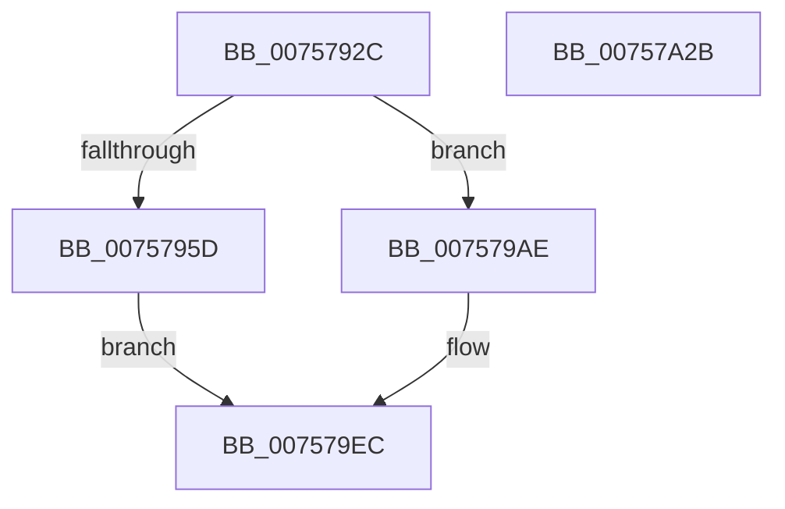

# PopDirectedDripsNotifyAppsAndServices

- RVA: `0x0075792C`–`0x00757A2C` (길이 `256` bytes)
- VA: `0x000000014075792C`
- 실행 섹션: `PAGE`
- PDB 이름 있음: `예`; PDB Function 태그: `아니요`
- unwind 정보 RVA: `0x000BD140`
- 디코드: `65`개 명령, `256/256` bytes 표시
- 미해석 바이트: `0` (있으면 어셈블리에 `.byte`로 보존)

> 이 문서는 커널 이미지의 기계어와 PDB 기호를 분석해 생성했습니다. 4번과 5번은 함수 원형과 자료형을 바이너리 사용 방식에서 추정한 C 해석이며 원본 소스 복구 결과는 아닙니다.

## 1. Dependencies

- 직접 호출 지점: **9**; 고유 호출 대상: **6**
- 직접 호출자로 확인된 함수: **3**
- RIP 상대 이미지 참조: **1**

### Outgoing calls
- `0x00757964` → [MmLockPagableSectionByHandle](../A4/MmLockPagableSectionByHandle_function_00A4D1E0.md) (function, `0x00A4D1E0`)
- `0x00757987` → [PoBlockConsoleSwitch](../AC/PoBlockConsoleSwitch_function_00ACCCA0.md) (function, `0x00ACCCA0`)
- `0x00757993` → [PopDirectedDripsSendSuspendResumeNotification](PopDirectedDripsSendSuspendResumeNotification_function_00757CCC.md) (function, `0x00757CCC`)
- `0x0075799C` → [PopDirectedDripsSendSuspendResumeNotification](PopDirectedDripsSendSuspendResumeNotification_function_00757CCC.md) (function, `0x00757CCC`)
- `0x007579B2` → [PopDirectedDripsSendSuspendResumeNotification](PopDirectedDripsSendSuspendResumeNotification_function_00757CCC.md) (function, `0x00757CCC`)
- `0x007579BB` → [PopDirectedDripsSendSuspendResumeNotification](PopDirectedDripsSendSuspendResumeNotification_function_00757CCC.md) (function, `0x00757CCC`)
- `0x007579D7` → [PopDispatchStateCallout](../91/PopDispatchStateCallout_function_0091248C.md) (function, `0x0091248C`)
- `0x007579E3` → [MmUnlockPagableImageSection](../../text/2A/MmUnlockPagableImageSection_function_002A39F0.md) (function, `0x002A39F0`)
- `0x00757A13` → [PopDiagTraceDirectedDripsNotifyAppsAndServices](../76/PopDiagTraceDirectedDripsNotifyAppsAndServices_function_007611EC.md) (function, `0x007611EC`)

### Direct callers
- [PopDirectedDripsEngage](../../text/49/PopDirectedDripsEngage_function_00498888.md) at `0x004988DB`
- [PopPowerAggregatorDisengageDirectedDrips](../6F/PopPowerAggregatorDisengageDirectedDrips_function_006FF6C0.md) at `0x006FF711`
- [sub_00B4309E](../B4/Unknown_function_00B4309E.md) at `0x00B4321E`

### Static image references
- `0x0075795D` → RVA `0x00FC6C00` (`ALMOSTRO`; read)

## 2. Other-region calls and transfers

- 다른 실행 섹션으로 향하는 call: **1**
  - `0x007579E3` → [MmUnlockPagableImageSection](../../text/2A/MmUnlockPagableImageSection_function_002A39F0.md) (`PAGE` → `.text`)
- 별도 외부 분기/꼬리 이동을 확인하지 못했습니다.

## 3. Assembly (complete function range)

```asm
0075792C  48 89 5C 24 08                  mov qword ptr [rsp + 8], rbx
00757931  48 89 6C 24 10                  mov qword ptr [rsp + 0x10], rbp
00757936  56                              push rsi
00757937  57                              push rdi
00757938  41 56                           push r14
0075793A  48 83 EC 20                     sub rsp, 0x20
0075793E  41 8A F0                        mov sil, r8b
00757941  48 8B FA                        mov rdi, rdx
00757944  48 8B D9                        mov rbx, rcx
00757947  F0 83 09 00                     lock or dword ptr [rcx], 0
0075794B  49 BE 08 00 00 00 80 F7 FF FF   movabs r14, 0xfffff78000000008
00757955  4D 8B 36                        mov r14, qword ptr [r14]
00757958  45 84 C0                        test r8b, r8b
0075795B  74 51                           je 0x1407579ae
0075795D  48 8B 0D 9C F2 86 00            mov rcx, qword ptr [rip + 0x86f29c]
00757964  E8 77 58 2F 00                  call 0x140a4d1e0
00757969  8B 07                           mov eax, dword ptr [rdi]
0075796B  48 8D 4F 28                     lea rcx, [rdi + 0x28]
0075796F  89 47 44                        mov dword ptr [rdi + 0x44], eax
00757972  C7 47 3C 02 00 00 00            mov dword ptr [rdi + 0x3c], 2
00757979  C7 47 40 05 00 00 00            mov dword ptr [rdi + 0x40], 5
00757980  C7 47 4C 15 00 00 00            mov dword ptr [rdi + 0x4c], 0x15
00757987  E8 14 53 37 00                  call 0x140accca0
0075798C  B2 01                           mov dl, 1
0075798E  89 47 20                        mov dword ptr [rdi + 0x20], eax
00757991  8A CA                           mov cl, dl
00757993  E8 34 03 00 00                  call 0x140757ccc
00757998  B2 01                           mov dl, 1
0075799A  33 C9                           xor ecx, ecx
0075799C  E8 2B 03 00 00                  call 0x140757ccc
007579A1  F0 83 0B 08                     lock or dword ptr [rbx], 8
007579A5  83 A3 88 00 00 00 00            and dword ptr [rbx + 0x88], 0
007579AC  EB 3E                           jmp 0x1407579ec
007579AE  33 D2                           xor edx, edx
007579B0  33 C9                           xor ecx, ecx
007579B2  E8 15 03 00 00                  call 0x140757ccc
007579B7  33 D2                           xor edx, edx
007579B9  B1 01                           mov cl, 1
007579BB  E8 0C 03 00 00                  call 0x140757ccc
007579C0  8B 47 20                        mov eax, dword ptr [rdi + 0x20]
007579C3  48 8D 54 24 50                  lea rdx, [rsp + 0x50]
007579C8  48 8D 4F 28                     lea rcx, [rdi + 0x28]
007579CC  89 44 24 50                     mov dword ptr [rsp + 0x50], eax
007579D0  C7 47 48 07 00 00 00            mov dword ptr [rdi + 0x48], 7
007579D7  E8 B0 AA 1B 00                  call 0x14091248c
007579DC  48 8B 0D 1D F2 86 00            mov rcx, qword ptr [rip + 0x86f21d]
007579E3  E8 08 C0 B4 FF                  call 0x1402a39f0
007579E8  F0 83 23 F7                     lock and dword ptr [rbx], 0xfffffff7
007579EC  48 A1 08 00 00 00 80 F7 FF FF   movabs rax, qword ptr [0xfffff78000000008]
007579F6  48 8B C8                        mov rcx, rax
007579F9  48 B8 4B 59 86 38 D6 C5 6D 34   movabs rax, 0x346dc5d63886594b
00757A03  49 2B CE                        sub rcx, r14
00757A06  48 F7 E1                        mul rcx
00757A09  40 8A CE                        mov cl, sil
00757A0C  48 C1 EA 0B                     shr rdx, 0xb
00757A10  4C 8B C2                        mov r8, rdx
00757A13  E8 D4 97 00 00                  call 0x1407611ec
00757A18  48 8B 5C 24 40                  mov rbx, qword ptr [rsp + 0x40]
00757A1D  48 8B 6C 24 48                  mov rbp, qword ptr [rsp + 0x48]
00757A22  48 83 C4 20                     add rsp, 0x20
00757A26  41 5E                           pop r14
00757A28  5F                              pop rdi
00757A29  5E                              pop rsi
00757A2A  C3                              ret
00757A2B  CC                              int3
```

## 4. C-style interpretation (structured pseudocode)

```c
__int64 __fastcall PopDirectedDripsNotifyAppsAndServices(__int64 a1, __int64 a2, unsigned __int8 a3)
{
    __int64 result;
    __int64 v_rsp;
    unsigned __int64 v_stack_p10;
    unsigned __int64 v_stack_p18;
    unsigned __int64 v_stack_p8;

    v_stack_p8 = v_rbx;
    v_stack_p10 = v_rbp;
    v_rsp = (v_rsp) - (32);
    if (a3 == 0) goto loc_007579AE;
    result = MmLockPagableSectionByHandle(*(unsigned __int64 *)(v_rip + 8843932), a2, a3, a4);
    *(unsigned int *)(a2 + 68) = (unsigned int)((unsigned int)(*(unsigned int *)(a2)));
    *(unsigned int *)(a2 + 60) = 2;
    *(unsigned int *)(a2 + 64) = 5;
    *(unsigned int *)(a2 + 76) = 21;
    result = PoBlockConsoleSwitch(a2 + 40, a2, a3, a4);
    *(unsigned int *)(a2 + 32) = (unsigned int)(result);
    result = PopDirectedDripsSendSuspendResumeNotification(1, 1, a3, a4);
    a1 = 0;
    result = PopDirectedDripsSendSuspendResumeNotification(a1, 1, a3, a4);
    goto loc_007579EC;
loc_007579AE:
    a2 = 0;
    a1 = 0;
    result = PopDirectedDripsSendSuspendResumeNotification(a1, a2, a3, a4);
    a2 = 0;
    result = PopDirectedDripsSendSuspendResumeNotification(1, a2, a3, a4);
    v_stack_p18 = (unsigned int)((unsigned int)(*(unsigned int *)(a2 + 32)));
    *(unsigned int *)(a2 + 72) = 7;
    result = PopDispatchStateCallout(a2 + 40, v_stack_p18, a3, a4);
    result = MmUnlockPagableImageSection(*(unsigned __int64 *)(v_rip + 8843805), v_stack_p18, a3, a4);
loc_007579EC:
    a1 = (result) - (*(unsigned __int64 *)(v_r14));
    a2 = (v_stack_p18) >> (11);
    result = PopDiagTraceDirectedDripsNotifyAppsAndServices(a3, a2, a2, a4);
    v_rsp = (v_rsp) + (32);
    return result;
}
```

## 5. (Beta) C Style

```c
int64_t PopDirectedDripsNotifyAppsAndServices(void *Arg1, void *Arg2, uint8_t Arg3)
{
    uint8_t *arg1 = (uint8_t *)Arg1;
    uint8_t *arg2 = (uint8_t *)Arg2;

    int64_t result;
    int64_t local_rsp;
    uint64_t v_stack_p10;
    uint64_t v_stack_p18;
    uint64_t v_stack_p8;

    v_stack_p8 = local_rbx;
    v_stack_p10 = local_rbp;
    local_rsp = (local_rsp) - (32);
    if (Arg3 == 0) goto loc_007579AE;
    result = MmLockPagableSectionByHandle(*(uint64_t *)(v_rip + 0x86F29C), Arg2, Arg3, a4);
    *(uint32_t *)(arg2 + 0x44) = (uint32_t)((uint32_t)(*(uint32_t *)(arg2)));
    *(uint32_t *)(arg2 + 0x3C) = 2;
    *(uint32_t *)(arg2 + 0x40) = 5;
    *(uint32_t *)(arg2 + 0x4C) = 21;
    result = PoBlockConsoleSwitch(Arg2 + 40, Arg2, Arg3, a4);
    *(uint32_t *)(arg2 + 0x20) = (uint32_t)(result);
    result = PopDirectedDripsSendSuspendResumeNotification(1, 1, Arg3, a4);
    Arg1 = 0;
    result = PopDirectedDripsSendSuspendResumeNotification(Arg1, 1, Arg3, a4);
    goto loc_007579EC;
loc_007579AE:
    Arg2 = 0;
    Arg1 = 0;
    result = PopDirectedDripsSendSuspendResumeNotification(Arg1, Arg2, Arg3, a4);
    Arg2 = 0;
    result = PopDirectedDripsSendSuspendResumeNotification(1, Arg2, Arg3, a4);
    v_stack_p18 = (uint32_t)((uint32_t)(*(uint32_t *)(arg2 + 0x20)));
    *(uint32_t *)(arg2 + 0x48) = 7;
    result = PopDispatchStateCallout(Arg2 + 40, v_stack_p18, Arg3, a4);
    result = MmUnlockPagableImageSection(*(uint64_t *)(v_rip + 0x86F21D), v_stack_p18, Arg3, a4);
loc_007579EC:
    Arg1 = (result) - (*(uint64_t *)(local_r14));
    Arg2 = (v_stack_p18) >> (11);
    result = PopDiagTraceDirectedDripsNotifyAppsAndServices(Arg3, Arg2, Arg2, a4);
    local_rsp = (local_rsp) + (32);
    return result;
}
```

### 관측된 메모리 오프셋

구조체 형식이 확인되지 않은 접근은 인자 기준의 오프셋으로만 기록했습니다.

| 기준 인자 | 오프셋 표현 | 폭 (bit) | 접근 |
|---|---:|---:|---|
| `Arg1` | `+ 0x0` | `32` | `R/W` |
| `Arg1` | `+ 0x88` | `32` | `R/W` |
| `Arg2` | `+ 0x0` | `32` | `R` |
| `Arg2` | `+ 0x20` | `32` | `R` |
| `Arg2` | `+ 0x20` | `32` | `W` |
| `Arg2` | `+ 0x28` | `64` | `R` |
| `Arg2` | `+ 0x3C` | `32` | `W` |
| `Arg2` | `+ 0x40` | `32` | `W` |
| `Arg2` | `+ 0x44` | `32` | `W` |
| `Arg2` | `+ 0x48` | `32` | `W` |
| `Arg2` | `+ 0x4C` | `32` | `W` |

## 6. Execution-region graph

[열기: 2D/3D 그래프와 함수 탐색 컨트롤 패널](../../../control-panel.html?section=page&rva=0x0075792C&view=graph)

- 2D 그래프는 위에서 아래로 흐르고, 3D 그래프는 빈 공간을 드래그해 회전합니다. Shift+드래그는 이동, 휠은 확대·축소, 함수 노드 선택은 대상 보고서 이동입니다.

### Static fallback


