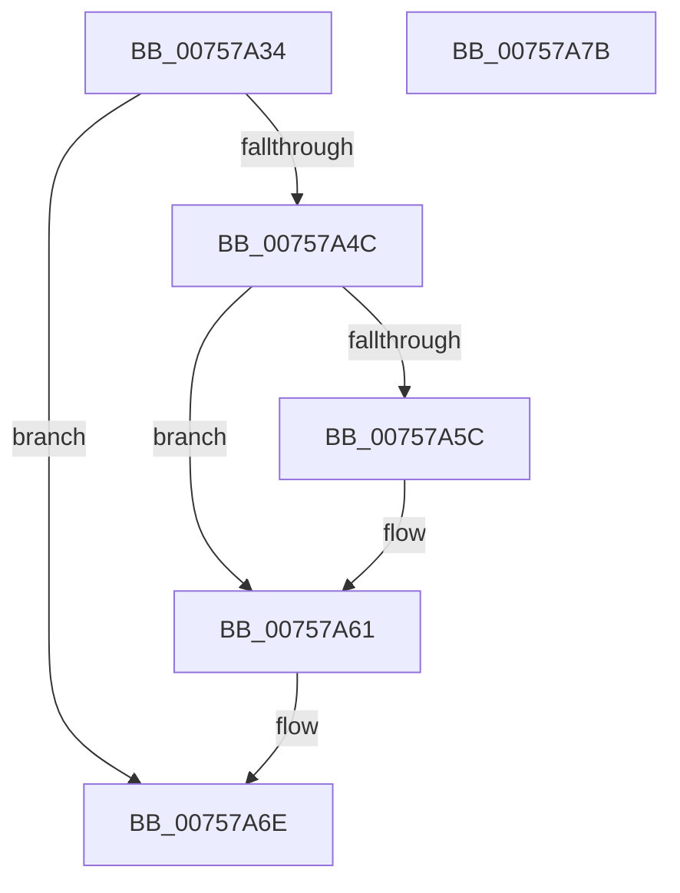

# PopDirectedDripsNotifyTransitionFailed

- RVA: `0x00757A34`–`0x00757A7C` (길이 `72` bytes)
- VA: `0x0000000140757A34`
- 실행 섹션: `PAGE`
- PDB 이름 있음: `예`; PDB Function 태그: `아니요`
- unwind 정보 RVA: `0x0005CF00`
- 디코드: `20`개 명령, `72/72` bytes 표시
- 미해석 바이트: `0` (있으면 어셈블리에 `.byte`로 보존)

> 이 문서는 커널 이미지의 기계어와 PDB 기호를 분석해 생성했습니다. 4번과 5번은 함수 원형과 자료형을 바이너리 사용 방식에서 추정한 C 해석이며 원본 소스 복구 결과는 아닙니다.

## 1. Dependencies

- 직접 호출 지점: **3**; 고유 호출 대상: **3**
- 직접 호출자로 확인된 함수: **1**
- RIP 상대 이미지 참조: **1**

### Outgoing calls
- `0x00757A3F` → [IoGetDeviceAttachmentBaseRefWithTag](../../text/27/IoGetDeviceAttachmentBaseRefWithTag_function_00272788.md) (function, `0x00272788`)
- `0x00757A5C` → [PopDirectedDripsDiagTraceBroadcastFailureDevice](../77/PopDirectedDripsDiagTraceBroadcastFailureDevice_function_0077127C.md) (function, `0x0077127C`)
- `0x00757A69` → [ObfDereferenceObjectWithTag](../../text/2F/ObfDereferenceObjectWithTag_function_002F78E0.md) (function, `0x002F78E0`)

### Direct callers
- [sub_00B80364](../../pagelk/B8/Unknown_function_00B80364.md) at `0x00B8043A`

### Static image references
- `0x00757A6E` → RVA `0x00F0ED0C` (`.data`; write)

## 2. Other-region calls and transfers

- 다른 실행 섹션으로 향하는 call: **2**
  - `0x00757A3F` → [IoGetDeviceAttachmentBaseRefWithTag](../../text/27/IoGetDeviceAttachmentBaseRefWithTag_function_00272788.md) (`PAGE` → `.text`)
  - `0x00757A69` → [ObfDereferenceObjectWithTag](../../text/2F/ObfDereferenceObjectWithTag_function_002F78E0.md) (`PAGE` → `.text`)
- 별도 외부 분기/꼬리 이동을 확인하지 못했습니다.

## 3. Assembly (complete function range)

```asm
00757A34  40 53                           push rbx
00757A36  48 83 EC 20                     sub rsp, 0x20
00757A3A  BA 50 64 69 67                  mov edx, 0x67696450
00757A3F  E8 44 AD B1 FF                  call 0x140272788
00757A44  48 8B D8                        mov rbx, rax
00757A47  48 85 C0                        test rax, rax
00757A4A  74 22                           je 0x140757a6e
00757A4C  48 8B 88 38 01 00 00            mov rcx, qword ptr [rax + 0x138]
00757A53  48 8B 49 28                     mov rcx, qword ptr [rcx + 0x28]
00757A57  48 85 C9                        test rcx, rcx
00757A5A  74 05                           je 0x140757a61
00757A5C  E8 1B 98 01 00                  call 0x14077127c
00757A61  BA 50 64 69 67                  mov edx, 0x67696450
00757A66  48 8B CB                        mov rcx, rbx
00757A69  E8 72 FE B9 FF                  call 0x1402f78e0
00757A6E  C6 05 97 72 7B 00 01            mov byte ptr [rip + 0x7b7297], 1
00757A75  48 83 C4 20                     add rsp, 0x20
00757A79  5B                              pop rbx
00757A7A  C3                              ret
00757A7B  CC                              int3
```

## 4. C-style interpretation (structured pseudocode)

```c
__int64 __fastcall PopDirectedDripsNotifyTransitionFailed(void)
{
    __int64 result;
    __int64 v_rsp;

    v_rsp = (v_rsp) - (32);
    result = IoGetDeviceAttachmentBaseRefWithTag(a1, (unsigned int)(0x67696450ULL), a3, a4);
    if (result == 0) goto loc_00757A6E;
    if (*(unsigned __int64 *)(*(unsigned __int64 *)(result + 312) + 40) != 0) {
        result = PopDirectedDripsDiagTraceBroadcastFailureDevice(*(unsigned __int64 *)(*(unsigned __int64 *)(result + 312) + 40), (unsigned int)(0x67696450ULL), a3, a4);
    }
    result = ObfDereferenceObjectWithTag(result, (unsigned int)(0x67696450ULL), a3, a4);
loc_00757A6E:
    *(unsigned __int8 *)(v_rip + 8090263) = 1;
    v_rsp = (v_rsp) + (32);
    return result;
}
```

## 5. (Beta) C Style

```c
void PopDirectedDripsNotifyTransitionFailed(void)
{
    int64_t result;
    int64_t local_rsp;

    local_rsp = (local_rsp) - (32);
    result = IoGetDeviceAttachmentBaseRefWithTag(a1, (uint32_t)(0x67696450ULL), a3, a4);
    if (result == 0) goto loc_00757A6E;
    if (*(uint64_t *)(*(uint64_t *)(result + 0x138) + 0x28) != 0) {
        result = PopDirectedDripsDiagTraceBroadcastFailureDevice(*(uint64_t *)(*(uint64_t *)(result + 0x138) + 0x28), (uint32_t)(0x67696450ULL), a3, a4);
    }
    result = ObfDereferenceObjectWithTag(result, (uint32_t)(0x67696450ULL), a3, a4);
loc_00757A6E:
    *(uint8_t *)(v_rip + 0x7B7297) = 1;
    local_rsp = (local_rsp) + (32);
    return result;
}
```

## 6. Execution-region graph

[열기: 2D/3D 그래프와 함수 탐색 컨트롤 패널](../../../control-panel.html?section=page&rva=0x00757A34&view=graph)

- 2D 그래프는 위에서 아래로 흐르고, 3D 그래프는 빈 공간을 드래그해 회전합니다. Shift+드래그는 이동, 휠은 확대·축소, 함수 노드 선택은 대상 보고서 이동입니다.

### Static fallback


