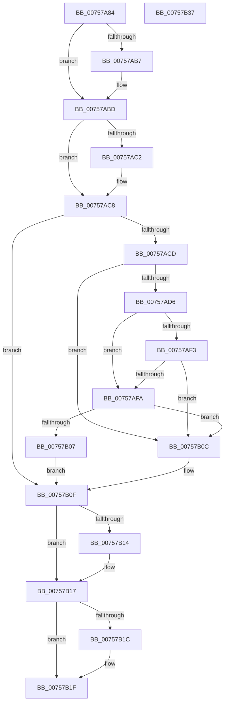

# PopDirectedDripsQueryEnabledMitigations

- RVA: `0x00757A84`–`0x00757B38` (길이 `180` bytes)
- VA: `0x0000000140757A84`
- 실행 섹션: `PAGE`
- PDB 이름 있음: `예`; PDB Function 태그: `아니요`
- unwind 정보 RVA: `0x0006C8E8`
- 디코드: `54`개 명령, `180/180` bytes 표시
- 미해석 바이트: `0` (있으면 어셈블리에 `.byte`로 보존)

> 이 문서는 커널 이미지의 기계어와 PDB 기호를 분석해 생성했습니다. 4번과 5번은 함수 원형과 자료형을 바이너리 사용 방식에서 추정한 C 해석이며 원본 소스 복구 결과는 아닙니다.

## 1. Dependencies

- 직접 호출 지점: **2**; 고유 호출 대상: **2**
- 직접 호출자로 확인된 함수: **2**
- RIP 상대 이미지 참조: **2**

### Outgoing calls
- `0x00757AA9` → [PopDirectedDripsQueryRegistryValues](PopDirectedDripsQueryRegistryValues_function_00757B40.md) (function, `0x00757B40`)
- `0x00757AEA` → [EmClientQueryRuleState](../../pagelk/B7/EmClientQueryRuleState_function_00B77D70.md) (function, `0x00B77D70`)

### Direct callers
- [PopDirectedDripsEngage](../../text/49/PopDirectedDripsEngage_function_00498888.md) at `0x004988B8`
- [PopDirectedDripsInitializePhase3](../../init/C3/PopDirectedDripsInitializePhase3_function_00C3E594.md) at `0x00C3E5C7`

### Static image references
- `0x00757ACD` → RVA `0x00E0B3C4` (`.data`; read)
- `0x00757AE3` → RVA `0x000291C8` (`.rdata`; read)

## 2. Other-region calls and transfers

- 다른 실행 섹션으로 향하는 call: **1**
  - `0x00757AEA` → [EmClientQueryRuleState](../../pagelk/B7/EmClientQueryRuleState_function_00B77D70.md) (`PAGE` → `PAGELK`)
- 별도 외부 분기/꼬리 이동을 확인하지 못했습니다.

## 3. Assembly (complete function range)

```asm
00757A84  48 8B C4                        mov rax, rsp
00757A87  48 89 58 10                     mov qword ptr [rax + 0x10], rbx
00757A8B  48 89 68 18                     mov qword ptr [rax + 0x18], rbp
00757A8F  48 89 70 20                     mov qword ptr [rax + 0x20], rsi
00757A93  57                              push rdi
00757A94  48 83 EC 20                     sub rsp, 0x20
00757A98  83 60 08 00                     and dword ptr [rax + 8], 0
00757A9C  48 8D 50 08                     lea rdx, [rax + 8]
00757AA0  48 8B E9                        mov rbp, rcx
00757AA3  40 32 F6                        xor sil, sil
00757AA6  40 32 FF                        xor dil, dil
00757AA9  E8 92 00 00 00                  call 0x140757b40
00757AAE  8B 5C 24 30                     mov ebx, dword ptr [rsp + 0x30]
00757AB2  F6 C3 01                        test bl, 1
00757AB5  74 06                           je 0x140757abd
00757AB7  40 B6 01                        mov sil, 1
00757ABA  83 E3 FE                        and ebx, 0xfffffffe
00757ABD  F6 C3 02                        test bl, 2
00757AC0  74 06                           je 0x140757ac8
00757AC2  40 B7 01                        mov dil, 1
00757AC5  83 E3 FD                        and ebx, 0xfffffffd
00757AC8  F6 C3 08                        test bl, 8
00757ACB  75 42                           jne 0x140757b0f
00757ACD  83 3D F0 38 6B 00 00            cmp dword ptr [rip + 0x6b38f0], 0
00757AD4  74 36                           je 0x140757b0c
00757AD6  48 8D 54 24 30                  lea rdx, [rsp + 0x30]
00757ADB  C7 44 24 30 01 00 00 00         mov dword ptr [rsp + 0x30], 1
00757AE3  48 8D 0D DE 16 8D FF            lea rcx, [rip - 0x72e922]
00757AEA  E8 81 02 42 00                  call 0x140b77d70
00757AEF  85 C0                           test eax, eax
00757AF1  78 07                           js 0x140757afa
00757AF3  83 7C 24 30 02                  cmp dword ptr [rsp + 0x30], 2
00757AF8  74 12                           je 0x140757b0c
00757AFA  8B 05 C4 38 6B 00               mov eax, dword ptr [rip + 0x6b38c4]
00757B00  FF C8                           dec eax
00757B02  83 F8 FD                        cmp eax, -3
00757B05  77 05                           ja 0x140757b0c
00757B07  40 B7 01                        mov dil, 1
00757B0A  EB 03                           jmp 0x140757b0f
00757B0C  40 32 FF                        xor dil, dil
00757B0F  40 84 F6                        test sil, sil
00757B12  74 03                           je 0x140757b17
00757B14  83 CB 01                        or ebx, 1
00757B17  40 84 FF                        test dil, dil
00757B1A  74 03                           je 0x140757b1f
00757B1C  83 CB 02                        or ebx, 2
00757B1F  48 8B 74 24 48                  mov rsi, qword ptr [rsp + 0x48]
00757B24  89 5D 30                        mov dword ptr [rbp + 0x30], ebx
00757B27  48 8B 5C 24 38                  mov rbx, qword ptr [rsp + 0x38]
00757B2C  48 8B 6C 24 40                  mov rbp, qword ptr [rsp + 0x40]
00757B31  48 83 C4 20                     add rsp, 0x20
00757B35  5F                              pop rdi
00757B36  C3                              ret
00757B37  CC                              int3
```

## 4. C-style interpretation (structured pseudocode)

```c
__int64 __fastcall PopDirectedDripsQueryEnabledMitigations(__int64 a1)
{
    __int64 result;
    __int64 v_rbx;
    __int64 v_rdi;
    __int64 v_rsi;
    __int64 v_rsp;
    unsigned __int64 v_stack_p10;
    unsigned __int64 v_stack_p18;
    unsigned __int64 v_stack_p20;
    unsigned int v_stack_p8;

    *(unsigned __int64 *)(v_rsp + 16) = v_rbx;
    *(unsigned __int64 *)(v_rsp + 24) = v_rbp;
    *(unsigned __int64 *)(v_rsp + 32) = v_rsi;
    v_rsp = (v_rsp) - (32);
    v_rsi = 0;
    v_rdi = 0;
    result = PopDirectedDripsQueryRegistryValues(a1, v_rsp + 8, a3, a4);
    v_rbx = (unsigned int)(v_stack_p8);
    if ((((unsigned __int8)((unsigned int)(v_stack_p8))) & (1)) != 0) {
        v_rsi = 1;
        v_rbx = (unsigned int)(((unsigned int)(v_stack_p8)) & (0xFFFFFFFEULL));
    }
    if ((((unsigned __int8)(v_rbx)) & (2)) != 0) {
        v_rdi = 1;
        v_rbx = (unsigned int)((v_rbx) & (0xFFFFFFFDULL));
    }
    if ((((unsigned __int8)(v_rbx)) & (8)) != 0) goto loc_00757B0F;
    if ((*(unsigned int *)(v_rip + 7026928)) == 0) goto loc_00757B0C;
    v_stack_p8 = 1;
    result = EmClientQueryRuleState(v_rip - 7530786, v_stack_p8, a3, a4);
    if (sign_flag) goto loc_00757AFA;
    if (v_stack_p8 == 2) goto loc_00757B0C;
loc_00757AFA:
    result = (unsigned int)(((unsigned int)(*(unsigned int *)(v_rip + 7026884))) - 1);
    if (((unsigned int)(result)) > -3) goto loc_00757B0C;
    goto loc_00757B0F;
loc_00757B0C:
    v_rdi = 0;
loc_00757B0F:
    if ((unsigned __int8)(v_rsi) != 0) {
        v_rbx = (unsigned int)((v_rbx) | (1));
    }
    if (0 != 0) {
        v_rbx = (unsigned int)((v_rbx) | (2));
    }
    *(unsigned int *)(a1 + 48) = (unsigned int)(v_rbx);
    v_rsp = (v_rsp) + (32);
    return result;
}
```

## 5. (Beta) C Style

```c
int64_t PopDirectedDripsQueryEnabledMitigations(void *Arg1)
{
    uint8_t *arg1 = (uint8_t *)Arg1;

    int64_t result;
    int64_t local_rbx;
    int64_t local_rdi;
    int64_t local_rsi;
    int64_t local_rsp;
    uint64_t v_stack_p10;
    uint64_t v_stack_p18;
    uint64_t v_stack_p20;
    uint32_t v_stack_p8;

    *(uint64_t *)(local_rsp + 0x10) = local_rbx;
    *(uint64_t *)(local_rsp + 0x18) = local_rbp;
    *(uint64_t *)(local_rsp + 0x20) = local_rsi;
    local_rsp = (local_rsp) - (32);
    local_rsi = 0;
    local_rdi = 0;
    result = PopDirectedDripsQueryRegistryValues(Arg1, local_rsp + 8, a3, a4);
    local_rbx = (uint32_t)(v_stack_p8);
    if ((((uint8_t)((uint32_t)(v_stack_p8))) & (1)) != 0) {
        local_rsi = 1;
        local_rbx = (uint32_t)(((uint32_t)(v_stack_p8)) & (0xFFFFFFFEULL));
    }
    if ((((uint8_t)(local_rbx)) & (2)) != 0) {
        local_rdi = 1;
        local_rbx = (uint32_t)((local_rbx) & (0xFFFFFFFDULL));
    }
    if ((((uint8_t)(local_rbx)) & (8)) != 0) goto loc_00757B0F;
    if ((*(uint32_t *)(v_rip + 0x6B38F0)) == 0) goto loc_00757B0C;
    v_stack_p8 = 1;
    result = EmClientQueryRuleState(v_rip - 7530786, v_stack_p8, a3, a4);
    if (sign_flag) goto loc_00757AFA;
    if (v_stack_p8 == 2) goto loc_00757B0C;
loc_00757AFA:
    result = (uint32_t)(((uint32_t)(*(uint32_t *)(v_rip + 0x6B38C4))) - 1);
    if (((uint32_t)(result)) > -3) goto loc_00757B0C;
    goto loc_00757B0F;
loc_00757B0C:
    local_rdi = 0;
loc_00757B0F:
    if ((uint8_t)(local_rsi) != 0) {
        local_rbx = (uint32_t)((local_rbx) | (1));
    }
    if (0 != 0) {
        local_rbx = (uint32_t)((local_rbx) | (2));
    }
    *(uint32_t *)(arg1 + 0x30) = (uint32_t)(local_rbx);
    local_rsp = (local_rsp) + (32);
    return result;
}
```

### 관측된 메모리 오프셋

구조체 형식이 확인되지 않은 접근은 인자 기준의 오프셋으로만 기록했습니다.

| 기준 인자 | 오프셋 표현 | 폭 (bit) | 접근 |
|---|---:|---:|---|
| `Arg1` | `+ 0x30` | `32` | `W` |

## 6. Execution-region graph

[열기: 2D/3D 그래프와 함수 탐색 컨트롤 패널](../../../control-panel.html?section=page&rva=0x00757A84&view=graph)

- 2D 그래프는 위에서 아래로 흐르고, 3D 그래프는 빈 공간을 드래그해 회전합니다. Shift+드래그는 이동, 휠은 확대·축소, 함수 노드 선택은 대상 보고서 이동입니다.

### Static fallback


