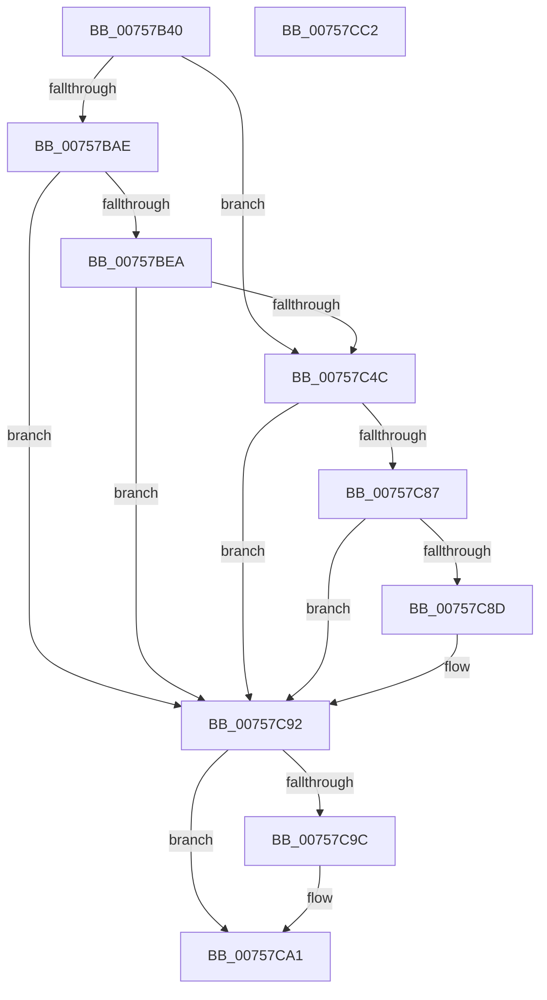

# PopDirectedDripsQueryRegistryValues

- RVA: `0x00757B40`–`0x00757CC3` (길이 `387` bytes)
- VA: `0x0000000140757B40`
- 실행 섹션: `PAGE`
- PDB 이름 있음: `예`; PDB Function 태그: `아니요`
- unwind 정보 RVA: `0x000CC06C`
- 디코드: `91`개 명령, `387/387` bytes 표시
- 미해석 바이트: `0` (있으면 어셈블리에 `.byte`로 보존)

> 이 문서는 커널 이미지의 기계어와 PDB 기호를 분석해 생성했습니다. 4번과 5번은 함수 원형과 자료형을 바이너리 사용 방식에서 추정한 C 해석이며 원본 소스 복구 결과는 아닙니다.

## 1. Dependencies

- 직접 호출 지점: **7**; 고유 호출 대상: **6**
- 직접 호출자로 확인된 함수: **1**
- RIP 상대 이미지 참조: **4**

### Outgoing calls
- `0x00757BDD` → [ZwOpenKey](../../text/6A/ZwOpenKey_function_006AD310.md) (function, `0x006AD310`)
- `0x00757BF5` → [RtlInitUnicodeString](../../text/42/RtlInitUnicodeString_function_0042A780.md) (function, `0x0042A780`)
- `0x00757C43` → [ZwCreateKey](../../text/6A/ZwCreateKey_function_006AD470.md) (function, `0x006AD470`)
- `0x00757C57` → [RtlInitUnicodeString](../../text/42/RtlInitUnicodeString_function_0042A780.md) (function, `0x0042A780`)
- `0x00757C7E` → [ZwQueryValueKey](../../text/6A/ZwQueryValueKey_function_006AD3B0.md) (function, `0x006AD3B0`)
- `0x00757C9C` → [ZwClose](../../text/6A/ZwClose_function_006AD2B0.md) (function, `0x006AD2B0`)
- `0x00757CA8` → [_security_check_cookie](../../text/6A/_security_check_cookie_function_006AC640.md) (function, `0x006AC640`)

### Direct callers
- [PopDirectedDripsQueryEnabledMitigations](PopDirectedDripsQueryEnabledMitigations_function_00757A84.md) at `0x00757AA9`

### Static image references
- `0x00757B57` → RVA `0x00E0A740` (`.data`; read)
- `0x00757BB6` → RVA `0x00FD9EF8` (`PAGEDATA`; read)
- `0x00757BEA` → RVA `0x00029180` (`.rdata`; read)
- `0x00757C4C` → RVA `0x000291A0` (`.rdata`; read)

## 2. Other-region calls and transfers

- 다른 실행 섹션으로 향하는 call: **7**
  - `0x00757BDD` → [ZwOpenKey](../../text/6A/ZwOpenKey_function_006AD310.md) (`PAGE` → `.text`)
  - `0x00757BF5` → [RtlInitUnicodeString](../../text/42/RtlInitUnicodeString_function_0042A780.md) (`PAGE` → `.text`)
  - `0x00757C43` → [ZwCreateKey](../../text/6A/ZwCreateKey_function_006AD470.md) (`PAGE` → `.text`)
  - `0x00757C57` → [RtlInitUnicodeString](../../text/42/RtlInitUnicodeString_function_0042A780.md) (`PAGE` → `.text`)
  - `0x00757C7E` → [ZwQueryValueKey](../../text/6A/ZwQueryValueKey_function_006AD3B0.md) (`PAGE` → `.text`)
  - `0x00757C9C` → [ZwClose](../../text/6A/ZwClose_function_006AD2B0.md) (`PAGE` → `.text`)
  - `0x00757CA8` → [_security_check_cookie](../../text/6A/_security_check_cookie_function_006AC640.md) (`PAGE` → `.text`)
- 별도 외부 분기/꼬리 이동을 확인하지 못했습니다.

## 3. Assembly (complete function range)

```asm
00757B40  48 89 5C 24 18                  mov qword ptr [rsp + 0x18], rbx
00757B45  48 89 7C 24 20                  mov qword ptr [rsp + 0x20], rdi
00757B4A  55                              push rbp
00757B4B  48 8D 6C 24 A9                  lea rbp, [rsp - 0x57]
00757B50  48 81 EC B0 00 00 00            sub rsp, 0xb0
00757B57  48 8B 05 E2 2B 6B 00            mov rax, qword ptr [rip + 0x6b2be2]
00757B5E  48 33 C4                        xor rax, rsp
00757B61  48 89 45 4F                     mov qword ptr [rbp + 0x4f], rax
00757B65  83 65 E7 00                     and dword ptr [rbp - 0x19], 0
00757B69  48 8D B9 38 02 00 00            lea rdi, [rcx + 0x238]
00757B70  83 65 EB 00                     and dword ptr [rbp - 0x15], 0
00757B74  33 C0                           xor eax, eax
00757B76  48 83 4D EF FF                  or qword ptr [rbp - 0x11], 0xffffffffffffffff
00757B7B  0F 57 C0                        xorps xmm0, xmm0
00757B7E  0F 57 C9                        xorps xmm1, xmm1
00757B81  C7 02 03 00 00 00               mov dword ptr [rdx], 3
00757B87  48 83 3F FF                     cmp qword ptr [rdi], -1
00757B8B  48 8B DA                        mov rbx, rdx
00757B8E  0F 11 45 F7                     movups xmmword ptr [rbp - 9], xmm0
00757B92  48 89 45 17                     mov qword ptr [rbp + 0x17], rax
00757B96  0F 11 45 07                     movups xmmword ptr [rbp + 7], xmm0
00757B9A  89 45 1F                        mov dword ptr [rbp + 0x1f], eax
00757B9D  0F 11 45 27                     movups xmmword ptr [rbp + 0x27], xmm0
00757BA1  89 45 47                        mov dword ptr [rbp + 0x47], eax
00757BA4  0F 11 4D 37                     movups xmmword ptr [rbp + 0x37], xmm1
00757BA8  0F 85 9E 00 00 00               jne 0x140757c4c
00757BAE  48 21 45 FF                     and qword ptr [rbp - 1], rax
00757BB2  4C 8D 45 F7                     lea r8, [rbp - 9]
00757BB6  48 8D 05 3B 23 88 00            lea rax, [rip + 0x88233b]
00757BBD  C7 45 F7 30 00 00 00            mov dword ptr [rbp - 9], 0x30
00757BC4  BA 19 00 02 00                  mov edx, 0x20019
00757BC9  48 89 45 07                     mov qword ptr [rbp + 7], rax
00757BCD  48 8D 4D EF                     lea rcx, [rbp - 0x11]
00757BD1  C7 45 0F 40 02 00 00            mov dword ptr [rbp + 0xf], 0x240
00757BD8  F3 0F 7F 45 17                  movdqu xmmword ptr [rbp + 0x17], xmm0
00757BDD  E8 2E 57 F5 FF                  call 0x1406ad310
00757BE2  85 C0                           test eax, eax
00757BE4  0F 88 A8 00 00 00               js 0x140757c92
00757BEA  48 8D 15 8F 15 8D FF            lea rdx, [rip - 0x72ea71]
00757BF1  48 8D 4D 27                     lea rcx, [rbp + 0x27]
00757BF5  E8 86 2B CD FF                  call 0x14042a780
00757BFA  48 8B 45 EF                     mov rax, qword ptr [rbp - 0x11]
00757BFE  4C 8D 45 F7                     lea r8, [rbp - 9]
00757C02  48 89 45 FF                     mov qword ptr [rbp - 1], rax
00757C06  0F 57 C0                        xorps xmm0, xmm0
00757C09  48 8D 45 27                     lea rax, [rbp + 0x27]
00757C0D  C7 45 F7 30 00 00 00            mov dword ptr [rbp - 9], 0x30
00757C14  48 89 45 07                     mov qword ptr [rbp + 7], rax
00757C18  45 33 C9                        xor r9d, r9d
00757C1B  48 8D 45 E7                     lea rax, [rbp - 0x19]
00757C1F  C7 45 0F 40 02 00 00            mov dword ptr [rbp + 0xf], 0x240
00757C26  48 89 44 24 30                  mov qword ptr [rsp + 0x30], rax
00757C2B  BA 19 00 02 00                  mov edx, 0x20019
00757C30  83 64 24 28 00                  and dword ptr [rsp + 0x28], 0
00757C35  48 8B CF                        mov rcx, rdi
00757C38  48 83 64 24 20 00               and qword ptr [rsp + 0x20], 0
00757C3E  F3 0F 7F 45 17                  movdqu xmmword ptr [rbp + 0x17], xmm0
00757C43  E8 28 58 F5 FF                  call 0x1406ad470
00757C48  85 C0                           test eax, eax
00757C4A  78 46                           js 0x140757c92
00757C4C  48 8D 15 4D 15 8D FF            lea rdx, [rip - 0x72eab3]
00757C53  48 8D 4D 27                     lea rcx, [rbp + 0x27]
00757C57  E8 24 2B CD FF                  call 0x14042a780
00757C5C  48 8B 0F                        mov rcx, qword ptr [rdi]
00757C5F  48 8D 45 EB                     lea rax, [rbp - 0x15]
00757C63  48 89 44 24 28                  mov qword ptr [rsp + 0x28], rax
00757C68  4C 8D 4D 37                     lea r9, [rbp + 0x37]
00757C6C  41 B8 02 00 00 00               mov r8d, 2
00757C72  C7 44 24 20 14 00 00 00         mov dword ptr [rsp + 0x20], 0x14
00757C7A  48 8D 55 27                     lea rdx, [rbp + 0x27]
00757C7E  E8 2D 57 F5 FF                  call 0x1406ad3b0
00757C83  85 C0                           test eax, eax
00757C85  78 0B                           js 0x140757c92
00757C87  83 7D 3F 04                     cmp dword ptr [rbp + 0x3f], 4
00757C8B  75 05                           jne 0x140757c92
00757C8D  8B 45 43                        mov eax, dword ptr [rbp + 0x43]
00757C90  89 03                           mov dword ptr [rbx], eax
00757C92  48 8B 4D EF                     mov rcx, qword ptr [rbp - 0x11]
00757C96  48 83 F9 FF                     cmp rcx, -1
00757C9A  74 05                           je 0x140757ca1
00757C9C  E8 0F 56 F5 FF                  call 0x1406ad2b0
00757CA1  48 8B 4D 4F                     mov rcx, qword ptr [rbp + 0x4f]
00757CA5  48 33 CC                        xor rcx, rsp
00757CA8  E8 93 49 F5 FF                  call 0x1406ac640
00757CAD  4C 8D 9C 24 B0 00 00 00         lea r11, [rsp + 0xb0]
00757CB5  49 8B 5B 20                     mov rbx, qword ptr [r11 + 0x20]
00757CB9  49 8B 7B 28                     mov rdi, qword ptr [r11 + 0x28]
00757CBD  49 8B E3                        mov rsp, r11
00757CC0  5D                              pop rbp
00757CC1  C3                              ret
00757CC2  CC                              int3
```

## 4. C-style interpretation (structured pseudocode)

```c
__int64 __fastcall PopDirectedDripsQueryRegistryValues(__int64 a1, __int64 a2, __int64 a3, int a4)
{
    __int64 result;
    __int64 v_rsp;
    unsigned __int64 v_stack_m10;
    unsigned int v_stack_m18;
    unsigned int v_stack_m1C;
    unsigned int v_stack_m20;
    unsigned __int64 v_stack_m28;
    unsigned __int64 v_stack_m38;
    unsigned int v_stack_m40;
    unsigned __int64 v_stack_m48;
    unsigned int v_stack_m50;
    unsigned __int64 v_stack_m58;
    unsigned __int64 v_stack_m5F;
    unsigned __int64 v_stack_m60;
    unsigned __int64 v_stack_m68;
    unsigned __int64 v_stack_m70;
    unsigned int v_stack_m74;
    unsigned int v_stack_m78;
    unsigned __int64 v_stack_m8;
    unsigned __int64 v_stack_m88;
    unsigned int v_stack_m90;
    unsigned __int64 v_stack_m98;
    unsigned __int64 v_stack_p18;
    unsigned __int64 v_stack_p20;

    v_stack_p18 = v_rbx;
    v_stack_p20 = v_rdi;
    v_rsp = (v_rsp) - (176);
    result = (*(unsigned __int64 *)(v_rip + 7023586)) ^ (v_rsp);
    v_stack_m10 = result;
    result = 0;
    *(unsigned int *)(a2) = 3;
    v_stack_m68 = v_xmm0;
    v_stack_m48 = 0;
    v_stack_m58 = v_xmm0;
    v_stack_m40 = 0;
    v_stack_m38 = v_xmm0;
    v_stack_m18 = 0;
    v_stack_m28 = v_xmm1;
    if ((*(unsigned __int64 *)(a1 + 568)) != -1) goto loc_00757C4C;
    v_stack_m68 = 48;
    v_stack_m58 = v_rip + 8921915;
    v_stack_m50 = 576;
    v_stack_m48 = v_xmm0;
    result = ZwOpenKey(v_stack_m70, (unsigned int)(0x20019ULL), v_stack_m68, a4);
    if (sign_flag) goto loc_00757C92;
    result = RtlInitUnicodeString(v_stack_m38, v_rip - 7531121, v_stack_m68, a4);
    v_stack_m60 = v_stack_m70;
    v_stack_m68 = 48;
    v_stack_m58 = v_stack_m38;
    a4 = 0;
    v_stack_m50 = 576;
    v_stack_m88 = v_stack_m78;
    v_stack_m48 = v_xmm0;
    result = ZwCreateKey(a1 + 568, (unsigned int)(0x20019ULL), v_stack_m68, a4);
    if (sign_flag) goto loc_00757C92;
loc_00757C4C:
    result = RtlInitUnicodeString(v_stack_m38, v_rip - 7531187, v_stack_m68, a4);
    v_stack_m90 = v_stack_m74;
    v_stack_m98 = 20;
    result = ZwQueryValueKey(*(unsigned __int64 *)(a1 + 568), v_stack_m38, 2, v_stack_m28);
    if (sign_flag) goto loc_00757C92;
    if (v_stack_m20 == 4) {
        result = v_stack_m1C;
        *(unsigned int *)(a2) = (unsigned int)(result);
    }
    if (v_stack_m70 != -1) {
        result = ZwClose(v_stack_m70, v_stack_m38, 2, v_stack_m28);
    }
    a1 = (v_stack_m10) ^ (v_rsp);
    result = _security_check_cookie(a1, v_stack_m38, 2, v_stack_m28);
    return result;
}
```

## 5. (Beta) C Style

```c
int64_t PopDirectedDripsQueryRegistryValues(void *Arg1, void *Arg2, int64_t Arg3, int32_t Arg4)
{
    uint8_t *arg1 = (uint8_t *)Arg1;
    uint8_t *arg2 = (uint8_t *)Arg2;

    int64_t result;
    int64_t local_rsp;
    uint64_t v_stack_m10;
    uint32_t v_stack_m18;
    uint32_t v_stack_m1C;
    uint32_t v_stack_m20;
    uint64_t v_stack_m28;
    uint64_t v_stack_m38;
    uint32_t v_stack_m40;
    uint64_t v_stack_m48;
    uint32_t v_stack_m50;
    uint64_t v_stack_m58;
    uint64_t v_stack_m5F;
    uint64_t v_stack_m60;
    uint64_t v_stack_m68;
    uint64_t v_stack_m70;
    uint32_t v_stack_m74;
    uint32_t v_stack_m78;
    uint64_t v_stack_m8;
    uint64_t v_stack_m88;
    uint32_t v_stack_m90;
    uint64_t v_stack_m98;
    uint64_t v_stack_p18;
    uint64_t v_stack_p20;

    v_stack_p18 = local_rbx;
    v_stack_p20 = local_rdi;
    local_rsp = (local_rsp) - (176);
    result = (*(uint64_t *)(v_rip + 0x6B2BE2)) ^ (local_rsp);
    v_stack_m10 = result;
    result = 0;
    *(uint32_t *)(arg2) = 3;
    v_stack_m68 = v_xmm0;
    v_stack_m48 = 0;
    v_stack_m58 = v_xmm0;
    v_stack_m40 = 0;
    v_stack_m38 = v_xmm0;
    v_stack_m18 = 0;
    v_stack_m28 = v_xmm1;
    if ((*(uint64_t *)(arg1 + 0x238)) != -1) goto loc_00757C4C;
    v_stack_m68 = 48;
    v_stack_m58 = v_rip + 8921915;
    v_stack_m50 = 576;
    v_stack_m48 = v_xmm0;
    result = ZwOpenKey(v_stack_m70, (uint32_t)(0x20019ULL), v_stack_m68, Arg4);
    if (sign_flag) goto loc_00757C92;
    result = RtlInitUnicodeString(v_stack_m38, v_rip - 7531121, v_stack_m68, Arg4);
    v_stack_m60 = v_stack_m70;
    v_stack_m68 = 48;
    v_stack_m58 = v_stack_m38;
    Arg4 = 0;
    v_stack_m50 = 576;
    v_stack_m88 = v_stack_m78;
    v_stack_m48 = v_xmm0;
    result = ZwCreateKey(Arg1 + 568, (uint32_t)(0x20019ULL), v_stack_m68, Arg4);
    if (sign_flag) goto loc_00757C92;
loc_00757C4C:
    result = RtlInitUnicodeString(v_stack_m38, v_rip - 7531187, v_stack_m68, Arg4);
    v_stack_m90 = v_stack_m74;
    v_stack_m98 = 20;
    result = ZwQueryValueKey(*(uint64_t *)(arg1 + 0x238), v_stack_m38, 2, v_stack_m28);
    if (sign_flag) goto loc_00757C92;
    if (v_stack_m20 == 4) {
        result = v_stack_m1C;
        *(uint32_t *)(arg2) = (uint32_t)(result);
    }
    if (v_stack_m70 != -1) {
        result = ZwClose(v_stack_m70, v_stack_m38, 2, v_stack_m28);
    }
    Arg1 = (v_stack_m10) ^ (local_rsp);
    result = _security_check_cookie(Arg1, v_stack_m38, 2, v_stack_m28);
    return result;
}
```

### 관측된 메모리 오프셋

구조체 형식이 확인되지 않은 접근은 인자 기준의 오프셋으로만 기록했습니다.

| 기준 인자 | 오프셋 표현 | 폭 (bit) | 접근 |
|---|---:|---:|---|
| `Arg1` | `+ 0x0` | `64` | `R` |
| `Arg1` | `+ 0x238` | `64` | `R` |
| `Arg2` | `+ 0x0` | `32` | `W` |

## 6. Execution-region graph

[열기: 2D/3D 그래프와 함수 탐색 컨트롤 패널](../../../control-panel.html?section=page&rva=0x00757B40&view=graph)

- 2D 그래프는 위에서 아래로 흐르고, 3D 그래프는 빈 공간을 드래그해 회전합니다. Shift+드래그는 이동, 휠은 확대·축소, 함수 노드 선택은 대상 보고서 이동입니다.

### Static fallback


