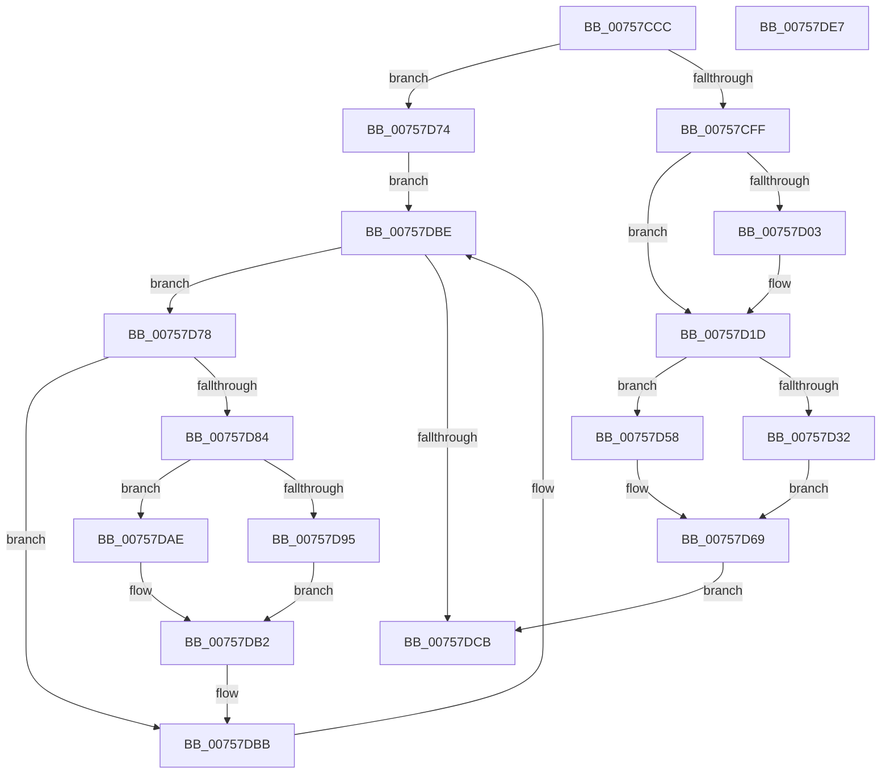

# PopDirectedDripsSendSuspendResumeNotification

- RVA: `0x00757CCC`–`0x00757DE8` (길이 `284` bytes)
- VA: `0x0000000140757CCC`
- 실행 섹션: `PAGE`
- PDB 이름 있음: `예`; PDB Function 태그: `아니요`
- unwind 정보 RVA: `0x000C48CC`
- 디코드: `74`개 명령, `284/284` bytes 표시
- 미해석 바이트: `0` (있으면 어셈블리에 `.byte`로 보존)

> 이 문서는 커널 이미지의 기계어와 PDB 기호를 분석해 생성했습니다. 4번과 5번은 함수 원형과 자료형을 바이너리 사용 방식에서 추정한 C 해석이며 원본 소스 복구 결과는 아닙니다.

## 1. Dependencies

- 직접 호출 지점: **9**; 고유 호출 대상: **5**
- 직접 호출자로 확인된 함수: **1**
- RIP 상대 이미지 참조: **1**

### Outgoing calls
- `0x00757D11` → [PopSuspendResumeInvocation](../AA/PopSuspendResumeInvocation_function_00AAE544.md) (function, `0x00AAE544`)
- `0x00757D21` → [PopSuspendResumeInvocation](../AA/PopSuspendResumeInvocation_function_00AAE544.md) (function, `0x00AAE544`)
- `0x00757D4A` → [PopUmpoSendLegacyEvent](../AA/PopUmpoSendLegacyEvent_function_00AA48E8.md) (function, `0x00AA48E8`)
- `0x00757D6D` → [PopUmpoSendLegacyEvent](../AA/PopUmpoSendLegacyEvent_function_00AA48E8.md) (function, `0x00AA48E8`)
- `0x00757D7B` → [PsGetProcessSessionId](../../text/22/PsGetProcessSessionId_function_002233A0.md) (function, `0x002233A0`)
- `0x00757DA0` → [PopSuspendResumeInvocation](../AA/PopSuspendResumeInvocation_function_00AAE544.md) (function, `0x00AAE544`)
- `0x00757DB6` → [PopSuspendResumeInvocation](../AA/PopSuspendResumeInvocation_function_00AAE544.md) (function, `0x00AAE544`)
- `0x00757DBE` → [PsGetNextSession](../91/PsGetNextSession_function_009128C0.md) (function, `0x009128C0`)
- `0x00757DD2` → [_security_check_cookie](../../text/6A/_security_check_cookie_function_006AC640.md) (function, `0x006AC640`)

### Direct callers
- [PopDirectedDripsNotifyAppsAndServices](PopDirectedDripsNotifyAppsAndServices_function_0075792C.md) at `0x00757993`
- [PopDirectedDripsNotifyAppsAndServices](PopDirectedDripsNotifyAppsAndServices_function_0075792C.md) at `0x0075799C`
- [PopDirectedDripsNotifyAppsAndServices](PopDirectedDripsNotifyAppsAndServices_function_0075792C.md) at `0x007579B2`
- [PopDirectedDripsNotifyAppsAndServices](PopDirectedDripsNotifyAppsAndServices_function_0075792C.md) at `0x007579BB`

### Static image references
- `0x00757CDE` → RVA `0x00E0A740` (`.data`; read)

## 2. Other-region calls and transfers

- 다른 실행 섹션으로 향하는 call: **2**
  - `0x00757D7B` → [PsGetProcessSessionId](../../text/22/PsGetProcessSessionId_function_002233A0.md) (`PAGE` → `.text`)
  - `0x00757DD2` → [_security_check_cookie](../../text/6A/_security_check_cookie_function_006AC640.md) (`PAGE` → `.text`)
- 별도 외부 분기/꼬리 이동을 확인하지 못했습니다.

## 3. Assembly (complete function range)

```asm
00757CCC  48 89 5C 24 08                  mov qword ptr [rsp + 8], rbx
00757CD1  48 89 7C 24 10                  mov qword ptr [rsp + 0x10], rdi
00757CD6  55                              push rbp
00757CD7  48 8B EC                        mov rbp, rsp
00757CDA  48 83 EC 50                     sub rsp, 0x50
00757CDE  48 8B 05 5B 2A 6B 00            mov rax, qword ptr [rip + 0x6b2a5b]
00757CE5  48 33 C4                        xor rax, rsp
00757CE8  48 89 45 F8                     mov qword ptr [rbp - 8], rax
00757CEC  33 C0                           xor eax, eax
00757CEE  0F 57 C0                        xorps xmm0, xmm0
00757CF1  89 45 F0                        mov dword ptr [rbp - 0x10], eax
00757CF4  40 8A FA                        mov dil, dl
00757CF7  0F 11 45 E0                     movups xmmword ptr [rbp - 0x20], xmm0
00757CFB  84 C9                           test cl, cl
00757CFD  75 75                           jne 0x140757d74
00757CFF  84 D2                           test dl, dl
00757D01  75 1A                           jne 0x140757d1d
00757D03  21 45 F0                        and dword ptr [rbp - 0x10], eax
00757D06  48 8D 4D E0                     lea rcx, [rbp - 0x20]
00757D0A  C7 45 EC 01 00 00 00            mov dword ptr [rbp - 0x14], 1
00757D11  E8 2E 68 35 00                  call 0x140aae544
00757D16  C7 45 EC 02 00 00 00            mov dword ptr [rbp - 0x14], 2
00757D1D  48 8D 4D E0                     lea rcx, [rbp - 0x20]
00757D21  E8 1E 68 35 00                  call 0x140aae544
00757D26  0F 57 C0                        xorps xmm0, xmm0
00757D29  0F 11 45 D0                     movups xmmword ptr [rbp - 0x30], xmm0
00757D2D  40 84 FF                        test dil, dil
00757D30  75 26                           jne 0x140757d58
00757D32  48 8D 4D D0                     lea rcx, [rbp - 0x30]
00757D36  C7 45 D4 12 00 00 00            mov dword ptr [rbp - 0x2c], 0x12
00757D3D  C7 45 D0 03 00 00 00            mov dword ptr [rbp - 0x30], 3
00757D44  66 C7 45 DC 01 00               mov word ptr [rbp - 0x24], 1
00757D4A  E8 99 CB 34 00                  call 0x140aa48e8
00757D4F  C7 45 D4 07 00 00 00            mov dword ptr [rbp - 0x2c], 7
00757D56  EB 11                           jmp 0x140757d69
00757D58  83 65 D0 00                     and dword ptr [rbp - 0x30], 0
00757D5C  C7 45 D4 04 00 00 00            mov dword ptr [rbp - 0x2c], 4
00757D63  66 C7 45 DC 00 01               mov word ptr [rbp - 0x24], 0x100
00757D69  48 8D 4D D0                     lea rcx, [rbp - 0x30]
00757D6D  E8 76 CB 34 00                  call 0x140aa48e8
00757D72  EB 57                           jmp 0x140757dcb
00757D74  33 C9                           xor ecx, ecx
00757D76  EB 46                           jmp 0x140757dbe
00757D78  48 8B CB                        mov rcx, rbx
00757D7B  E8 20 B6 AC FF                  call 0x1402233a0
00757D80  85 C0                           test eax, eax
00757D82  74 37                           je 0x140757dbb
00757D84  48 83 65 E0 00                  and qword ptr [rbp - 0x20], 0
00757D89  83 65 E8 00                     and dword ptr [rbp - 0x18], 0
00757D8D  89 45 F0                        mov dword ptr [rbp - 0x10], eax
00757D90  40 84 FF                        test dil, dil
00757D93  75 19                           jne 0x140757dae
00757D95  48 8D 4D E0                     lea rcx, [rbp - 0x20]
00757D99  C7 45 EC 01 00 00 00            mov dword ptr [rbp - 0x14], 1
00757DA0  E8 9F 67 35 00                  call 0x140aae544
00757DA5  C7 45 EC 02 00 00 00            mov dword ptr [rbp - 0x14], 2
00757DAC  EB 04                           jmp 0x140757db2
00757DAE  83 65 EC 00                     and dword ptr [rbp - 0x14], 0
00757DB2  48 8D 4D E0                     lea rcx, [rbp - 0x20]
00757DB6  E8 89 67 35 00                  call 0x140aae544
00757DBB  48 8B CB                        mov rcx, rbx
00757DBE  E8 FD AA 1B 00                  call 0x1409128c0
00757DC3  48 8B D8                        mov rbx, rax
00757DC6  48 85 C0                        test rax, rax
00757DC9  75 AD                           jne 0x140757d78
00757DCB  48 8B 4D F8                     mov rcx, qword ptr [rbp - 8]
00757DCF  48 33 CC                        xor rcx, rsp
00757DD2  E8 69 48 F5 FF                  call 0x1406ac640
00757DD7  48 8B 5C 24 60                  mov rbx, qword ptr [rsp + 0x60]
00757DDC  48 8B 7C 24 68                  mov rdi, qword ptr [rsp + 0x68]
00757DE1  48 83 C4 50                     add rsp, 0x50
00757DE5  5D                              pop rbp
00757DE6  C3                              ret
00757DE7  CC                              int3
```

## 4. C-style interpretation (structured pseudocode)

```c
__int64 __fastcall PopDirectedDripsSendSuspendResumeNotification(unsigned __int8 a1, unsigned __int8 a2)
{
    __int64 result;
    __int64 v_rsp;
    unsigned __int64 v_stack_m10;
    unsigned int v_stack_m18;
    unsigned int v_stack_m1C;
    unsigned int v_stack_m20;
    unsigned __int64 v_stack_m28;
    unsigned __int16 v_stack_m2C;
    unsigned int v_stack_m34;
    unsigned __int64 v_stack_m38;
    unsigned __int64 v_stack_p10;
    unsigned __int64 v_stack_p8;

    v_stack_p8 = v_rbx;
    v_stack_p10 = v_rdi;
    v_rsp = (v_rsp) - (80);
    result = (*(unsigned __int64 *)(v_rip + 7023195)) ^ (v_rsp);
    v_stack_m10 = result;
    result = 0;
    v_stack_m18 = 0;
    v_stack_m28 = v_xmm0;
    if (a1 != 0) goto loc_00757D74;
    if (a2 == 0) {
        a1 = v_stack_m28;
        v_stack_m1C = 1;
        result = PopSuspendResumeInvocation(a1, a2, a3, a4);
        v_stack_m1C = 2;
    }
    result = PopSuspendResumeInvocation(v_stack_m28, a2, a3, a4);
    v_stack_m38 = v_xmm0;
    if (a2 != 0) goto loc_00757D58;
    v_stack_m34 = 18;
    v_stack_m38 = 3;
    v_stack_m2C = 1;
    result = PopUmpoSendLegacyEvent(v_stack_m38, a2, a3, a4);
    v_stack_m34 = 7;
    goto loc_00757D69;
loc_00757D58:
    v_stack_m34 = 4;
    v_stack_m2C = 256;
loc_00757D69:
    result = PopUmpoSendLegacyEvent(v_stack_m38, a2, a3, a4);
    goto loc_00757DCB;
loc_00757D74:
    a1 = 0;
    goto loc_00757DBE;
loc_00757D78:
    result = PsGetProcessSessionId(v_rbx, a2, a3, a4);
    if ((unsigned int)(result) == 0) goto loc_00757DBB;
    v_stack_m18 = (unsigned int)(result);
    if (a2 != 0) goto loc_00757DAE;
    v_stack_m1C = 1;
    result = PopSuspendResumeInvocation(v_stack_m28, a2, a3, a4);
    v_stack_m1C = 2;
    goto loc_00757DB2;
loc_00757DAE:
loc_00757DB2:
    result = PopSuspendResumeInvocation(v_stack_m28, a2, a3, a4);
loc_00757DBB:
loc_00757DBE:
    result = PsGetNextSession(v_rbx, a2, a3, a4);
    if (result != 0) goto loc_00757D78;
loc_00757DCB:
    a1 = (v_stack_m10) ^ (v_rsp);
    result = _security_check_cookie(a1, a2, a3, a4);
    v_rsp = (v_rsp) + (80);
    return result;
}
```

## 5. (Beta) C Style

```c
int64_t PopDirectedDripsSendSuspendResumeNotification(uint8_t Arg1, uint8_t Arg2)
{
    int64_t result;
    int64_t local_rsp;
    uint64_t v_stack_m10;
    uint32_t v_stack_m18;
    uint32_t v_stack_m1C;
    uint32_t v_stack_m20;
    uint64_t v_stack_m28;
    uint16_t v_stack_m2C;
    uint32_t v_stack_m34;
    uint64_t v_stack_m38;
    uint64_t v_stack_p10;
    uint64_t v_stack_p8;

    v_stack_p8 = local_rbx;
    v_stack_p10 = local_rdi;
    local_rsp = (local_rsp) - (80);
    result = (*(uint64_t *)(v_rip + 0x6B2A5B)) ^ (local_rsp);
    v_stack_m10 = result;
    result = 0;
    v_stack_m18 = 0;
    v_stack_m28 = v_xmm0;
    if (Arg1 != 0) goto loc_00757D74;
    if (Arg2 == 0) {
        Arg1 = v_stack_m28;
        v_stack_m1C = 1;
        result = PopSuspendResumeInvocation(Arg1, Arg2, a3, a4);
        v_stack_m1C = 2;
    }
    result = PopSuspendResumeInvocation(v_stack_m28, Arg2, a3, a4);
    v_stack_m38 = v_xmm0;
    if (Arg2 != 0) goto loc_00757D58;
    v_stack_m34 = 18;
    v_stack_m38 = 3;
    v_stack_m2C = 1;
    result = PopUmpoSendLegacyEvent(v_stack_m38, Arg2, a3, a4);
    v_stack_m34 = 7;
    goto loc_00757D69;
loc_00757D58:
    v_stack_m34 = 4;
    v_stack_m2C = 256;
loc_00757D69:
    result = PopUmpoSendLegacyEvent(v_stack_m38, Arg2, a3, a4);
    goto loc_00757DCB;
loc_00757D74:
    Arg1 = 0;
    goto loc_00757DBE;
loc_00757D78:
    result = PsGetProcessSessionId(local_rbx, Arg2, a3, a4);
    if ((uint32_t)(result) == 0) goto loc_00757DBB;
    v_stack_m18 = (uint32_t)(result);
    if (Arg2 != 0) goto loc_00757DAE;
    v_stack_m1C = 1;
    result = PopSuspendResumeInvocation(v_stack_m28, Arg2, a3, a4);
    v_stack_m1C = 2;
    goto loc_00757DB2;
loc_00757DAE:
loc_00757DB2:
    result = PopSuspendResumeInvocation(v_stack_m28, Arg2, a3, a4);
loc_00757DBB:
loc_00757DBE:
    result = PsGetNextSession(local_rbx, Arg2, a3, a4);
    if (result != 0) goto loc_00757D78;
loc_00757DCB:
    Arg1 = (v_stack_m10) ^ (local_rsp);
    result = _security_check_cookie(Arg1, Arg2, a3, a4);
    local_rsp = (local_rsp) + (80);
    return result;
}
```

## 6. Execution-region graph

[열기: 2D/3D 그래프와 함수 탐색 컨트롤 패널](../../../control-panel.html?section=page&rva=0x00757CCC&view=graph)

- 2D 그래프는 위에서 아래로 흐르고, 3D 그래프는 빈 공간을 드래그해 회전합니다. Shift+드래그는 이동, 휠은 확대·축소, 함수 노드 선택은 대상 보고서 이동입니다.

### Static fallback


