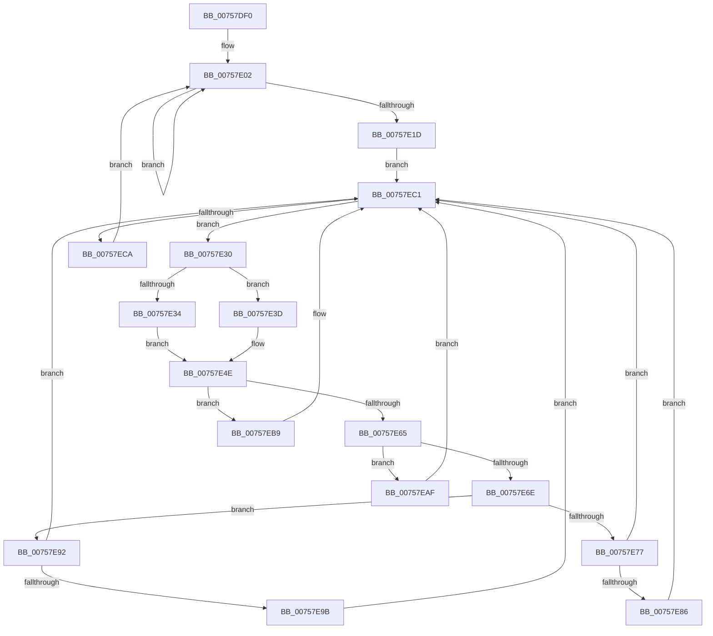

# PopDirectedDripsWorkerRoutine

- RVA: `0x00757DF0`–`0x00757ECF` (길이 `223` bytes)
- VA: `0x0000000140757DF0`
- 실행 섹션: `PAGE`
- PDB 이름 있음: `예`; PDB Function 태그: `아니요`
- unwind 정보 RVA: `0x000CC05C`
- 디코드: `61`개 명령, `223/223` bytes 표시
- 미해석 바이트: `0` (있으면 어셈블리에 `.byte`로 보존)

> 이 문서는 커널 이미지의 기계어와 PDB 기호를 분석해 생성했습니다. 4번과 5번은 함수 원형과 자료형을 바이너리 사용 방식에서 추정한 C 해석이며 원본 소스 복구 결과는 아닙니다.

## 1. Dependencies

- 직접 호출 지점: **7**; 고유 호출 대상: **7**
- 직접 호출자로 확인된 함수: **0**
- RIP 상대 이미지 참조: **0**

### Outgoing calls
- `0x00757E14` → [KeWaitForSingleObject](../../text/20/KeWaitForSingleObject_function_0020E6B0.md) (function, `0x0020E6B0`)
- `0x00757E26` → [PopDiagTraceDirectedDripsWorker](../A7/PopDiagTraceDirectedDripsWorker_function_00A71BF0.md) (function, `0x00A71BF0`)
- `0x00757E8B` → [PopDeepSleepClearDisengageReason](../../text/39/PopDeepSleepClearDisengageReason_function_0039010C.md) (function, `0x0039010C`)
- `0x00757EA0` → [PopDirectedDripsResumeDevices](../A4/PopDirectedDripsResumeDevices_function_00A4DB10.md) (function, `0x00A4DB10`)
- `0x00757EA8` → [PopDirectedDripsSuspendDevices](../A4/PopDirectedDripsSuspendDevices_function_00A4D474.md) (function, `0x00A4D474`)
- `0x00757EB2` → [PopDirectedDripsHandleResiliencyNotification](../A4/PopDirectedDripsHandleResiliencyNotification_function_00A4DC3C.md) (function, `0x00A4DC3C`)
- `0x00757EBC` → [PopDirectedDripsRefreshDisengageState](../A4/PopDirectedDripsRefreshDisengageState_function_00A4D9B0.md) (function, `0x00A4D9B0`)

### Direct callers
- 이 함수 시작 RVA로 연결되는 직접 call은 확인되지 않았습니다. 간접 호출은 완전히 역산할 수 없습니다.

### Static image references
- 디코드된 RIP-relative 메모리 참조가 없습니다.

## 2. Other-region calls and transfers

- 다른 실행 섹션으로 향하는 call: **2**
  - `0x00757E14` → [KeWaitForSingleObject](../../text/20/KeWaitForSingleObject_function_0020E6B0.md) (`PAGE` → `.text`)
  - `0x00757E8B` → [PopDeepSleepClearDisengageReason](../../text/39/PopDeepSleepClearDisengageReason_function_0039010C.md) (`PAGE` → `.text`)
- 별도 외부 분기/꼬리 이동을 확인하지 못했습니다.

## 3. Assembly (complete function range)

```asm
00757DF0  48 89 5C 24 08                  mov qword ptr [rsp + 8], rbx
00757DF5  48 89 74 24 20                  mov qword ptr [rsp + 0x20], rsi
00757DFA  57                              push rdi
00757DFB  48 83 EC 30                     sub rsp, 0x30
00757DFF  48 8B F9                        mov rdi, rcx
00757E02  48 83 64 24 20 00               and qword ptr [rsp + 0x20], 0
00757E08  48 8D 4F 18                     lea rcx, [rdi + 0x18]
00757E0C  45 33 C9                        xor r9d, r9d
00757E0F  45 33 C0                        xor r8d, r8d
00757E12  33 D2                           xor edx, edx
00757E14  E8 97 68 AB FF                  call 0x14020e6b0
00757E19  85 C0                           test eax, eax
00757E1B  75 E5                           jne 0x140757e02
00757E1D  33 DB                           xor ebx, ebx
00757E1F  48 87 5F 08                     xchg qword ptr [rdi + 8], rbx
00757E23  48 8B CB                        mov rcx, rbx
00757E26  E8 C5 9D 31 00                  call 0x140a71bf0
00757E2B  E9 91 00 00 00                  jmp 0x140757ec1
00757E30  85 DB                           test ebx, ebx
00757E32  74 09                           je 0x140757e3d
00757E34  0F BC CB                        bsf ecx, ebx
00757E37  89 4C 24 48                     mov dword ptr [rsp + 0x48], ecx
00757E3B  EB 11                           jmp 0x140757e4e
00757E3D  48 8B C3                        mov rax, rbx
00757E40  48 C1 E8 20                     shr rax, 0x20
00757E44  0F BC C8                        bsf ecx, eax
00757E47  89 4C 24 50                     mov dword ptr [rsp + 0x50], ecx
00757E4B  83 C1 20                        add ecx, 0x20
00757E4E  BA 01 00 00 00                  mov edx, 1
00757E53  48 D3 E2                        shl rdx, cl
00757E56  48 8B C2                        mov rax, rdx
00757E59  48 F7 D0                        not rax
00757E5C  48 23 D8                        and rbx, rax
00757E5F  48 83 FA 02                     cmp rdx, 2
00757E63  74 54                           je 0x140757eb9
00757E65  48 81 FA 00 04 00 00            cmp rdx, 0x400
00757E6C  74 41                           je 0x140757eaf
00757E6E  48 81 FA 00 08 00 00            cmp rdx, 0x800
00757E75  74 1B                           je 0x140757e92
00757E77  48 B8 00 00 00 00 08 00 00 00   movabs rax, 0x800000000
00757E81  48 3B D0                        cmp rdx, rax
00757E84  75 3B                           jne 0x140757ec1
00757E86  B9 08 00 00 00                  mov ecx, 8
00757E8B  E8 7C 82 C3 FF                  call 0x14039010c
00757E90  EB 2F                           jmp 0x140757ec1
00757E92  80 BF A8 00 00 00 00            cmp byte ptr [rdi + 0xa8], 0
00757E99  74 26                           je 0x140757ec1
00757E9B  B2 01                           mov dl, 1
00757E9D  48 8B CF                        mov rcx, rdi
00757EA0  E8 6B 5C 2F 00                  call 0x140a4db10
00757EA5  48 8B CF                        mov rcx, rdi
00757EA8  E8 C7 55 2F 00                  call 0x140a4d474
00757EAD  EB 12                           jmp 0x140757ec1
00757EAF  48 8B CF                        mov rcx, rdi
00757EB2  E8 85 5D 2F 00                  call 0x140a4dc3c
00757EB7  EB 08                           jmp 0x140757ec1
00757EB9  48 8B CF                        mov rcx, rdi
00757EBC  E8 EF 5A 2F 00                  call 0x140a4d9b0
00757EC1  48 85 DB                        test rbx, rbx
00757EC4  0F 85 66 FF FF FF               jne 0x140757e30
00757ECA  E9 33 FF FF FF                  jmp 0x140757e02
```

## 4. C-style interpretation (structured pseudocode)

```c
__int64 __fastcall PopDirectedDripsWorkerRoutine(__int64 a1, int a2, int a3, int a4)
{
    __int64 result;
    __int64 v_rbx;
    __int64 v_rsp;
    unsigned __int64 v_stack_m18;
    unsigned int v_stack_p10;
    unsigned int v_stack_p18;
    unsigned __int64 v_stack_p20;
    unsigned __int64 v_stack_p8;

    v_stack_p8 = v_rbx;
    v_stack_p20 = v_rsi;
    v_rsp = (v_rsp) - (48);
loc_00757E02:
    a4 = 0;
    a3 = 0;
    a2 = 0;
    result = KeWaitForSingleObject(a1 + 24, a2, a3, a4);
    if ((unsigned int)(result) != 0) goto loc_00757E02;
    v_rbx = 0;
    result = PopDiagTraceDirectedDripsWorker(0, a2, a3, a4);
    goto loc_00757EC1;
loc_00757E30:
    if (0 == 0) goto loc_00757E3D;
    v_stack_p10 = 0;
    goto loc_00757E4E;
loc_00757E3D:
    result = (0) >> (32);
    v_stack_p18 = 0;
    a1 = (unsigned int)((0) + (32));
loc_00757E4E:
    a2 = (1) << ((unsigned __int8)(a1));
    result = ~(a2);
    v_rbx = (v_rbx) & (result);
    if (a2 == 2) goto loc_00757EB9;
    if (a2 == 0x400ULL) goto loc_00757EAF;
    if (a2 == 0x800ULL) goto loc_00757E92;
    if (a2 != result) goto loc_00757EC1;
    result = PopDeepSleepClearDisengageReason(8, a2, a3, a4);
    goto loc_00757EC1;
loc_00757E92:
    if ((*(unsigned __int8 *)(a1 + 168)) == 0) goto loc_00757EC1;
    result = PopDirectedDripsResumeDevices(a1, 1, a3, a4);
    result = PopDirectedDripsSuspendDevices(a1, 1, a3, a4);
    goto loc_00757EC1;
loc_00757EAF:
    result = PopDirectedDripsHandleResiliencyNotification(a1, 1, a3, a4);
    goto loc_00757EC1;
loc_00757EB9:
    result = PopDirectedDripsRefreshDisengageState(a1, 1, a3, a4);
loc_00757EC1:
    if (v_rbx != 0) goto loc_00757E30;
    goto loc_00757E02;
}
```

## 5. (Beta) C Style

```c
int64_t PopDirectedDripsWorkerRoutine(void *Arg1, int32_t Arg2, int32_t Arg3, int32_t Arg4)
{
    uint8_t *arg1 = (uint8_t *)Arg1;

    int64_t result;
    int64_t local_rbx;
    int64_t local_rsp;
    uint64_t v_stack_m18;
    uint32_t v_stack_p10;
    uint32_t v_stack_p18;
    uint64_t v_stack_p20;
    uint64_t v_stack_p8;

    v_stack_p8 = local_rbx;
    v_stack_p20 = local_rsi;
    local_rsp = (local_rsp) - (48);
loc_00757E02:
    Arg4 = 0;
    Arg3 = 0;
    Arg2 = 0;
    result = KeWaitForSingleObject(Arg1 + 24, Arg2, Arg3, Arg4);
    if ((uint32_t)(result) != 0) goto loc_00757E02;
    local_rbx = 0;
    result = PopDiagTraceDirectedDripsWorker(0, Arg2, Arg3, Arg4);
    goto loc_00757EC1;
loc_00757E30:
    if (0 == 0) goto loc_00757E3D;
    v_stack_p10 = 0;
    goto loc_00757E4E;
loc_00757E3D:
    result = (0) >> (32);
    v_stack_p18 = 0;
    Arg1 = (uint32_t)((0) + (32));
loc_00757E4E:
    Arg2 = (1) << ((uint8_t)(Arg1));
    result = ~(Arg2);
    local_rbx = (local_rbx) & (result);
    if (Arg2 == 2) goto loc_00757EB9;
    if (Arg2 == 0x400ULL) goto loc_00757EAF;
    if (Arg2 == 0x800ULL) goto loc_00757E92;
    if (Arg2 != result) goto loc_00757EC1;
    result = PopDeepSleepClearDisengageReason(8, Arg2, Arg3, Arg4);
    goto loc_00757EC1;
loc_00757E92:
    if ((*(uint8_t *)(arg1 + 0xA8)) == 0) goto loc_00757EC1;
    result = PopDirectedDripsResumeDevices(Arg1, 1, Arg3, Arg4);
    result = PopDirectedDripsSuspendDevices(Arg1, 1, Arg3, Arg4);
    goto loc_00757EC1;
loc_00757EAF:
    result = PopDirectedDripsHandleResiliencyNotification(Arg1, 1, Arg3, Arg4);
    goto loc_00757EC1;
loc_00757EB9:
    result = PopDirectedDripsRefreshDisengageState(Arg1, 1, Arg3, Arg4);
loc_00757EC1:
    if (local_rbx != 0) goto loc_00757E30;
    goto loc_00757E02;
}
```

### 관측된 메모리 오프셋

구조체 형식이 확인되지 않은 접근은 인자 기준의 오프셋으로만 기록했습니다.

| 기준 인자 | 오프셋 표현 | 폭 (bit) | 접근 |
|---|---:|---:|---|
| `Arg1` | `+ 0x8` | `64` | `R/W` |
| `Arg1` | `+ 0x18` | `64` | `R` |
| `Arg1` | `+ 0xA8` | `8` | `R` |

## 6. Execution-region graph

[열기: 2D/3D 그래프와 함수 탐색 컨트롤 패널](../../../control-panel.html?section=page&rva=0x00757DF0&view=graph)

- 2D 그래프는 위에서 아래로 흐르고, 3D 그래프는 빈 공간을 드래그해 회전합니다. Shift+드래그는 이동, 휠은 확대·축소, 함수 노드 선택은 대상 보고서 이동입니다.

### Static fallback


