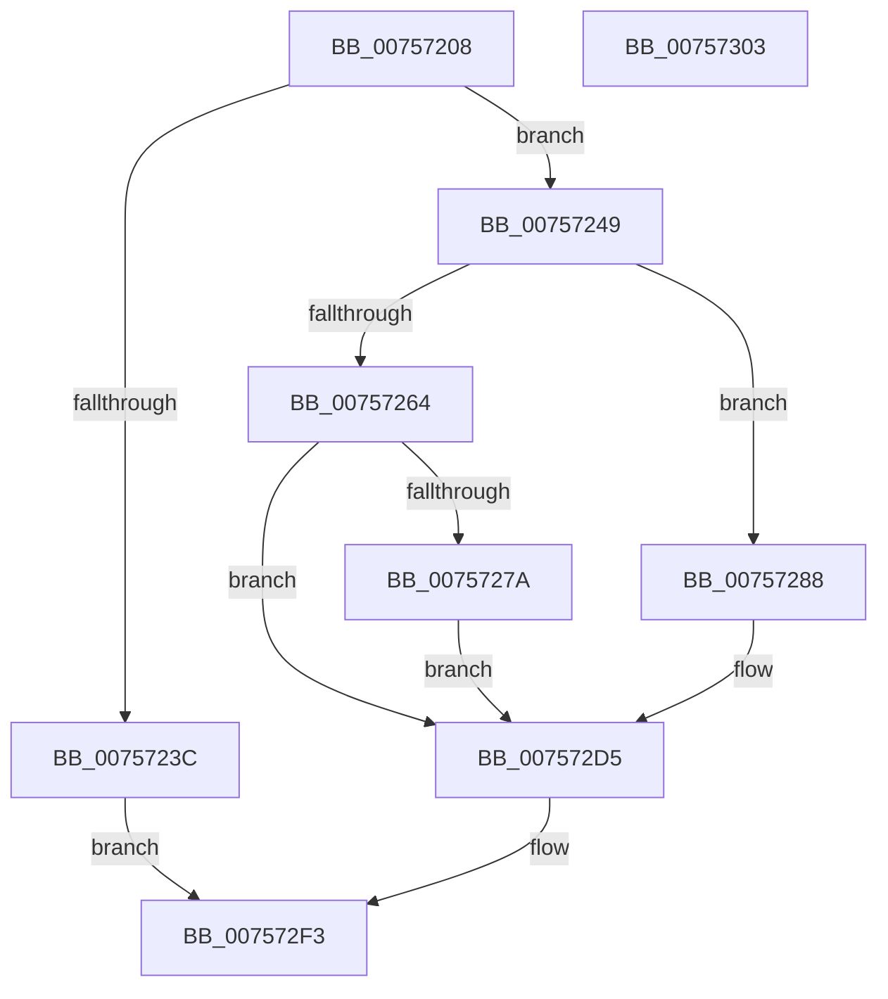

# PopDisableCoolingExtension

- RVA: `0x00757208`–`0x00757304` (길이 `252` bytes)
- VA: `0x0000000140757208`
- 실행 섹션: `PAGE`
- PDB 이름 있음: `예`; PDB Function 태그: `아니요`
- unwind 정보 RVA: `0x0008A4C8`
- 디코드: `67`개 명령, `252/252` bytes 표시
- 미해석 바이트: `0` (있으면 어셈블리에 `.byte`로 보존)

> 이 문서는 커널 이미지의 기계어와 PDB 기호를 분석해 생성했습니다. 4번과 5번은 함수 원형과 자료형을 바이너리 사용 방식에서 추정한 C 해석이며 원본 소스 복구 결과는 아닙니다.

## 1. Dependencies

- 직접 호출 지점: **13**; 고유 호출 대상: **9**
- 직접 호출자로 확인된 함수: **3**
- RIP 상대 이미지 참조: **1**

### Outgoing calls
- `0x00757230` → [PopAcquireRwLockExclusive](../../text/43/PopAcquireRwLockExclusive_function_00430B44.md) (function, `0x00430B44`)
- `0x0075723F` → [PopReleaseRwLock](../../text/2D/PopReleaseRwLock_function_002DFBBC.md) (function, `0x002DFBBC`)
- `0x00757256` → [PopDiagTraceCoolingExtension](../A3/PopDiagTraceCoolingExtension_function_00A39C28.md) (function, `0x00A39C28`)
- `0x0075725B` → [Feature_Servicing_CoolingFrameworkDeviceCleanupFix__private_IsEnabledDeviceUsageNoInline](../../text/5D/Feature_Servicing_CoolingFrameworkDeviceCleanupFix__private_IsEnabledDeviceUsageNoInline_function_005D1004.md) (function, `0x005D1004`)
- `0x00757269` → [PopPropogateCoolingChange](../../text/4E/PopPropogateCoolingChange_function_004E8FA0.md) (function, `0x004E8FA0`)
- `0x0075727A` → [ObfDereferenceObject](../../text/2F/ObfDereferenceObject_function_002F9350.md) (function, `0x002F9350`)
- `0x00757292` → [KeInitializeEvent](../../text/40/KeInitializeEvent_function_0040DD10.md) (function, `0x0040DD10`)
- `0x007572A5` → [PopPropogateCoolingChange](../../text/4E/PopPropogateCoolingChange_function_004E8FA0.md) (function, `0x004E8FA0`)
- `0x007572AD` → [PopReleaseRwLock](../../text/2D/PopReleaseRwLock_function_002DFBBC.md) (function, `0x002DFBBC`)
- `0x007572C4` → [KeWaitForSingleObject](../../text/20/KeWaitForSingleObject_function_0020E6B0.md) (function, `0x0020E6B0`)
- `0x007572CC` → [PopAcquireRwLockExclusive](../../text/43/PopAcquireRwLockExclusive_function_00430B44.md) (function, `0x00430B44`)
- `0x007572E3` → [PopReleaseRwLock](../../text/2D/PopReleaseRwLock_function_002DFBBC.md) (function, `0x002DFBBC`)
- `0x007572EE` → [guard_dispatch_icall](../../text/6B/guard_dispatch_icall_function_006BAAD0.md) (function, `0x006BAAD0`)

### Direct callers
- [PopCoolingExtensionPnpNotification](PopCoolingExtensionPnpNotification_function_00757110.md) at `0x0075713A`
- [PopCoolingExtensionPnpNotification](PopCoolingExtensionPnpNotification_function_00757110.md) at `0x00757176`
- [PopOrphanCoolingExtension](PopOrphanCoolingExtension_function_00757474.md) at `0x0075749C`
- [PopCleanCoolingExtension](../AD/PopCleanCoolingExtension_function_00ADF580.md) at `0x00ADF59D`

### Static image references
- `0x00757249` → RVA `0x000211E8` (`.rdata`; read)

## 2. Other-region calls and transfers

- 다른 실행 섹션으로 향하는 call: **12**
  - `0x00757230` → [PopAcquireRwLockExclusive](../../text/43/PopAcquireRwLockExclusive_function_00430B44.md) (`PAGE` → `.text`)
  - `0x0075723F` → [PopReleaseRwLock](../../text/2D/PopReleaseRwLock_function_002DFBBC.md) (`PAGE` → `.text`)
  - `0x0075725B` → [Feature_Servicing_CoolingFrameworkDeviceCleanupFix__private_IsEnabledDeviceUsageNoInline](../../text/5D/Feature_Servicing_CoolingFrameworkDeviceCleanupFix__private_IsEnabledDeviceUsageNoInline_function_005D1004.md) (`PAGE` → `.text`)
  - `0x00757269` → [PopPropogateCoolingChange](../../text/4E/PopPropogateCoolingChange_function_004E8FA0.md) (`PAGE` → `.text`)
  - `0x0075727A` → [ObfDereferenceObject](../../text/2F/ObfDereferenceObject_function_002F9350.md) (`PAGE` → `.text`)
  - `0x00757292` → [KeInitializeEvent](../../text/40/KeInitializeEvent_function_0040DD10.md) (`PAGE` → `.text`)
  - `0x007572A5` → [PopPropogateCoolingChange](../../text/4E/PopPropogateCoolingChange_function_004E8FA0.md) (`PAGE` → `.text`)
  - `0x007572AD` → [PopReleaseRwLock](../../text/2D/PopReleaseRwLock_function_002DFBBC.md) (`PAGE` → `.text`)
  - `0x007572C4` → [KeWaitForSingleObject](../../text/20/KeWaitForSingleObject_function_0020E6B0.md) (`PAGE` → `.text`)
  - `0x007572CC` → [PopAcquireRwLockExclusive](../../text/43/PopAcquireRwLockExclusive_function_00430B44.md) (`PAGE` → `.text`)
  - `0x007572E3` → [PopReleaseRwLock](../../text/2D/PopReleaseRwLock_function_002DFBBC.md) (`PAGE` → `.text`)
  - `0x007572EE` → [guard_dispatch_icall](../../text/6B/guard_dispatch_icall_function_006BAAD0.md) (`PAGE` → `.text`)
- 별도 외부 분기/꼬리 이동을 확인하지 못했습니다.

## 3. Assembly (complete function range)

```asm
00757208  48 89 5C 24 08                  mov qword ptr [rsp + 8], rbx
0075720D  48 89 74 24 10                  mov qword ptr [rsp + 0x10], rsi
00757212  57                              push rdi
00757213  48 83 EC 50                     sub rsp, 0x50
00757217  48 8D 71 20                     lea rsi, [rcx + 0x20]
0075721B  48 8B F9                        mov rdi, rcx
0075721E  0F 57 C0                        xorps xmm0, xmm0
00757221  33 C0                           xor eax, eax
00757223  48 8B CE                        mov rcx, rsi
00757226  48 89 44 24 40                  mov qword ptr [rsp + 0x40], rax
0075722B  0F 11 44 24 30                  movups xmmword ptr [rsp + 0x30], xmm0
00757230  E8 0F 99 CD FF                  call 0x140430b44
00757235  33 DB                           xor ebx, ebx
00757237  38 5F 50                        cmp byte ptr [rdi + 0x50], bl
0075723A  75 0D                           jne 0x140757249
0075723C  48 8B CE                        mov rcx, rsi
0075723F  E8 78 89 B8 FF                  call 0x1402dfbbc
00757244  E9 AA 00 00 00                  jmp 0x1407572f3
00757249  48 8D 15 98 9F 8C FF            lea rdx, [rip - 0x736068]
00757250  88 5F 50                        mov byte ptr [rdi + 0x50], bl
00757253  48 8B CF                        mov rcx, rdi
00757256  E8 CD 29 2E 00                  call 0x140a39c28
0075725B  E8 A4 9D E7 FF                  call 0x1405d1004
00757260  85 C0                           test eax, eax
00757262  74 24                           je 0x140757288
00757264  B2 01                           mov dl, 1
00757266  48 8B CF                        mov rcx, rdi
00757269  E8 32 1D D9 FF                  call 0x1404e8fa0
0075726E  48 8B 8F D0 00 00 00            mov rcx, qword ptr [rdi + 0xd0]
00757275  48 85 C9                        test rcx, rcx
00757278  74 5B                           je 0x1407572d5
0075727A  E8 D1 20 BA FF                  call 0x1402f9350
0075727F  48 89 9F D0 00 00 00            mov qword ptr [rdi + 0xd0], rbx
00757286  EB 4D                           jmp 0x1407572d5
00757288  45 33 C0                        xor r8d, r8d
0075728B  48 8D 4C 24 30                  lea rcx, [rsp + 0x30]
00757290  33 D2                           xor edx, edx
00757292  E8 79 6A CB FF                  call 0x14040dd10
00757297  48 8D 44 24 30                  lea rax, [rsp + 0x30]
0075729C  33 D2                           xor edx, edx
0075729E  48 8B CF                        mov rcx, rdi
007572A1  48 89 47 60                     mov qword ptr [rdi + 0x60], rax
007572A5  E8 F6 1C D9 FF                  call 0x1404e8fa0
007572AA  48 8B CE                        mov rcx, rsi
007572AD  E8 0A 89 B8 FF                  call 0x1402dfbbc
007572B2  45 33 C9                        xor r9d, r9d
007572B5  48 89 5C 24 20                  mov qword ptr [rsp + 0x20], rbx
007572BA  45 33 C0                        xor r8d, r8d
007572BD  48 8D 4C 24 30                  lea rcx, [rsp + 0x30]
007572C2  33 D2                           xor edx, edx
007572C4  E8 E7 73 AB FF                  call 0x14020e6b0
007572C9  48 8B CE                        mov rcx, rsi
007572CC  E8 73 98 CD FF                  call 0x140430b44
007572D1  48 89 5F 60                     mov qword ptr [rdi + 0x60], rbx
007572D5  48 8B 5F 70                     mov rbx, qword ptr [rdi + 0x70]
007572D9  48 8B CE                        mov rcx, rsi
007572DC  48 8B BF 80 00 00 00            mov rdi, qword ptr [rdi + 0x80]
007572E3  E8 D4 88 B8 FF                  call 0x1402dfbbc
007572E8  48 8B CB                        mov rcx, rbx
007572EB  48 8B C7                        mov rax, rdi
007572EE  E8 DD 37 F6 FF                  call 0x1406baad0
007572F3  48 8B 5C 24 60                  mov rbx, qword ptr [rsp + 0x60]
007572F8  48 8B 74 24 68                  mov rsi, qword ptr [rsp + 0x68]
007572FD  48 83 C4 50                     add rsp, 0x50
00757301  5F                              pop rdi
00757302  C3                              ret
00757303  CC                              int3
```

## 4. C-style interpretation (structured pseudocode)

```c
__int64 __fastcall PopDisableCoolingExtension(__int64 a1, __int64 a2, int a3, int a4)
{
    __int64 result;
    __int64 v_rbx;
    __int64 v_rsp;
    unsigned __int64 v_stack_m18;
    unsigned __int64 v_stack_m28;
    unsigned __int64 v_stack_m38;
    unsigned __int64 v_stack_p10;
    unsigned __int64 v_stack_p8;

    v_stack_p8 = v_rbx;
    v_stack_p10 = v_rsi;
    v_rsp = (v_rsp) - (80);
    result = 0;
    v_stack_m18 = 0;
    v_stack_m28 = v_xmm0;
    result = PopAcquireRwLockExclusive(a1 + 32, a2, a3, a4);
    v_rbx = 0;
    if ((*(unsigned __int8 *)(a1 + 80)) != 0) goto loc_00757249;
    result = PopReleaseRwLock(a1 + 32, a2, a3, a4);
    goto loc_007572F3;
loc_00757249:
    *(unsigned __int8 *)(a1 + 80) = 0;
    result = PopDiagTraceCoolingExtension(a1, v_rip - 7561320, a3, a4);
    result = Feature_Servicing_CoolingFrameworkDeviceCleanupFix__private_IsEnabledDeviceUsageNoInline(a1, v_rip - 7561320, a3, a4);
    if ((unsigned int)(result) == 0) goto loc_00757288;
    result = PopPropogateCoolingChange(a1, 1, a3, a4);
    if (*(unsigned __int64 *)(a1 + 208) == 0) goto loc_007572D5;
    result = ObfDereferenceObject(*(unsigned __int64 *)(a1 + 208), 1, a3, a4);
    *(unsigned __int64 *)(a1 + 208) = 0;
    goto loc_007572D5;
loc_00757288:
    a3 = 0;
    a2 = 0;
    result = KeInitializeEvent(v_stack_m28, a2, a3, a4);
    a2 = 0;
    *(unsigned __int64 *)(a1 + 96) = v_stack_m28;
    result = PopPropogateCoolingChange(a1, a2, a3, a4);
    result = PopReleaseRwLock(a1 + 32, a2, a3, a4);
    a4 = 0;
    v_stack_m38 = 0;
    a3 = 0;
    a2 = 0;
    result = KeWaitForSingleObject(v_stack_m28, a2, a3, a4);
    result = PopAcquireRwLockExclusive(a1 + 32, a2, a3, a4);
    *(unsigned __int64 *)(a1 + 96) = 0;
loc_007572D5:
    result = PopReleaseRwLock(a1 + 32, a2, a3, a4);
    result = guard_dispatch_icall(*(unsigned __int64 *)(a1 + 112), a2, a3, a4);
loc_007572F3:
    v_rsp = (v_rsp) + (80);
    return result;
}
```

## 5. (Beta) C Style

```c
int64_t PopDisableCoolingExtension(void *Arg1, int64_t Arg2, int32_t Arg3, int32_t Arg4)
{
    uint8_t *arg1 = (uint8_t *)Arg1;

    int64_t result;
    int64_t local_rbx;
    int64_t local_rsp;
    uint64_t v_stack_m18;
    uint64_t v_stack_m28;
    uint64_t v_stack_m38;
    uint64_t v_stack_p10;
    uint64_t v_stack_p8;

    v_stack_p8 = local_rbx;
    v_stack_p10 = local_rsi;
    local_rsp = (local_rsp) - (80);
    result = 0;
    v_stack_m18 = 0;
    v_stack_m28 = v_xmm0;
    result = PopAcquireRwLockExclusive(Arg1 + 32, Arg2, Arg3, Arg4);
    local_rbx = 0;
    if ((*(uint8_t *)(arg1 + 0x50)) != 0) goto loc_00757249;
    result = PopReleaseRwLock(Arg1 + 32, Arg2, Arg3, Arg4);
    goto loc_007572F3;
loc_00757249:
    *(uint8_t *)(arg1 + 0x50) = 0;
    result = PopDiagTraceCoolingExtension(Arg1, v_rip - 7561320, Arg3, Arg4);
    result = Feature_Servicing_CoolingFrameworkDeviceCleanupFix__private_IsEnabledDeviceUsageNoInline(Arg1, v_rip - 7561320, Arg3, Arg4);
    if ((uint32_t)(result) == 0) goto loc_00757288;
    result = PopPropogateCoolingChange(Arg1, 1, Arg3, Arg4);
    if (*(uint64_t *)(arg1 + 0xD0) == 0) goto loc_007572D5;
    result = ObfDereferenceObject(*(uint64_t *)(arg1 + 0xD0), 1, Arg3, Arg4);
    *(uint64_t *)(arg1 + 0xD0) = 0;
    goto loc_007572D5;
loc_00757288:
    Arg3 = 0;
    Arg2 = 0;
    result = KeInitializeEvent(v_stack_m28, Arg2, Arg3, Arg4);
    Arg2 = 0;
    *(uint64_t *)(arg1 + 0x60) = v_stack_m28;
    result = PopPropogateCoolingChange(Arg1, Arg2, Arg3, Arg4);
    result = PopReleaseRwLock(Arg1 + 32, Arg2, Arg3, Arg4);
    Arg4 = 0;
    v_stack_m38 = 0;
    Arg3 = 0;
    Arg2 = 0;
    result = KeWaitForSingleObject(v_stack_m28, Arg2, Arg3, Arg4);
    result = PopAcquireRwLockExclusive(Arg1 + 32, Arg2, Arg3, Arg4);
    *(uint64_t *)(arg1 + 0x60) = 0;
loc_007572D5:
    result = PopReleaseRwLock(Arg1 + 32, Arg2, Arg3, Arg4);
    result = guard_dispatch_icall(*(uint64_t *)(arg1 + 0x70), Arg2, Arg3, Arg4);
loc_007572F3:
    local_rsp = (local_rsp) + (80);
    return result;
}
```

### 관측된 메모리 오프셋

구조체 형식이 확인되지 않은 접근은 인자 기준의 오프셋으로만 기록했습니다.

| 기준 인자 | 오프셋 표현 | 폭 (bit) | 접근 |
|---|---:|---:|---|
| `Arg1` | `+ 0x20` | `64` | `R` |
| `Arg1` | `+ 0x50` | `8` | `R` |
| `Arg1` | `+ 0x50` | `8` | `W` |
| `Arg1` | `+ 0x60` | `64` | `W` |
| `Arg1` | `+ 0x70` | `64` | `R` |
| `Arg1` | `+ 0x80` | `64` | `R` |
| `Arg1` | `+ 0xD0` | `64` | `R` |
| `Arg1` | `+ 0xD0` | `64` | `W` |

## 6. Execution-region graph

[열기: 2D/3D 그래프와 함수 탐색 컨트롤 패널](../../../control-panel.html?section=page&rva=0x00757208&view=graph)

- 2D 그래프는 위에서 아래로 흐르고, 3D 그래프는 빈 공간을 드래그해 회전합니다. Shift+드래그는 이동, 휠은 확대·축소, 함수 노드 선택은 대상 보고서 이동입니다.

### Static fallback


